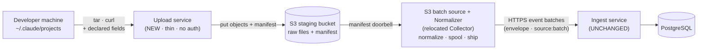

# Upload-Based Batch Ingestion (v1 — no laptop agent)

**Status:** Draft v1 for review · **RFC**
**Parent architecture:** `docs/design/system-architecture.md` (the authority; where this doc
and it differ, it wins). **Master doc:** `docs/design/coding-econ-design-draft.md`.
**Scope boundary:** this doc designs the *feeder* — how session files get from a developer's
machine into the existing Ingest service — and stops at the normalizer's input boundary. **The
normalizer's internal design is `docs/modules/normalizer.md`** (record→event mapping, subagent
correlation, redaction, field→metric provenance); this doc specifies only what the feeder hands
it and how the two join (§6).

Sections marked **⚠ proposal** are written for review; everything else reflects decisions
taken in the design discussion that produced this doc.

---

## 1. In a Nutshell

The first iteration ships **without any laptop install**. Instead of a daemon tailing files on
each developer's machine, a developer runs a one-line command that uploads their
`~/.claude/projects` directory to a thin web service; the files land in an S3 staging bucket
as-is; and a server-side **adapter+normalizer** — the existing Collector, *relocated off the
laptop* — reads them from S3 and ships events to the **unchanged** Ingest service.

This is not a new pipeline. It is the architecture's **batch mode** (parent §2.2 — "the
producer doesn't need to install any component") with the collector's read loop moved from a
laptop file-tailer to an S3 reader. Everything from the normalizer rightward — Ingest, the
event contract, workers, storage — is untouched.

**Three load-bearing decisions:**

1. **The collector relocates server-side, fed by S3.** No laptop component. The laptop's only
   job is to copy files up; all normalization and shipping run in our environment where a bug
   is fixed by redeploying one service, not the fleet.
2. **The upload service is thin and unauthenticated in v1.** It is deliberately close to
   throwaway. There is no login and no producer-registration handshake; the few facts the
   files don't carry (org, user, plan) are **self-declared** by the uploader and travel in a
   manifest. Real auth and per-producer registration are a named later seam (§9).
3. **A completion manifest is the doorbell.** Processing of an upload starts only after the
   *whole* upload has landed and the service writes a manifest — never per-file — because a
   session's economic truth is split across its main file and its sibling `subagents/`
   directory, and starting early would break that linkage (§4.3).

**Headline numbers** (§7): a heavy developer's full history is ~3 GB of JSONL ≈ 0.3–0.6 GB
compressed on the wire; S3 staging is ~3 GB/developer-year at cents/GB-month; processing
reuses batch mode's ~5,000 ev/s, so a 100-developer year processes in under a day. The web
service itself is I/O-bound and trivially sized.



---

## 2. Terms and Notation

Terms from the master doc §2 and architecture §3 apply unchanged (Producer, Batch mode,
At-least-once, Idempotent, Doorbell). New or sharpened here:

| Term | Meaning |
|---|---|
| **Upload** | One invocation of the upload command: a single compressed archive of a developer's `~/.claude/projects` tree, plus the declared fields, plus the server-issued `upload_id`. The unit of work for processing. |
| **Declared fields** | Identity/context the JSONL files do not contain — `org_id`, `user_id`, plan — supplied by the uploader at upload time. Untrusted in v1 (no auth); treated as data, not as an authenticated principal. |
| **Manifest** | A small JSON object the upload service writes to S3 *after* an upload's bytes have fully landed. It carries the declared fields, a file inventory, and a completion marker; its appearance is the signal that the upload is ready to process. |
| **Staging bucket** | The S3 bucket that holds uploaded raw files as-is. A holding area and the durable replay source — not the system of record (Postgres is). |
| **Relocated Collector** | The existing Collector modules (source adapter → normalizer → spool → shipper, architecture §6.1–6.3) running as a server-side process, fed by S3 instead of a local file watcher. |
| **Synthetic producer_id** | A deterministic `producer_id` derived from the declared identity (§5.2), standing in for the architecture's server-issued registration id until real registration lands. |

---

## 3. Architecture and Data Flow

### 3.1 What is new, what moves, what is untouched

| Piece | Status | Note |
|---|---|---|
| Upload service | **New** | Thin HTTP receiver; writes to S3; writes the manifest. §4.1 |
| S3 staging bucket | **New** | Structure-preserving raw store + replay source. §4.2 |
| S3 batch source adapter | **New (a source variant)** | Replaces the laptop file-tailer as the feeder into the normalizer. §4.3 |
| Normalizer | **Designed** (`docs/modules/normalizer.md`) | Same module (architecture §6.2); its design is now complete. This doc fixes the *input* boundary it consumes. §6 |
| Spool + shipper (msging client) | **Reused, relocated** | Same `src/common/msging` client; now server-side, identity set per-upload. §5.3 |
| Ingest, event contract, workers, storage, metrics | **Unchanged** | Events arrive with `source: batch`; downstream cannot tell the difference (parent §2.2). |

### 3.2 End-to-end flow

```mermaid
flowchart LR
    s1["1 · Developer runs the<br/>one-line upload command"] --> s2["2 · Archive of<br/>~/.claude/projects<br/>+ declared fields"]
    s2 --> s3["3 · Upload service stores<br/>objects to S3, then writes<br/>the completion manifest"]
    s3 --> s4["4 · Manifest doorbell wakes<br/>the S3 batch source adapter"]
    s4 --> s5["5 · Adapter reads the upload,<br/>hands vendor records to the<br/>normalizer (see normalizer doc)"]
    s5 --> s6["6 · Normalizer emits common<br/>events; msging spools and<br/>ships batches (source:batch)"]
    s6 --> s7["7 · Ingest authenticates,<br/>de-duplicates by event_id,<br/>appends to Postgres"]
    s7 --> s8["8 · Workers fold sessions,<br/>cost, rollups — unchanged"]
```



The reasoning per step:

1. **Upload command.** A copy-paste shell one-liner (§4.1) — no install. It compresses
   `~/.claude/projects` and POSTs it with the declared fields.
2. **Structure preserved.** The archive keeps relative paths, so each `<session>.jsonl` stays
   next to its `subagents/` directory — a hard requirement (§4.3).
3. **Store then mark complete.** The service streams objects into the bucket and, only once
   the whole upload is durable, writes the manifest. The two-step "bytes first, marker last"
   is what makes the doorbell safe.
4. **Manifest doorbell.** The manifest's arrival releases exactly one upload for processing —
   the architecture's doorbell principle (parent §8.1): advisory wake-up, the object store is
   the truth.
5. **Adapter reads.** The S3 batch source enumerates the upload's sessions and streams each
   session's records (and surfaces its sibling subagent files) to the normalizer in read
   order — the same interface the laptop tailer presented, different feeder.
6. **Normalize and ship.** The normalizer (unchanged) produces common events; the msging
   client spools and ships compressed batches over HTTPS, stamping `source: batch`.
7. **Ingest.** Unchanged. Deterministic `event_id` dedupe makes re-uploads land zero
   duplicate rows (§4.4).
8. **Workers.** Unchanged; they cannot distinguish batch-uploaded data from live data.

### 3.3 Why this shape (alternatives)

| Option | Pros | Cons | Verdict |
|---|---|---|---|
| **Upload → S3 staging → server-side relocated collector (chosen)** | Zero laptop install; normalizer bugs fixed server-side; S3 doubles as durable replay source; is literally the architecture's batch mode | Full content transits to our environment (privacy handled by deployment boundary, §8); a server-side collector fleet to run | **Chosen.** Lowest adoption friction; maximal reuse of the existing design. |
| Laptop collector (the architecture's realtime P1) | Live, seconds-fresh; no bulk upload | Requires an install on every laptop — the exact friction this iteration avoids | The eventual realtime path; this doc is the no-install precursor. Same events, same ingest. |
| Upload straight into Ingest (skip S3) | One fewer hop | Ingest would have to parse vendor files and buffer large uploads — violates its "thin, stateless, always-available" mandate (parent §6.4); loses the durable replay store | Rejected. Keeps Ingest thin. |
| Normalize in the browser / on upload | No server-side collector | Puts vendor-format logic back on the client — the fleet-bug problem returns; browsers can't run the normalizer | Rejected. Defeats the point of relocating. |

---

## 4. The New Pieces

### 4.1 Upload service (thin, unauthenticated in v1)

One HTTP endpoint whose entire job is: accept a compressed archive plus declared fields,
stream it to S3 under a fresh `upload_id`, then write the manifest. It does **no** parsing,
**no** normalization, and holds **no** state beyond the in-flight request. It is FastAPI +
uvicorn (architecture §19), sized for a handful of concurrent human-initiated uploads.

**No auth in v1 (decided).** There is no login and no key. The service runs inside the trusted
zone; the declared fields are accepted as-is. This is a deliberate "don't overengineer a
throwaway" choice — the whole service may be replaced as the product matures. Authentication
(enrollment key, then JWT) is the named seam in §9, and it slots in as a FastAPI dependency
(architecture §18.1) without changing anything downstream.

**The one-liner (client).** The "install floor" is a single copy-paste command, not a binary:

```
tar czf - -C ~ .claude/projects \
  | curl -sS -X POST "https://<host>/v1/uploads?org=<org>&user=<user>&plan=<plan>" \
         -H "Content-Type: application/gzip" --data-binary @-
```

`tar` preserves the directory structure (§4.3); `--data-binary @-` streams so nothing large
is buffered on the client. The declared fields ride as query parameters. Vendor defaults to
`claude_code` (the archive is a Claude Code home); it is a parameter so Codex/Cursor can reuse
the same endpoint later.

**Wire contract — request:**

```
POST /v1/uploads?org=<str>&user=<str>&plan=<str|absent>&vendor=<str=claude_code>&label=<str|absent>
  Content-Type: application/gzip
  body: gzip'd tar of the ~/.claude/projects tree
```

**Wire contract — response (201):**

```json
{
  "upload_id":   "string · server-generated, collision-free (uuid4 hex) · the primary key for this upload",
  "received_ts": "string · ISO-8601 UTC · when the bytes finished landing",
  "bytes":       "int · archive size received",
  "status":      "enum: staged · bytes are durable in S3; manifest written",
  "declared":    { "org_id": "string", "user_id": "string", "plan": "string | null", "vendor": "string" }
}
```

Resumable/multipart upload for very large archives is a seam (§9); v1 is one streamed request.

### 4.2 S3 staging bucket (structure-preserving)

Uploaded bytes are written **as-is**, unpacked into a per-upload prefix that mirrors the
original tree so sibling relationships survive:

```
s3://<bucket>/uploads/<upload_id>/
    manifest.json
    raw/projects/<escaped-project-dir>/<session_id>.jsonl
    raw/projects/<escaped-project-dir>/<session_id>/subagents/agent-<id>.jsonl
    raw/projects/<escaped-project-dir>/<session_id>/subagents/agent-<id>.meta.json
```

The `upload_id` prefix (not `org`/`user`) is the primary key, because the declared fields are
untrusted and may collide or be mistyped; the manifest records the declared identity for
querying. The bucket is a **holding area and replay source**, never the system of record —
Postgres is. Per-org bucket/prefix isolation, at-rest encryption, and a retention window are
deployment properties (§8); the enterprise "customer-provided staging bucket" is a config swap
(§9), since the adapter only needs a bucket + prefix.

### 4.3 S3 batch source adapter (the relocated feeder)

This is the architecture's Collector source-adapter role (parent §6.1), with the local
file-watcher replaced by an S3 reader. Triggered by a manifest (§4.4), it processes **one
upload as one coherent unit**:

- **Enumerate sessions** from the manifest's inventory: each `<session_id>.jsonl` and its
  associated `subagents/` files.
- **Stream records in read order** to the normalizer, exactly as the laptop tailer did — the
  normalizer's input contract (§6) is identical to live mode; only the byte source differs.
- **Surface the whole session unit**, main file *plus* its sibling subagent streams **keyed by
  `toolUseId`/`agentId`** (the `SessionSource` the normalizer consumes, normalizer doc §10), so
  the normalizer reconstructs subagent linkage. The adapter's guarantee is *co-location,
  completeness, and keying*, not correlation — correlation is the normalizer's (§6).

**Why per-upload, not per-file.** The linkage between a session's main file and its
`subagents/agent-*.jsonl` is positional (a parent turn's `Agent` tool-use id names the
subagent file). If per-file S3 events drove processing, a main file could be normalized before
its subagent files arrived, silently losing subagent cost. Processing the upload as a unit,
gated on the completion manifest, removes the race. One upload = one work unit = one worker
(preserves per-session order; scales by adding workers, the architecture's §15 concurrency
seam — partition by `upload_id`).

**Alternatives for the trigger:**

| Option | Pros | Cons | Verdict |
|---|---|---|---|
| **Completion-manifest doorbell (chosen)** | Upload processed as a coherent unit; subagent linkage safe; one clean "ready" signal | Needs the service to write a marker after bytes land | **Chosen.** |
| Per-file S3 event notifications | Simplest wiring; native S3 feature | Races: a session processed before its `subagents/` files land → lost subagent cost; needs regrouping anyway | Rejected for v1; revisit only with explicit grouping. |
| Scheduled bucket poll | No event wiring; matches the poller archetype (parent §8.1) | Added latency; still needs an "is this upload complete?" signal — i.e. the manifest anyway | Fallback if S3 event notifications are unavailable in a deployment. |

### 4.4 Re-uploads and idempotency

Developers will re-upload a growing `~/.claude/projects` repeatedly. v1 relies entirely on the
architecture's existing idempotency rather than delta logic. **This doc does not invent that
idempotency** — it inherits the event contract's `event_id` rule, and the guarantee is only as
strong as that rule's precondition, made explicit here.

**The dedup key is `event_id`, defined in two tiers** (master doc §6.1.1, architecture §5.1;
supplied by the producer, `docs/design/event-messaging-design.md` §7):

- **Tier 1 — the vendor record's own id (what Claude Code uses).** If the normalizer supplies a
  `record_id`, that *is* the `event_id`. Every *shippable* Claude Code record —
  `user`, `assistant`, `system`, `attachment`, in both the main file and the `subagents/`
  files — carries a unique `uuid` (the UI/meta records that lack one, `mode`,
  `permission-mode`, `last-prompt`, `file-history-snapshot`, `ai-title`, are not shipped). That
  id is **intrinsic to the record**, so re-uploading the same append-only file yields the
  identical `event_id` regardless of ordering, declared identity, or which run it is. This is
  what makes CC re-upload dedup robust.
- **Tier 2 — synthesized fallback** (`uuid5(producer_id / session_id / seq)`) for vendors whose
  records lack a stable id. This tier is **fragile across re-uploads**: `seq` is assigned at
  send time (event-messaging.md), so it is deterministic only when every re-upload re-reads the
  session from its true start in identical order *and* `producer_id` is stable. Claude Code
  never uses this tier; Cursor may (§9, Q1-vendor seam).

**The precondition (normative):** Tier 1 holds **only if the normalizer forwards the vendor
record's stable id as `record_id`**. If it does not, CC events silently drop to the
fragile Tier-2 fallback. This is a normalizer obligation, pinned in the §6 boundary contract —
it is the single dependency the re-upload guarantee rests on.

Given the precondition, Ingest's insert-if-absent makes re-normalizing an already-seen (now
longer) session insert only the new tail and drop the rest — "batch re-run yields zero new
rows" (parent §5.2). Therefore **full re-upload each time is correct**, and the simplest thing
that works; per-file S3 checkpoints to skip unchanged files are a pure optimization deferred to
§9. Consequence to accept honestly: re-uploads re-transfer and re-normalize bytes already
seen — wasteful but never wrong, and cheap at v1 volumes (§7).

---

## 5. Identity Without Registration

### 5.1 The problem

The architecture issues a `producer_id` at a daemon's self-registration (parent §7.1). There
is no daemon here and no auth, and Claude Code files carry no stable machine identity (only
`cwd`, `gitBranch`, `userType`, `version`). So producer identity must come from elsewhere.

### 5.2 The v1 model: declared identity + synthetic producer

- **`org_id` and `user_id` are declared at upload** and recorded in the manifest. This is
  exactly the architecture's "org/user optional on the wire, defaulted server-side" (parent
  §7.2) — here the "default" source is the upload's declared fields.
- **`producer_id` is synthesized deterministically** from the declared identity, so a user's
  repeat uploads map to one stable producer: `producer_id = uuidv5(TALIUM_NS,
  "<org_id>/<user_id>")`. This satisfies the wire contract's mandatory `producer_id` without a
  registration round-trip.
- **Stamped by the adapter**, per upload, onto every event header: `source = batch`,
  `producer_id` (synthetic), `org_id`/`user_id` (declared), `vendor` (declared),
  `collector_version` = the adapter's version, `agent_version` from the file records.

Accepted limitations, stated plainly: declared identity is **unverified** (anyone in the zone
can claim any org/user — acceptable for v1, closed by the auth seam §9); and one user's
multiple machines collapse to one producer (the architecture already treats machine-identity
forking as a future pruning concern, parent §7.1).

| Option | Pros | Cons | Verdict |
|---|---|---|---|
| **Declared identity + deterministic synthetic producer_id (chosen)** | Zero setup; stable across re-uploads; satisfies the wire contract; trivially replaced by real registration later | Unverified; can't distinguish a user's machines | **Chosen for v1.** Matches the "throwaway service, don't overengineer" decision. |
| One producer per upload | Clean per-upload audit | Fragments a user's history across producer rows; breaks `last_seen`/liveness | Rejected. |
| Derive machine identity from file content | No declared fields needed | Fragile/likely wrong — no stable id in the files | Rejected. |

### 5.3 Talking to Ingest (auth in v1)

The relocated adapter ships to Ingest with the **same `src/common/msging` client** the laptop
collector uses (architecture §5) — spool, batching, retry, whole-batch ACK/NACK — so Ingest
needs no change. Two adaptations, both small:

- **Identity is set per-upload, not per-process.** The laptop client binds one identity at
  `register()`; the server-side adapter serves many users, so it opens msging sessions with
  the upload's `producer_id`/`org_id`/`user_id`. This is a usage change in how the adapter
  drives the client, flagged as an interface item (§10), not a redesign of msging.
- **No producer key in v1.** With registration deferred, the adapter authenticates to Ingest
  with a single **service credential** (the architecture's service key — "hygiene, not
  defense," parent §18.1), or Ingest runs with producer-auth disabled inside the trusted zone.
  Per-producer keys arrive with the registration seam (§9).

---

## 6. The Normalizer Boundary

The normalizer is designed in **`docs/modules/normalizer.md`**. This section is the boundary
contract between the S3 batch source adapter (this doc) and that design — what the feeder
delivers, and what comes back — now settled on both sides:

- **Input unit:** one session at a time, delivered as an ordered stream of raw vendor records
  from `<session_id>.jsonl`, **plus its sibling `subagents/` streams keyed by
  `toolUseId`/`agentId`** (records + `meta.json`). This is the normalizer's `SessionSource`
  (normalizer doc §10). The adapter guarantees *co-location, completeness, and keying*; it does
  **not** interpret subagent linkage.
- **Context passed alongside:** the stamped header identity (§5.2) and `source: batch`.
- **Output:** **one or more** `NormalizedSession`s — the parent session **plus one per
  subagent** (each with its own `session_id` = the `agentId`, linked to the parent by
  `sub_agent_spawn.child_session_id`; normalizer doc §6). The normalizer does **not** fold
  subagent content into a single stream — parent and children are separate, linked event
  streams. The Collector driver opens one msging `SessionSender` per `NormalizedSession`;
  payload shapes, subagent correlation, redaction, and feature extraction are the normalizer's.
- **Dedup obligation (normative):** for every event derived from a vendor record that has a
  stable id, the normalizer **must** pass that id as the msging `record_id`, so
  `event_id` is the intrinsic vendor id (Tier 1, §4.4) rather than the fragile synthesized
  fallback. For Claude Code this is the record's `uuid`. This is the single dependency the
  re-upload idempotency guarantee (§4.4) rests on (also pinned in normalizer doc §8).

**Resolved (was the open join question):** subagent correlation — the parent-turn `Agent`
tool-use id ↔ `subagents/agent-*.jsonl` walk — lives in the **normalizer**, not the adapter
(normalizer doc §6). The adapter stays dumb: co-locate, complete, and key the streams; the
normalizer correlates.

---

## 7. Back-of-the-Envelope

### 7.1 Assumptions

| Quantity | Estimate | Basis |
|---|---|---|
| A developer's full `~/.claude/projects` (heavy user, 1 year) | ~1,500 files, ~3 GB JSONL | Master doc §10.4 |
| JSONL compression (gzip) | ~5–10× | Text/JSON with repeated keys |
| Compressed upload size (heavy first upload) | ~0.3–0.6 GB | 3 GB ÷ ~6 |
| Typical incremental re-upload | tens of MB compressed | A few days of new sessions |
| Events per developer-year after normalize | ~1 GB of events | Master doc §10.4 |
| Batch ingest throughput | ~5,000 ev/s | Master doc §10.4 (pipeline without the wait) |
| Reference org sizes | 10 · 100 · 1,000 developers | Master doc §10.1 |

### 7.2 Transfer, storage, processing, money

- **Transfer:** a heavy developer's *first* upload is ~0.3–0.6 GB compressed; over a broadband
  link, minutes, once. Re-uploads are tens of MB. A 100-developer org onboarding ≈ 100 ×
  0.5 GB ≈ **~50 GB one-time transfer**, spread across developers.
- **S3 staging storage:** ~3 GB/developer-year raw retained → 10-dev ≈ 30 GB, 100-dev ≈
  0.3 TB, 1,000-dev ≈ 3 TB. At ≈ $0.023/GB-month that is **~$0.70 / $7 / $70 per month** — noise.
  A retention window (§9) caps it.
- **Processing:** at 5,000 ev/s, a 100-developer *year* (~100 GB events) batch-processes in
  **under a day** (master doc §10.4). The relocated collector is CPU-cheap (parse + hand off);
  throughput scales by adding upload-partitioned workers.
- **Upload service:** I/O-bound, a handful of concurrent human uploads; one small container.
- **Per-unit conclusion:** onboarding cost is dominated by a one-time ~0.5 GB/developer
  transfer and cents/developer-month of S3; the compute is the existing batch pipeline. **Well
  under 1¢/developer/day at steady state**, fits comfortably in the architecture's existing
  Postgres and worker sizing (parent §14).

---

## 8. Privacy and Security Posture

Consistent with the architecture's stance — **privacy is a deployment-boundary property, not a
wire rule** (parent §17). Full content ships (v2), so this design moves content through the
upload service and S3; that boundary is where protection lives:

- **S3 at-rest encryption** (SSE) and **per-org prefix/bucket isolation** are deployment
  configuration, not application logic.
- **Logs stay content-free** (parent §13) — the upload service logs sizes and `upload_id`s,
  never file contents.
- **No auth in v1 is a conscious, scoped risk** (trusted zone, throwaway service). It is the
  one place this design is deliberately weaker than the target, with the seam to fix it named
  in §9.
- **The enterprise variant** — a customer-owned staging bucket in the customer's cloud — keeps
  content inside the customer boundary; the adapter binds to that bucket by config.

---

## 9. Phasing and Named Seams

**v1 (this doc):** one-liner upload → no-auth thin service → S3 staging → manifest doorbell →
relocated collector (S3 source + normalizer [`docs/modules/normalizer.md`] + msging) →
unchanged Ingest. Declared
identity + synthetic producer. Claude Code only.

Seams where deferred pieces slot in without reworking the above:

| Deferred piece | Seam |
|---|---|
| **Auth on upload** | A FastAPI dependency on `/v1/uploads` (architecture §18.1): enrollment key first, JWT the successor. Declared fields become *verified* claims; nothing downstream changes. |
| **Real producer registration** | The synthetic `producer_id` (§5.2) is replaced by a registered id; the adapter stamps the registered id instead. Ingest's producer model is already there (parent §7). |
| **Enterprise customer-owned bucket** | The adapter's bucket+prefix is config; point it at the customer's staging bucket. Content never leaves the customer cloud. |
| **Incremental / resumable upload** | Multipart/resumable upload in the service; per-file S3 checkpoints in the adapter to skip unchanged files (§4.4). Idempotency already makes this an optimization, not a correctness fix. |
| **Other vendors (Codex, Cursor)** | Same upload endpoint (`vendor` param); a Codex/Cursor S3 source variant; same normalizer contract (§6). |
| **Live mode (laptop collector)** | The architecture's realtime P1 (parent §2.1). Same events, same Ingest; this upload path and live mode coexist as two feeders. |

---

## 10. Clarifying Questions

Never blocking — each has a working assumption used in this doc; revisit as needed.

| # | Question | Working assumption in this doc |
|---|---|---|
| Q1 | Exact declared fields to collect at upload | `org_id`, `user_id` (required), `plan`, `vendor=claude_code`, optional `label`. Plan is needed later for burst-cost accuracy; captured now, optional. |
| Q2 | Bucket ownership in v1 | Our cloud, one staging bucket; enterprise customer-owned bucket is the §9 seam. |
| Q3 | Retention of staged raw files | Keep as the durable replay source; exact window (e.g. 90 days, or until reprocessed) TBD. Contradicts nothing; sharpens parent §7.4. |
| Q4 | Does subagent correlation live in the source adapter or the normalizer? | **Resolved:** the normalizer (normalizer doc §6); the adapter co-locates, completes, and keys the subagent streams by `toolUseId`/`agentId`. |
| Q5 | msging client identity per-upload | The client can be driven with per-session `producer_id`/`org`/`user`; treated as a usage adaptation, not a msging redesign (§5.3). To confirm against the msging module doc. |
| Q6 | Max upload size before resumability is required | Single streamed request in v1; if archives routinely exceed a few GB, pull in the resumable-upload seam (§9) sooner. |
| Q7 | Auth genuinely absent in v1 | Yes, per decision — trusted zone, throwaway service. Flagged as the one deliberate deviation from the architecture's "every endpoint authenticates" rule (parent §18.1); §9 is its fix path. |
