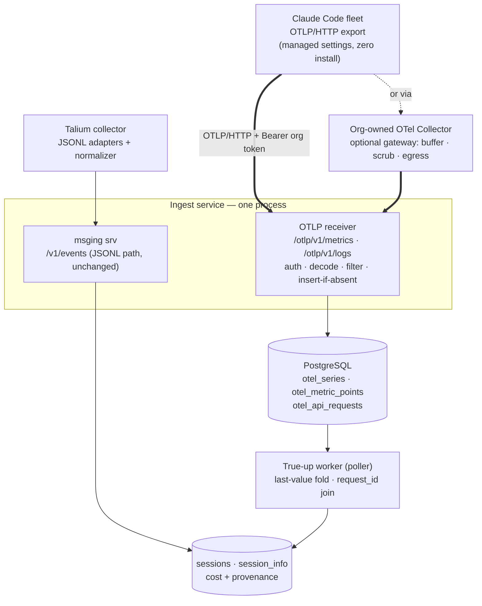
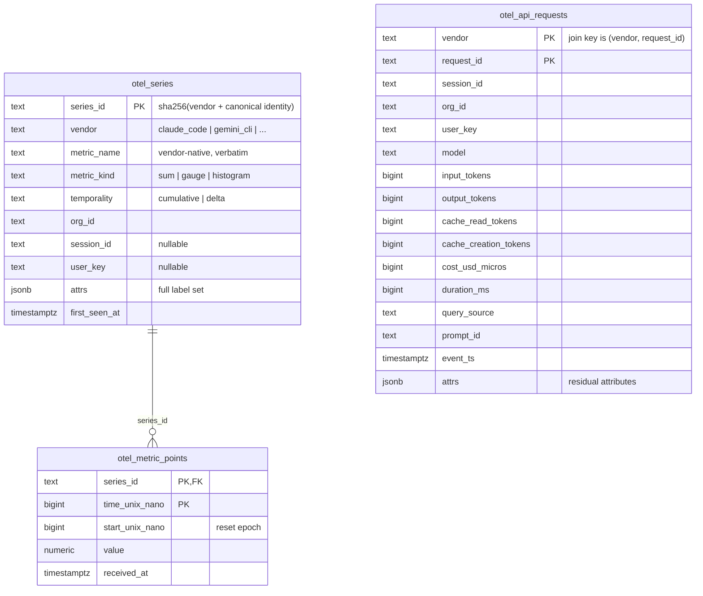

# OTel Telemetry Intake — Design

**Status:** Frozen 2026-08-04 (decisions D-OT1…D-OT5 settled in review)
**Role:** Module design under `system-architecture.md`. Adds the OTel signal path that makes
the pipeline hybrid: **OTel = spend truth, JSONL = session fidelity.** Empirical basis:
the 2026-08-02 reconciliation (deduped JSONL matched OTel exactly on all 4 token fields for
36/36 joined requests; each source has a distinct structural gap).
**Companions:** `docs/ProductSpec/Fidelity-Advantage.md` (why both sources),
`docs/design/event-messaging-design.md` (the JSONL wire, unchanged by this doc).

---

## 1. Nutshell

Claude Code clients export OTLP directly to the **existing ingest service** — a second,
zero-install signal source beside the JSONL collector. No new process, no required
OTel Collector deployment, no Go code.

Load-bearing decisions:

1. **Native OTLP/HTTP receiver mounted in ingest** (`/otlp/v1/metrics`, `/otlp/v1/logs`).
   Spec-compliant OTLP on the wire, so an org's own OTel Collector can front us as an
   optional gateway (buffering, attribute scrubbing, egress control) with zero Talium code.
2. **v1 accepts metrics + the `api_request` log event only.** `api_request` carries
   `request_id` + `cost_usd` — the per-request join key to JSONL. Other log events are
   counted and dropped (config-toggled); the full logs firehose is the priority-2 seam.
3. **Dedicated `otel_*` tables + a true-up worker.** OTel data never rides the §5 event
   envelope. The receiver appends parsed rows idempotently; a poller folds last-values and
   joins `request_id` into session cost truth.
4. **Org-level ingest token** in OTLP headers; user/session identity read from payload
   attributes. Zero per-developer setup — one managed-settings block enrolls a fleet.

Headline numbers (1,000-dev reference org, §6): ~65 OTLP posts/s peak (~100× headroom on
one uvicorn process; only ~20–30% more bytes than the JSONL path), ~10⁷ metric points/day
(~45 GB steady at 30-day retention), ~40 GB/yr durable request ledger, spend truth fresh
within ~2 min. Fits the existing single Postgres.



---

## 2. Terms

| Term | Meaning |
|---|---|
| **OTLP** | OpenTelemetry Protocol — the wire format OTel clients export. Two HTTP encodings: protobuf (`application/x-protobuf`) and JSON. Signal-specific paths: base endpoint + `/v1/metrics`, `/v1/logs`. |
| **Signal** | One of the three OTLP data kinds: metrics, logs, traces. Claude Code emits metrics and logs; its "events" (`api_request`, `tool_result`, …) ride the **logs** signal as log records with an `event.name` attribute. |
| **Series** | One metric stream: metric name + the full set of resource/datapoint attribute key-values. Each export interval adds one datapoint per live series. |
| **Cumulative temporality** | Datapoint values are running totals since `start_unix_nano`, not deltas. **Never sum datapoints** — summing inflated totals 150× in the reconciliation. Correct read: last value per series per reset epoch. |
| **Reset epoch** | The span during which a cumulative counter grows monotonically. A new `start_unix_nano` on the same series marks a counter reset (process restart); totals are summed **across** epochs, last-value **within** one. |
| **True-up** | Replacing/annotating JSONL-derived session cost with OTel-derived truth, per request where joinable, per session otherwise. |
| **Org token** | A bearer key (`tk_org_…`) issued per org by the auth module; scopes inbound OTLP to that org. |
| **Managed settings** | Claude Code's fleet-wide admin-pushed configuration — how an org sets the OTLP endpoint + headers on every laptop without Talium software. |
| **At-least-once / idempotent** | As in `system-architecture.md` §3. OTel SDK retries on failure ⇒ duplicate delivery is normal; every insert is insert-if-absent. |

---

## 3. Why Two Sources (settled, one table)

| | JSONL (collector) | OTel (this intake) |
|---|---|---|
| Cost in USD | absent (vendor closed as not_planned) | `cost_usd` per request, cumulative `cost.usage` |
| Per-request identity | `requestId` (after mandatory dedup) | `request_id` on `api_request` events; **none on metrics** |
| Background utility calls (`prompt_suggestion`, `generate_session_title`) | missing (~5.7% of session cost) | present, labeled `query_source` |
| User-interrupted requests | present (input-side fields real) | **missing** — OTel fires only on request completion |
| Session interiors (DAG, tools, sub-agents, content) | full | none (counters + curated event stream) |
| Org/user identity | inferred (§7.2) | asserted attributes: `organization.id`, `user.email`, `user.account_uuid` |

Verdict (frozen): OTel is authoritative for tokens/spend; JSONL is authoritative for
structure/fidelity; join on `request_id`; neither alone is complete.

---

## 4. Architecture

### 4.1 Receiver — a router inside ingest

New module `src/server/ingest/otlp/`, mounted on the existing FastAPI app beside the msging
srv router. Behavior per request:

```
POST /otlp/v1/{metrics|logs}
  1. auth        verify(request) → principal {type: org_token, org_id} | 401
  2. decode      by Content-Type: x-protobuf (opentelemetry-proto) | json; gzip honored
  3. size gate   reject > max_body_bytes (config, default 8 MB) → 413
  4. detect      vendor from resource/scope attrs (match rules in the per-vendor mapping
                 config §4.6; e.g. scope com.anthropic.claude_code → claude_code).
                 Unknown vendor: metrics stored tagged vendor=unknown (prunable,
                 harmless), log events count-and-drop + alarm.
  5. parse       walk resource → scope → datapoints / logRecords, mapping attr names →
                 canonical fields per the vendor's mapping config
  6. filter      logs: keep event.name ∈ the vendor mapping's accept_events
                 (claude_code v1 = {api_request}; gemini_cli would be {api_response});
                 count-and-drop the rest (log the counts).
                 Server-side by necessity: Claude Code has no per-event-type export
                 filter (verified against monitoring docs 2026-08-04) — the logs
                 signal is all-or-nothing on the client; OTEL_LOG_* vars gate content
                 within events, not which events ship. Orgs wanting events dropped
                 before egress use the gateway pattern (collector filter processor
                 on event.name).
  7. write       insert-if-absent, one transaction per request body
  8. respond     200 + empty ExportServiceResponse; partial failures reported via
                 partialSuccess counts (spec), never a 5xx for bad records
```

- 429/503 with `Retry-After` under overload — OTel SDK retry honors it; backpressure is
  the protocol's, not ours to invent.
- **Isolation guards (shared-fate protection for the JSONL path):**
  - bounded concurrency on OTLP routes only (semaphore, config default 16 in-flight);
    beyond it, shed with 429 **before decoding** — cumulative metrics are self-healing
    (each datapoint carries the running total), so shed intervals cost freshness, never
    totals; a shed `api_request` at worst leaves that request `jsonl_est`.
  - per-org rate limit keyed on the org token (every request is attributable); breach →
    throttle + alarm. Shed/throttle counters are the measured trigger for the D-OT1
    process split.
- A malformed body is 400; a valid body with unmapped records is 200 + partialSuccess —
  intake availability over strictness, matching the thin-ingest principle (§6.4).
- gRPC (`OTEL_EXPORTER_OTLP_PROTOCOL=grpc`) is **not served** (D-OT5). Fleets that require
  it point at their own collector gateway, which forwards as OTLP/HTTP.

**Implementation notes (recorded 2026-08-04, Phase D).**

- **The shed check runs before auth, not after.** The step list above puts auth first, but
  auth's cache miss is a database read: admitting a request past the semaphore in order to
  authenticate it would let overload consume the very connection pool the JSONL path shares,
  which is the shared-fate failure the guard exists to prevent. Shedding is an integer
  comparison; it costs nothing and protects everything behind it. The per-org rate limit
  still runs after auth — it is keyed on the org, so it cannot.
- **`partialSuccess` reports rejections only, never filter drops.** A datapoint with no
  timestamp or a request event with no `request_id` is counted there. The ~99% of log records
  the `accept_events` filter drops are not: they are refused deliberately, by config, and
  reporting them as rejections on every batch would tell a correctly-configured client it is
  broken. The drop distribution goes to `otlp_batch_accepted` instead, counted per
  `event.name`, which is where "what is this fleet sending?" is actually answerable.
- **Protobuf bodies are converted to the OTLP/JSON dict shape at the door** (via
  `MessageToDict`) so one parser serves both encodings. Verified by test: the same fixture
  posted as protobuf and as JSON produces byte-identical `series_id` hashes — a fleet
  switching `OTEL_EXPORTER_OTLP_PROTOCOL` must not fork its series.
- **Decode and write run in a worker thread.** The storage layer is synchronous and this
  router shares an event loop with the msging SSE channel; decoding on the loop would stall
  JSONL delivery behind an OTel batch.

### 4.2 Client enrollment contract

Enrollment is per-vendor; each vendor mapping (§4.6) gets an enrollment snippet in its
docs (Gemini CLI: telemetry settings; Codex CLI: `[otel]` in `config.toml`). Claude Code —
everything an org pushes via managed settings (or a solo dev sets in `settings.json`):

```json
{
  "CLAUDE_CODE_ENABLE_TELEMETRY": "1",
  "OTEL_METRICS_EXPORTER": "otlp",
  "OTEL_LOGS_EXPORTER": "otlp",
  "OTEL_EXPORTER_OTLP_PROTOCOL": "http/protobuf",
  "OTEL_EXPORTER_OTLP_ENDPOINT": "https://<ingest-host>/otlp",
  "OTEL_EXPORTER_OTLP_HEADERS": "Authorization=Bearer tk_org_<token>"
}
```

Client export cadence (vendor defaults, config on their side): metrics every 60 s,
log events batched ~5 s. These set the freshness floor in §6.4.

### 4.3 Storage contract

Three tables, owned by the storage module (SQLAlchemy models + Alembic migration; detailed
DDL is the storage module's deliverable). Dedup keys are the idempotency contract:

```json
{
  "otel_series": {
    "series_id":     "text PK · sha256 over (vendor + metric_name + sorted resource attrs + sorted datapoint attrs); computed at receive",
    "vendor":        "text · from detection (§4.1 step 4): claude_code | gemini_cli | codex | gen_ai | unknown; session/user namespaces are vendor-scoped",
    "metric_name":   "text · vendor-native, stored verbatim (claude_code.token.usage, gen_ai.client.token.usage); canonicalization happens at fold time via mapping config",
    "metric_kind":   "enum: sum | gauge | histogram · from the OTLP payload",
    "temporality":   "enum: cumulative | delta · from aggregationTemporality; the fold branches on it (§4.4)",
    "org_id":        "text · from the authenticated org token, never from payload",
    "session_id":    "text | null · via the vendor mapping's session attr (claude_code: session.id)",
    "user_key":      "text | null · via the vendor mapping's identity preference list",
    "attrs":         "jsonb · the full label set verbatim (model, type, query_source, effort, …)",
    "first_seen_at": "timestamptz"
  },
  "otel_metric_points": {
    "series_id":       "text PK,FK",
    "time_unix_nano":  "bigint PK · dedup key with series_id — replays produce zero rows",
    "start_unix_nano": "bigint · reset-epoch marker (§2)",
    "value":           "numeric",
    "received_at":     "timestamptz · retention/pruning key"
  },
  "otel_api_requests": {
    "vendor":                "text PK · request_id formats are vendor namespaces; the join key is (vendor, request_id)",
    "request_id":            "text PK · dedup key; joins JSONL within the same vendor",
    "session_id":            "text · vendor-scoped, via the vendor mapping",
    "org_id":                "text · from token, as above",
    "user_key":              "text | null",
    "model":                 "text",
    "input_tokens":          "bigint",
    "output_tokens":         "bigint",
    "cache_read_tokens":     "bigint | null · vendors without a cache-read concept",
    "cache_creation_tokens": "bigint | null",
    "cost_usd_micros":       "bigint | null · only claude_code emits cost today; null → priced by the fitted estimator, provenance 'estimated'",
    "duration_ms":           "bigint | null",
    "query_source":          "text | null · canonical concept: which subsystem issued the request; null = interactive; populated per vendor mapping",
    "prompt_id":             "text | null",
    "event_ts":              "timestamptz · from the vendor mapping's timestamp attr",
    "attrs":                 "jsonb · vendor residue (claude_code: speed, effort; gemini_cli: thoughts/tool token counts; …)"
  }
}
```



**Implementation notes (recorded 2026-08-04, Phase A).** Two departures from the sketch
above, both settled against `docs/modules/storage.md` §3.1 and carried into that module's
§3.7:

1. **`otel_metric_points.series_id` is a plain column, not an FK** (the ER above draws the
   edge; the constraint is not created). Storage's rule is FKs only for genuinely safe
   references, and the receiver writes a series row and its points in one transaction — the
   reference holds by construction, so the constraint would only add a check to the hottest
   insert path in the system.
2. **On `otel_api_requests`, only `vendor`, `request_id`, `org_id` and `received_at` are NOT
   NULL.** `session_id`, `model`, `input_tokens` and `output_tokens` are typed as plain
   text/bigint above but are stored nullable, because one transaction covers a whole export
   body: a NOT NULL violation on one malformed record would abort the batch and force a 5xx,
   which §4.1 forbids. What a record must carry is enforced in the receiver, which can count
   it into `partialSuccess`. §8 already treats identity fields as nullable and vendor-mapped.

Roles differ: `otel_api_requests` is the **durable spend ledger** (kept, partitioned by
month). `otel_metric_points` is a **staging buffer** — after true-up it serves only
debugging/recompute and is pruned past a config retention window (default 30 days).
Evolution rules: additive-only columns; unknown payload attributes always land in `attrs`
(must-ignore on read); new metric names require no schema change (new `otel_series` rows).

### 4.4 True-up worker

A poller (§8.1 archetype) in `src/server/worker/`; no doorbell — the stream is constant, a
timer is the honest trigger. Interval config, default 60 s. All joins and folds are
scoped `(vendor, session_id)` / `(vendor, request_id)` — ids are vendor namespaces.

```
each tick (one transaction per session):
  touched = distinct (vendor, session_id) in otel rows with received_at > watermark
  for s in touched:
    # metrics fold — branch on the series' declared shape:
    per series in s:
      cumulative sum → epoch_last = value at max(time_unix_nano) per start_unix_nano
                       series_total = Σ epoch_last over epochs
      delta sum      → series_total = Σ all points
      gauge          → series_total = value at max(time_unix_nano)
      histogram      → use the datapoint's own sum/count (v1: sum only)
    session_otel_totals = group series_total by canonical measure — the vendor mapping
                          (§4.6) translates vendor-native metric names/labels to
                          canonical measures (tokens_input, tokens_output, cost, …)

    # requests: three-way join on request_id, labelled on TWO axes
    sources     both | otel_only | jsonl_only        -- which pipes saw it
    cost_basis  vendor | estimated | unknown         -- where the dollar came from
    otel_gap    pre_otel | unobserved                -- why OTel missed a jsonl_only row

    write session_info cost block + per-source totals; advance watermark
```

- Idempotent: recomputing a session from unpruned rows yields identical state; the
  watermark advances in the same transaction as the write (§8.3 pattern).
- Arrival order between the two sources is unconstrained: `otel_only` is a **transient**
  state for interactive requests (JSONL batch may lag minutes to days in batch mode);
  every tick that sees new JSONL rows for a session re-runs the join, so rows migrate
  `otel_only → matched` naturally.
- Late-arrival test (per §8.3): OTel first / JSONL first / interleaved must converge to
  the same session cost block.

**Revision (recorded 2026-08-05): one provenance label was three facts.** `jsonl_est` meant
"interrupted request", "telemetry was enabled after this session", and "this org deploys JSONL
only" all at once — three different truths needing three different answers from a dashboard,
and all three priced at null. On a real deployment that is the majority of history, not an edge
case: 83% of requests in the first live test were unpriced.

Replaced by two orthogonal fields, `sources` and `cost_basis`, plus `otel_gap` to say *why*
OTel is missing where that is computable (a request predating the org's first OTel data was
never observable). Costs for anything the vendor did not price now come from the P0 pricing
engine (`config/pricing.yaml`, `common/pricing.py`), stored in `cost_est_usd_micros` — a
separate field, so an estimate can never overwrite vendor truth. The block reports
`cost_usd_micros` (vendor), `cost_est_usd_micros` (estimated) and `cost_effective_usd_micros`
(vendor where present, estimate otherwise).

Two consequences worth naming. **JSONL-only became a real tier**: `touched_sessions` gained an
arm for sessions whose JSONL moved, without which a collector-only deployment produced no cost
block at all. And **the estimates are self-checking**: every request the vendor priced is also
priced from tokens, and the disagreement is reported per model as `calibration` (measured on
live data: 102 requests, worst error 1 micro). A stale price table or a vendor rate change
announces itself on the next tick instead of in an audit. The price table itself is derived
from that same vendor data by `utils/fit_prices.py`, not typed in from a list.

**Implementation notes (recorded 2026-08-04, Phase E).** Five things the sketch above did not
survive contact with:

1. **The JSONL side had no join key.** `assistant_message` did not carry `requestId` — only
   `api_error` did — so the three-way join had nothing to join against. Fixed in the
   normalizer: `assistant_message.provider_request_id` (normalizer.md §6.4). One request can
   stream several messages, so the query dedups with `DISTINCT ON`; that dedup is what the
   2026-08-02 reconciliation needed to reach 36/36, and without it the JSONL side inflates
   exactly the way naive datapoint summing inflates the metrics side.
2. **`touched` needed a third arm.** As defined — OTel rows past the watermark — a session
   whose OTel arrived first would never be revisited, because JSONL arriving later creates no
   OTel row and cannot move a watermark that tracks `received_at`. `otel_only` would then be
   permanent, contradicting the transient-state promise directly above. The fix is a third
   UNION arm: any session whose stored block still reports `otel_only > 0`. Self-limiting —
   a session leaves the arm on the tick its JSONL joins.
3. **One transaction per vendor per tick, not per session.** §4.4 asks for both "one
   transaction per session" and a watermark advancing "in the same transaction as the write",
   which cannot both hold across more than one session. Resolved for arch §8.3's crash-safety
   rule: work and watermark commit together, a crash takes both, the next tick re-finds the
   work. Affordable because the tick is a few hundred sessions of indexed aggregates (§6.2),
   and free to retry because the fold is idempotent.
4. **The watermark advances with a small lag** (config, default 5 s) behind the newest row the
   tick saw. A write committing after the tick read the maximum would otherwise land in the
   gap and never be folded. The re-scan overlap costs nothing — the fold reads, it never
   accumulates.
5. **Datapoint values are exact decimals end to end.** The JSON decoder parses floats as
   `Decimal` and the column is NUMERIC, so a cost of `0.9870844999999999` is stored and summed
   as those digits. Attributes are normalized back to float — they are labels, nothing sums
   them, and it keeps the two wire encodings' residue byte-identical.

The cost block lands at `session_info.info["otel"]` and reports the metrics fold and the
request ledger side by side rather than reconciling them into one number: they are two
independent views of the same session, and where they disagree that disagreement is what the
usage reconciler (§9, v1.1) wants to see. `cost_complete` is false while any request carries a
null cost — the honest flag for "this total is a floor", which stays false for interrupted
requests until the pricing engine lands.

### 4.5 Auth

- New principal type in the §18.1 auth module: `verify()` → `{type: org_token, org_id}`;
  `issue(org_token, org_descriptor)` from the admin CLI. Same bearer mechanics, hash at
  rest, `tk_org_` prefix, revocation via the same table pattern.
- `org_id` on every stored row comes from the **token**, never from the payload's
  `organization.id` (which is recorded into `attrs` for reconciliation).
- Trust boundary, stated honestly: within an org, payload identity attributes
  (`user.email`, `session.id`) are client-asserted and spoofable by a hostile developer.
  Accepted for v1 — same trust zone as the JSONL collector. The JWT successor (§18.1)
  is the named fix path.

### 4.6 Vendor genericity — the mapping config

The OTel dialect differs per agent (metric names, event names, attribute vocabulary,
metric shapes). All vendor knowledge is trapped in one YAML per vendor —
`config/otel/{vendor}.yaml` — mirroring the JSONL normalizer's
`config/normalizer/{vendor}.yaml`. **Adding an agent = adding a config file** (design
rule 4); receiver and fold code are vendor-blind.

```yaml
vendor: claude_code            # the value stamped on every stored row
detect:                        # payload match rules; ANY one hit claims the payload,
                               # files evaluated in filename order, first match wins
  scope_name_prefix: "com.anthropic.claude_code"
  service_name_prefix: "claude-code"
identity:
  session_attr: "session.id"
  user_attrs: ["user.account_uuid", "user.email", "user.id"]   # first present wins
events:
  accept: ["api_request"]      # event.name values kept; all else count-and-drop
  request_event: "api_request" # which accepted event maps to otel_api_requests
  fields:                      # canonical column ← vendor attr
    request_id:   "request_id"
    model:        "model"
    input_tokens: "input_tokens"
    output_tokens: "output_tokens"
    cache_read_tokens: "cache_read_tokens"
    cache_creation_tokens: "cache_creation_tokens"
    cost_usd_micros:           # candidate list, first present wins
      - attr: "cost_usd_micros"
      - attr: "cost_usd"
        scale: 1000000         # pre-v2.1.219 clients emit only the float (§8)
    duration_ms:  "duration_ms"
    query_source: "query_source"
    prompt_id:    "prompt.id"
    event_ts:     "event.timestamp"
    # unmapped attrs → attrs jsonb residue, always
measures:                      # canonical measure ← vendor metric (+ label selector)
  tokens_input:          {metric: "claude_code.token.usage", where: {type: "input"}}
  tokens_output:         {metric: "claude_code.token.usage", where: {type: "output"}}
  tokens_cache_read:     {metric: "claude_code.token.usage", where: {type: "cacheRead"}}
  tokens_cache_creation: {metric: "claude_code.token.usage", where: {type: "cacheCreation"}}
  cost_usd:              {metric: "claude_code.cost.usage"}
  active_time_s:         {metric: "claude_code.active_time.total"}
```

**Implementation notes (recorded 2026-08-04, Phase B).** The skeleton above is the shipped
`config/otel/claude_code.yaml`; four things were settled while writing it against the dump:

- **`scope_name` became `scope_name_prefix`.** The two signals carry *different* scope names:
  metrics arrive under `com.anthropic.claude_code`, log events under
  `com.anthropic.claude_code.events`. An exact rule would have detected the vendor's metrics
  and dropped its events.
- **Detect rules are alternatives (OR), not a conjunction**, and a fourth rule kind —
  `resource_attr_present` — exists for `gen_ai.yaml`, which has no stable scope or service
  name to match on. Requiring every rule would fail exactly the deployments that most need
  detection (a gateway that rewrites `service.name`, a fleet on an older scope).
- **A field maps to a candidate list, each entry optionally `scale`d.** This is how §8's
  documented `cost_usd` float fallback is expressed without a transform language; a plain
  string stays sugar for a single unscaled candidate. If a vendor ever needs real
  computation, that is a code adapter and D-OT6 is reopened.
- **`prompt_id` and the two cache measures were added.** Both concepts already have canonical
  columns (§4.3) and the fold consumes the cache token totals; leaving them unmapped would
  have left real columns permanently null.

`gen_ai.yaml`'s detection is the one weak spot and carries a TODO: semconv defines
`gen_ai.provider.name` on datapoints, and whether an emitter also promotes it to a resource
attribute is emitter-dependent. Written against the specification, not a dump — so per the
rule below, its rows fold `estimated` until it gets its own reconciliation spike, and a
missed payload degrades to `vendor=unknown` (loud, and lossless for metrics).

- Shipped in v1: `claude_code.yaml` plus a `gen_ai.yaml` mapping the OpenTelemetry
  **GenAI semantic conventions** (`gen_ai.client.token.usage`, `gen_ai.*` attrs) as a
  pseudo-vendor — any semconv-compliant tool then maps with zero work. Gemini CLI
  (`api_response` event, thoughts/tool token kinds) and Codex CLI (`[otel]` config,
  own event names) are v1.1 configs, each gated on its own reconciliation spike.
- Canonical-vs-residue rule (normative): a canonical column exists only for a concept
  ≥2 vendors share or the fold consumes; everything else rides `attrs`. Promotion from
  residue to column is a migration, driven by the metric registry's needs.
- The 36/36 exact-match validation is a **claude_code result only**. Each vendor's
  `otel` provenance is trusted only after its own JSONL↔OTel reconciliation spike;
  until then its rows fold with provenance `estimated`.

---

## 5. Decisions

### D-OT1 · Receiver topology

| Option | Pros | Cons | Verdict |
|---|---|---|---|
| **OTLP/HTTP router inside ingest (chosen)** | One front door (§6.4); reuses auth + storage layer; single deployable for self-host (procurement gate, Competitive-Landscape §3.17); direct CC→us = 15-min zero-install trial (the Faros-shaped wedge) | Metric stream shares ingest availability; OTLP parsing is ours | **Chosen.** Ingest is stateless — replication behind an LB is the existing scaling seam (§16.1). |
| Separate otel-gateway process | Availability isolation | Second deployable in every install; duplicated auth wiring | Switch if OTLP traffic measurably degrades JSONL intake. |
| Stock OTel Collector as required tier | Battle-tested buffering | Mandatory extra container even for a laptop trial; still needs our receiver behind it | Rejected as *requirement*; **supported as org-owned optional gateway** — zero code on our side. |
| Collector exporter → Postgres direct | No receiver code | No maintained Postgres metrics exporter; custom Go; bypasses storage layer (rule 5) | Rejected; not revisited. |

### D-OT2 · Signal scope (v1)

| Option | Pros | Cons | Verdict |
|---|---|---|---|
| **Metrics + `api_request` events (chosen)** | Spend truth at both granularities; request-level JSONL join; logs transport exists for priority-2 | Two OTLP pipelines from day one | **Chosen.** The filter set is config — widening it is a config change. |
| Metrics only | Simplest | No `request_id` ⇒ session-granularity true-up only; no background-call attribution | Switch never — the join is the point. |
| All log events stored | Immediate "OTel logs instead of JSONL" option | Forces the logs-normalization design now; it is priority 2 | Deferred to the §9 seam. |

### D-OT3 · Write path

| Option | Pros | Cons | Verdict |
|---|---|---|---|
| **Dedicated `otel_*` tables + true-up worker (chosen)** | Cumulative semantics kept honest (last-value, epochs); natural dedup keys; envelope pipeline untouched | A second write path to maintain | **Chosen.** |
| Translate into §5 event envelopes | One uniform pipeline | Cumulative counters fit append-only event folding badly; envelope/seq overhead per datapoint; session-less series (`session.id` absent) have no home | Switch only if a third telemetry source makes per-source tables proliferate. |

### D-OT3b · Metric storage shape

| Option | Pros | Cons | Verdict |
|---|---|---|---|
| **Series table + append-only points (chosen)** | Label set (~1 KB) stored once per series, not per datapoint; dedup key stays small `(series_id, time_unix_nano)`; reset epochs preserved ⇒ totals recomputable; receiver stays interpretation-free (thin-ingest); raw trajectory feeds §13 debuggability and the D1 burn-rate curve; prunable staging keeps it ~45 GB steady | Two tables; a fold step before numbers are usable | **Chosen.** |
| Latest-value upsert per series | Tiny storage; no prune job | Counter reset overwrites pre-restart total (lossy); reset/ordering interpretation moves into the receiver hot path — a bug there corrupts totals unrecoverably; no drill-down evidence | Switch never — correctness, not cost. |
| Single wide table, labels inline on points | One table | ~10× row size; dedup index over a label blob; same labels stored ~90×/session | Rejected; not revisited. |
| No metric storage — sum `otel_api_requests` instead | One fewer pipeline | Metrics-only fleets (`OTEL_LOGS_EXPORTER=none` is the only client-side event opt-out) would get no spend truth; loses metrics-only signals (`active_time`, `lines_of_code`, `code_edit_tool.decision`, `session.count`); loses the metrics-vs-events cross-check | Rejected while zero-install intake is a goal. |

### D-OT4 · Client auth

| Option | Pros | Cons | Verdict |
|---|---|---|---|
| **Org-level token (chosen)** | One managed-settings block enrolls a fleet; no per-dev steps; matches how orgs deploy CC telemetry | Coarse: revocation is org-wide; in-org spoofing possible (§4.5) | **Chosen.** |
| Reuse producer keys | Per-machine identity/revocation | Requires the Talium collector installed — destroys the zero-install property | Available automatically once collector is installed *anyway*? No — kept out: one credential kind per path. |
| Accept both | Flexible | More auth surface now, no v1 consumer | Revisit with the JWT successor. |

### D-OT5 · Protocol surface

| Option | Pros | Cons | Verdict |
|---|---|---|---|
| **OTLP/HTTP, protobuf + JSON (chosen)** | Serves CC's `http/protobuf` and `http/json`; plain FastAPI routes; `opentelemetry-proto` is the only new dependency | gRPC fleets need a gateway hop | **Chosen.** |
| Also serve gRPC | Complete surface | grpcio server beside uvicorn = second server runtime in ingest | Switch if a customer fleet cannot set `OTEL_EXPORTER_OTLP_PROTOCOL` and cannot run a gateway. |

---

### D-OT6 · Multi-vendor strategy

| Option | Pros | Cons | Verdict |
|---|---|---|---|
| **Vendor-blind engine + per-vendor mapping YAML (chosen)** | New agent = config file; mirrors the JSONL normalizer pattern the team already operates; vendor stored explicitly on every row; semconv pseudo-vendor covers the converging standard for free | Mapping DSL to keep small and honest; per-vendor validation still required before trusting joins | **Chosen.** |
| Per-vendor code adapters in the receiver | Full expressive power | Code change + deploy per agent; contradicts design rule 4; the JSONL side already rejected this shape | Switch only if a vendor's dialect exceeds what declarative mapping can express. |
| Claude-Code-only now, generalize later | Smallest v1 | Vendor-scoping of keys (`(vendor, request_id)`) and series identity cannot be retrofitted without rewriting stored hashes — the migration this avoids is worse than the cost | Rejected — the *identifiers* must be generic on day one even though only one mapping ships. |
| Normalize all vendors to GenAI semconv at receive | One canonical dialect in storage | Lossy where vendors exceed semconv (CC's cost, query_source); semconv still evolving; fidelity-first argues store-verbatim | Rejected; semconv is a *mapping target*, not the storage format. |

## 6. Back-of-the-Envelope

### 6.1 Assumptions

| Quantity | Estimate | Basis |
|---|---|---|
| Live series per active session | ~20 | Dump: 6 metric names × label fan-out (model, type, query_source) |
| Metric export interval | 60 s | Vendor default |
| Sessions/dev/day · active length | 6 · ~90 min | §14.1 of system-architecture.md, unchanged |
| API requests per session | ~40 | Reconciliation session: 37 |
| Point row size (incl. index) | ~150 B | 64 B series_id + 3 numerics + tuple overhead |
| Request row size | ~500 B | ~15 columns + jsonb residue |
| Reference org | 1,000 devs, 300 concurrently active | §14.1 |

### 6.2 Arithmetic

- **Request rate at ingest:** logs ship every 5 s, metrics every 60 s ⇒ 300/5 + 300/60 ≈ **65 posts/s peak**, payloads 2–50 KB (content-redacted). More requests than the JSONL path (~10 batches/s) but only ~20–30% more bytes — JSONL carries full content, OTel carries metadata; ~99% of log records are dropped after a dict lookup on `event.name`.
- **Decode cost:** < 1 MB/s of protobuf against per-core decode throughput of hundreds of MB/s — and decode is irreducible in any topology (a fronting collector or separate gateway parses the same bytes).
- **Metric points:** 6,000 sessions/day × 90 exports × 20 series ≈ **10⁷ points/day** ≈ 1.5 GB/day. At 30-day retention: **~45 GB steady** — prunable staging, not growth.
- **Request ledger:** 6,000 × 40 ≈ 2.4×10⁵ rows/day × 500 B ≈ **~45 GB/yr durable**, partitioned monthly.
- **True-up CPU:** ~10⁷ points/day folded with one indexed last-value query per session per tick — a few hundred sessions × trivial aggregates; one worker core loafs.
- **Freshness:** 60 s client export + ≤60 s worker tick ⇒ **spend truth ~1–2 min behind**; the JSONL path remains the 10–30 s live view.

**Per-unit conclusion:** the OTel intake adds roughly **0.1 MB/dev/day durable + 1.5 MB/dev/day transient** and no new hardware — it fits the same single Postgres with 100× headroom; at the 10-dev proof point it is unmeasurable.

---

## 7. Limits and Failure Modes (recorded)

- Interrupted requests never appear in OTel — `jsonl_est` provenance is permanent for them.
- Metrics for sessions whose JSONL never arrives (no collector, no batch upload) produce
  OTel-only sessions: spend-true, fidelity-blank. This is the intended zero-install tier,
  not an error.
  - **Gap found 2026-08-06:** `_write_cost_block` creates the `session_info` row but **no
    `sessions` row**, and `session_info` carries no `user_id`, `started_at` or `agent` — the
    fields every dashboard query filters on. So the tier is currently invisible to the
    dashboard entirely, *including the spend truth it does have*. Fix is a stub `sessions`
    row written by the true-up (`status='otel_only'`, `started_at` from earliest `event_ts`,
    `agent` from vendor, `org_id` from the token), which later JSONL fills in place —
    `otel_only → both` with no migration. Specified in
    `docs/design/dashboard-datasource-modes.md` §8, scheduled as phase PM.2 of the dashboard
    plan.
- Counter resets are inferred from `start_unix_nano`; an SDK that reuses the start time
  after a reset would undercount — no such behavior observed on CC v2.1.219; drift is the
  usage-reconciler's job to flag.
- Clock skew: `time_unix_nano` is the client's clock; `received_at` is ours; the true-up
  orders by client time within a series (monotonic by construction), never across clients.
- Label cardinality is bounded by CC's own attribute set; a hostile client could invent
  series — capped by `max_series_per_org` config (reject + alarm above it).

## 8. Clarifying Questions

| Question | Working assumption in this doc |
|---|---|
| Do all target fleets allow setting `OTEL_EXPORTER_OTLP_PROTOCOL`? | Yes via managed settings; gRPC-only fleets use their own collector gateway (D-OT5). |
| Are identity attributes (`user.email`, `organization.id`) always present? | No — presence depends on CC telemetry settings; `user_key` degrades gracefully (§4.3) and org scoping never depends on payload. |
| Does `cost_usd_micros` exist on all CC versions we care about? | Observed on v2.1.219; older clients may send only float `cost_usd` — receiver falls back to `round(cost_usd × 10⁶)`. |
| Plan-usage OTel signals (budget remaining)? | None observed; plan depletion stays with the §6.1 usage poller. |
| Where does the dashboard read spend from post-true-up? | `session_info` cost block only; `otel_*` tables are not a dashboard surface (consistent with rollups-from-sessions, §9). Settled 2026-08-06: the dashboard reads `cost_effective_usd_micros`, **promoted to its own `session_info` column** so the sessions list can sort on it without JSONB extraction, and because that figure covers JSONL-only sessions too — a cost living inside a column named `otel` reads as a bug. See `docs/design/dashboard-datasource-modes.md` §3. |
| Gemini CLI / Codex CLI attribute inventories? | Sketched from docs (Gemini: `api_response` event, GenAI semconv histograms, thoughts/tool token kinds; Codex: `[otel]` config.toml, own event names, prompts redacted by default) — each mapping YAML is written against a recorded dump, not docs, as its reconciliation spike. |
| Histogram datapoints (GenAI semconv)? | v1 stores the datapoint's own sum/count as the point value (bucket detail dropped, recorded limit) — sufficient for token totals. |
| Do session_id/user attrs exist on all vendors? | Unknown for Codex; identity fields are nullable and vendor-mapped; a session-less vendor still yields org-level spend truth. |

## 9. Phasing

- **v1 (this doc): implemented 2026-08-04.** Vendor-blind receiver + fold engine; mapping
  configs `claude_code.yaml` and `gen_ai.yaml`; the tables (vendor-scoped keys from day one);
  true-up worker; org-token auth; managed-settings enrollment doc. Module doc:
  `docs/modules/otel-intake.md`. Deltas found during implementation are recorded inline in
  §4.1, §4.3, §4.4 and §4.6 above; the ones that changed a contract rather than a detail:
  - **Five tables, not three.** `org_tokens` was always planned (§4.5); `otel_watermarks` was
    not — the true-up needs a progress marker, and arch §8.3 leaves the mechanism to the
    module.
  - **The cost block is `session_info.otel`, its own column**, not a key inside
    `session_info.info`. The JSONL fold replaces `info` wholesale on every arrival of a
    session, so a second writer's key inside it is deleted by the next upload. Caught by the
    end-to-end test, which ships the same session twice.
  - **The JSONL side gained the join key it did not have.** `assistant_message` carried no
    `requestId`; without it the three-way join joins against nothing. Added as
    `provider_request_id` (normalizer.md §6.4) — a cross-module change this design implied
    but did not name.
- **v1.1:** `gemini_cli.yaml` and `codex.yaml` mappings, each behind its own recorded-dump
  reconciliation spike; org-gateway deployment guide (reference collector config exists in
  `~/.claude/otel-local/`); `max_series_per_org` guard; usage-reconciler drift check
  OTel-vs-JSONL.
- **v2 seams, named:** full logs firehose → the `accept_events` filter widens by config and
  a logs-normalization module maps `tool_result`/`user_prompt`/`tool_decision` events into
  the common event schema (the "OTel logs instead of JSONL" tier for fleets that refuse any
  file access); traces signal remains rejected-at-door until a consumer exists.
