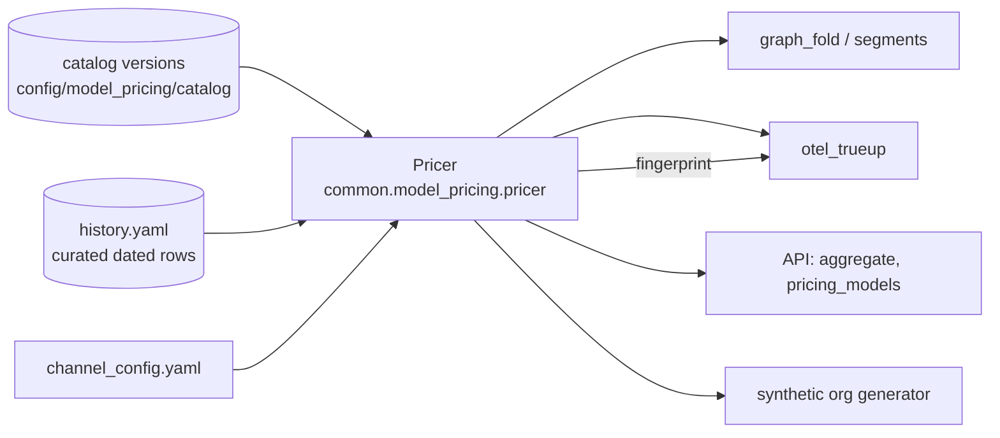

# Pricing migration (#68) — design

| | |
|---|---|
| **Status** | Draft for review · no code |
| **Scope (V1)** | Move dashboard, ingest, worker and the synthetic org generator from `common.pricing` / `config/pricing.yaml` to `common.model_pricing`; retire the legacy pair; reprice stored actuals |
| **Related** | [model-pricing module](../modules/model-pricing.md) · context note `docs/design/notes/2026-10-06-issue-68-pricing-migration-context.md` (on branch `docs/forecast-plan-budget-features`, commit dac68ff; its facts are inlined here and in the plan) · [scratchpad](notes/issue-68-pricing-migration-brainstorm.md) · #67 (merged) · #70 |
| **Issues** | [#68](https://github.com/talium-ai/code-econ/issues/68) |
| **Updated** | 2026-10-07 |

## 1. Flow



The module adds one class, `Pricer`, that gives consumers the call shapes they use today over the new
catalog. Consumers change their import and their config keys; their arithmetic does not change.

## 2. Core logic

### 2.1 Terms

| Term | Meaning |
|---|---|
| `Pricer` | Version-bound, org-bound pricing handle: wraps `Catalog.for_org(org_id)` plus the history rows. |
| history row | A rate row dated before the first catalog version, from `history.yaml`. |
| fingerprint | String stored beside computed costs; a mismatch means the cost must be recomputed. |

### 2.2 Pseudo-code

```text
Pricer.load(org_id, version, root=..., config_root=..., history_path=...):
    catalog = load_catalog(version, root, config_root)            # current if None
    prices  = catalog.for_org(org_id or "")                       # unknown/empty org -> vendor channels
    history = load_history(history_path)                          # absent -> empty
    fingerprint = catalog.version + ("+h" + hash8(history) if history else "")
    # hash8 = first 8 hex of SHA-256 over the rows as canonical JSON (sorted keys), rows sorted by
    # (channel, model_id, start_date), each rate rendered format(d.normalize(), "f")

Pricer.price_tokens(model, tokens, at, cache_write_detail):
    day    = as_date(at)                                           # legacy `_as_date` moved unchanged: date | datetime | ISO str; None -> ValueError
    tokens = split_cache_write(tokens, cache_write_detail)        # moved verbatim from common.pricing
    match  = prices.resolve(model)
    if match.status != "matched": return None                      # unknown / ambiguous: never 0
    total = 0
    for token_type in TOKEN_TYPES where tokens[token_type] > 0:
        rate = rate_on(match, token_type, day)                        # history first, then catalog
        if rate is None: return None                               # retired or missing: no partial total
        total += tokens[token_type] * rate
    return total                                                   # USD, Decimal
```

`rate_on(match, token_type, day)`: if `(channel, model_id)` has a history row with `start_date ≤ day`
**and** `day` is before the key's first catalog row, the latest such history row wins. Otherwise
`OrgPrices.rate` (catalog forward / backward / retired rules, model-pricing §3.4), unchanged. History
rows therefore never interact with `retired_on`: they only cover dates before the catalog begins.

Worked example — `claude-sonnet-5`, channel `anthropic`, 1M input + 1M `cache_write` (combined, OTel path):

| Step | Value |
|---|---|
| combined write → `cache_write_1h` | 1,000,000 |
| input | 1M × 0.000002 = $2.00 |
| cache_write_1h | 1M × 0.000004 = $4.00 |
| total | **$6.00** |

Becomes a required unit test; it equals the legacy result at the pre-2026-09-01 block.

## 3. Interfaces

### 3.1 Inputs

| Source | Access | Fields used |
|---|---|---|
| Catalog | `load_catalog(version).for_org(org_id)` → `resolve`, `rate` | rates per `token_type`, `start_date`, `retired_on` |
| History | `config/model_pricing/history.yaml` (new) | `channel`, `model_id`, `start_date`, five rates (USD per million, as the legacy file) |
| Service config | `pricing_org: str \| None`, `pricing_version: str \| None` (replace `pricing_config`) | org id for channel selection; version pin (`None` = current). The catalog path is cwd-independent (`REPO_ROOT` from `__file__`), so these only pick org and version. Today `pricing_config` is never passed to the loaders (they use the default path); the new fields are |

### 3.2 API

```python
from common.model_pricing import Pricer, price_to_micros

pricer = Pricer.load(org_id="talium.ai", version=None)     # also root=, config_root=, history_path= (test seams)
pricer = Pricer(prices, history, version)                   # direct constructor over an OrgPrices, for tests
pricer.price_tokens(model, tokens, at, cache_write_detail=None)  # Decimal | None   (legacy price_tokens)
pricer.rates(model, at)          # dict token_type -> Decimal | None, USD per token; None if the model does not resolve
pricer.fingerprint               # str
pricer.models(at)                # {model_id: rates dict}: anthropic-vendor models on the org's resolved channel, registry ids, retired models omitted
```

`pricer.rates` returns a dict whose values may be `None` (callers keep the `is None` guard) and replaces `PricingConfig.block_for` (used by `api/manager/aggregate.py`). `price_to_micros`
and `split_cache_write` move into `common.model_pricing` unchanged. Unit note: `rates` are per token,
the legacy block was per million; the one consumer (`_blended_rate`, `aggregate.py:487`) is a ratio and
unaffected.

`history.yaml` schema: `extra=forbid`; rates parsed through `Decimal(str(x))`; `(channel, model_id, start_date)` unique; rows sorted by date on load; `model_id` must be a catalog registry id (else `ConfigError`).

`history.yaml`:

```yaml
schema_version: 1
rows:
  - channel: anthropic
    model_id: claude-sonnet-5
    start_date: 2026-09-01
    input: 3.00            # USD per million tokens
    output: 15.00
    cache_read: 0.30
    cache_write_5m: 3.75
    cache_write_1h: 6.00
```

## 4. Decisions made by this issue

| # | Question | Decision |
|---|---|---|
| 1 | Past prices | Curated rows in `history.yaml`, read beneath the catalog (§2.2). Ships empty: with decision 2 no known dated change predates the catalog, so the file exists for the next real one. |
| 2 | Sonnet 5 price | LiteLLM is the price authority (user decision, 2026-10-07): the catalog's $2.00 / $10.00 stands, and `pricing.yaml`'s 2026-09-01 $3.00 block is not carried over. The `pricing_drift` check against vendor-reported costs stays as a warning, not a gate. |
| 3 | Fingerprint | `Pricer.fingerprint` = catalog `version` (+ history hash). It identifies the **whole price table** a cost was computed under, not the price of one session (that is the dated lookup). Stored in the existing `otel.pricing_fingerprint` field of `session_info`. A change makes the true-up recompute; recomputation is idempotent. |
| 4 | Repricing actuals | Real DBs: run `server.worker.cli_refold`, then let the true-up reprice rows whose fingerprint differs. `*_synth` DBs are never refolded: the generator prices with `Pricer` and the seed dump is regenerated. |
| 5 | Measured / ratio / `fit:` | Dropped with `pricing.yaml`. No `ratio` entry exists; the two `published+measured` blocks agree with the catalog. `pricing_drift` in the true-up remains the continuous check. `utils/fit_prices.py` prints a fit-vs-catalog comparison instead of a YAML block. |
| 6 | Channel | `pricing_org` per service; unset → vendor channels (`anthropic` for Claude). |
| 7 | Dates before the first row | New rule applies (first row), legacy returned `None`. Recorded behaviour change; tests asserting `None` for early dates change with this decision. |
| 8 | Model-id matching | Legacy matched the observed string against exact table keys. The catalog normalises (`claude-sonnet-4-5-20250929` and `us.anthropic.claude-…` now price; the catalog has models the legacy table lacked, e.g. `claude-sonnet-4-5`) and has a new `None` path, `ambiguous`. Accepted: it is the module's purpose. `claude-haiku-4-5-20251001` must resolve to `claude-haiku-4-5` (test). Stored rows that were unpriced and now price change `cost_basis` unknown → estimated; the report counts them. The generator keeps the dated Haiku id in `series.yaml` (it resolves). The org config's load-time `price_tokens` validation (`synthetic/org/config.py:489`) keeps working through `Pricer`. |

### 4.1 Preserved behaviours (each gets a test on the new path)

| Behaviour | How |
|---|---|
| Dated lookup | `rate_on` forward rule; history + catalog rows |
| Unknown model → `None`, never $0 | `resolve` status ≠ `matched` → `None`; missing rate with tokens > 0 → `None` |
| Cache-write 5m/1h split | `split_cache_write` moved verbatim; combined OTel write priced at 1h |
| Fingerprint invalidation | `Pricer.fingerprint` compared in `otel_trueup` as today |

### 4.2 Before/after report

For one existing database, per model: `sum(cost_usd_micros)` before, after, ratio, count of requests unpriced before / after, and the §4 decision that explains each difference (price → #2, early date → #7, newly matched or newly ambiguous model → #8). Expected: Sonnet 5 drops to 2.00/10.00 for 2026-09-01 onward (ratio 0.667 there, 1.000 before); Opus 5 and Haiku 4.5 ratio 1.000.

## 5. Consumers to change

| Consumer | Change |
|---|---|
| `server/api/app.py`, `api/manager/aggregate.py`, `api/single_user/service.py` (`pricing_models`), `api/config.py` | `Pricer.load`; `block_for` → `rates`; `pricing_config` → `pricing_org`/`pricing_version`. `/v1/pricing/models`: `effective_from` = the row's `start_date`; rates quantized to the legacy two-decimal USD-per-million strings; model set = `pricer.models(at)` (anthropic models, org channel). Contract is numeric equality of the five rates, not byte equality |
| `server/worker/graph_fold.py` (`load_pricing_survivable(org, version)`), `worker/{cli_work,cli_refold}.py`, `ingest/app.py`, `worker/config.py`, `ingest/config.py` | `PricingConfig` → `Pricer`; loader reads `pricing_org`/`pricing_version`; catalog absent (`CatalogError`) → `None` |
| `server/worker/otel_trueup.py` (constructor arg `pricing_config` → `pricer`), `config/queries/otel.yaml` | `Pricer`; fingerprint = `pricer.fingerprint`; comment in the query updated |
| `server/worker/segments/{__init__,beats}.py` | type + import |
| `econ-forecast/.../synthetic/org/{pricing,config,expand}.py` (existing wrapper class `Pricer` renamed `OrgPricer`; it holds a `common.model_pricing.Pricer`), `cli_synt_gen.py`, `testing/cli_cache_write_acceptance.py`, `config/synthetic/org/org.yaml` | `Pricer` over a pinned version; `pricing_file` replaced by `pricing_version`; snapshot copies the pinned catalog file(s) and `history.yaml` into the dataset (a version name alone does not reproduce) |
| `utils/fit_prices.py` | verifier (decision 5) |
| `docs/modules/model-pricing.md` §12 | mark dashboard migration done; document `Pricer` and `history.yaml` |

## 6. Source layout

```text
src/common/model_pricing/pricer.py    # Pricer, split_cache_write, price_to_micros, history loader (+ registry check in `load`)
config/model_pricing/history.yaml     # curated dated rows (may be empty)
tests/common/model_pricing/test_pricer.py
```

Deleted: `src/common/pricing.py`, `config/pricing.yaml`, `tests/common/test_pricing.py` (its assertions
move to `test_pricer.py`).

## 7. Key decisions

| Decision | Pros | Cons |
|---|---|---|
| One `Pricer` adapter with legacy call shapes | ~20 call sites change import only | Adapter is one more layer over `OrgPrices` |
| Fingerprint = catalog version | Reuses the catalog's own integrity hash; no second hash | Any new version invalidates all costs, though only dates ≥ its `start_date` change |
| History in a separate file | Catalog stays a pure snapshot of what sources published | A second file to keep consistent with the catalog |

## 8. Deferred

- Store the fingerprint on fold output so a price change flags stale fold costs ([#83](https://github.com/talium-ai/code-econ/issues/83)).
- Invalidate only costs dated on or after a new version's `start_date`.
- Fast-mode / batch multipliers (the `TODO(pricing)` block) → #70; carry the TODO into `model-pricing.md` §2.5, not lost with the YAML.
- Per-org negotiated discounts.

## 9. Open items for review

None. Resolved 2026-10-07: LiteLLM is authoritative (§4 #2); the orphan catalog files are deleted; only the OTel true-up stores a fingerprint (§4 #3).

The JSONL fold stores none: its costs (`channel_cost`, `carry`, `resume_cost`, `cache_busts`) are computed at fold time and never marked stale (`graph_fold.py:566`). A price change therefore reprices them only through `cli_refold`; the migration runs it once, and it is a documented step after every catalog version that changes a served price. Auto-detecting that (store the fingerprint on fold output) is deferred.
