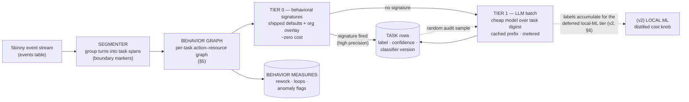
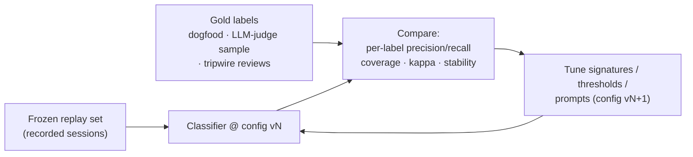

# Task Classification and Analysis — Design Thoughts

**Status:** Draft v3 — **Phase 1 scope** · **Parent design:** `coding-econ-design-draft.md` (§4.5 classifier worker type, §10.5, §11.5)
**Goal:** two outputs from one machinery. (1) **Classification** — label spans of a session
with what the developer was doing: the unit-economics layer (cost per bug fix, per feature,
per review) no vendor dashboard has. (2) **Behavioral analysis** — measure *how* the task
behaved: rework, progress, stuck loops, anomalies — quantities that were aspirations until
the behavior graph made them countable.

> **Implementation note (2026-09-01).** The Tier-0 span classification described here is implemented in
> `server/worker/segments/session_type.py` (`classify_segments`), driven by the causal-graph turn model via
> `server/worker/graph_fold.py`. It is a behavior-preserving port of the retired event-fold's classifier —
> the scoring model, keyword sets and thresholds match this design (defaults live in `segments/config.py`,
> mirroring `config/worker.yaml` `fold.*`). Segment boundaries come from the graph turn model, so labels are
> **graph-native** (accepted wholesale, not byte-matched to the old fold).

---

## 1. Proposal in a Nutshell

A per-task **behavior graph** feeding a **two-tier cascade** and a set of **behavior
measures**. Runs server-side, post-hoc (at task/session close), as the **classifier worker
type** — the parent design's worker codebase deployed as its own container (lightweight; no
resident model in v1), consuming the same event queue (parent §4.5). Everything that will
change — taxonomy, signatures, thresholds, prompts, tier on/off — lives in a versioned
config, and every task row is stamped with the classifier version so labels can be recomputed
by replaying stored events.

- **Tier 0 — behavioral signatures.** Predicates over the behavior graph and structural
  markers, **shipped by us** as versioned default config (like the pricing table); customers
  never author them, an org overlay is optional. High precision, expected to decide ~40–60%
  of tasks for free.
- **Tier 1 — LLM batch.** A cheap small model (Haiku-class) classifies everything Tier 0
  didn't, over a few-hundred-token task digest, with the taxonomy as a cached prompt prefix.
  Best available accuracy on day one, nothing to train, nothing resident. Its spend is
  metered as system cost.
- **Local ML is deferred, not deleted** (§6): once volume makes LLM spend noticeable, a
  small model trained on accumulated Tier 1 labels (distillation) slots between the tiers by
  config flip — a pure cost/latency optimization with its cold-start problem already solved
  by production labels.
- **Behavior measures** come straight off the graph, no labels needed — rework counts, loop
  depth, anomaly flags — interpreted conditioned on the task label (§5).

Broad labels first; sub-labels are a second field added when the broad tier is trusted.
Estimated cost at 1,000 developers: **≈ $15–25/day of LLM spend + negligible CPU** (§8) — a
few cents per developer per day, decreasing. At proof-point scale (a 10-developer org) the
whole layer costs **cents per day** — which is the point of choosing LLM-first.

---

## 2. Taxonomy (v1)

Seven broad labels (from the product spec's RQ-04 list reconciled with observed developer
behavior), single primary label per task, optional sub-label later:

| Label | Covers | Candidate sub-labels (later) |
|---|---|---|
| BUG_FIX | diagnose + fix defects | diagnose, fix, verify |
| REVIEW | reviewing code, commits, PRs | pr-review, security-review |
| COMPREHEND | reading/searching/understanding code; research | codebase, external-research |
| DESIGN | architecture/design docs and discussion | — |
| PLAN | producing a plan of work (incl. agent plan modes) | — |
| IMPLEMENT | writing/changing product code | feature, refactor, test-writing |
| OPS | git operations, environment setup, CI wrangling | git, env |
| MISC | fallback; honestly unclassified | — |

Rules of the taxonomy: it is **config data, not code**; MISC is a real label (never force a
guess); DEBUG-then-FIX collapses into BUG_FIX with sub-labels rather than two broad labels
(boundary between them is unreliable).

---

## 3. Inputs — what the skinny stream gives us

The normalizer drops tool outputs and all content-bearing parameter values, and reduces tool
inputs to structured metadata — file paths and operations, extensions, shell command verbs,
shape measures, optional hunk ranges, and a salted input hash (parent §4.2, §6.1). What this
layer sees, per event, ordered by signal strength:

1. **User messages** (chat/intent text) — the strongest signal by far. *Privacy-gated:*
   org-level opt-in per the parent design's posture (assumption A1, §11).
2. **Structural markers** — plan-mode enter/exit, slash commands/skills invoked (`/review`,
   `/security-review` are labels handed to us), sub-agent spawns **with agent type**
   (Explore ⇒ COMPREHEND, Plan ⇒ PLAN — sub-agents do one task by design, so they arrive
   pre-segmented and nearly pre-labeled).
3. **Tool calls with resource metadata** — tool names and classes, the files each call
   touched and how (operation, line deltas, hunk ranges), exit statuses, input hashes. The
   raw material of the behavior graph (§5).
4. **File paths and extensions** — edits under `docs/` ⇒ DESIGN/PLAN; under `tests/` ⇒
   test work; extension ⇒ language dimension (kept as a separate attribute, not a label).
5. **Shell command verbs** — the first word of commands (test runners, git verbs, build
   tools), available without command arguments.
6. **Timing and shape** — gaps, turn counts, token velocity, session length.
7. **Git events** — branch prefixes (`fix/`, `feat/`), commit verbs, PR linkage (also used
   for consistency checking, §7).

Degraded mode: if an org declines intent-text collection, classification runs on signals 2–7
only — the behavior graph is the strongest surviving signal, which is a large part of why it
exists; accuracy is reported per mode.

## 4. Segmentation — where does one task end?

Simpler problem than labeling, solved with markers, not ML. A task span = consecutive turns
between strong boundaries:

- a user message following a **completed cadence** (agent finished, went idle) after a time
  gap above a threshold (config, ~10 min);
- **plan-mode transitions**, context clear / `compaction` events (now a first-class event
  type — parent §6.1.2), session start/end;
- a **git commit / PR push** (natural task terminator);
- **sub-agent spawn** opens a child task (own label; cost rolls up to the parent).

Over-segmentation is the cheap failure (two spans with the same label merge trivially);
under-segmentation pollutes cost-per-task, so boundaries lean eager. Boundary thresholds are
config knobs. Phase changes in the behavior graph (read-dominant → write-dominant, §5) are a
candidate boundary signal to add once measured.

---

## 5. The Behavior Graph — measuring how a task behaved

For every task span the worker builds an **action–resource graph** from the skinny stream:
nodes are tool calls typed by class (read / edit / execute / search / spawn); edges are
(a) turn structure, from the event header's `parent_id` and `seq`; (b) shared resources —
two calls touching the same file path or the same command verb; (c) outcome — exit statuses
linking an execute call to the edits it verified. Sub-agent spawns attach child graphs. The
graph is built mostly from structure — paths, operations, hunk ranges, verbs, exit codes;
identical-call detection (the no-progress loop, below) compares the tool-call `input` directly
(parent §6.1 — full content ships in v2), replacing v1's salted `input_hash`, which is removed.

**Behavioral signatures** — recurring graph shapes with names. The v1 shipped set:

| Signature | Shape in the graph | Reads as |
|---|---|---|
| Exploration | read/search fan-out, zero write operations | COMPREHEND |
| Red-green loop | edit → test(fail) → edit → test(pass) cycle on one file | verify phase of BUG_FIX / IMPLEMENT |
| No-progress loop | identical tool-call `input` failing with the same exit status N times | stuck agent, wasted spend |
| Thrash | alternating edits to the same hunk region reverting each other | churn / model struggling |
| Divergence | touched-file set drifting from the span's initial focus without returning | task wandering off goal |
| Runaway fan-out | spawn-tree depth or width far above per-label baseline | cost anomaly |
| Abandon-after-loop | failing loop followed by session abandonment | wasted spend, frustration marker |
| Housekeeping tail | git verbs clustered at the end of a span | task closing out (boundary + OPS signal) |

**What becomes measurable** — these were aspirations; the graph makes them arithmetic:

- **Within-task rework:** loop iterations per file before its test goes green.
- **Cross-task rework:** a later task's edit nodes landing on an earlier task's output set
  (files written, hunk ranges) — the RQ-03 rework signal, measured, not inferred.
- **Progress vs. stuck:** repeats of an identical failing call, exactly detectable by
  comparing the tool-call `input` (content ships, v2).
- **Anomaly flags:** signature statistics against per-label baselines — including
  shape/cost mismatch (a COMPREHEND-shaped graph with IMPLEMENT-level token burn), which
  doubles as a tripwire on the classifier itself (§7).

**Interpretation rule:** behavior measures are read *conditioned on the task label*. A
red-green loop inside BUG_FIX is the job; the same loop inside IMPLEMENT is rework. Quality
scoring (RQ-03, deferred) consumes these measures joined to labels — its own doc, later.

**Where the graph feeds:** Tier 0 predicates *are* signatures; the Tier 1 digest includes a
signature summary; sub-label phases (diagnose / fix / verify) come from the graph's phase
structure (v2); tripwires and anomaly flags feed the eval set (§7); and signature detection —
unlike LLM classification — is streamable later if Phase-2 governance wants live hints (A4).

**The offline lab.** Full-content trajectory tooling from the research world (TAR-style DAG
visualizers, failure-attribution replay — see `notes/coding_agent_task_classification_framework.md`)
requires thoughts and tool outputs we never collect in production. We *do* have full JSONL
for our own dogfood sessions — so those tools run offline, on our data, to mine new
discriminating signatures, which then ship as content-free config. Heavy analysis in the
lab; skinny signatures in the field.

---

## 6. The Tiers

### Tier 0 — behavioral signatures (shipped by us)

A signature rule = predicate over the behavior graph and §3 markers → label (+ optional
sub-label) + fixed confidence, declared in config, evaluated in order, first match wins.
Examples: "sub-agent of type Explore" ⇒ COMPREHEND; "plan-mode span" ⇒ PLAN; "review
slash-command" ⇒ REVIEW; "exploration signature" ⇒ COMPREHEND; "edits docs/-dominant" ⇒
DESIGN; "only git verbs, no file edits" ⇒ OPS.

**Ownership — the burden is ours, never the customer's.** The signature set is product
content we ship, exactly like the pricing table: versioned defaults bundled with every
release, updated centrally as agent products evolve. A customer gets full function with zero
authoring. An org **overlay** is optional and additive — "our design docs live in `rfcs/`" —
never a prerequisite. This also keeps deployment simple: signatures are config *data* in the
database, not deployment artifacts; an update is a config version bump, replayable over
history.

- **Pros:** free, instant, explainable ("labeled REVIEW because /review was invoked"),
  privacy-clean (no content), and its high-precision slice doubles as ground truth for
  evaluating Tier 1 (§7).
- **Cons:** coverage plateaus; signatures rot as agent products change — hence shipped
  defaults under our maintenance, config + versioning.

### Tier 1 — LLM batch (everything Tier 0 didn't decide)

Build a **task digest** — user messages (under the opt-in), the signature summary and
behavior measures, a tool/file summary; a few hundred tokens — and batch-classify with a
cheap small model against the taxonomy with per-label definitions, temperature 0,
forced-choice + confidence. **Caching does real work:** the taxonomy and label definitions
are a fixed prompt prefix (prompt-cached across the whole batch), and identical digests
dedupe. Tier 1 also receives a small random sample of Tier 0 decisions for continuous audit.
Every call is metered and attributed as system cost.

*Why LLM rather than local ML in v1:* at proof-point scale the spend is cents per day and
latency is irrelevant (batch, minutes); accuracy is the best available on day one; there is
nothing to train, nothing resident, and one fewer model dependency in the worker.

### Deferred: local ML tier (the v2 cost knob)

When volume makes LLM spend worth optimizing, a small local classifier — embeddings plus
behavior-graph features, scikit-learn-class — trains on the Tier 1 labels accumulated in
production (**distillation**) and slots between Tier 0 and Tier 1 by config flip, taking the
easy majority of the residue at ML cost. Its cold-start problem is solved by the time it
exists, and it must beat the LLM tier's accuracy-per-dollar on the eval harness (§7) before
the flip. Until then it is deliberately not built.

### Config-driven evolution

One versioned config object holds: taxonomy (labels, sub-labels, definitions), the shipped
signature set + org overlays, digest format, confidence thresholds, tier enable/disable per
org, audit sampling rate, Tier 1 model choice and prompts. Task rows carry
`classifier_version`; changing config + replaying stored events (parent design §5.2)
relabels history — classification is always recomputable, never precious.

---

## 7. Measuring Accuracy (with no gold data today)

Bootstrapping order, cheapest first:

1. **Dogfood gold set.** We label our own sessions (starting with the ones producing this
   repo). A few hundred tasks is enough for per-label precision/recall on 7 labels.
2. **Anchor-slice agreement.** Tier 0's high-precision slice is treated as truth; Tier 1 is
   scored against it on that slice (keep the anchor signals out of Tier 1's digest on that
   slice to avoid circularity).
3. **LLM-judge on a stratified sample.** A strong (not Haiku-class) model labels a random
   sample across orgs/labels; report agreement as **Cohen's kappa** (agreement corrected for
   chance; 0 = chance, 1 = perfect). This is the ongoing production accuracy meter.
4. **Consistency tripwires.** Label vs. reality cross-checks, now fed by behavior measures:
   a COMPREHEND task that merged a PR, an IMPLEMENT task with zero file edits, a
   shape/cost mismatch flag (§5) — flagged, sampled, fed to the eval set.
5. **Dev thumbs (later).** The dev-local personal view can ask "was this a bug fix?" —
   highest-quality labels, volunteer-only, arrives with that feature.

Standing eval harness: a **frozen replay set** of recorded sessions (backfill mode is the
harness); every classifier/config change runs against it before rollout.

Metrics reported: per-label precision/recall, macro-average, **coverage** (% of task time
classified above threshold — MISC and low-confidence are visible, not hidden), kappa vs.
LLM-judge, and label stability across reruns. Working target for v1: **~80–85% on broad
labels with ≥90% coverage** — sufficient for cost analytics, stated honestly on the dashboard.

---

## 8. Back-of-the-Envelope

Reference: 1,000-dev org from the parent design — 6,000 sessions/day, assume ~3 tasks/session
⇒ **18k tasks/day** (~200k events/day feeding the segmenter).

| Resource | Estimate | Basis |
|---|---|---|
| Graph build + Tier 0 CPU | negligible | linear in events/task; predicates over pre-built graph, µs–ms/task |
| Tier 1 LLM spend | ~$15–25/day initially | ~50% residue = 9k tasks × ~1.5k input tokens ≈ 13M tokens/day at Haiku-class pricing, reduced by the cached taxonomy prefix; shrinks as signatures grow and the v2 ML tier lands |
| Worker memory | small (no resident model in v1) | graph + config in memory per batch |
| Task-row storage | ~18 MB/day (~7 GB/yr) | ~1 KB/task row incl. behavior measures |
| Digest storage | ~30 MB/day, short retention | ~5 KB/task, kept ~30 days for audit/replay, then dropped (events remain the durable source) |
| Latency | minutes (batch) | classified at task close-out; not in any live path |

**Proof-point scale:** a 10-developer org ⇒ ~180 tasks/day ⇒ **~$0.20–0.30/day** of LLM
spend — negligible, which is precisely why the LLM-first shape is right for the first
customers.

Order-of-magnitude conclusion: **a few ¢/dev/day at 1,000 developers, decreasing; cents/day
at proof-point scale.** One small worker container — no GPU, no resident model, no queue
changes. These numbers are mirrored as §10.5 in the parent design's budget.

---

## 9. Alternatives Considered

### Classification method

| Approach | Pros | Cons | Verdict |
|---|---|---|---|
| **Signatures + LLM batch (chosen for v1)** | Ships our domain knowledge as the free bulk path; LLM accuracy from day one; simplest build (nothing to train, nothing resident); degrades gracefully without intent text via the behavior graph | LLM spend scales with volume until distillation lands; two components | **Chosen** — matches "fast and simple now, knobs later" |
| LLM-only (classify every task) | Best accuracy, zero build | ~$30+/day at 1k devs and rising with volume; opaque; no free explainable slice; slow/costly to rerun over history | Close to chosen — Tier 0 in front cuts the bulk cost and adds explainability + ground truth |
| Signatures + local ML + LLM (three-tier, this doc's v2) | Cheapest at scale; LLM accuracy at ML cost via distillation | Local ML needs labels that don't exist on day one; model dependency + 0.5 GB resident footprint; not worth the build at proof-point scale | **Deferred to v2** — slots in by config flip once Tier 1 labels accumulate and spend justifies it |
| Deterministic-only | Free, explainable, privacy-perfect | Coverage ceiling ~50–60%; everything else lands in MISC | Kept as Tier 0; insufficient alone for a differentiator |
| Train a supervised model up front | Clean single component | No labeled data exists on day one — cold start kills it | Arrived at via distillation instead (deferred tier) |
| Zero-shot NLI models (bart-large-mnli-style) | No training data; decent accuracy | ~1.6 GB model, ~100× slower than small embeddings on CPU; inferior to a cheap LLM at similar operational cost | Rejected |
| Unsupervised clustering then naming (Clio-style, per Anthropic's research) | Discovers taxonomy from data instead of imposing one | Cluster names drift; analytics needs stable labels across time and orgs | Use offline as a taxonomy *sanity check*, not in the pipeline |

**Is there an off-the-shelf classifier for this?** No. As of mid-2026 there is no open-source
"coding-agent task classifier"; the adjacent work is Anthropic's Clio (usage-clustering
research, no released code), the trajectory-analysis research compiled in
`notes/coding_agent_task_classification_framework.md` (offline-lab use only — needs content
we don't collect), and generic intent-classification tooling. What we leverage when the v2
ML tier arrives: **scikit-learn**, **sentence-transformers**, Hugging Face model hub.
fastText was considered and rejected — Meta archived it in 2024, failing the maintenance
bar. The signature set, taxonomy, behavior graph, and digest format are our work —
appropriately, since that domain knowledge *is* the moat.

### Where it runs

| Option | Pros | Cons | Verdict |
|---|---|---|---|
| **Server, as the classifier worker type (chosen)** | Sees the full event stream + git; same codebase and queue as other workers, own container (parent §4.5); replayable over history | Needs intent text shipped (opt-in) | **Chosen** for v1 |
| On the laptop (collector-side) | Text never leaves the machine at all | Ships classification to every laptop; can't see git correlation; fleet-upgrade pain per iteration | Revisit if privacy demands it; Tier 0 signatures are laptop-feasible |
| Live in-session (streaming) | Enables realtime governance hooks | LLM too slow/costly in hot path (review doc, resolved point) | Post-hoc only; signature detection can stream later for live *hints* |

---

## 10. Comparison: Claude / Cursor Enterprise Dashboards

What the vendor dashboards offer today (as of mid-2026) vs. this layer:

| Capability | Claude Code analytics / API | Cursor enterprise admin | This design |
|---|---|---|---|
| Spend, tokens, sessions per user | ✔ | ✔ | ✔ (table stakes) |
| Lines accepted / tool acceptance | ✔ | ✔ (tab/apply rates) | ✔ via events |
| Cross-vendor view | ✖ single-vendor | ✖ single-vendor | ✔ one schema |
| **Task-level labels** | ✖ | ✖ | ✔ core of this doc |
| **Cost per task type** | ✖ | ✖ | ✔ tasks × cost engine |
| **Behavior measures (rework, stuck loops, anomalies)** | ✖ | ✖ | ✔ behavior graph (§5) |
| Model × task-type evidence (feeds routing) | ✖ (and incentive-blocked: vendors won't recommend competitors' models) | ✖ | ✔ accumulates as a dataset |
| Task quality linkage (rework, PR outcome) | ✖ | ✖ | ✔ behavior graph + git correlator |

The one-line differentiator: vendors report *how much you spent*; this layer reports *what
you bought and how well it went* — and neither vendor has an incentive to build cross-vendor
task economics.

---

## 11. Clarifying Questions (documented; assumed answers used above)

| # | Question | Working assumption |
|---|---|---|
| A1 | Does user-intent text leave the laptop by default? Parent design said metadata-only; Tier 1 wants the skinny chat text. | **Org-level opt-in, expected ON for enterprise contracts; disclosed to devs.** Degraded no-text mode exists (§3), strengthened by the behavior graph. *Resolved:* parent doc §9 names intent text (and raw tool inputs) as explicit opt-in classes. |
| A2 | Single label per task or multi-label? | Single primary label (+ sub-label later). Multi-label breaks cost attribution — a task's cost must sum to 100%. |
| A3 | Are sub-agent runs their own tasks? | Yes — child task rows, own labels, cost rolls up to the parent task. |
| A4 | Is live (in-session) labeling needed for Phase-2 governance? | Not now. Signature detection is streamable later if governance wants live task hints (no-progress loops are the obvious first one). |
| A5 | Per-language / per-project sub-dimension? | Language and repo/project are separate task attributes (from file extensions and repo id), not part of the label taxonomy. |
| A6 | Accuracy bar before dashboard exposure? | Ship behind "beta" tag at ≥80% broad-label accuracy on the eval harness with coverage shown; product call to flip on by default. |

## 12. Phasing

1. **v0 (with first pipeline release / backfill proof point):** segmenter + behavior graph +
   shipped Tier 0 signatures + Tier 1 LLM batch; MISC visible; behavior measures computed
   and stored; dogfood gold set started; eval harness = replay set.
2. **v1:** behavior measures on the dashboard (rework, stuck loops, anomaly flags,
   label-conditioned); audit sampling + kappa reporting; cost-per-task on the dashboard
   (beta); org signature overlays.
3. **v2:** local ML tier via distillation (config flip) as the cost knob; sub-labels from
   the graph's phase structure; taxonomy sanity check via offline clustering; dev-thumbs
   feedback if the personal view has shipped.
