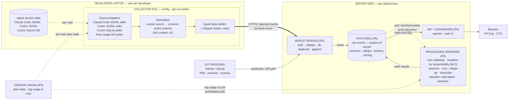
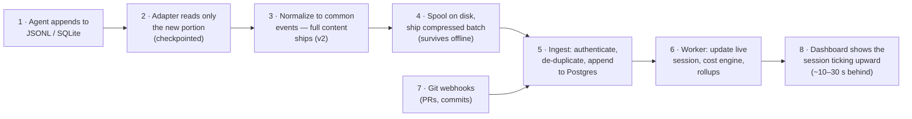
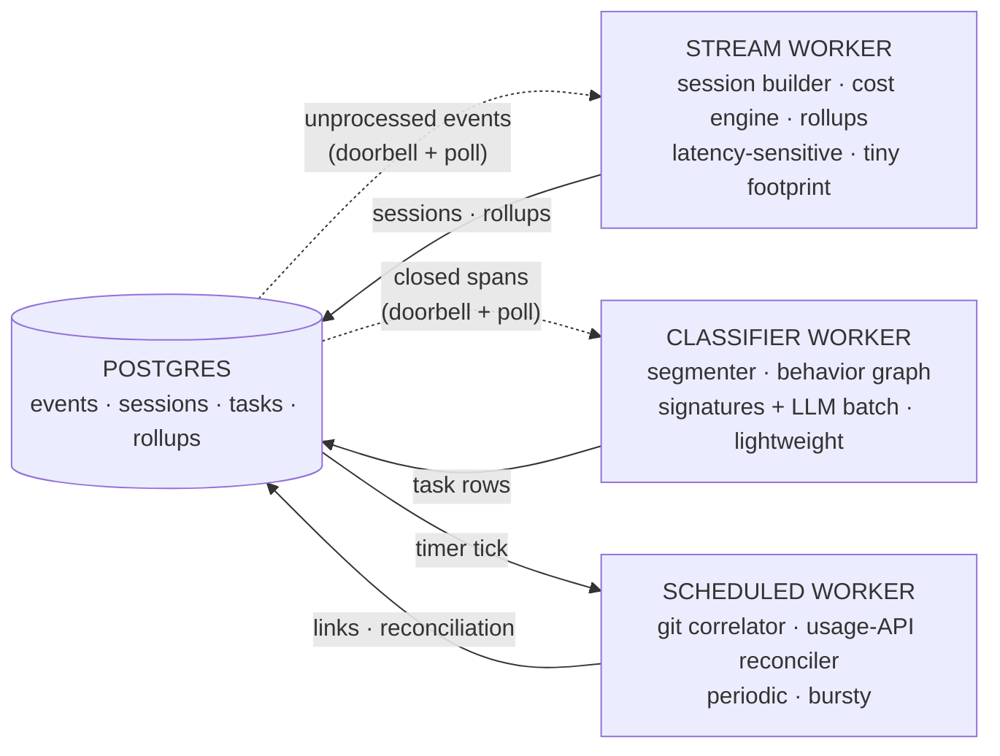
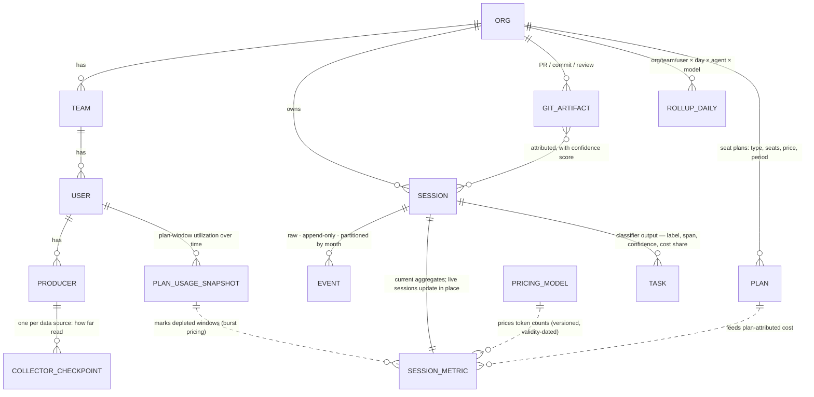
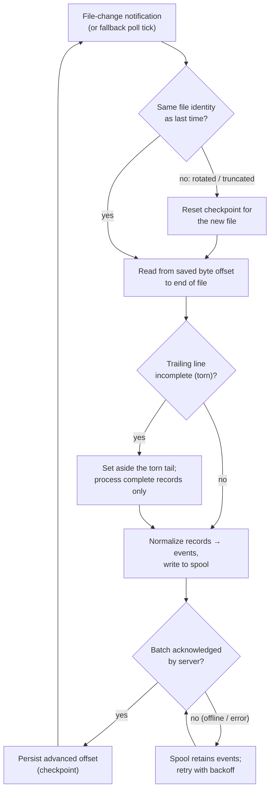
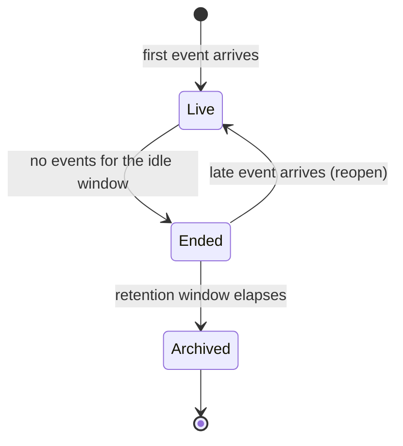

# Coding Agent Economics — System Design

**Status:** Draft v2 · **Source of truth for requirements:** `docs/ProductSpec/Coding_Agent_Economics.md`
**Companion reading:** `docs/ProductSpec/Coding_Agent_Economics-review.md` (used as side notes, not requirements)
**Architecture reference:** `docs/design/system-architecture.md` — the authoritative
architecture document that module designs cite; where this draft and that document differ,
the architecture document wins.

> **Revision note (v2).** Four areas of the v1 draft are superseded; the load-bearing
> sections are corrected in place below, and any residual v1 phrasing elsewhere should be
> read accordingly:
> 1. **Privacy posture reversed** — full content (messages, tool inputs) is collected;
>    privacy comes from the deployment boundary, not metadata-only collection (§9).
> 2. **"Postgres is also the queue" retired** — there is no queue; workers are pollers or
>    REST-woken handlers (§7.2, architecture doc §6).
> 3. **"Backfill" renamed "batch mode"** (`source: batch`).
> 4. **"Device" renamed "producer"** — a server-issued identity covering laptops and server
>    endpoints alike (architecture doc §5).

---

## 1. Purpose and Scope

This document describes the architecture of the platform that collects coding-agent usage
data from developer machines, turns it into cost / productivity / quality intelligence, and
presents it to engineering leadership (Enterprise and Team plans) and, later, to individual
developers.

**In scope for this design (Release 1):**

- Collect session data from **Claude Code** and **Codex** (both write local JSONL files) and
  **Cursor** (writes to a local SQLite database), *while the session is in progress* — not
  after it ends.
- Normalize everything into one common schema so every downstream feature is
  agent-vendor-neutral.
- Compute per-session metrics: cost, model mix, tokens, cache efficiency, sub-agents, tools,
  files changed (Spec RQ-01).
- Correlate sessions with git activity for productivity measures (Spec RQ-02).
- **Classify task spans, compute cost per task type, and measure task behavior** (rework,
  stuck loops, anomalies) (Spec RQ-04) — the unit-economics differentiator, promoted into
  Phase 1. Design in the companion doc `Task-Classification-and-Analysis.md`; runs as its
  own handler (§4.5, architecture doc §6).
- Serve an enterprise dashboard and query API with org / team / user tenancy.
- **Batch-mode processing of existing JSONL files — the initial customer proof
  point.** The first thing a customer runs: point the collector at the session files
  already on developer machines and populate the dashboard from history, before (or
  without) live tailing. Same pipeline, same events, marked `source: batch` (§3.2).

**Deliberately deferred, but the architecture leaves room for:**

- Session quality scoring (Spec RQ-03) — same event stream, a later worker sub-module.
- Governance and realtime control (gateway integration, quotas, kill/throttle) — Phase 2.
- Dev-local personal view (privacy-preserving, laptop-only).

**Guiding principles** (from the product brief):

1. **Simple first, decomposable later.** Fewest moving parts that still have clean seams. Every
   seam is an interface (§6) so a piece can be pulled out into its own service when scale demands.
2. **Requirements will change.** Vendor file formats, metrics, and features are all in flux, so
   raw data is kept forever-parseable (§5.2) and the schema is versioned.
3. **Scale is not a concern now**, but nothing in the design should require a rewrite to reach
   ~1,000-developer orgs (§10 shows the numbers are small anyway).

---

## 2. Terms and Notation

Defined once here; used throughout without re-explanation.

| Term | Meaning |
|---|---|
| **Agent** | A coding assistant product: Claude Code, Codex, or Cursor. |
| **Session** | One continuous conversation between a developer and an agent. Claude Code and Codex represent this as one JSONL file; Cursor as rows in its database keyed by a conversation id. |
| **Event** | One normalized record extracted from a session: a user message, an assistant reply with token counts, a tool call, a sub-agent launch, a file edit, etc. Events are the atomic unit that moves through the whole system. |
| **Header / payload / extensions** | The three parts of every event (§6.1): the mandatory envelope present on every event; the type-specific body; and a namespaced map of optional fields. |
| **Must-ignore** | Forward-compatibility rule: a consumer that meets an unknown optional field skips it rather than erroring. |
| **Hunk** | One contiguous block of changed lines in a diff, identified by a start line and a length. |
| **Worker / handler** | *(v2)* Workers are identified by responsibility, not by a fixed type enum; each is a poller or a REST-woken handler and may be split as development proceeds (architecture doc §6). The v1 "worker type" enum (stream / scheduled / classifier) is retired. |
| **Collector** | The small program installed on the developer's laptop that watches agent data and ships events to the server. |
| **Tailing** | Reading a file incrementally as another program appends to it — like `tail -f` — so data flows out while the session is still running. |
| **Batch mode** | *(formerly "backfill")* The initial customer proof point: feeding already-complete session files through the same pipeline, chunk by chunk, as if they were being written live. |
| **Producer** | *(formerly "device")* One registered event source — a laptop or server endpoint — with a server-issued identity stable across restarts (architecture doc §5). |
| **Rollup** | A pre-computed summary table (e.g., cost per team per day) maintained so dashboards don't scan raw events. |
| **Tenant** | One customer organization. Tenancy hierarchy: **org → team → user → producer**. |
| **Seat plan** | Subscription pricing (Claude Max, Cursor seats) as opposed to per-token API pricing. Cost accounting must handle both. |
| **Burst** | Usage that continues after a plan window's budget is depleted, priced at API rates. The plan covers usage until the window runs out; the rest of that window is burst. |
| **Plan-usage snapshot** | A point-in-time reading from the vendor's usage API: how much of the plan window is consumed, what remains, when it resets. The only authoritative source of plan depletion. |
| **At-least-once delivery** | A transfer guarantee: an event may arrive more than once (e.g., after a retry) but is never silently lost. The receiver removes duplicates using each event's unique id. |
| **ev/s** | Events per second. **KB/MB/GB** = kilobytes/megabytes/gigabytes. **p95** = 95th percentile (19 out of 20 cases are at or below this value). |

---

## 3. Architecture at a Glance

### 3.1 Block diagram



Five deployable pieces total: **Collector** (laptop), **Ingest Service**, **Processing
Workers** (one codebase deployed as three worker-type containers, §4.5), **API + Dashboard**,
and **Postgres**. §5 explains why exactly these are separate processes and why nothing else is.

### 3.2 Data flow, end to end



The same steps, with the reasoning:

1. A developer runs a session. The agent appends to its JSONL file (Claude Code, Codex) or
   writes rows into its SQLite database (Cursor) on the laptop.
2. The Collector's source adapter notices the change within a couple of seconds (file-change
   notification for JSONL; short-interval polling for SQLite), reads only the new portion, and
   remembers how far it has read (a checkpoint), so nothing is re-read or missed after a restart.
3. The Normalizer converts each vendor record into the common event schema — **metadata only
   by default**: token counts, model names, tool names, file paths, timestamps. Prompt and code
   *content* is not shipped (see §9, privacy).
4. Events accumulate in a small on-disk spool; the Shipper sends a compressed batch every few
   seconds (or sooner when the batch is full) over HTTPS. If the laptop is offline, the spool
   holds events until connectivity returns.
5. The Ingest Service authenticates the producer, validates the batch, discards duplicates by
   event id, and appends the events to Postgres. Ingest does **no** interpretation — it is a
   dumb, fast, always-available front door.
6. Processing Workers pull newly arrived events from Postgres in small batches, update the
   session record incrementally (a session is "live" until events stop arriving), run the cost
   engine against pricing tables, and refresh rollups. This is where all intelligence lives.
   At task/session close-out the classifier worker labels task spans in batch (§4.5) —
   off the live path, so it never delays the numbers below.
7. Git webhooks (PR opened/merged, commits) arrive through the same Ingest front door as a
   different event type; the git correlator in the worker links them to sessions.
8. The Dashboard reads sessions and rollups over the query API. A session's numbers visibly
   tick upward while the developer is still typing — the "watch it as it happens" requirement —
   with an end-to-end delay of roughly 10–30 seconds (§10.3).

**Batch mode (the initial customer proof point)** is the same pipeline with one
difference: the adapter is pointed at a directory of completed files instead of waiting for
live appends. It does **not** slurp a file whole. It runs the same read loop as live tailing
(§11.1), reading each file from its checkpoint in bounded chunks, so the normalizer receives
records as a stream exactly as if the session were being written right now — chunk →
normalize → spool → ship → checkpoint, repeated to end of file. A completed file is simply a
file whose growth all happened before we arrived. The consequences that matter: memory stays
bounded no matter how large the file, a batch run interrupted mid-file resumes from its
checkpoint, the spool's batching and backpressure pace the server load, and nothing
downstream can tell the difference except the header's `source: batch`. This same mode is
our own test harness and the classifier's replay/eval mechanism — recorded sessions through
the full stack.

---

## 4. Modules: What, Why, and What Else Was Considered

A **module** is a body of code with one job and a defined interface. Only some modules get
their own process (§5).

### 4.1 Source Adapters (in the Collector)

One adapter per agent vendor. Each adapter's only job: detect new session data and emit raw
vendor records with a stable per-record identity. Everything vendor-specific — file locations,
formats, quirks — is trapped here.

- **Claude Code**: sessions are JSONL files under the Claude home directory, one file per
  session, appended as the conversation proceeds. Records carry their own unique ids and
  parent links, which we reuse for event identity.
- **Codex**: same shape — per-session JSONL under the Codex home directory, date-organized.
- **Cursor**: no JSONL; conversation and usage state live in local SQLite database files. The
  adapter polls on a short interval with a read-only connection and asks "which rows are new
  since my checkpoint?". Polling a live SQLite file that another process is writing needs care
  (read-only mode; fall back to copy-then-read if the database is momentarily locked) — this
  is contained entirely inside this one adapter.
- **Plan-usage poller (per vendor that exposes one)**: not a file source at all — a
  low-frequency poll (every few minutes; it is a budget gauge, not a stream) of the vendor's
  plan-usage endpoint, authenticated with the developer's existing agent credentials already
  on the machine (the approach popularized by tools like ccusage). It emits **plan-usage
  snapshot** events: plan-window utilization, remaining budget, reset time. Session files show
  tokens *consumed*; only this endpoint knows what the plan has *left* — it is what makes plan
  depletion and burst pricing (§4.5) measured rather than modeled. It runs in the collector
  because the credential is per-user and never leaves the laptop; its use is disclosed to the
  developer next to the collector's opt-out switch (consent posture: §14).

All paths are configurable — vendors move these locations, and the adapter registry is the
extension point for agent #4.

**Alternatives considered for the collection approach as a whole:**

| Option | Pros | Cons | Verdict |
|---|---|---|---|
| **Tail local files / poll local DB (chosen)** | Works for seat-plan traffic (most real spend); richest detail (tools, sub-agents, cache stats); no vendor cooperation needed; works offline | Requires a laptop install; formats are undocumented and can change | **Chosen.** Only option that satisfies "process while the session is progressing" for all three agents. |
| Vendor usage APIs (per-user plan endpoint; Anthropic usage/cost admin API, Cursor admin) | Official; authoritative for plan state and vendor-billed spend; no session parsing | Aggregated and delayed (admin side); single-vendor; misses session detail entirely | **Adopted as complementary source**: per-user plan endpoint feeds the plan-usage poller (above); org admin APIs feed the usage-API reconciler (§4.5). Not primary — no session detail. |
| OpenTelemetry export (Claude Code can emit OTel metrics) | Standard protocol, existing tooling | Claude Code-only; metrics are pre-aggregated (loses per-event detail); Codex/Cursor don't offer it | Revisit as an optional second input; the ingest interface doesn't preclude it. |
| LLM gateway logs | Central, no laptop agent | Only sees API-key traffic; seat-plan sessions never pass through a gateway | Phase-2 complement for governance, not a substitute. |

**Could vendor-hosted session data replace the laptop collector?** Enterprise editions
increasingly retain full session context server-side, which would make deployment
frictionless. What vendors *expose* today, however, is analytics aggregates and admin usage
APIs — not raw session export, so neither the per-event detail this design needs (tools,
sub-agents, cache behavior) nor the in-progress requirement is available that way. The
collector stays. The seam is ready regardless: a server-side adapter pulling a vendor's
session-export API (if one ever ships) is just another feeder into Ingest, and that vendor's
laptop footprint disappears with no downstream change. Tracked as a per-vendor research item
(§14).

### 4.2 Normalizer (in the Collector)

Converts vendor records into the **common event schema** — the single most important contract
in the system (§6.1). Everything server-side speaks only this schema; adding an agent never
touches the server.

*Why normalize on the laptop rather than the server?* It keeps the server vendor-agnostic —
everything server-side speaks one schema, and adding an agent never touches the server. The
trade-off is that a normalizer bug needs a collector update to fix. Mitigation: the
normalizer also forwards vendor-record fields it didn't understand in a namespaced catch-all,
so the server can re-derive missed information without re-collecting (§5.2).

**Content ships (v2 correction).** The v1 draft required metadata-only collection; that
requirement is withdrawn (§9). Events carry full content — user and assistant message text,
tool inputs — inside the org's trusted deployment boundary. Hashed stand-ins for content
(v1's salted `input_hash`) are rejected outright: hashing destroys the intent signal the
classifier needs, and it poisons queryability — every match or SELECT against the column
would need the identical salted hash applied at query time.

**Tool-call feature extraction.** Alongside the content, the normalizer still extracts the
high-signal *structured* facts per tool, because downstream consumers query them constantly
and shouldn't parse tool inputs to get them:

- file paths and the operation performed (read / create / edit / delete), plus the file
  extension;
- the shell command's **verb** (first token), for cheap grouping;
- shape measures: lines added / removed, bytes read, input size in characters;
- **hunk line ranges** (start, length) — copied *only* when the vendor record already carries
  them. Claude Code's edit records include structured-patch metadata with exactly these
  numbers, so range extraction is a field copy, not a computation; the collector never reads
  files or produces diffs itself. Vendors whose records lack ranges simply ship events
  without them (per-vendor spike, §14);
- for MCP tools: the MCP server name and tool name.

This extraction is a **query convenience layered on top of the content, not a privacy
gate** — the content it summarizes is present in the same event. File-change events are
derived uniformly from it, so all vendors produce them even where the native format has no
such record type.

The governing principle stands: **the collector ships facts; the server derives
interpretations.** Anything derivable from a shipped fact — file kind from extension, tool
class from tool name — is derived server-side, where a bug is fixed by reprocessing stored
events (§5.2) instead of redeploying the laptop fleet. With full content shipped, this hedge
is stronger than in v1: nearly everything is re-derivable server-side.

### 4.3 Spool and Shipper (in the Collector)

A small write-ahead disk buffer plus an HTTP sender with batching, compression, retry with
backoff, and at-least-once semantics. Exists so that laptop offline periods, server
maintenance, or crashes never lose data — the spool drains when connectivity returns. The
alternative (send synchronously, drop on failure) is simpler but silently loses exactly the
long, expensive offline/flaky-network sessions we most need to count.

### 4.4 Ingest Service (server)

Thin, stateless front door: authenticate producer token → validate schema version → deduplicate
by event id → append to Postgres → acknowledge. Also receives git webhooks (translated into
git-event records) — one door for all inbound data.

*Why so thin?* Ingestion availability must not depend on processing correctness. If a worker
has a bug or the pricing table is broken, events still land safely and are reprocessed later.
Thin also means stateless, which makes it trivially replicable later.

### 4.5 Processing Workers (server)

All interpretation happens here: one worker **codebase** sharing one work-discovery discipline (§6.2),
deployed as **handlers grouped by responsibility** (v2 — the fixed three-type enum is retired; architecture doc §6) — separable containers with distinct CPU/memory profiles
that scale independently. "Processing" is not one workload: the session builder must stay
seconds-fresh on a tiny footprint, the correlator and reconciler run on schedules in bursts,
and the classifier does batch LLM I/O on its own cadence. Same code, same work-discovery contract,
different deployment units.



The sub-modules, by responsibility:

- **Session builder** *(stream)* — folds events into a session record incrementally: token totals by
  model, tool usage counts, sub-agent counts, files touched, cache-hit ratio, start/last-seen
  timestamps. A session with no new events for an idle window (e.g., 30 minutes) is marked
  ended. Live and ended sessions are the same row — "live" is just a status.
- **Cost engine** *(stream)* — converts token counts to money using versioned pricing tables *and
  plan-usage snapshots* (§4.1). Computes three numbers per session: **list-price cost** (the
  tokens at API list prices — the comparable unit across vendors), **plan-attributed cost**
  (the session's share of a seat subscription), and **billed cost** (what the org actually
  pays): usage while snapshots show plan budget remaining is plan-covered; once a window is
  depleted, further usage in it is priced at API rates as burst. Plan-vs-API break-even and
  "plan + burst" totals are thereby answered from measured depletion, not modeled consumption.
  Pricing is line-item complete: cache writes are priced per TTL tier when `cache_write_detail`
  is present (else the `cache_write_tokens` total at a default tier), and provider-billed
  `server_tool_use` counts are added as their own line items — both keyed off the neutral
  payload fields (§6.1.2), so cost stays agent-agnostic and correct without a flat-rate
  mis-price.
- **Usage-API reconciler** *(scheduled)* — polls vendor org/admin usage and cost APIs
  (Anthropic's usage & cost API, Cursor's admin API) hourly or daily. Two jobs: cross-check
  vendor-reported totals against our event-derived numbers (drift here means a collector or
  pricing bug — surfaced, not hidden), and capture org-level API spend that never touches a
  developer laptop.
- **Git correlator** *(scheduled)* — links PRs/commits to sessions via branch names, commit
  trailers, and time-window + file-overlap matching (§8.3).
- **Rollup maintainer** *(stream)* — updates per-day / per-team / per-model summary tables incrementally.
- **Task segmenter + classifier + behavior analysis** *(classifier)* — labels task spans
  for cost-per-task analytics and measures task behavior — rework, stuck loops, anomaly
  flags (Spec RQ-04, **Phase 1**). Batch, at task/session close-out; a per-task behavior
  graph feeding a two-tier cascade (behavioral signatures we ship → small-LLM batch; a
  local ML tier is the deferred v2 cost knob), LLM spend metered as system cost. Full
  design in the companion doc `Task-Classification-and-Analysis.md`; headline numbers in
  §10.5. It is purely a consumer of the same event stream — collection and ingest are
  unaffected by its presence.

*Why one codebase with multiple handlers rather than a service per function?* At current scale
each function is far below one CPU (§10), so separate services would add design and
communication overhead for nothing. But the resource profiles genuinely differ — the
classifier waits on batch LLM calls and tolerates minutes of latency; the stream worker must
not — so the deployment units are separate containers from day one. The sub-modules share
nothing but the database, which is what makes handler placement a *deployment* decision: lifting
a sub-module into a different type (or a new one) is configuration, not code (§5.4).

### 4.6 API + Dashboard (server)

A query API (REST, JSON) over sessions and rollups, plus the web dashboard. Enforces tenancy
(every query is scoped to the caller's org) and plan gating (Team plan sees a feature subset;
same code, same schema, a feature flag per org). Live-session updates are served by simple
short-interval polling from the browser — at a 10–30 s data latency, streaming push adds
complexity for no visible benefit.

*Build vs. buy for the dashboard:* Grafana or Metabase over Postgres would be fastest and are
fine for internal validation, but multi-tenant customer-facing access control is awkward in
both, and the product's dashboard *is* the product surface. Decision: custom web UI on the
query API; optionally stand up Metabase internally for ad-hoc exploration during development.

### 4.7 What is deliberately absent

- **No message broker (Kafka/RabbitMQ/Redis) and no queue at all (v2).** Workers poll or are REST-woken; rows in Postgres are the pending-work truth (§7.2). At
  hundreds of events/second a broker is pure operational weight. The ingest→worker seam is
  where one would slot in if ever needed.
- **No LLM gateway / policy engine.** Phase-2 governance. The event schema already carries
  the signals (token velocity, sub-agent fan-out) a future controller will need.
- **No stream processor (Flink/Spark).** Incremental aggregation of ~100 ev/s is a loop over
  rows, not a streaming-framework problem.

---

## 5. Processes and Deployment

A **process** here = one independently deployable unit that can be given its own CPU/memory
budget (e.g., one container). Modules ≠ processes: the Collector contains four modules but is
one process.

### 5.1 The process inventory

| # | Process | Contains (modules) | Runs | State | Sizing intuition |
|---|---|---|---|---|---|
| P1 | **Collector** | source adapters + plan-usage poller, normalizer, spool, shipper | Each developer laptop | Checkpoints + spool on local disk | Must be near-invisible: target <100 MB memory, ~0 CPU when idle |
| P2 | **Ingest Service** | auth, validation, dedup, append; webhook receiver | Server, ≥1 replica | Stateless | Small; I/O-bound |
| P3 | **Processing Workers** — one codebase, three worker types, one container each | *stream:* session builder, cost engine, rollups · *scheduled:* usage-API reconciler, git correlator · *classifier:* segmenter + behavior graph + task classifier | Server, ≥1 per type | Stateless (all state in Postgres) | Stream/scheduled: small, grow with event rate · classifier: lightweight, batch LLM I/O |
| P4 | **API + Dashboard** | query API, web UI | Server, ≥1 | Stateless | Small; read-only load |
| P5 | **Postgres** | — | Managed service preferred | The system of record | The only component needing care in sizing/backup |

### 5.2 Why these seams and not others

The two server-side seams are chosen because they sit at the natural **failure and change
boundaries**:

- **Ingest ↔ Processing** (seam = the events table). Ingestion must survive processing bugs.
  Because raw events are retained, any processing bug is repaired by fixing the worker and
  re-running it over stored events — reprocessing is the primary "requirements changed"
  mechanism. New metric? Recompute a year of sessions from raw events. This is the single
  biggest hedge against the acknowledged requirement flux.
- **Processing ↔ API** (seam = sessions/rollup tables). Reads never contend with the write
  path, and heavy dashboard queries can't stall event processing.

Merging P2–P4 into one monolith was considered (simpler still) and rejected: the processes
share no in-memory state anyway, so keeping them separate costs almost nothing now and buys
crash isolation and independent restarts/upgrades immediately. Splitting further (e.g., cost
engine as its own service) was rejected: no failure boundary or scaling need justifies it yet.

### 5.3 Concurrency and correctness rules

Rules that make distribution safe are cheap now and expensive to retrofit, so they are in from
day one:

1. **Session ownership.** All events of one session are processed by one worker at a time
   (one handler instance processes a given session at a time), so session aggregation needs no cross-worker
   coordination. Sessions are independent of each other — this is the natural sharding key.
2. **Idempotent everything.** Duplicate event delivery is normal (at-least-once). Every event
   has a deterministic unique id (vendor record id where available, otherwise a hash of source
   identity + position), and every processing step must produce the same result if run twice.
3. **Checkpoint, then acknowledge.** Collectors advance their read checkpoint only after the
   server acknowledges the batch; workers mark events processed only after results commit.
   Everything resumes cleanly after a crash.

### 5.4 How it distributes when the time comes

- **P2, P4**: stateless — add replicas behind a load balancer. Nothing to design.
- **P3**: split handlers into their own containers; per-session serialization (5.3.1) already
  partitions work safely. The type split (§4.5) is in from day one, so scaling any one
  workload — including the classifier's LLM batches — is replica count on that type, and a
  future fourth type is a deployment change, not a design change.
- **P5**: read replicas for dashboards first; then move raw events to a column store (§7.3)
  while Postgres keeps tenancy/sessions/rollups. The interfaces make this a contained swap.
- **P1**: inherently distributed already (one per laptop); the fleet-management problem
  (auto-update, health) is an operational feature to build, not an architectural change.

### 5.5 Collector packaging and OS coverage

One Python codebase covers macOS, Windows, and Linux. Developer laptops get per-OS **signed
single-file binaries** (PyInstaller-class, per §12): no Python setup, no runtime
dependencies, one installer per platform. **Docker is explicitly rejected for the collector**
— it would put Docker Desktop on every developer machine (install friction, commercial
licensing, and imperfect file-change notification across the VM boundary). Server processes
(P2–P4) ship as ordinary containers, as already assumed. The file-watching library (§12)
abstracts each OS's notification API, so OS coverage is a packaging-and-signing matter, not a
code fork.

---

## 6. Interfaces Between Modules

Four contracts define the system. Each is versioned (a schema-version field travels with the
data) so producers and consumers can upgrade independently.

### 6.1 The Event Message — Collector → Ingest (and everything after)

The system's lingua franca and its most foundational contract: every downstream feature —
sessions, cost, git correlation, classification — is a consumer of this one message shape.
One event = one JSON object with **literal three-part nesting on the wire**: a mandatory
**header**, a type-specific **payload**, and an optional **extensions** map (`ext`). The
pattern is deliberately borrowed from network protocol design — fixed header plus optional
TLVs: a fixed part every consumer can rely on, a self-describing optional part any consumer
can skip, and a must-ignore-unknown rule for forward compatibility. JSON provides
skip-without-understanding natively, so the TLV idea is expressed as keyed objects rather
than literal type-value arrays — see the alternatives table below.

Notation in this section: each field's value states its **type and constraint**. All field
names are snake_case; all timestamps are ISO-8601 UTC strings; `| null` means the key is
always present but may be null; `| absent` means the key is omitted when it does not apply.
The pydantic models in code are generated from — and normative for — exactly this structure.

#### 6.1.1 Envelope

```json
{
  "header": {
    "event_id":          "string · deterministic, globally unique — vendor record id where available, else hash(source identity + position); the dedup key",
    "session_id":        "string | null · null only for git_event (linked to sessions later by the correlator, §11.3)",
    "seq":               "int ≥ 0 · monotonic within the session; total order when timestamps tie",
    "parent_id":         "string | null · vendor linkage to the parent record (e.g. the turn a tool call belongs to)",
    "schema_version":    "string · e.g. \"1.0\"; major version gates header evolution",
    "org_id":            "string",
    "user_id":           "string | null · null until identity is mapped (e.g. git author → user, server-side)",
    "producer_id":       "string | null · server-issued producer identity (architecture doc §5); null for server-received events (git_event)",
    "vendor":            "enum: claude_code | codex | cursor | github | gitlab · the producing source",
    "agent_version":     "string | null · version of the agent product; null for non-agent sources",
    "collector_version": "string | null · which normalizer built the event; null for server-received events",
    "source":            "enum: live_tail | batch | webhook | poll",
    "event_ts":          "string · ISO-8601 UTC · the source's clock",
    "collected_ts":      "string · ISO-8601 UTC · the collector's/receiver's clock; delta to event_ts measures skew and lag",
    "event_type":        "enum: session_start | user_message | assistant_message | tool_call | sub_agent_spawn | file_change | api_error | compaction | session_end | git_event | plan_usage_snapshot | unknown"
  },
  "payload": { "— exactly one of the typed objects in §6.1.2, selected by header.event_type —" },
  "ext": {
    "vendor.<vendor_name>.<field>": "scalar | small object · unmapped vendor metadata fields (the safety net)",
    "x.<name>":                     "scalar | small object · experimental fields under trial"
  }
}
```

#### 6.1.2 Payloads — one typed object per event_type

"Which measures apply" is a function of the type, so it is encoded as a discriminated union
(pydantic's native idiom), never as one flat sea of nullable fields.

```json
"session_start": {
  "cwd":        "string · working directory",
  "repo_id":    "string | null · normalized remote URL / repo fingerprint",
  "git_branch": "string | null"
}
```

```json
"user_message": {
  "text":          "string · the full message text (v2 — content ships; §9)",
  "char_count":    "int · message length, kept as a cheap queryable measure",
  "slash_command": "string | null · e.g. \"/review\" — a near-free task label (companion doc)",
  "plan_mode":     "enum: enter | exit | null · plan-mode transition markers"
}
```

```json
"assistant_message": {
  "model":              "string · vendor model id",
  "input_tokens":       "int",
  "output_tokens":      "int",
  "reasoning_tokens":   "int | null · portion of output_tokens spent on reasoning/thinking — a decomposition of output_tokens, NEVER additive; null when the vendor does not expose it",
  "cache_read_tokens":  "int",
  "cache_write_tokens": "int · universal total of cache-write tokens",
  "cache_write_detail": "[ { \"ttl_s\": int, \"tokens\": int } ] | absent · per-TTL-tier breakdown where the provider prices cache writes by tier (e.g. 5m, 1h); omit when the provider has no tiers — the total always stays in cache_write_tokens",
  "cache_miss_tokens":  "int | null · tokens that missed a reusable cache and were recomputed (recoverable waste); the vendor-specific miss reason travels in ext",
  "server_tool_use":    "{ <tool_name>: int } | absent · counts of provider-billed hosted tools (e.g. web_search, web_fetch, code_execution), each billed as its own line item; omit when none",
  "stop_reason":        "string | null",
  "duration_ms":        "int | null"
}
```

```json
"tool_call": {
  "tool_name":    "string · vendor tool name, e.g. \"Edit\", \"Bash\", \"Grep\"",
  "mcp_server":   "string | absent · MCP tools only (server name)",
  "mcp_tool":     "string | absent · MCP tools only (tool name on that server)",
  "files": [ {
    "path":          "string",
    "operation":     "enum: read | create | edit | delete",
    "lines_added":   "int | null",
    "lines_removed": "int | null",
    "hunks":         "[ { \"start\": int, \"len\": int } ] | absent · copied from the vendor record only, never computed locally (§4.2)"
  } ],
  "command_verb": "string | absent · shell tools: first token, for cheap grouping",
  "input":        "string | null · the full tool input (v2 — content ships; §9); identical-call detection (no-progress loops) compares this directly",
  "bytes_read":   "int | null",
  "input_chars":  "int | null · size of the tool input, kept as a cheap queryable measure",
  "exit_status":  "int | string | null",
  "duration_ms":  "int | null"
}
```

```json
"sub_agent_spawn": {
  "agent_type":       "string · e.g. \"Explore\", \"Plan\" — pre-segmented, near-pre-labeled tasks (companion doc)",
  "child_session_id": "string | null · links the child's own event stream and task rows"
}
```

```json
"file_change": {
  "path":                  "string",
  "extension":             "string · file kind (code/doc/config/data) is derived server-side, not shipped",
  "operation":             "enum: create | edit | delete · reads stay on tool_call events",
  "lines_added":           "int | null",
  "lines_removed":         "int | null",
  "hunks":                 "[ { \"start\": int, \"len\": int } ] | absent",
  "derived_from_event_id": "string · the tool_call this was derived from (§4.2 — uniform across vendors)"
}
```

```json
"api_error": {
  "error_class":         "enum: rate_limit | overloaded | server | auth | timeout | network | other · vendor status mapped to a neutral class — the cross-agent handle",
  "http_status":         "int | null · transport status where applicable (e.g. 429, 529); null for non-HTTP transports",
  "retryable":           "bool · whether the agent treated the error as retryable",
  "retry_count":         "int | null · attempt number / retries so far for this call",
  "retry_after_ms":      "int | null · backoff the agent applied before the next attempt",
  "provider_request_id": "string | null · vendor request id, for cross-referencing with provider logs",
  "message":             "string | null · human-readable error text (content ships, v2; §9)"
}
```

```json
"compaction": {
  "trigger":          "enum: auto | manual | null · what initiated the context reclamation",
  "tokens_before":    "int | null · context size before compaction",
  "tokens_after":     "int | null · context size after compaction",
  "tokens_reclaimed": "int | null · tokens_before − tokens_after when both are known",
  "duration_ms":      "int | null · time spent compacting"
}
```

```json
"session_end": {
  "reason": "enum: recorded | idle_timeout · \"recorded\" when the vendor wrote an end marker; idle close-out is otherwise synthesized server-side (§11.4)"
}
```

```json
"git_event": {
  "provider":      "enum: github | gitlab",
  "repo":          "string",
  "action":        "string · pr_opened | pr_merged | pr_closed | push | review | …",
  "branch":        "string | null",
  "pr_number":     "int | null",
  "commit_ids":    "[ string ]",
  "files_touched": "[ string ] · paths only — no diffs, no code",
  "author":        "string · provider identity; mapped to user_id server-side"
}
```

```json
"plan_usage_snapshot": {
  "plan_type":       "string · vendor plan name",
  "utilization_pct": "number · 0–100 of the current plan window",
  "window_reset_ts": "string · ISO-8601 UTC",
  "depleted":        "bool · window budget exhausted — burst pricing applies (§4.5)"
}
```

```json
"unknown": { "— empty; whatever was recognized travels in ext —" }
```

Not on the wire, by design: **server-derived attributes** — tool class from tool name, file
kind from extension, team from user. Per §4.2 the collector ships facts; the server derives
interpretations, so derivations can be fixed by reprocessing instead of fleet redeploys.

#### 6.1.3 Contract rules (normative)

1. **Header evolution:** header fields are never removed or repurposed; within a major
   schema_version the header only grows.
2. **Payload selection:** exactly one payload type per event, selected by
   `header.event_type`; consumers **must ignore** unknown fields inside any payload.
3. **Extensions:** keys are namespaced (`vendor.*`, `x.*`). Consumers **must ignore** unknown
   keys; intermediaries **must pass them through** unmodified. This is the vendor-extras
   safety net of earlier drafts, formalized.
4. **Content is permitted (v2 — replaces the v1 metadata-only rule):** payloads may carry
   full content — message text, tool inputs. Privacy is a deployment-boundary concern (§9),
   not a wire rule. Content still never appears in *logs* (architecture doc §11).
5. **Agent-neutral by construction (normative).** Event types and payload fields name
   *universal concepts of agentic coding*, never one vendor's record shape — the contract must
   not drift toward "the Claude Code schema" as Codex, Cursor, and others are added. When
   adding fidelity, place it at the **lowest tier that fits**:
   - **Tier A — `ext`:** vendor-shaped specifics (e.g. Anthropic's `x-should-retry` header, a
     vendor cache-miss `reason_type`, compaction internals). Zero schema cost; must-ignore
     (rule 3) carries it.
   - **Tier B — an optional payload field, `| null` / `| absent`:** a universal *measure* that
     decomposes something an existing event already represents (`reasoning_tokens`,
     `server_tool_use`, `cache_write_detail`). Agents that lack it omit it — no nulls forced on
     other vendors.
   - **Tier C — a new event type:** reserved for a universal *occurrence* that is a distinct
     point on the timeline (`api_error`, `compaction`). Name it for the concept; keep the typed
     core minimal and neutral (`error_class`, not the raw HTTP body); push vendor quirks to
     `ext`. A future agent reuses the type, fills the neutral core it has, and drops its
     specifics in `ext` — never a new event type for the same concept.

   Prefer the lowest tier. A new event type is the heaviest commitment — every consumer's
   discriminated union grows — so it is justified only by a genuine cross-agent timeline
   occurrence, not by one vendor's convenience.

#### 6.1.4 Example — one real tool_call event

```json
{
  "header": {
    "event_id": "cc-9f2e51ab-73c4-4f0e-a1d2-6b8e0c9d1f22",
    "session_id": "0f5e45b9-ecc1-4773-913c-86cd341369d1",
    "seq": 217,
    "parent_id": "a41c2210-88fe-4b31-9c55-df03e7a6b901",
    "schema_version": "1.0",
    "org_id": "org_7f3a",
    "user_id": "u_192",
    "producer_id": "prd_5511",
    "vendor": "claude_code",
    "agent_version": "2.3.1",
    "collector_version": "0.4.0",
    "source": "live_tail",
    "event_ts": "2026-07-09T14:02:11.482Z",
    "collected_ts": "2026-07-09T14:02:13.107Z",
    "event_type": "tool_call"
  },
  "payload": {
    "tool_name": "Edit",
    "files": [ {
      "path": "src/common/schema.py",
      "operation": "edit",
      "lines_added": 12,
      "lines_removed": 3,
      "hunks": [ { "start": 41, "len": 15 } ]
    } ],
    "input": "{\"file_path\": \"src/common/schema.py\", \"old_string\": \"...\", \"new_string\": \"...\"}",
    "input_chars": 842,
    "exit_status": 0,
    "duration_ms": 310
  },
  "ext": {
    "vendor.claude_code.user_type": "external"
  }
}
```

**Storage mapping gives the split physical meaning** (§7): header fields become real, indexed
relational columns — the header *is* the relational projection of an event; payload and
extensions are stored as JSONB. Header = what the database indexes; payload = what the type
defines; extensions = what we don't understand yet.

| Option | Pros | Cons | Verdict |
|---|---|---|---|
| **Keyed JSON: header + typed payload + namespaced extensions (chosen)** | JSONB-queryable and GIN-indexable; typed validation via discriminated unions; duplicate fields impossible | Per-type payload schemas must be maintained | **Chosen.** |
| Literal TLV: array of type-value objects | Uniform parser; familiar from binary protocols | JSON is already self-delimiting, so TLV's skip-by-length benefit buys nothing; defeats JSONB indexing (every query scans the array); weakly typed; permits duplicates and ordering ambiguity | Rejected. Would only be revisited for a binary wire format, which nothing at this volume motivates. |
| Flat bag of nullable optional fields | Simplest to describe | Which fields apply to which type is implied, not encoded — every consumer re-derives validity, and drift hides in the nulls | Rejected. |

Transport: HTTPS POST of a compressed batch; response acknowledges the batch; unique event
ids make retries safe. Authentication: per-producer token issued at registration, tied to org and
user.

### 6.2 Ingest → Processing: rows are the truth, wake-ups are advisory (v2)

Ingest appends events, then wakes the relevant worker with an advisory REST call (the
"doorbell"). The notification carries at most a hint (session IDs); the worker always derives
its actual work from a `seq`-ordered query for unprocessed rows — so a missed wake-up delays
work but never loses or disorders it, and a slow background poll plus a startup catch-up
sweep are the correctness backstop. Workers write results and mark progress in one
transaction. There is no claim protocol and no queue (v1's `SKIP LOCKED` design is retired —
§7.2); full design in architecture doc §6.

### 6.3 Processing → API: sessions and rollup tables

Workers write; the API only reads. The API never reads raw events for dashboards — if a view
needs new numbers, the worker grows a rollup. This discipline is what keeps dashboard latency
flat as data grows.

### 6.4 Git provider → Ingest: webhooks

PR and push webhooks (GitHub first) arrive at a public endpoint on Ingest, are verified
(shared-secret signature), reduced to metadata (repo, branch, PR number, action, commit ids,
files touched — no diffs/code), and appended as git-events. A scheduled API poll covers
missed webhooks. GitLab/Bitbucket later = new translator, same git-event schema.

---

## 7. Data Store

### 7.1 Decision: PostgreSQL, alone, for Release 1

One store for everything: raw events (append-only), sessions, rollups, tenancy, pricing,
git artifacts, collector checkpoint bookkeeping. Managed hosting (RDS or equivalent) in SaaS;
plain Postgres container for future on-prem — it is also the only widely-safe choice if
on-prem/self-hosted deployment becomes a requirement.

Why it holds: §10 shows a 1,000-developer org generates ~2 GB/day of events — a few hundred
inserts/second at peak against a store comfortable at thousands. JSONB columns absorb schema
flux in vendor extras; time-partitioning the events table by month keeps it manageable and
makes retention (drop old partitions) trivial.

### 7.2 Postgres is not a queue (v2 — retires the v1 "Postgres is also the queue")

The v1 draft layered a claim protocol (`FOR UPDATE SKIP LOCKED`) on the events table to let
concurrent workers share a work pool. That design is withdrawn: **there is no queue
component.** Rows in Postgres are the pending-work *truth* — the events table exists as the
system of record regardless — but workers discover work by query, not by claim protocol:
each worker is either a poller (timer-driven) or a REST-woken handler (ingest calls its
doorbell after a batch commits), always deriving its actual work from a `seq`-ordered query.
Crash-safety comes from writing results and marking progress in one transaction; a single
instance per handler is a stated limitation. If concurrent dispatch is ever needed, the
designated seam is Redis notifications carrying session IDs (pointers, never event
payloads) — Postgres-as-queue is permanently rejected. Full design: architecture doc §6
(processing model) and §12 (concurrency).

### 7.3 Alternatives, honestly

| Option | Pros | Cons | When we'd adopt it |
|---|---|---|---|
| **Postgres only (chosen)** | One system; transactions; JSONB flexibility; everyone knows it; fine at our scale; on-prem-friendly | Analytics over billions of raw events eventually slow; queue pattern has a ceiling | Now |
| ClickHouse for events + Postgres for the rest | Excellent at large-scale event analytics; great compression | Second system to run; weak single-row updates (wrong shape for live session state); overkill below ~10⁹ rows | If raw-event analytics gets slow at big-fleet scale |
| TimescaleDB (Postgres extension) | Stays in Postgres; automated partitioning/compression | Extension availability varies on managed hosting; solves a problem plain partitioning already solves at our size | If events-table maintenance becomes a burden |
| Object storage (S3) + DuckDB/parquet for events | Cheapest archival; unlimited scale | Not a live-query path; adds a lake pipeline | As a cold tier for events older than the hot window |
| MongoDB | Schema flexibility | JSONB already provides that, minus transactions across our relational core | Not planned |
| Kafka in front of everything | Industry-standard event backbone | Heavy operations for hundreds of ev/s; still need a database after it | If ingest rate or fan-out of consumers outgrows 7.2 |

### 7.4 Data lifecycle

Raw events: hot in Postgres for a retention window (e.g., 12 months), then archived to object
storage or dropped per contract. Sessions and rollups: kept indefinitely (small). Pricing
tables: versioned, never deleted — historical cost must stay reproducible.

---

## 8. Data Model (sketch — expected to change)

Relational core + JSONB where flux lives.



Notes:

- **event** is immutable and append-only; everything else is derivable from it — the
  reprocessing guarantee in §5.2 depends on this property.
- **session** carries org/team/user/producer denormalized, because every query filters by them.
- **git_artifact ↔ session** is many-to-many with a confidence score per link (§8.3): several
  sessions can feed one PR and vice versa, and attribution is probabilistic.
- Tenancy enforcement: org id on every row; queries scoped at the API layer (Postgres
  row-level security is an available hardening step later).
- Plan gating (Enterprise vs Team) is a field on **org**, interpreted by the API — not a
  schema difference.

---

## 9. Privacy Posture (v2 — reversed from the v1 metadata-only design)

**Privacy is a deployment-boundary property, not a wire rule.** The system runs entirely
within the org's VPC / trusted zone; full content — user and assistant message text, tool
inputs — is collected, stored, and queryable inside that boundary. The v1 metadata-only
posture was an inferred requirement, not a stated one, and it was paying real costs: hashed
inputs destroy the intent signal the classifier needs and poison queryability (every
match/SELECT would need the identical salted hash applied at query time), and metadata-only
digests hobbled classification quality.

What remains true and enforced:

- **Logs are content-free** (architecture doc §11): structured logs travel to consoles,
  aggregators, and bug reports where content is not governed; content lives in the database
  where it is.
- **At-rest protection is a deployment concern** (disk / Postgres-native encryption), not
  application complexity.
- **SaaS / multi-tenant deployment is a named future seam**, not designed now: config-driven
  redaction at the collector before content leaves the machine, per-org content-collection
  toggles, retention windows, and a metadata-only fallback mode for regulated orgs
  (architecture doc §14).
- The collector ships with a visible opt-out switch per the spec's persona requirements.
  Per-developer metrics exist for cost accounting; quality/productivity views aggregate at
  team level.

---

## 10. Back-of-the-Envelope: Volume and Latency

Assumptions stated first; all downstream numbers are simple multiplication. These are
estimates to one significant figure — the point is the order of magnitude.

### 10.1 Assumptions

| Quantity | Estimate | Basis |
|---|---|---|
| Events per active session per second | ~0.3 ev/s | A busy agent turn produces a handful of records over ~10 s |
| Normalized event size (compressed in transit) | ~0.5 KB metadata + content payload (varies; a large edit can be tens of KB) | v2: content ships; storage estimates gain a content term but keep order-of-magnitude headroom |
| Sessions per developer per working day | ~6 | Heavy-user assumption, deliberately high |
| Events per session | ~1,500 | ~90 min active × 0.3 ev/s, rounded up |
| Developers concurrently active in an org | ~30% of seats | Work-hours overlap |
| Reference org sizes | 10 (startup) · 100 (mid) · 1,000 (large) | |

### 10.2 Volume

Per developer-day: 6 sessions × 1,500 events × 0.5 KB ≈ **~5 MB/day** — the laptop
collector's network cost is noise (< a few KB/s while active).

| Org size | Peak event rate (seats × 30% × 0.3 ev/s) | Stored per day | Stored per year (raw) |
|---|---|---|---|
| 10 | ~1 ev/s | ~50 MB | ~13 GB |
| 100 | ~10 ev/s | ~0.5 GB | ~130 GB |
| 1,000 | ~100 ev/s | ~5 GB | ~1.3 TB |

Even the large org peaks at ~100 inserts/second (arriving as ~10 batches/s, since collectors
batch) and ~1.3 TB/year of raw events — inside a single well-kept Postgres, and the cold-tier
option (§7.4) exists before it gets uncomfortable. Rollups, which serve nearly all dashboard
queries, are thousands of times smaller (org × team × day rows).

Processing cost per event is trivial (parse, add numbers to a session row): one worker CPU
handles thousands of ev/s; we run ≥2 workers for availability, not throughput. The plan-usage
poller adds one small API call per developer every few minutes — noise on both the laptop and
the vendor endpoint.

### 10.3 Latency budget (file write → visible on dashboard)

| Stage | Budget |
|---|---|
| Agent writes → adapter reads (file notify / SQLite poll) | 1–5 s |
| Spool → shipper flush (batch window) | ≤ 5 s |
| Network + ingest + insert | < 1 s |
| Worker wake-up + aggregate + rollup | 1–5 s |
| Dashboard poll interval | ≤ 15 s |
| **End to end** | **~10–30 s typical** |

That comfortably satisfies "processing as the session progresses." It is *not* fast enough to
kill a runaway loop mid-flight — by design; realtime enforcement is the Phase-2 gateway/hooks
problem, and this pipeline's job is to detect and alert, where 30 s on a multi-minute runaway
is fine. The knobs (poll intervals, batch windows) trade laptop/server load against freshness
and are configuration, not architecture.

### 10.4 Batch mode

Batch mode is the first thing a customer sees (§1), so its throughput is a first-release
number, not an afterthought. One year of one developer's history ≈ 1,500 files × ~2 MB ≈
3 GB of JSONL, reducing to ~1 GB of events. At an easily sustainable 5,000 ev/s of batch
ingest, a 100-developer org's full year batch-processes in under a day. No special machinery —
just the pipeline without the wait.

### 10.5 Classifier worker budget

Arithmetic in the companion doc (`Task-Classification-and-Analysis.md` §8); the headline at
the 1,000-developer reference (~18k tasks/day): negligible CPU (behavior graph + signature
rules), **no resident model in v1**, **~$15–25/day** of small-model LLM spend on the tasks
signatures don't decide (metered as system cost; shrinks as the shipped signature set grows
and the v2 distilled ML tier lands), and **~50 MB/day** of task-row and digest storage.
Total **a few ¢/developer/day at 1,000 developers, decreasing — and cents per day at
proof-point scale**. Latency is minutes, batch, at task close-out — entirely off the live
path, so the §10.3 budget is untouched.

---

## 11. Key Algorithms and Methods

No novel algorithms are required for Release 1; the craft is in reliability details.

### 11.1 Tail-with-checkpoint (Collector, JSONL sources)

Watch directories via OS file-change notifications; on change, read from the saved byte
offset to end-of-file, split into records, handle a torn (half-written) last line by waiting
for its completion, and persist the new offset after server acknowledgment. Detect file
rotation/truncation by tracking file identity, not just path. Well-trodden ground — this is
what every log shipper does; the library choice in §12 covers the fiddly notification layer,
and offset/rotation logic is deliberately ours (small, and it *is* the product's reliability).


The same loop as compact pseudocode (the one deliberate exception to this doc's no-code rule —
for engineering readers an algorithm reads faster this way):

```
on notify(file) or poll_tick:
    if file.identity != ckpt.identity:        # rotated or truncated
        ckpt = reset_for(file)
    bytes = read(file, from=ckpt.offset, to=EOF)
    records, torn_tail = split_lines(bytes)   # torn tail waits for the next round
    spool.append(normalize(records))
    pending = ckpt.offset + len(records)      # candidate offset, not yet durable

on server_ack(batch):
    ckpt.offset = pending; persist(ckpt)      # advance only after the server has the data

on send_failure:
    retry_with_backoff()                      # spool holds events; ckpt untouched
```

Batch mode (§3.2) runs this exact loop: a completed file is consumed from offset 0 as one
large "growth", read in bounded chunks with the same normalize → spool → checkpoint cadence.
The only difference from live tailing is that no further notifications will arrive — there
is no separate batch code path.

### 11.2 Live-SQLite polling (Collector, Cursor)

Open read-only; each poll asks for rows newer than the checkpoint (by row id / timestamp);
if the database is locked or in a mid-write state, skip and retry next tick; if it stays
unreadable, copy the file and read the copy. Poll interval a few seconds. Contained in one
adapter; worst failure mode is delayed, never corrupted, data.

### 11.3 Session ↔ git attribution (Worker)

No single correlator is reliable in practice, so the correlator combines a **range of
signals** — deterministic markers where policy and habit allow them, probabilistic signals
everywhere — into a confidence score on each session↔commit/PR link. Strongest first:

1. **Explicit session marker in commit metadata.** A commit **trailer** — a structured line
   at the end of a commit message, the same mechanism as `Co-authored-by:` — or a branch name
   carrying the session id, added automatically by an **agent hook** (a user-configured
   command the agent runs at defined moments, such as before a git commit). Exact match when
   present. The coverage caveat is real: many orgs strip or forbid agent-attribution lines in
   commit messages, and commits made by hand or from an editor (VS Code and the like) bypass
   agent hooks entirely. Per-org opt-in configuration, never assumed.
2. **Suggested correlator in the commit message.** Where trailers are unwelcome, the tooling
   *suggests* — never enforces — including a short correlator token when committing session
   work. A strong signal when the developer includes it; silently absent otherwise, and the
   design must expect "absent" to be common.
3. **In-change marker (exploratory).** Embed the marker inside the change itself — an
   agent-authored code comment or similar annotation — so it travels with the diff rather
   than the commit metadata and therefore survives hand-made and editor commits. Hard to
   work around, which is exactly what makes it worth exploring; also invasive, since it puts
   tracking artifacts into source code, which many repos forbid. Needs a spike and may well
   be rejected — recorded here so the option is evaluated, not forgotten.
4. **File overlap**: files the session touched vs files in the commit/PR.
5. **Time proximity**: session activity window vs commit/push time on the same repo+author.

Signals 1–3 are markers, each gated on org policy and developer cooperation; signals 4–5 are
inference, always available. Expected steady state: markers where the org permits them,
overlap+proximity carrying the rest.

File overlap in Release 1 is **file-level, weighted toward files the session wrote** (a
session that read a file is weaker evidence than one that edited it — the operation field of
§4.2 provides the distinction). A **v2 refinement** upgrades it to region matching using the
optional hunk line ranges in tool-call events (§6.1): when two sessions touched the same
file, the one whose edit regions overlap the commit's hunks wins the tie. Two recorded
caveats so v2 doesn't re-litigate the analysis: *(a)* session-side ranges drift — later edits
shift earlier offsets, and commit hunks refer to final file state — so region matching is
tolerance-windowed, never exact, and remains a tie-breaker rather than a primary signal;
*(b)* commit-side hunks are **not in webhooks** — the correlator must fetch the diff from the
git provider server-side, extract the range numbers, and discard the patch content
immediately. Code therefore transits the server during correlation but is never stored; this
is a server-side data-handling policy, distinct from the laptop posture in §9.

Links above a threshold feed productivity metrics; ambiguous links are stored with their
scores rather than forced — dashboards can state coverage honestly ("82% of PRs attributed").
Simple weighted scoring first; it is transparent and debuggable. Anything fancier waits for
evidence that it's needed.

### 11.4 Session liveness and idle close-out (Worker)

A session is live from its first event until no events for an idle window (default 30 min);
a late event after close-out reopens it (idempotent aggregation makes this safe, §5.3). Plain
timer logic — stated because "when is a session over" drives cost-per-session correctness.



### 11.5 Task classification and analysis (RQ-04) — Phase 1, own design doc

Promoted from a deferred slot into Release 1 scope (§1). The plan of record keeps the split
the review document sketched: **cheap streaming heuristics** (token velocity, repeated file
reads, no-progress loops) remain available for live alerting later; **batch processing at
task close-out** produces task labels, cost-per-task, and behavior measures — LLM calls stay
out of the live path on principle. The design — segmentation, the per-task behavior graph
and its measures (rework, stuck loops, anomaly flags), a two-tier cascade (behavioral
signatures we ship → small-LLM batch, with a local ML tier deferred as the cost knob),
taxonomy-as-config, accuracy bootstrapping — lives in the companion doc
`Task-Classification-and-Analysis.md`. It runs as the **classifier worker type** (§4.5)
consuming the same events; its budget is §10.5, and its spend is itself metered as system
cost.

---

## 12. External Libraries and Components

Per project standards the server and collector are Python 3.11+. Criteria: widely used,
actively maintained, permissive license; no single-maintainer curiosities, no commercial
dependencies.

| Need | Choice | Alternatives & why not |
|---|---|---|
| File-change notifications (collector) | **watchdog** (the standard Python cross-platform file-watching library) | Raw OS APIs per platform (needless work); polling only (slower, but kept as fallback — watchdog degrades to it gracefully) |
| Schema definition/validation (events, API) | **pydantic v2** | attrs+manual validation (more code); jsonschema alone (no typed models) |
| HTTP server (ingest, API) | **FastAPI + uvicorn** | Flask (weaker typed-schema integration); Django (brings an ORM/admin world we don't need) |
| HTTP client (shipper) | **httpx** | requests (fine, but httpx shares pydantic-era ecosystem and async support) |
| Postgres access + migrations | **SQLAlchemy (core) + Alembic**, psycopg3 driver | Raw psycopg (fine too, but migrations discipline via Alembic is the real want); heavy ORM usage deliberately avoided for the event path |
| Retry/backoff (shipper, workers) | **tenacity** | Hand-rolled loops (bug-prone) |
| Structured JSON logging (all processes) | **structlog** (project mandate: JSON logs, per-module format) | stdlib logging + json formatter (workable, weaker ergonomics) |
| SQLite reading (Cursor adapter) | **Python stdlib sqlite3** | No dependency needed |
| Model pricing data | **LiteLLM's open-source model-price table as imported data** (widely maintained community price map), snapshotted into our versioned pricing tables — we depend on the data file, not the library runtime | Maintain prices fully by hand (we still can; the table is the interface); pull vendor price pages (scraping, brittle) |
| Dashboard UI | **React + a maintained chart library (e.g., Recharts/ECharts)** — final pick at implementation time | Grafana/Metabase (kept for internal ad-hoc use; not customer-facing, §4.6) |
| Packaging the collector | **PyInstaller-style single binary or signed installer** — decided at implementation; requirement is zero-Python-setup install for devs | Shipping a pip package (unacceptable install friction for non-consenting laptops) |

Explicitly *not* adopted now: Kafka, Redis, Flink/Spark, an ORM-centric framework, any
commercial telemetry SDK. Each has a named seam where it would slot in if ever justified
(§4.7, §7.3).

---

## 13. How This Design Absorbs Change

The spec says requirements are unstable; these are the specific hedges, in one place:

1. **New agent vendor** → one new adapter in the collector. Nothing else changes.
2. **Vendor changes its file format** → adapter/normalizer update; unrecognized fields were
   already flowing through vendor-extras, and raw events allow reprocessing history.
3. **New metric or fixed bug in a metric** → change worker logic, reprocess stored events.
   No data loss, no collector redeploy.
4. **New feature (anomaly alerts, quality scoring, governance signals)** → new worker
   sub-module or worker type on the same event stream — exactly the path the task classifier
   took when it moved from deferred slot to Phase 1 (§4.5).
5. **Scale growth** → replicate stateless processes; split handlers into their own processes; adopt the Redis dispatch seam
   for a broker; move cold events to a column store/object storage. All are deployment or
   contained-swap changes, none are rewrites.
6. **Plan/packaging changes (Enterprise vs Team)** → feature flags at the API layer over one
   schema.
7. **On-prem demand** → the stack is five containers and Postgres; no cloud-only dependency
   is load-bearing.

---

## 14. Open Questions (for the next revision)

1. **Collector distribution & fleet management** — signing, auto-update cadence, and health
   reporting for laptop agents; an operational design of its own.
2. **Enrollment/identity flow** — how a producer token binds to org/user (SSO? invite codes?);
   touches the tenancy model but not the pipeline.
3. **Cursor data depth** — how much session detail Cursor's local database actually yields
   (token counts vs conversation structure) determines whether Cursor sessions reach metric
   parity with Claude Code/Codex or ship with a reduced metric set. Needs a spike.
4. **Seat-plan attribution rules** — how exactly a subscription's monthly price is spread
   over sessions (by tokens? by active time?); a cost-engine policy decision, deliberately
   isolated in the pricing/plan tables.
5. **Idle-window and retention defaults** — product decisions; both are configuration.
6. **Vendor-hosted session data** — per-vendor research (Claude Enterprise, Cursor Business,
   Codex workspaces): is session-level *export* available or planned, beyond analytics
   aggregates? If yes for a vendor, a server-side adapter replaces that vendor's laptop
   collection (§4.1) and deployment for it becomes frictionless.
7. **Credential-use consent** — the plan-usage poller reuses the agent's own local
   credentials. Working assumption: org-level default-on, disclosed to the developer beside
   the collector opt-out. Needs product/legal confirmation, and a check per vendor's terms
   of service.
8. **MCP tools — semantic extraction.** Today we capture the MCP server name, tool name,
   counts, duration, and status; MCP tool *parameters* are dropped because their schemas are
   arbitrary — there is no allowlist knowledge to extract with (§4.2). Needs further thought:
   per-server extraction maps for popular MCP servers; whether MCP resource reads should
   count as file reads in session metrics; cost attribution of work MCP servers perform
   out-of-band; and how MCP-heavy tasks classify (they may look tool-opaque to the
   classifier's tool-graph signals).
9. **Hunk-range coverage per vendor** — Claude Code's records carry structured-patch line
   ranges the normalizer can copy (§4.2); whether Codex and Cursor records expose anything
   equivalent needs a per-vendor spike. Events from vendors without ranges simply omit the
   field; the correlator's v2 region matching (§11.3) degrades to file-level for them.
