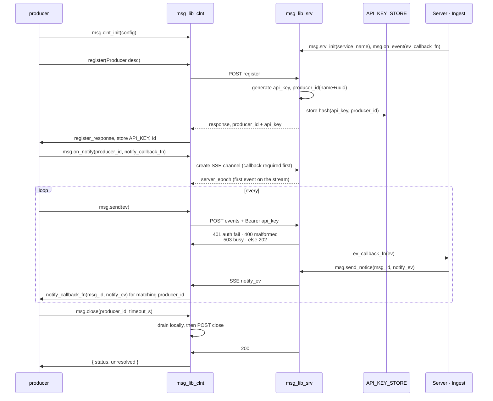
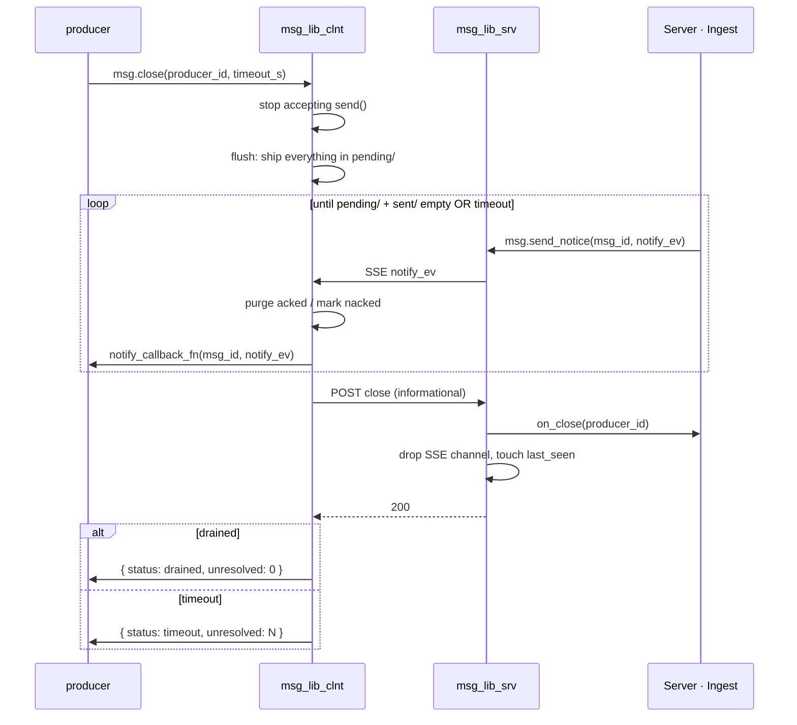

# Event Messaging Library (`src/common/msging`)

**Status:** Implemented in `src/common/msging` — see that module's
[`README.md`](../../src/common/msging/README.md) for the as-built API, config and known
limitations. This document stays authoritative for *behaviour*; where the two disagree, the
code is what needs fixing.
**Scope:** The shared transport library between the collector (producer side) and the
ingest service (server side). It owns reliable at-least-once delivery of event envelopes
(system architecture §5) and the producer registration/auth handshake (§7.1, §18.1).
It does **not** own event semantics: payloads are opaque to this library.

---

## 1. Introduction

One small library, imported by both ends of the wire:

<!-- AI_NOTE: This section has a lot of incorrect assuption that was not part of the design conversation, I have corrected
     your design in this section. -->

A client (typically a producer) sends msgs with an opaque payload to a server (consumer)
process, using the msg library. This is a small library used by both clients and servers.

  - Built on top of HTTP(S) REST
  - Supports at-least-once delivery semantics
  - SSE (Server-Sent Events) is used to send notifications from server to client
  - Multiple servers can coexist on a single endpoint, each uniquely identified by name
  - Handles retries on error
  - Contents are gzipped
  - **One msg = one POST.** The producer decides batching, not this library — today one
    session file per msg. A `batch_mode` may follow later (§9.3)
  - **No ordering guarantee on the wire.** Many msgs may be in flight; a retried msg can
    land after a later one. Any ordering the app needs lives in the payload


The binding is always between a client process (identified by `producer_id`) and the server.
A server is identified by a name string which is unique. The transport is HTTPS.
The whole thing must be implemented as a library that can then be used by any process acting
as either producer or server.

A server can receive msgs from multiple clients, each identified by `producer_id`.
A client can send msgs to multiple servers.
Event send is async, fire-and-forget. The server process must send a notification over the
SSE channel as an explicit ACK or NACK with a clear error message.

The at-least-once paradigm requires the client-side msg library to keep msgs in durable
storage. That design is covered in a later section.


A simple flowchart shows the basic concept. For clarity the msg lib is shown on both sides,
acting on behalf of the producer and on behalf of the consumer.


Close is client-driven and is detailed in §2.4.

## 2. Msg Lifecycle

Every msg must be saved in durable storage (filesystem) by the client side before sending,
so that it survives a restart and guarantees the at-least-once promise.

But before that, let's talk about the msg lifecycle.

### 2.1 Lifecycle (States)

Msg lifecycle as a state machine.

```
PENDING  → written to durable store, not yet sent (or queued for resend)
SENT     → POST succeeded, awaiting outcome, still durable
ACKED    → outcome known good, purged
NACKED   → outcome known bad, reason attached. Producer resolves by purging or retrying.
```

`SENT → PENDING` is also legal, driven by the cleaner loop (§4.4):

- `sent_timeout_s` elapsed, no outcome
- SSE reconnect with a changed `server_epoch` (§4.3)

Without it, a msg whose outcome dies in transit sits in `sent/` forever — nothing resends
it, because it looks handled.

### 2.2 Steady State Flow

`msg_id` is the durable correlation key: an integer, monotonic per producer, assigned by
the library. `event_id` is a separate, optional key supplied by the client app.

1. **msg.send(msg)**
    1. `msg_lib.send(payload)` → write `PENDING` to durable store.
    2. POST to server with `msg_id`.
    3. On `202 Accepted`, transition record → `SENT`.
    4. Return control to producer.

    - Synchronous to a definitive answer (`202` `200` `401` `400`) or timeout.
    - Not synchronous on the outcome — ACK/NACK arrives over SSE.
    - Exactly one POST attempt. No inline retry; cleaner loop (§4.4) owns retry/backoff.
    - Timeout or unreachable → record stays `PENDING`, returns normally. Durably stored,
      so the promise already holds.
    - Bounds `send()` latency at one `req_timeout_s`. Retry policy lives in one place.
    - Returns `err_code` + free-form `reason` (§8).

2. **ACK path**
    1. SSE delivers `ack {msg_id}`.
    2. Purge durable record for `msg_id`.
    3. Fire `notify_callback_fn(msg_id, notify_ev)` — **only if `notify_on_ack`** (§6.1).
       Off by default: the record is already purged and the app has no decision to make.

    Purge happens before the callback.

3. **NACK path**
    1. SSE delivers `nack {msg_id, reason}`.
    2. Mark durable record `NACKED`, persist `reason`.
    3. Fire `notify_callback_fn(msg_id, notify_ev)`. Always — this is the default.
    4. App calls `msg.resolve(producer_id, msg_id, action)`:
      - `PURGE` → delete durable record. Terminal.
      - `RETAIN` → back to `PENDING`, durably, then resend. **Default.**
    5. No `resolve()` call → RETAIN. The record stays `NACKED` and §2.3 folds it into
      `PENDING` on restart.
    6. Handled only once that state-write is confirmed on disk.

RETAIN is always safe. A resend landing on a `msg_id` the server already has hits its dedup
constraint and comes back as an ACK, purging on the next round-trip. Still the app's call.

### 2.3 Restart Reconciliation

On startup, scan the durable store:

| State found | Meaning | Action |
|---|---|---|
| `PENDING` | never sent, or resend queued | send/resend |
| `SENT` | in flight when process died, outcome unknown | resend (server dedupes if already done) |
| `ACKED` | crashed after ack, before purge completed | purge; fire callback only if `notify_on_ack` |
| `NACKED` | crashed mid-decision (before app's PURGE/RETAIN write committed) | treat as `PENDING`, resend |

No ambiguity remains in `NACKED`: since it's never a resting state in normal
operation, finding one at startup only ever means "the decision didn't
finish committing" — always safe to fold into `PENDING`.

Restart reconciliation is the same sweep the cleaner loop (§4.4) performs continuously;
startup is just its first pass.

### 2.4 Close

**The client drains, not the server.** The server holds no durable state — no `pending_set`,
no `last_id` fence — so it cannot know what is outstanding. The client does: the outstanding
set *is* `pending/` + `sent/`.

```
msg.close(producer_id, timeout_s):
  1. stop accepting send()            -> ProducerClosingError
  2. flush: ship everything in pending/
  3. wait until pending/ and sent/ are empty, or timeout
  4. POST close                       -> informational only
  5. return { status: drained | timeout, unresolved: N }
```



Consequences:

- No fence, no `last_id`. Nothing to fence.
- Server `/close` is a courtesy: drop the SSE channel, touch `last_seen`, `200`. Optionally
  invoke the app hook `on_close(producer_id)` so the app can finalize.
- Unresolved msgs at timeout stay durable. Next start, §2.3 resends `SENT` immediately —
  no waiting on `sent_timeout_s`.

## 3. Durable Msg Store

Msgs and their states are stored durably in files.

Each msg must have a unique `msg_id` per producer, and it must not collide after restarts.
That means the `msg_id` must also be kept in a durable file store.

Core idea is to keep the msg metadata and payload together in one single file.
The folder dictates the state of the msg.
Rename is an atomic operation, which guarantees an atomic state transition.

Here is a rough sketch:
```
<base>/<server_alias>/<producer_id>/
  identity.json     # { producer_id, api_key, server_alias,           0600
                    #   base_path, service_name, registered_at }
  msg_id.json       # { next_msg_id: 1149 }      high-water mark, see §3.1
  pending/
  sent/
  nacked/
```

`server_alias` = one binding: endpoint + `service_name` (§5.1).

- two aliases → two bindings: separate `producer_id`, api_key, directory, SSE channel
- a client may use both at once
- startup scans `<base>/*/*/identity.json` → rebuilds `producer_id → server`
- hence `send()`, `close()`, `flush()`, `set_info()`, `on_notify()` take only `producer_id`

**Stale binding** — stored `base_path` ≠ configured `base_path`:

- log loudly, leave the old directory for inspection
- register fresh under the new endpoint (new `producer_id`)
- never silent: the orphan may hold undelivered msgs

There is no received-side cursor. Nothing reads one:

- server holds no durable state → no replay to request → no cursor to send
- the unresolved set **is** `pending/` + `sent/` + `nacked/`
- an ACKed msg is purged, so "progress" is just what is left on disk

A highest-resolved counter may be added later purely as a telemetry metric — advisory,
never fsynced, never read for correctness.


Each msg is a JSON file like:

<!-- gen:schema msg_record -->
```json
{
  "msg_id":      42,
  "envelope":    {},                         // the whole §7 envelope, verbatim
  "created_at":  "2026-07-25T10:15:30Z",
  "sent_at":     "2026-07-25T10:15:30Z",     // null until the msg reaches SENT
  "attempts":    1,
  "nack_reason": null                        // set when the server NACKs it
}
```
<!-- /gen:schema -->

(Generated from `src/common/msging/schema/msg_record.json` by
`utils/gen_schema_blocks.py` — edit the schema file, not this block.)

The record stores the **whole envelope**, not just the payload. A resend after restart
rebuilds the request verbatim — `event_id`, `dedup`, `info` and `service_name` are all
needed and none can be recomputed.

### 3.1 msg_id (durability requirement)

`msg_id` is an integer, monotonic per producer, allocated by the lib at registration time.
Gaps are fine. The initial value may be random rather than fixed, so a producer that loses
its store while `identity.json` survives does not replay `msg_id`s the server already saw.

Fsync per send is too much. **Reserve blocks instead:**

```
startup / block exhausted:
  next_msg_id += msg_id_block      # default 1000
  write + fsync msg_id.json        # 1 fsync per block, not per msg
  hand out ids from memory

crash:       persisted value is already past everything used -> no reuse, only gaps
clean close: write back the true next id so the block is not burned
```

This is only safe because gaps are fine. Cost: 1 fsync per `msg_id_block` msgs; up to
`msg_id_block` ids burned per crash.

The msg file's own fsync stays — it **is** the at-least-once promise:

```
write tmp -> fsync tmp -> rename into pending/ -> fsync dir
```

- directory fsync is required, or the rename itself is not durable
- two fsyncs per msg, unavoidable without batching — and batching is the producer's call (§1)

Rejected:

- **Derive the counter by scanning the store for max msg_id** — breaks once everything is
  ACKed and purged: the directory empties, the counter restarts low, and server-side dedup
  falsely rejects new msgs.
- **Wall-clock / snowflake ids** — no counter file, but a laptop's clock steps backward on
  suspend/resume and NTP correction. Collision risk for no real gain.

## 4. Notification Channel (SSE)

Outcomes travel server → client over a long-lived SSE stream, separate from the POST that
delivered the msg. `PATH = talium/{service_name}/v1/notify`.

### 4.1 Opening the channel

`msg.on_notify()` must be registered **before** the channel opens. The lib raises otherwise.

Why: on restart `sent/` holds records from the previous run, and the server may push their
outcomes the instant the stream opens. A missing callback would drop them silently.

### 4.2 Keepalive

- Server: SSE comment `: hb` every `heartbeat_s`. Ignored by conformant parsers.
- Client: idle-read timer = `idle_heartbeats` × the server's `heartbeat_s`. No bytes at
  all — data or heartbeat — → link dead → reconnect with jittered backoff.
- The client configures the **multiple, not the timer**. The constraint is a relationship
  between two configs owned by two sides; as an absolute it cannot be right for two servers
  at once, and raising a server's `heartbeat_s` would silently put every producer into a
  permanent teardown/rebuild cycle. `/register` already returns `heartbeat_s` (§6.1), so
  the timer is derived and drift is impossible rather than merely detectable.
- How many heartbeats to tolerate is the operator's call. There is no "these look
  mismatched" warning: with the multiple configured there is no second number to disagree
  with it, and `heartbeat_s` moves only by a server config edit plus a restart, which the
  next `/register` picks up.
- `idle_timeout_s` is the fallback for the one case with nothing to derive from: a stored
  identity written before `heartbeat_s` was recorded, or a server that does not report it.

- primary purpose is client-side death detection: a half-open TCP connection (NAT timeout,
  pulled cable) is otherwise indistinguishable from a server with nothing to say
- keeping proxies from idling out (30–60s) is secondary

### 4.3 Server restart — `server_epoch`

`srv_init()` generates a boot id, sent as the first event on every stream.

- Epoch differs from last seen → server restarted
- → sweep all of `sent/` back to `pending/`
- → normal send path resumes. No special resend machinery
- Redundant resends are safe: the app is idempotent (§9.1)

Why it is needed:

- server holds no durable state — no record that an answer was owed
- a msg accepted (`202`) whose `ev_callback_fn` had not finished when the server died gets
  no outcome, ever
- the client would sit in `SENT` forever

**Thundering herd** — every producer reconnects, re-epochs and resends at once, into a
server that booted seconds ago:

- jitter the reconnect backoff → spreads the connection storm
- cap resends at `max_in_flight` (§5.1) → spreads the msg storm

### 4.4 Cleaner loop

Background sweeper, single thread. Owns what `send()` deliberately does not.

```
every sweep_interval_s:
  epoch changed -> sweep all of sent/ -> pending/   (first, short-circuits the pass)
  PENDING  -> send, while in_flight < max_in_flight
  SENT     -> PENDING   if older than sent_timeout_s
  ACKED    -> purge     (crash remnants)
  NACKED   -> leave     (unresolved = RETAIN, §2.2)
  pending count > max_pending -> alarm
```

- serial. `max_in_flight` is already the concurrency gate
- per-msg attempt counter, exponential backoff with jitter, capped
- `server_busy` honors `Retry-After` instead of the backoff curve
- **never gives up.** `retry_num` bounds one cycle, not the msg. Retrying forever with
  capped backoff is what keeps at-least-once true; `max_pending` is what bounds disk

Coverage split:

- `server_epoch` → server restart only
- `sent_timeout_s` → everything else: app crash mid-callback, dropped notification, an app
  that never calls `send_notice`

## 5. Config

The infra is built over FastAPI REST functionality.
Every server has a configured name that becomes part of the path.

Server will be listening on all interfaces.

PATH = talium/{service_name}/v1/register --> Register
PATH = talium/{service_name}/v1/event    --> Msg events are sent/received
PATH = talium/{service_name}/v1/notify   --> SSE notification stream (§4)
PATH = talium/{service_name}/v1/close

There might be more endpoints like this as necessary, but the core idea stays.

### 5.1 Client Config

Defaults in YAML, overridable by `msg.clnt_init()`. Every timeout is configurable — no
hardcoded waits.

```yaml
client:
  default_server: ${TALIUM_SERVER:-ingest_prod}   # used when register() omits the alias
  servers:
    ingest_prod:
      base_path:    "https://ingest.prod:8443"
      service_name: ingest                        # defaults to the alias
    ingest_dev:
      base_path:    "https://ingest.dev:8443"
      service_name: ingest
      enabled:      false                         # declared but off
      req_timeout_s: 30                           # per-server override
  defaults:                  # applied to every server unless overridden above
    req_timeout_s:   10      # per-POST deadline; expiry -> stored_timeout, stays PENDING
    retry_num:       3       # cleaner-loop retries only, never inline in send()
    max_pending:     10000   # slot limit: msgs allowed in the durable store
    slot_wait_s:     1.0     # send() waits this long for a slot, then fails slot_full
    max_in_flight:   64      # cap on SENT awaiting an outcome
    sent_timeout_s:  300     # SENT older than this -> demoted to PENDING
    close_timeout_s: 30      # close() drain deadline before returning status=timeout
    msg_id_block:    1000    # ids reserved per fsync of msg_id.json (§3.1)
    idle_heartbeats:  5      # idle-read timer = this x the server's heartbeat_s (§4.2)
    idle_timeout_s:  45      # fallback only, when the server reports no heartbeat_s
    sweep_interval_s: 5      # cleaner loop period (§4.4)
    gzip_min_bytes:  1024    # below this, gzip costs more than it saves
    base_dir: "~/.talium/msging"   # durable store root: <base_dir>/<alias>/<producer_id>/ (§3)
```

`base_dir` was missing from this block until the implementation needed a root for §3's store;
it is listed here so the key set above is the complete one the loader accepts.

- switching environments is a config or env-var change, never a code change
- two aliases keep both identities and both backlogs intact across a switch
- one alias with a swapped `base_path` invalidates the stored api_key every switch
  (§3, stale binding)

`max_pending` and `max_in_flight` are different limits with different jobs.

`max_in_flight` — bounds `SENT`. Protects the server; throttles the thundering herd (§4.3).

- increment on send
- decrement on any terminal notification, **and** on `SENT → PENDING` demotion — else the
  window leaks slots permanently after a restart
- full window never fails a send → stored, returns `stored_throttled`, ships when a slot frees

`max_pending` — bounds the durable store. Protects local disk during an outage.

- server unreachable → nothing in flight → the window constrains nothing, `pending/` grows
- the **only** condition that rejects a `send()`: after `slot_wait_s`, returns `slot_full`,
  msg **not** stored
- caller must back off or drop

The window throttles. The slot cap says stop.

### 5.2 Server Config

```yaml
# config/msging.yaml — server side (config rule 8: defaults in code → YAML → env vars)
server:
  queue_max:      10000      # queued-and-not-yet-picked-up cap; full -> 503 server_busy
  workers:        4          # concurrent handler tasks; in-flight msgs sit outside queue_max
  retry_after_s:  5          # Retry-After sent with a 503
  heartbeat_s:    15         # SSE keepalive interval (§4.2)
  max_msg_bytes:  33554432   # 32 MiB; larger -> 413 too_large
  max_notice_bytes: 32768    # one notify_ev; must stay under the client's 64 KiB
                             # frame cap or an oversized info bag wedges the link
  notify_buffer:  100        # per-producer notifications held while SSE is down
  notify_ttl_s:   60         # buffered notification expiry
  auth_cache_max: 1024       # successful verify() results held in process (§10.3).
                             # LRU + expiry sweep; the worst case is this x descriptor
                             # size, not "however many keys were ever presented".
                             # 0 = no cache, every verify() hits the store
  shutdown_drain_s: 5        # how long srv_shutdown() lets a live /notify stream flush
                             # its ring before the streams are ended (§6.2 step 3).
                             # 0 = end at once, forfeiting what was buffered (§4.4 recovers)
  shutdown_signals: true     # chain srv_shutdown() onto the host's SIGINT/SIGTERM.
                             # false when the host drives shutdown itself (§6.3)
  registration:
    mode: open               # open | enrollment_key  (§10.1)
    key:  ${TALIUM_ENROLL_KEY}   # required when mode=enrollment_key
    max_producers: 1000      # store rows this server will ever issue; 0 = unlimited (§10.1)
    rate_per_min:  60        # /register attempts per source per minute; 0 = unlimited

producer_store:
  backend: file                # file | postgres  (s3, ... = future adapter + stanza)
  file:
    path: ${TALIUM_DATA_DIR}/producers.json
  postgres: {}
    # no DSN/pool settings here — the postgres backend reuses the storage
    # module's process-wide engine (config/storage.yaml, TALIUM_DB_DSN);
    # this stanza is a placeholder for adapter-specific overrides only
```

**Directive — the store is an extension point.** Many integrations will follow.

- file = default, postgres = option
- new backend = new adapter class + config stanza. Never edit the server
- selection is config, never code
- postgres branch lazy-imports its adapter — the client imports this same package and must
  not need SQLAlchemy/psycopg


## 6. API

### 6.1 Client API

1. `msg.clnt_init(config)`: Initializes global config; overrides YAML defaults (§5.1)
2. Callback registration:

    1. `msg.on_notify(producer_id, notify_callback_fn, notify_on_ack=False)`: Passes
       `notify_ev` (§8.2). **Required before the SSE channel opens** (§4.1).
       Default fires on anything not `ack`. `notify_on_ack=True` for producers that gate on
       confirmed delivery, e.g. marking a source file done. Not a YAML knob — config could
       silently break such a producer
3. `msg.register(producer_description, server_alias=None)` -> Producer object
   `{ producer_id, api_key, max_msg_bytes, ... }`. `None` → `client.default_server`. Raises
   `ConfigError` if the alias is unset, unknown, or disabled. One `register()` per binding.
   The response carries the server's limits so client and server configs cannot drift
4. `msg.set_info(producer_id, info)`: Sets the producer-level `info` dict. Replaces it
   wholesale, may be called at any time, and affects subsequent sends only
5. `msg.send(producer_id, event, info=None)`: Send msg. Returns `err_code` + `reason` (§8).
   Per-msg `info` is **shallow-merged** over the producer-level dict, per-msg keys winning.
   Defaults to `None`
6. `msg.resolve(producer_id, msg_id, action=RETAIN)`: Resolves a NACKed msg.
   `PURGE` → delete, terminal. `RETAIN` → back to `PENDING`, resend. Default `RETAIN` (§2.2)
7. `msg.close(producer_id, timeout_s=None)`: Client-driven drain (§2.4). Returns
   `{ status: drained | timeout, unresolved: N }`. Defaults to `close_timeout_s`
8. `msg.flush(producer_id)`: Starts immediate flushing of all PENDING msgs
9. `msg.poll_notify(producer_id)`: Drains queued notifications instead of receiving them on
   the SSE thread (§6.4). For apps that own their threading


### 6.2 Server API

1. `msg.srv_init(service_name)`: Registers one service, returns its `APIRouter` mounted at
   `talium/{service_name}/v1/*`. The host includes it
2. `msg.srv_start()` / `msg.srv_shutdown()` / `msg.srv_stop()`: Boot, begin shutdown, drain.
   The shared machinery — worker pool, SSE registry — once per process. `srv_start()`
   generates the `server_epoch` (§4.3)

    `srv_shutdown()` is sync, idempotent, and safe from a signal handler and from any thread.
    It returns at once; the drain it starts runs on the event loop, in this order:

    ```
    1. stop accepting     /register, /event, /notify -> 503 server_busy + Retry-After (§8.1).
                          /close still answers — the client has already drained (§2.4)
    2. drain the pool     in-flight msgs finish, their outcomes reach the rings
    3. flush              up to server.shutdown_drain_s for live streams to empty those
                          rings, so a connected producer receives the outcomes instead of
                          waiting out sent_timeout_s (§4.4)
    4. close every stream connections drain -> ASGI runs lifespan shutdown -> srv_stop()
    ```

    - **This is what makes an ASGI shutdown possible at all.** `srv_stop()` runs from the
      lifespan, and ASGI runs lifespan *shutdown* only after connections drain — but
      `/notify` is endless by design (§4.1), so it never drains, so `srv_stop()` never runs.
      A server with one producer connected could not be stopped: with uvicorn's default
      `timeout_graceful_shutdown` (`None` = wait forever), which is what §6.3's recipe
      produces, SIGTERM and SIGINT both hung until the deploy's SIGKILL — `srv_stop()` never
      ran, the pool never drained, `on_close` never fired, and the whole in-memory queue died
      with the process. The streams have to end *before* the drain, which means from the
      signal rather than from the lifespan
    - **wired automatically:** `srv_start()` chains it onto whatever SIGINT/SIGTERM handler
      is already installed (uvicorn's, normally) and `srv_stop()` restores it. Chained, never
      replaced — uvicorn still sets `should_exit`, a host's own handler still runs. Only over
      a *callable* handler: with `SIG_DFL` there is no graceful shutdown to deadlock, and
      installing there would replace "terminate" with "trip a flag and keep running"
    - **a host that owns its signals** sets `server.shutdown_signals: false`, calls
      `srv_shutdown()` from its own handler, and lets its lifespan call `srv_stop()` as usual
    - a second `srv_shutdown()` joins the drain in flight rather than starting a second one
      over the same machinery. A no-op before `srv_start()` and after `srv_stop()`
    - `srv_stop()` joins a drain still in flight, then finishes the stop. `server_epoch`
      survives a `srv_stop()`/`srv_start()` cycle — a new one would tell every client the
      *server* restarted and make each sweep `sent/` back to `pending/` (§4.3)
3. `msg.on_event(ev_callback_fn)`: Registers the app handler. **Async by design:**

    ```
    POST -> enqueue -> 202          # request handler returns immediately
    worker -> ev_callback_fn(msg)   # app processes later
    ```

    - app never runs inside the request handler. Inline would make the outcome known at
      POST time, leaving SSE nothing to carry
    - queue is in memory, can be lost. Covered by `server_epoch` on reconnect (fast) or
      `sent_timeout_s` (backstop, §4.4)
    - capped at `queue_max` (§5.2). Full → `503` + `server_busy` + `Retry-After`. Never grows
    - `queue_max` counts what is *queued*. A msg a worker has picked up is in flight and no
      longer queued, so accepted-but-unprocessed peaks at `queue_max + workers`. Immaterial
      at the default ratio; it matters if you set `queue_max` small
4. `msg.on_close(close_callback_fn)`: Optional. Fired when a producer closes, so the app
   can finalize (§2.4)
5. `msg.send_notice(producer_id, msg_id, code, reason=None, info=None)`: Sends the
   notification over the SSE channel (§8.2). SSE down → held in a per-producer ring
   (`notify_buffer`, `notify_ttl_s`), delivered on reconnect. Overflow or expiry drops;
   the client's `sent_timeout_s` resends
6. `msg.make_app(*service_names)`: Convenience. Returns a preconfigured app with lifespan
   wired. Sugar over the primitive, not a second path

### 6.3 ASGI wiring

The lib returns a router. The host owns the app.

```python
@asynccontextmanager
async def lifespan(app):
    await msg.srv_start()                        # also chains srv_shutdown() onto
    try:                                         #   SIGINT/SIGTERM (§6.2)
        yield
    finally:
        await msg.srv_stop()                     # finally: a failed startup must
                                                 #   still drain the pool it booted

app = FastAPI(lifespan=lifespan)
app.include_router(msg.srv_init("ingest"))       # talium/ingest/v1/*
app.get("/healthz")(healthz)                     # host's own routes

uvicorn.run(app, host="0.0.0.0", port=8001)      # uvicorn's defaults are fine
```

**This recipe used to produce a server that could not be stopped.** The `yield`/`await` pair
above was a bare `yield` followed by `srv_stop()` and nothing chained onto the signals — and
with an endless `/notify` stream open, ASGI never reached lifespan shutdown, so `srv_stop()`
never ran and the process had to be SIGKILLed. `srv_start()` now installs the signal chain
that ends those streams first, so the wiring above terminates on SIGINT/SIGTERM under
uvicorn's own defaults. Measured with one producer on `/notify`: SIGTERM 0.14 s, SIGINT
0.26 s, both reaching `srv_stopped`.

- host keeps middleware, auth, CORS, lifespan, metrics, docs. Lib never owns the process
- `make_app("ingest")` collapses the above for a dedicated process
- **`timeout_graceful_shutdown` is not required and is not the fix.** Setting it makes uvicorn
  *cancel* the streams after N seconds — the msgs in flight are lost and the cancellation is
  logged as an error. `srv_shutdown()` ends them in order instead, and reaches `srv_stopped`.
  A host may still set one as an outer bound on anything else it serves
- a host that installs its own SIGINT/SIGTERM handler sets `server.shutdown_signals: false`
  and calls `msg.srv_shutdown()` from it — see §6.2
- **convention: one server per process.** Not enforced — a second service is
  `include_router` twice, and already works
- `server_epoch` is per process, not per service. Services in one process die together

Deployment is unaffected by the choice. Two processes behind a reverse proxy route by path
prefix with no rewriting:

```
talium/ingest/v1/*          -> :8001
talium/github_worker/v1/*   -> :8002
```

### 6.4 Concurrency

Client = threads. Server = asyncio (FastAPI).

```
send()        producer's thread, blocking, returns at 202/timeout
SSE reader    lib thread, streams /notify, fires notify_callback_fn
cleaner loop  lib thread, periodic sweeps (§4.4)
```

- threads on the client → producers are **not** forced async
- delivery semantics identical under either model: `send()` never waits for the ACK
- `notify_callback_fn` runs on the SSE thread. Thread-safe and quick — a slow callback
  stalls every notification behind it
- `poll_notify()` drains a queue instead, for apps that own their threading
- the two halves share only the wire format and the models


## 7. Msg Shape, JSON

Each msg has:

 - Envelope aka header — this is what the msg infra deals with
 - payload: opaque
 - info: free-form dict for labels, debug, and instrumentation. Opaque to the library

<!-- gen:schema envelope -->
```json
{
  "schema_version": "1.0",                   // major.minor; unenforced in v1 (§10.2)
  "event_id":       "sess-2026-07-25-abc",   // optional, app-supplied
  "dedup":          false,                   // true requires event_id
  "producer_id":    "prodA",
  "msg_id":         42,                      // the transport's key, per producer
  "service_name":   "ingest",
  "created_at":     "2026-07-25T10:15:30Z",
  "producer_desc":  "optional desc",
  "info":           {},                      // free-form; opaque to the library
  "payload":        {}                       // opaque to the library
}
```
<!-- /gen:schema -->

(Generated from `src/common/msging/schema/envelope.json` by
`utils/gen_schema_blocks.py` — edit the schema file, not this block.)

`msg_id` is the transport's own key: an integer, monotonic per producer, assigned by the
library. Together with `producer_id` it uniquely identifies a msg. `event_id` is optional,
supplied by the client app to facilitate dedup of already-processed msgs. `producer_desc`
is an optional human-meaningful description carried for ease of troubleshooting.

`dedup: true` requires an `event_id`; without one it raises at `send()` (§8.3). Lib-side
dedup is not in v1 — the flag is reserved for §9.1.

`info` — one free-form bag, deliberately not two. Never interpreted by the lib; handed to
the server app as-is.

- producer-level dict from `set_info()`
- shallow-merged with per-msg `info` from `send()`, per-msg keys winning
- shallow by design — deep merge is where this gets surprising

## 8. Error Codes and Status

**One enum, used everywhere** — `send()` return code, `code` in a `200`/`202` body, NACK
code over SSE. This is the API contract.

Every return carries `err_code` + `reason`. `reason` is free-form and human-only. Code
must never branch on it.

### 8.1 Runtime codes returned by `send()`

```
err_code             trigger                         msg state        caller action
-----------------------------------------------------------------------------------------
ok                   202                             SENT             await SSE outcome
already_processed    200                             purged inline    none, terminal
stored_timeout       no response in req_timeout_s    PENDING          none, loop retries
stored_unreachable   conn refused / DNS / TLS        PENDING          none, loop retries
stored_throttled     max_in_flight reached           PENDING          none, ships on free slot
server_busy          503, server queue full          PENDING          none, loop retries
                     or the server is shutting down                   after Retry-After
slot_full            max_pending after slot_wait_s   NOT stored       back off or drop
too_large            over max_msg_bytes              NOT stored       split at the producer
unauthorized         401                             PENDING, halted  re-register
rejected             400 malformed envelope          NACKED           fix + resend, or purge
```

- `already_processed` is **reserved for §9.1**. v1 never emits it.
- three `stored_*` codes, not one — same state, three causes. All informational, promise holds
- `slot_full` and `too_large` are the only outright rejections
- **`server_busy` is the whole capacity vocabulary, and it is deliberately only one word.** A
  full queue, a draining server (§6.2) and §10.1's registration caps all answer `503` +
  `server_busy` + `Retry-After`: in every case the caller presented nothing wrong and the
  server has no room, so the client keeps the msg PENDING and comes back. A rolling restart
  wants exactly that. `/register` uses the same code for the same reason — a refusal for
  capacity is not `RegistrationError`, which stays terminal for the things that really are
  (a bad enrollment key)
- `too_large` is checked **client-side before storing**, against the `max_msg_bytes` returned
  at `register()`. Otherwise an oversized msg lands in `pending/` and is retried forever
  against a server that will never take it. The server's `413` backstops a stale limit

### 8.2 notify_ev — the SSE notification

<!-- gen:schema notify_ev -->
```json
{
  "msg_id":      42,                         // correlates to the sent msg
  "producer_id": "prodA",
  "event_id":    "sess-2026-07-25-abc",      // echoed if the msg carried one
  "code":        "ack",                      // ack | nack | extensible
  "reason":      "",                         // free-form, server-populated
  "info":        {},                         // optional app bag
  "ts":          "2026-07-25T10:15:31Z"      // outcome timestamp
}
```
<!-- /gen:schema -->

(Generated from `src/common/msging/schema/notify_ev.json` by
`utils/gen_schema_blocks.py` — edit the schema file, not this block.)

- `code` is the only outcome field. A new code must state whether the client purges or
  retains.
- `reason` is server-populated, free-form, human only.
- `info` carries whatever the app returns — a row id, a computed session id.

```
msg.send_notice(producer_id, msg_id, code, reason=None, info=None)
```

### 8.3 Conditions that raise instead of returning

Return codes are for runtime conditions. Programming errors raise.

```
NotRegisteredError     send() before register()
NoCallbackError        SSE connect without on_notify()   (§4.1)
InvalidEnvelopeError   dedup: true with no event_id
ProducerClosingError   send() after close(), draining
```

## 9. Design Notes (not yet designed)

Ideas captured for later. None of these are committed; they exist so the v1 design does
not accidentally foreclose them.

### 9.1 Optional lib-side dedup cache

**Baseline (v1):** the lib never dedups. Every accepted POST reaches `ev_callback_fn`; the
app is idempotent, typically via a unique constraint on `event_id` or its own business key.
Server side holds no durable state.

**The idea:** `dedup: true` (requires `event_id`) lets a producer opt in, per msg, to the
msg layer doing that dedup. The app's ACK marks the `event_id` processed; a later msg with
the same `event_id` is answered by the lib directly, without waking the app.

Decided:

- **`200`, synchronous.** `202` = queued, outcome over SSE. A known-processed `event_id`
  needs no round trip — the answer is known at request time. `200` +
  `{code: "already_processed", msg_id, event_id}`, client purges inline. Chosen over the
  literally-named `208 Already Reported`: safe through proxies/gateways, no special-casing
  in any HTTP stack, and further synchronous outcomes can share `200`, differing by `code`.
- **In-memory, best-effort, never durable.** An effective filter; app business logic stays
  the arbiter. Durable would promise exactly-once and drag in retention/partitioning plus a
  server-side DB dependency — which is what keeps "many named servers in one process" cheap.

Still to settle:

- **TTL > client retry horizon** (`retry_num` × backoff + offline window), else the cache
  expires exactly the entries it exists to catch.
- **In-flight race.** The populating ACK is async. Between `202` and the app's ACK a
  concurrent duplicate can arrive and cannot honestly be called processed. Two states:
  `in_flight`, `processed`. Only ACK promotes. NACK must **not** — a NACKed msg was not
  processed. On an `in_flight` hit, fall through to the app.
- **Multiple replicas.** Behind a LB a per-process cache splits the hit rate. Shared cache
  is a further step; another reason the promise stays best-effort.

### 9.2 Chunked payloads (TBD)

v1 rejects anything over `max_msg_bytes` with `too_large`; splitting is the producer's
problem. A future version should chunk automatically.

- **all-or-nothing**, like S3 multipart. A partial msg is never delivered to the app
- chunk sequencing is **not** the session `seq` — that is session-file semantics, this is
  transport framing. Distinct concepts, distinct fields
- open: chunk id and reassembly keying, where partial chunks are held server-side without
  reintroducing durable server state, how `msg_id` maps to N chunks, whether an
  incomplete set expires or NACKs

### 9.3 Batch mode (TBD)

v1 is one msg per POST. Batching is the producer's decision — it packs whatever it wants
into one opaque payload, today one session file per msg.

- a later `batch_mode` may let the lib pack N msgs per POST
- the per-msg durable record and the per-msg outcome do not change; only the POST body does
- keeping batching out of v1 avoids burdening every use case with one use case's policy

## 10. Notes

Settled, thin on purpose. These are decisions, not deferrals — recorded here because each
needs more design before it grows.

### 10.1 Registration policy

```yaml
server:
  registration:
    mode: open                  # open | enrollment_key
    key:  ${TALIUM_ENROLL_KEY}  # required when mode=enrollment_key
    max_producers: 1000         # rows this server will ever issue; 0 = unlimited
    rate_per_min:  60           # /register attempts per source per minute; 0 = unlimited
```

- v1 default is `open`: anyone reaching `/register` gets a `producer_id` + api_key
- interim, knowingly. Acceptable inside a trusted network, not on a public endpoint

**`max_producers` / `rate_per_min` bound the count, not the caller.** `mode: open` means every
identity is a permanent store row that the auth path reads, and capping the *size* of one
descriptor bounds nothing on its own — the number of them was unbounded, so a loop of
anonymous POSTs grew `producers.json` without limit and every request, a rejected one
included, paid for the growth.

- neither is a security boundary — that is `enrollment_key`. They are the blast radius of a
  hostile caller, and equally of a buggy client in a retry loop
- over either cap → `503` + `server_busy` + `Retry-After` (§8.1), counted as
  `registrations_refused_total{reason}` (§10.5). Not a 4xx: the caller presented nothing
  wrong, the server has no room, and `server_busy` is the code that already says that
- **checked before the enrollment key.** A limit that only applied to callers who already knew
  the secret would bound nothing an anonymous loop does
- `rate_per_min` is a fixed window per source, keyed on the peer address and deliberately not
  on `X-Forwarded-For` — that header is caller-controlled, so trusting it would let the loop
  this bounds hand itself a fresh key per request. Behind a reverse proxy the key collapses to
  the proxy and the limit becomes global, which is still the right bound: the failure it stops
  is the same shape either way. The whole counter map is dropped at each window roll, so the
  cap cannot itself become the leak
- **1000 is sized against the `file` backend, not against fleet ambition.** At the 8 KiB
  descriptor cap that is an 8 MB `producers.json`, and every upsert and every `touch_last_seen`
  rewrites it whole. A deployment with more producers than this wants `backend: postgres` and
  a raised cap, **in that order** — raising it on the file backend just moves the cliff
- `enrollment_key`: pre-shared secret checked before issuing. Bad or missing → `401` →
  terminal `RegistrationError`, no retry loop — retrying a wrong secret never helps
- rotating the enrollment key stops new enrollment; already-issued api_keys are unaffected
- **final phase:** a signed app authorizes and presents an API key, the standard
  multi-service pattern. Not designed here
- out-of-band provisioning (admin issues keys, no `/register`) rejected — breaks the
  zero-setup laptop install goal (arch §19)

### 10.2 schema_version

- format `major.minor`, e.g. `"1.0"`. Present from day one
- **unenforced in v1** — not validated, never rejected. No `version_unsupported` code
- escape hatch: a major bump becomes a switch or a migration in code. Not thought through
- **receivers must ignore unknown keys.** That is what allows additive change without
  touching the version, and why it can sit unused for a long time

### 10.3 org_id / user_id

- app semantics. They ride in the **payload**, never in the envelope
- msging never reads them
- `ProducerRecord` still declares them, unused. Drop vs leave is issue #20 — dropping
  touches the storage schema and needs a migration

### 10.4 Logging

Structured JSON, per CLAUDE.md rule 1. Will evolve.

```
always     module, event, ts, level
client     producer_id, server_alias, msg_id, err_code, attempts
server     producer_id, msg_id, service_name, code, server_epoch
```

```
client   msg_stored       msg_id, size_bytes
         msg_sent         msg_id, err_code, latency_ms, attempts
         msg_resolved     msg_id, code, action
         sse_connected    server_alias, server_epoch, epoch_changed, downtime_s
         sse_lost         server_alias, reason, uptime_s, attempt
         epoch_sweep      server_alias, server_epoch  <- loud, means resends
         slot_full        pending_count            <- loud, backpressure hit
         cleaner_sweep    retried, demoted, purged (only when non-zero)

server   producer_registered  producer_id, mode
         auth_failed          key_prefix, code
         msg_accepted         producer_id, msg_id, queue_depth
         queue_full           queue_depth          <- loud, 503s going out
         notice_sent          producer_id, msg_id, code
         notice_dropped       producer_id, msg_id, reason   <- loud
         notice_oversized     producer_id, msg_id, size_bytes, max_bytes  <- loud
         registration_rate_limited  source, rate_per_min     <- loud (§10.1)
         registration_at_capacity   max_producers            <- loud (§10.1)
         srv_shutdown_begin         services, server_epoch   (§6.2)
         srv_shutdown_complete      services, server_epoch
         srv_shutdown_drain_timeout buffered, timeout_s      <- loud, outcomes forfeited
```

- the two registration lines carry **no key material** — nothing has been minted at that
  point, and §10.4's rule would forbid it if it had. `source` is the peer address the rate
  limiter keyed on
- the shutdown lines bracket §6.2's drain. `srv_shutdown_begin` without a matching
  `srv_stopped` is the signature of the deadlock `srv_shutdown()` exists to prevent

Normative:

- **never log an api_key.** `key_prefix` only — this is why the record stores prefix and
  hash separately
- **never log the payload.** Opaque, and real user data. `size_bytes` is what debugging needs

Three field lists were reconciled to the implementation rather than the other way:

- `downtime_s` rides on `sse_connected`, not `sse_lost`. When a link drops the outage has
  only just begun, so there is nothing to report; what *is* knowable then is how long the
  stream lived and which retry this is, hence `uptime_s`/`attempt`
- `epoch_sweep` names the `server_epoch` it saw, not a `swept` count. The reader detects
  the change; the `on_epoch` callee performs the sweep and is the only side that knows how
  many msgs moved — that number is its `epoch_swept_msgs_total` (§10.5)
- `notice_oversized` is new: `send_notice()` bounds one serialised `notify_ev` at
  `server.max_notice_bytes`, because the client's SSE parser caps one event at 64 KiB and
  a larger frame is not resynchronisable. Without the bound an app returning an oversized
  `info` bag drops that producer's link on *every* delivery attempt — a permanent reconnect
  loop escaped only by `sent_timeout_s`. `info` is shed and `reason` truncated; `code` and
  `event_id` are correlation keys and are never touched, so a notice still over budget is
  dropped as `notices_dropped_total{reason="too_large"}`

### 10.5 Metrics

- accumulated in process, read via `msg.metrics() -> dict` (counters + gauges, snapshot)
- **exposure is out of scope** — endpoint, scraper, CLI, file snapshot are all system-level
  decisions taken elsewhere. No `prometheus_client` dependency, no `/metrics` route here

```
client   msgs_stored_total · msgs_sent_total{err_code} · msgs_acked_total
         msgs_nacked_total · msgs_resolved_total{action}
         pending_count(g) · in_flight_count(g) · send_latency_ms(sum+count)
         sse_reconnects_total · epoch_sweeps_total · epoch_swept_msgs_total
         slot_full_total · cleaner_retries_total · cleaner_demotions_total

server   msgs_accepted_total · queue_depth(g) · queue_full_total
         notices_sent_total{code} · notices_dropped_total{reason}
         sse_connections(g) · auth_failures_total{code} · registrations_total
         registrations_refused_total{reason}
```

Label sets mirror the §8.1 codes — one vocabulary across logs, metrics, and return codes.

**This list is normative: a name the code emits and this list does not have is a defect in one
of the two.** `registrations_refused_total{reason}` was added here deliberately when §10.1's
caps landed. `reason` is `rate | capacity` — the two ways a registration is refused for
capacity rather than for policy. It is *not* folded into `registrations_total`: that counter
is "identities issued", and a refusal issues none. Nor into `auth_failures_total`, which is
§8.1's `unauthorized` and says the caller presented something wrong.
