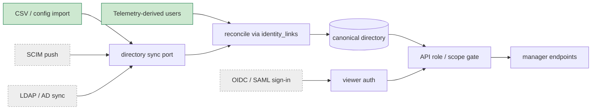
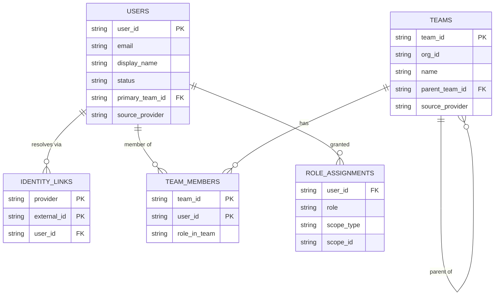

# Identity & Org-Directory Ingestion

**Date:** 2026-09-09 · **Author:** Lead Architect · **Status:** Design
**Feeds:** `docs/plan/2026-09-09-mvp-backend-implementation.md` Track G (and F2 role gate, F1 budgets).

---

## 1. In a nutshell

The manager dashboard is cross-user: every screen groups by team/person and gates by role. Today
there is no roster — `users` is populated as a side effect of telemetry (`upsert_user_account_uuid`),
and **no teams, roles, or hierarchy exist at all.** We need an authoritative directory, and the
customer will eventually require it come from *their* identity provider (Entra/Okta/LDAP), not ours.

**The design, in one line:** model the **directory**, not the source — one canonical schema the API
reads, fed through a single **sync port** whose providers are swappable adapters. Ship a CSV provider
now; slot SCIM/LDAP/SSO behind the same port later with no schema or API change.

Three load-bearing decisions:

1. **Canonical directory + provider port.** The API never knows whether a user came from CSV,
   telemetry, or an IdP. Providers are adapters that emit a common record into `sync()`.
2. **`identity_links(provider, external_id) → user_id` is the join spine.** A CSV-seeded user and a
   later IdP-provisioned user reconcile to **one** `user_id` instead of duplicating. This is the
   "carry the key from day one" discipline that avoids the rewrite.
3. **AuthN is separated from the directory and deferred.** The dashboard needs *authorization* (who is
   in which team, with which role) now; it does **not** need single-sign-on to function. SSO slots into
   F2's auth seam later. Conflating the two is the mistake that forces a rebuild.

Headline size: a 10,000-employee directory is **< 10 MB** and a full CSV import runs in **< 1 s** (§6)
— this is not a data-volume problem, it is a modeling problem. It fits the existing Postgres.



---

## 2. Terms

- **Directory** — the authoritative set of users, teams, memberships, and roles. The thing the API reads.
- **AuthN (authentication)** — proving *who the caller is* (password, SSO). Deferred here.
- **AuthZ (authorization)** — deciding *what the caller may see* (role + team/repo scope). Needed now.
- **Provider** — a source of directory data: `csv`, `github`, `telemetry`, later `scim`/`ldap`/`oidc`.
- **SCIM** — System for Cross-domain Identity Management; the standard REST protocol an IdP (Okta,
  Entra) uses to *push* user/group provisioning to an app.
- **Idempotent** — running the same import twice leaves the same state (no duplicates, no drift).
- **Reconcile** — map an incoming record to an existing `user_id` via a stable external key rather than
  creating a new row.

---

## 3. Architecture & data flow

Providers differ only in how they *acquire* records; all converge on one port and one schema.

```
acquire          normalize            reconcile              persist           read
─────────────────────────────────────────────────────────────────────────────────────
CSV row        → DirectoryRecord  → match identity_links  → upsert users   → F2 gate
SCIM event       (common shape)     (provider,external_id)  teams             (role+scope)
LDAP entry                          → existing user_id       team_members    → Track A
telemetry user                        or new                 role_assignments  aggregation
```

- **One port:** `directory.sync(records: list[DirectoryRecord]) -> SyncResult`. Providers are adapters
  in front of it (mirrors the collector's adapter/normalizer split). `sync()` is the only writer of the
  directory tables.
- **Reconcile before insert.** Every record carries one or more external keys; `sync()` resolves them
  against `identity_links` and upserts the matched `user_id`, else creates one and links it. A
  telemetry-derived stub (github login / account_uuid only) is **enriched**, never duplicated, when the
  CSV later names the same person.
- **Provider precedence** decides who wins a field when sources disagree: `authoritative IdP > csv >
  telemetry`. Stored per row as `source_provider` so a later IdP sync can own a field a CSV only
  bootstrapped, and a CSV re-import cannot clobber an IdP-owned value.
- **Hierarchy** is an adjacency (`teams.parent_team_id`); roll-ups walk `descendants(team_id)`.

### 3.1 Data model



### 3.2 Contracts

The `DirectoryRecord` — the only thing a provider produces, and the sole input to `sync()`:

```jsonc
{
  "external_keys": [                 // >= 1; the reconcile spine. provider+id unique.
    {"provider": "csv",    "external_id": "anil@acme.com"},
    {"provider": "github", "external_id": "anilk"}          // | absent
  ],
  "email": "anil@acme.com",          // string | null
  "display_name": "Anil K",          // string | null
  "status": "active",                // "active" | "disabled"
  "teams": [                         // membership; [] = no team (rolls into "unassigned")
    {"team_id": "platform", "role_in_team": "lead"}         // role_in_team: string | null
  ],
  "roles": [                         // app authz grants; [] = default "dev"
    {"role": "lead", "scope_type": "team", "scope_id": "platform"}
    // role ∈ dev|lead|admin ; scope_type ∈ org|team|repo ; scope_id references a team/repo
  ],
  "source_provider": "csv"           // who asserted this record; sets precedence
}
```

Teams are declared in their own records (or the same import), carrying `parent_team_id` for hierarchy:

```jsonc
{"team_id": "platform", "org_id": "acme", "name": "Platform",
 "parent_team_id": null, "source_provider": "csv"}   // parent_team_id: string | null (root = null)
```

**Evolution rules:** additive-only fields; `sync()` must ignore unknown keys (a newer provider may send
more); `external_keys` is append-only per user (never rewrite a link, only add). A record with zero
resolvable `external_keys` is rejected, not guessed.

### 3.3 CSV provider (v1)

`cli_directory_import.py` reads three CSVs (or one workbook), maps each row to a `DirectoryRecord`,
and calls `sync()` with `--dry-run` diff by default:

```
users.csv     email, display_name, github_login, status
teams.csv     team_id, name, parent_team_id
members.csv   email, team_id, role_in_team, role            # role = org-level grant, optional
```

### 3.4 User ↔ repo contribution (derived, **not** provider-sourced)

The repos/projects a user contributes to are a user attribute, but they come from **activity, not the
directory** — so no provider supplies them and no CSV column carries them. They are **derived from two
sources already in hand** and materialized on the user row:

- **Telemetry** — `session_info(user_id, repo_id)`: repos the user ran sessions in.
- **Live GitHub** — `git_artifacts(author user_id, repo_id)`: repos the user authored PRs/commits in.

The two sets differ (a user may author PRs in a repo they never ran a session in, or vice versa), so
each entry records *which* sources evidence it. Stored as a bounded rollup in `users.info` — the
forward "this user's repos" direction, cheap to read for the role gate and the person/repo-split views:

```jsonc
"repos": [                          // derived rollup; refreshed as sessions/PRs arrive
  {
    "repo_id": "github:acme/api",   // canonical id; the only cross-user join key (REPO §1.4)
    "provenance": "remote",         // pr_link | remote | path — path = local label, not cross-user
    "sources": ["telemetry","github"], // >=1 of telemetry|github; where the contribution is evidenced
    "session_count": 47,            // from session_info
    "pr_count": 12,                 // from git_artifacts author=user
    "first_seen": "...", "last_seen": "..."
  }
]
```

**Provenance discipline (REPO §1.1/§1.4):** only `pr_link`/`remote` repos are real cross-user
contributions; a `path`-tier repo is a local label and is marked as such, never merged across users.
**Reverse direction** ("who contributes to repo X") is **not** served from this list — it stays a
`GROUP BY user_id` over `session_info`/`git_artifacts`, which is authoritative and needs no
denormalization. Refresh by a lightweight rollup as sessions/PRs land (compute-on-read is acceptable in
MVP). Consumers: F2 repo scope, the person/MyUsage repo split (REPO View A), project contributor lists.

*When we'd switch to a `user_repos` table:* if a screen needs to sort/filter/paginate the user↔repo
edge in SQL at scale, or the per-user repo count stops being small — promote the embedded list to an
association table with the same fields. The bounded forward-list is the MVP choice, not a permanent one.

---

## 4. Alternatives

**Directory source model**

| Option | Pros | Cons | Verdict |
| :-- | :-- | :-- | :-- |
| Canonical schema + provider port | API source-agnostic; one writer; swap providers free | The reconcile layer is upfront work | **Chosen** |
| Per-source bespoke tables | Each source simple in isolation | API must union N shapes; IdP move = rewrite | Rejected — *switch if we ever have exactly one permanent source* |
| Pull from IdP only (no CSV) | No intermediate format | Blocks every customer without SCIM wired day one; no local/PoC path | Rejected — *switch once all customers are IdP-provisioned* |

**Reconcile key**

| Option | Pros | Cons | Verdict |
| :-- | :-- | :-- | :-- |
| `identity_links(provider, external_id)` | One person, many identities; telemetry stub reconciles | A join, not a column | **Chosen** |
| `email` as user PK | Simple | Emails change, differ across systems, absent in telemetry | Rejected — *never; PK must be stable* |
| `github_user` only | Already captured | No non-GitHub identity; breaks for Jira/IdP-only users | Rejected — *switch if GitHub is the sole identity forever* |

**AuthN timing**

| Option | Pros | Cons | Verdict |
| :-- | :-- | :-- | :-- |
| Trusted header / config now, SSO seam later | Unblocks the dashboard immediately; PoC-friendly | Not production auth (acceptable pre-GA) | **Chosen** |
| SSO (OIDC/SAML) now | Production-grade from day one | Weeks of work gating every screen; needs a customer IdP to test | Rejected — *switch at GA / first security review* |

**Hierarchy**

| Option | Pros | Cons | Verdict |
| :-- | :-- | :-- | :-- |
| `parent_team_id` adjacency | Trivial schema; recursive CTE walks it | Deep trees need a recursive query | **Chosen** |
| Flat teams, no parent | Simplest | Can't model org→team→sub-team the customer asked for | Rejected — *switch if hierarchy is never needed* |
| Closure table | O(1) ancestor queries | Extra table to maintain on every change | Rejected — *switch if trees get deep and hot* |

---

## 5. Security & privacy

- **Per-person cost is lead-scoped** (EFF §5.5); the role gate (F2) enforces it from `role_assignments`.
- Directory holds names/emails/team — **no secrets, no passwords** (auth is the IdP's job). SSO tokens,
  when added, are verified and discarded, never stored as credentials.
- Offboarded users are `status=disabled`, retained for historical cost attribution; they never appear
  in active rosters or seat counts.

---

## 6. Back-of-the-envelope

Assumptions:

| Assumption | Value | Basis |
| :-- | :-- | :-- |
| Employees (large customer) | 10,000 | upper bound for a single tenant |
| Teams | 1,000 | ~10 people/team |
| External identities per user | 3 | email + github + idp |
| Bytes per directory row | ~300 B | a handful of short strings |
| Import cadence | daily (IdP) / ad-hoc (CSV) | directory changes slowly |

Arithmetic (one significant figure):

- **Storage:** 10,000 users × 300 B + 30,000 links × 100 B + 1,000 teams × 200 B ≈ 3 MB + 3 MB + 0.2 MB
  ≈ **~6 MB.** Rounds to **< 10 MB**, indexes included.
- **Import time:** 10,000 upserts at ~5,000 rows/s on Postgres ≈ **~2 s**; a typical org (hundreds of
  rows) is **< 1 s.**
- **Read cost (role gate):** one indexed lookup on `identity_links` + one on `role_assignments` per
  request ≈ **sub-millisecond**; cache per request.
- **Hierarchy walk:** recursive CTE over 1,000 teams ≈ **< 1 ms.**

Conclusion: the directory for a 10,000-person tenant is **< 10 MB and imports in seconds** — it adds no
measurable load and needs no store beyond the existing Postgres. Cost is **~0**; the whole value is in
the model, not the scale.

---

## 7. Clarifying questions

| Question | Working assumption in this doc |
| :-- | :-- |
| Can a user belong to multiple teams? | **Yes** (`team_members` is many-to-many); `primary_team_id` gives the default attribution. |
| When the IdP lands, does it own roles too, or only membership/attributes? | IdP owns identity + membership + attributes; **app roles (dev/lead/admin) stay app-assigned** via `role_assignments`, mapped from IdP groups where configured. |
| Is `dev/lead/admin` the final role set? | Yes for MVP; the scoped `role_assignments` shape extends to finer roles without migration. |
| Retain offboarded users? | **Yes**, `status=disabled`, for historical attribution; excluded from active counts. |
| Multiple orgs per deployment (true multi-tenant)? | Single tenant per deployment in MVP; `org_id` is carried on every row so multi-tenant is a filter, not a rewrite (BLUE §9.5 precedent). |

---

## 8. Phasing

- **v0 (now, Track G1–G6):** canonical schema + CSV/config provider + reconcile + precedence +
  the read service F2 and Track A consume. **Shipped** — `src/server/directory/`.
- **v1:** **SCIM 2.0** push endpoint — Okta/Entra provision users & groups to the same `sync()`.
- **v2:** **LDAP/AD** scheduled directory pull; **OIDC/SAML SSO** for authN feeding
  `identity_links(provider=oidc)` and F2's viewer resolution.

SCIM/LDAP/OIDC are later tracks: each is a new provider adapter that emits `DirectoryRecord`s
into the *same* `sync()` and a new `(provider, external_id)` namespace in the *same*
`identity_links` — **no schema change, no API change, no new table**. The four seams they slot
into all exist in code today (Track G sign-off, plan G8):

| Seam | Where it lives now | What a later track changes |
| :-- | :-- | :-- |
| `directory.sync(records)` — the sole writer | `src/server/directory/sync.py` | nothing; a new provider just calls it |
| `identity_links(provider, external_id) → user_id` | `src/server/storage/schema/directory.py`, `config/queries/directory.yaml` | adds rows in a new `provider` namespace |
| **F2 auth seam** — `viewer_id_from_headers()` + `resolve_viewer()` | `src/server/directory/service.py` | SSO verifies a token *inside* `viewer_id_from_headers`; `resolve_viewer` and below unchanged |
| **provider-precedence config** — `directory.precedence` | `config/directory.yaml`, `src/server/directory/precedence.py` | one line: slot `scim`/`ldap` above `csv` |
