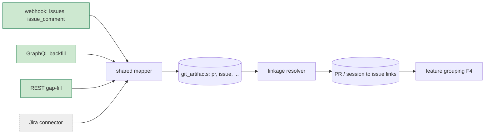

# Issue / Ticket Ingestion & PR Linkage

**Date:** 2026-09-09 · **Author:** Lead Architect · **Status:** Design
**Feeds:** `docs/plan/2026-09-09-mvp-backend-implementation.md` Track H (and F4 feature boundary key).
**Backing:** `docs/design/notes/2026-08-19-github-signal-sources.md` (**SIG**, REST/GraphQL split),
`docs/design/2026-08-28-repo-project-insights-analysis.md` §4 (feature-cost composite).

---

## 1. In a nutshell

The "cost of a feature" screen is the flagship, and a feature is keyed by its **issue/ticket**. Today
issues are **not ingested**: `git_artifacts.kind` is `pr|commit|review|check` only, `map_github.py`
carries `TODO(git): map issues/issue_comment in v1.5`, and `linked_issue` is a **regex for "Closes #N"
on the PR body** — a bare ref string with no entity behind it. So a feature has no title, state, or
epic, and the grouping key misses every PR that links its issue by branch, title, or commit trailer.

**The design, in one line:** pull issues as **first-class artifacts** through the *existing* git
pipeline (they reuse the mapper, backfill, and storage already built for PRs), resolve PR↔issue links
from GitHub's **authoritative** `closingIssuesReferences` with an extraction fallback, and key both on
a tracker-agnostic **issue ref** so Jira drops in later without reshaping the feature surfaces.

Three load-bearing decisions:

1. **Issue is a new `kind` on `git_artifacts`, not a new table.** It reuses the webhook mapper, the
   GraphQL backfill, REST gap-fill, the session-join indexes, and the "paths/labels/counts, never body
   text" rule. One pipeline, one more kind.
2. **Linkage = GraphQL `closingIssuesReferences` (authoritative) + extraction fallback** (branch →
   title → body → commit trailer), each link carrying method + confidence. This replaces the
   body-only regex that F4 wrongly assumed was a full extractor.
3. **Tracker-agnostic ref `(tracker, project_key, number)`.** GitHub ships now; the ref shape and the
   linkage resolver interface are the seams a Jira connector fills later — no change to F4 or the
   Feature/Project screens.

Headline size: issues run **~1× the PR volume**; a one-time backfill for a 100-developer-year adds
roughly the **same GraphQL rate-limit budget as the PR pass** — minutes, not hours (§6).



---

## 2. Terms

- **Issue / ticket** — a tracked unit of work (GitHub Issue, Jira ticket). Distinct from a **PR**, which
  is a proposed code change. A feature is usually one issue realized by one-or-more PRs.
- **Epic** — a parent grouping of issues. GitHub has no native epic; modeled via parent issue /
  milestone / label. Jira has it natively.
- **`closingIssuesReferences`** — a GitHub GraphQL field on a PR listing the issues it will close; the
  authoritative machine link, superior to parsing text.
- **Backfill** — one-time historic pull (GraphQL, SIG §3.5). **Webhook** — the live event stream.
  **Gap-fill** — REST top-up for anything missed (SIG §3.5).
- **Linkage method / confidence** — how a PR↔issue tie was found (`graphql|trailer|branch|title|body`)
  and how trustworthy it is (1.0 for the GraphQL reference, <1 for text heuristics).

---

## 3. Architecture & data flow

Issues ride the pipeline SIG §3.5 already defined (webhook + GraphQL backfill + REST gap-fill sharing
one mapper). This adds an issue mapping path, an issue backfill query, and a linkage resolver.

```
source            map                       store                    link                    group
──────────────────────────────────────────────────────────────────────────────────────────────────
issues webhook  → issue artifact          → git_artifacts          → resolver:              → F4:
GraphQL issues    (kind="issue")            (kind="issue")            closingIssuesRefs (1.0)   feature
REST gap-fill     + closingIssuesRefs     → PR artifact (exists)     then branch/title/        = issue
                    on the PR                                          body/trailer (<1)         + its PRs
```

- **Acquisition, GitHub first.** Map the `issues` and `issue_comment` webhook events (the existing
  v1.5 TODO) and add an **issues backfill** alongside the PR/commit/review GraphQL passes. Pull the
  entity the UI needs; **never body or comment text** (storage §11, identical to the PR rule).
- **Linkage resolver.** For each PR, take `closingIssuesReferences` as the primary, authoritative link;
  fall back to extraction with real precedence and validation. Store each link with method +
  confidence, same pattern as `session_git_links`.
- **Feature grouping (F4).** A feature = an issue ref + the PRs linked to it; `session → PR → issue`
  composes session economics up to the feature. Issues with no PR are still features (status
  "in-progress / not started"); PRs with no issue fall back to a single-PR feature.
- **Feature boundary-key priority** (REPO §4, stated once): `linked issue → PR-cluster on one branch →
  branch → label/milestone`. The resolver emits the best available; F4 groups on it.

### 3.1 Contracts

**Issue artifact** — a new `kind` reusing `git_artifacts` columns (no schema change beyond allowing the
value):

```jsonc
{
  "artifact_id": "github:42:issue:318",   // "github:<repo_num>:issue:<number>"
  "kind": "issue",                         // new allowed value alongside pr|commit|review|check
  "repo_id": "github:acme/api",
  "org_id": "acme",
  "number": 318,
  "state": "open",                         // "open" | "closed"
  "title": "Async auth middleware",        // metadata; never logged (§11)
  "author_login": "anilk",                 // string | null
  "user_id": "u_123",                      // resolved via users.github_user; null until mapped
  "labels": ["auth", "perf"],              // grouping + tier-0 class
  "milestone": "Sprint 21",                // string | null — epic/sprint proxy
  "linked_issue": "github:42:issue:300",   // parent/epic ref, if any | null
  "created_at": "...", "closed_at": "... | null",
  "stats": {"comment_count": 4},           // counts only, never text
  "info": {"github.assignees": ["anilk"]}  // namespaced catch-all
}
```

Fields inapplicable to issues (`merged_at`, `files`, `commit_shas`, `reverts_sha`, …) stay `null` —
same table, narrower population.

**Issue ref** — the tracker-agnostic key F4 groups on and the Jira seam:

```jsonc
{
  "tracker": "github",          // "github" | "jira"
  "project_key": "acme/api",    // repo for github; project key (e.g. "PLAT") for jira
  "number": 318,                // issue / ticket number
  "artifact_id": "github:42:issue:318"   // resolved entity | null if referenced-but-not-pulled
}
```

**Linkage record** — one row per (PR artifact, issue ref):

```jsonc
{
  "pr_artifact_id": "github:42:pr:502",
  "issue_ref": { "...": "as above" },
  "method": "graphql",          // graphql | trailer | branch | title | body
  "confidence": 1.0             // 1.0 for graphql; < 1 for text heuristics
}
```

**Evolution rules:** additive-only; must-ignore unknown keys; `artifact_id` namespaced by tracker so
GitHub and Jira never collide. A GraphQL-backfilled issue and a webhook-delivered issue must be
**byte-identical** after mapping (SIG §3.6 parity rule, extended to issues).

### 3.2 Linkage precedence

```
PR → issues it closes:
  1. closingIssuesReferences present   → method=graphql, confidence=1.0   (authoritative)
  2. else commit trailer "Closes #N"   → method=trailer,  confidence=0.9
  3. else branch name "…/ISSUE-123"    → method=branch,   confidence=0.7
  4. else PR title "#N" / "PROJ-123"   → method=title,    confidence=0.6
  5. else PR body "Closes #N"          → method=body,     confidence=0.5   (today's only path)
validate every candidate:
  reject SHA-1 (40-hex), UTF-8/ISO tokens, and keys outside the repo's known project-key set
```

---

## 4. Alternatives

**Issue storage**

| Option | Pros | Cons | Verdict |
| :-- | :-- | :-- | :-- |
| New `kind="issue"` on `git_artifacts` | Reuses mapper, backfill, indexes, retention, §11 rule | PR-specific columns sit null for issues | **Chosen** |
| Separate `issues` table | Tidy column set | Duplicates the whole pipeline + join logic | Rejected — *switch only if issue shape diverges hard from artifacts* |

**PR↔issue linkage**

| Option | Pros | Cons | Verdict |
| :-- | :-- | :-- | :-- |
| GraphQL `closingIssuesReferences` + extraction fallback | Authoritative primary; catches branch/title/trailer links text-regex misses | Two code paths | **Chosen** |
| Body "Closes #N" regex only (today) | Already built | Misses branch/title/commit; no confidence; no entity | Rejected — *it is the fallback's last rung, not the strategy* |
| Manual mapping UI | Perfect precision | No one does it; doesn't scale | Rejected — *never as the primary* |

**Tracker scope**

| Option | Pros | Cons | Verdict |
| :-- | :-- | :-- | :-- |
| GitHub now, `(tracker,project_key,number)` ref for Jira later | Ships the flagship on data in hand; no rework to add Jira | Jira users wait | **Chosen** |
| GitHub-only, hardcoded | Slightly less abstraction | F4 + screens reshape when Jira lands | Rejected — *the ref abstraction is nearly free* |
| Build Jira now too | Covers mixed shops day one | Doubles the connector work before the GitHub path is proven | Rejected — *switch when a design-partner runs on Jira* |

---

## 5. Measurement honesty

- **Link confidence is carried, not flattened** (§3.2). A feature assembled from low-confidence links
  is marked as such; a 1.0 GraphQL link and a 0.5 body-regex link are not the same claim.
- **An issue with no linked PR is a real state**, not missing data — it is a feature not yet built, and
  the Feature screen shows it as in-progress/not-started rather than hiding it.
- **No epic invention.** Where GitHub exposes no parent, `epic` is null — not a guessed grouping.

---

## 6. Back-of-the-envelope

Assumptions:

| Assumption | Value | Basis |
| :-- | :-- | :-- |
| Developers (one tenant) | 100 | SIG's worked example |
| PRs / year | 25,000 | SIG §3.2 |
| Issues : PRs | ~1 : 1 | issues ≈ PRs in active repos |
| GraphQL density | ~75× REST per rate-limit unit | SIG §3.2 |
| Issue artifact size | ~500 B | labels + counts, no text |

Arithmetic (one significant figure):

- **Storage:** 25,000 issues × 500 B ≈ **~13 MB/tenant-year** of issue artifacts; links ≈ 25,000 ×
  100 B ≈ **~3 MB.** Negligible beside session data.
- **Backfill cost:** issues are a GraphQL connection like PRs, so the one-time issue pass costs **about
  the same rate-limit budget as the PR backfill** — SIG's figure is **minutes of wall-clock** for the
  100-dev-year, and **concurrency helps** (SIG §3.2). Re-backfill is the same budget again.
- **Live cost:** `issues`/`issue_comment` webhooks are small events handled on the existing path — no
  extra API call, **~0** marginal cost.
- **Linkage:** one `closingIssuesReferences` field is already in the PR GraphQL node — **free on the
  existing PR pull**; the text fallback runs only when it's empty.

Conclusion: issue ingestion roughly **doubles the git artifact footprint** (still tens of MB per
tenant-year) and adds **one GraphQL pass of the same order as the PR backfill** — a one-time cost in
minutes. It is essentially free on the live webhook path.

---

## 7. Clarifying questions

| Question | Working assumption in this doc |
| :-- | :-- |
| Jira timing? | **GitHub first**; the ref shape + resolver interface are Jira-ready, connector is a later track. |
| How is an epic resolved on GitHub (no native epic)? | Parent issue → milestone → label, in that order; **null if none** — never invented. |
| Count issues with no PR as features? | **Yes** — a feature not-yet-built; shown as in-progress/not-started. |
| Cross-repo issues (a mono-repo issue spanning repos)? | Keyed by its own repo; PRs in other repos link across via the ref — no special-casing in MVP. |
| Historic depth for issues? | Match the PR backfill window (SIG §4's two-speed plan); same cursor. |

---

## 8. Phasing

- **v0 (now, Track H1–H2):** GitHub `issues`/`issue_comment` webhook mapping + issue GraphQL backfill +
  linkage resolver (GraphQL primary, extraction fallback). F4 groups features on the resolved ref.
- **v1:** Jira connector — OAuth app + REST issue/epic pull + webhook, emitting the same issue ref and
  artifacts through the resolver.
- **v2:** richer epic/initiative modeling (the 2026-09-08 "initiatives started vs shipped" trend) and
  issue→incident linkage for the lagging-quality signal (EFF §7).

Named seams the later work slots into:

- **Issue ref `(tracker, project_key, number)`** — a new tracker is a new `tracker` value, no reshape.
- **Linkage resolver interface** — a Jira provider implements the same `resolve(pr) -> links[]`.
- **`git_artifacts.kind`** — issues joined the existing pipeline, so any further kind follows the same
  mapper/backfill/storage path.
