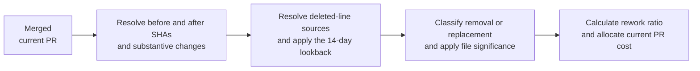

# Cross-PR Rework Measurement Method

**Status:** Draft  
**Scope:** Rework detected when a merged pull request changes code produced by recently
merged pull requests.  
**Default lookback:** 14 days, configurable.

## 1. Method in a Nutshell

Rework is the portion of a merged pull request that removes or replaces recently produced
code. It is an observable engineering activity, not a judgment that the earlier or later
work was wasteful. A redesign, correction, requirement change, and useful improvement can
all contain rework.

The pull request is the unit of delivery and cost. For each newly merged pull request,
called the current PR, the method compares the target branch immediately before and after
the merge. It examines lines that disappeared from the earlier state, identifies the prior
PR that last produced each line, and checks whether that prior PR was merged within the
14-day lookback. Recent disappeared lines are then classified as removed or replaced.

Small edits are filtered at the file level before the PR-level ratio is calculated. A file
must exceed both a proportional rewrite threshold and a minimum affected-line threshold.
Only eligible file changes enter the rework numerator, while all substantive changes in the
current PR remain in the denominator. The resulting ratio estimates the share of the
current PR's work that was rework and can therefore be applied to that PR's session cost.

The load-bearing decisions are:

1. The lookback is a sliding age test applied when each PR merges; it is not a sequence of
   fixed 14-day buckets.
2. The repository state immediately before the current PR is the comparison baseline.
   Earlier PRs are discovered from the provenance of affected lines, not by comparing every
   pair of PRs.
3. Rework is reported neutrally. Classification as redesign, correction, improvement, or
   waste is a separate analysis.

## 2. Terms

| Term | Meaning |
|---|---|
| Current PR | The merged pull request being evaluated, also referred to as PR-q. |
| Source PR | The earlier pull request that last produced the prior-state version of an affected line. |
| Before commit SHA (`before_sha`) | The commit SHA identifying the target branch snapshot immediately before the current PR was integrated. It corresponds to GitHub's push-event `before` field. |
| After commit SHA (`after_sha`) | The commit SHA identifying the target branch snapshot immediately after the current PR was integrated. It corresponds to GitHub's push-event `after` field. |
| Lookback | The maximum permitted age of a source PR for its code to be considered recent. The initial working value is 14 days. |
| Recent prior-state line | A line whose current version was last produced by a source PR merged no more than 14 days before the current PR. |
| Removed old line | A prior-state line that disappears without corresponding replacement content. |
| Replaced old line | A prior-state line that disappears and is matched to replacement content. Git does not record this relationship directly; it is an inferred classification. |
| Replacement new line | A newly added line matched to one or more replaced old lines. |
| Substantive change | A source change remaining after configured exclusions such as generated files, vendored code, pure formatting, and detected moves. |
| File significance gate | The proportional and absolute thresholds a file must exceed before its recent changes contribute to rework. |
| Rework ratio | The share of the current PR's substantive change units attributed to significant recent removal or replacement. |
| Rework cost | The current PR's attributed session cost multiplied by its rework ratio. |

## 3. Data Flow



The process creates relationships from the current PR back to one or more source PRs. It
does not select one base PR for the entire lookback. A current PR can rework code from
several source PRs, and different affected lines in one file can have different source PRs.

## 4. Rework Ratio Overview

### 4.1 File significance

Each affected file is scored against its own before state. The file's recent-change fraction
is the number of recent prior-state lines removed or replaced by the current PR, divided by
the file's substantive line count immediately before the current PR.

A file is eligible only when both of these conditions hold:

- Its recent-change fraction reaches the configured rewrite threshold.
- Its number of recent old lines removed or replaced reaches the configured minimum line
  count.

The proportional threshold prevents a small edit to a large file from being called a
rewrite. The minimum line count prevents a two-line edit to a three-line file from receiving
outsized significance. Both thresholds are product configuration and require calibration;
this document does not yet prescribe their values.

Changes in files that fail the gate contribute nothing to the rework numerator. They remain
in the denominator because they were still part of the current PR's delivered work and
session cost.

### 4.2 PR-level numerator

For every eligible file, the rework numerator includes:

- removed old lines (`removed_old_f`): recent prior-state lines removed without
  replacement;
- replaced old lines (`replaced_old_f`): recent prior-state lines matched to replacement
  content; and
- replacement new lines (`replacement_new_f`): new lines matched to those replaced old
  lines.

Including both sides of a replacement is necessary for cost allocation. If one hundred
recent lines are replaced by one hundred new lines, Git exposes one hundred deletions and
one hundred additions. Counting only the deletions would incorrectly describe a complete
rewrite as fifty percent rework.

### 4.3 PR-level denominator

The denominator is every substantive addition and deletion delivered by the current PR,
across all files. Pure moves, generated output, vendored content, and changes determined to
be formatting-only are excluded from both numerator and denominator under the same policy.

The ratio therefore answers: "What share of the current PR's delivered change was spent
removing or replacing recently produced code in significantly affected files?"

The ratio does not answer how much of a source PR's original cost was invalidated. That is a
different measure and should not be mixed into the current PR's rework cost.

## 5. Detecting Rework for a Merged PR

Given a merged current PR, the method proceeds as follows.

### 5.1 Establish the state transition

Before identifying any reworked lines, resolve two commit SHAs that describe the
actual update to the target branch:

- `before_sha` is the commit SHA of the target branch tip immediately before the current PR
  was integrated.
- `after_sha` is the commit SHA of the target branch tip immediately after the current PR
  was integrated.

These names follow GitHub's push-event terminology. GitHub defines `before` as the SHA of
the most recent commit on the target ref before the push and `after` as the SHA after the
push. This document adds the `_sha` suffix to make the value type explicit. See
[GitHub's push webhook payload](https://docs.github.com/en/webhooks/webhook-events-and-payloads#push).

These commits already represent complete repository snapshots. The method does not need to
check out two working directories or reconstruct file trees manually. Every later status,
patch, and blame command reads the snapshots directly from Git.

#### 5.1.1 Merge commit

When the current PR produces merge commit `M`, the merge commit is the after state and its
first parent is the before state:

```bash
after_sha=$(git rev-parse "$merge_sha")
before_sha=$(git rev-parse "${after_sha}^1")
```

The first command validates and resolves GitHub's merge commit SHA as `after_sha`. The
second resolves its first parent as `before_sha`. A merge commit's first parent is the
former target branch tip. Its second parent is the PR branch tip and must not be used as the
before state.

The parent relationship can be inspected before accepting the range:

```bash
git rev-list --parents -n 1 "$merge_sha"
```

The output contains the merge commit followed by its first and second parents.

#### 5.1.2 Squash merge

When the current PR produces one squash commit `S`, the squash commit is the after state and
its only parent is the target branch state immediately before the squash:

```bash
after_sha=$(git rev-parse "$merge_sha")
before_sha=$(git rev-parse "${after_sha}^1")
```

The commands are the same as for a merge commit, but the squash commit has one parent. The
hosting provider's merged-PR metadata supplies the squash commit identifier and associates
it with the current PR.

#### 5.1.3 Basic GitHub CLI example for merge and squash

The following shell script accepts a merged GitHub PR number and establishes the two commit
SHAs. It applies when the repository uses a merge commit or squash merge.

```bash
#!/usr/bin/env bash
set -euo pipefail

pr_number="${1:?Usage: ./pr_states.sh <pr-number>}"

state=$(gh pr view "$pr_number" --json state --jq '.state')
base_branch=$(gh pr view "$pr_number" --json baseRefName --jq '.baseRefName')
merge_sha=$(gh pr view "$pr_number" --json mergeCommit --jq '.mergeCommit.oid')

if [[ "$state" != "MERGED" ]]; then
    echo "PR $pr_number has not been merged"
    exit 1
fi

git fetch origin "$base_branch"

after_sha=$(git rev-parse "$merge_sha")
before_sha=$(git rev-parse "${after_sha}^1")

echo "PR:         $pr_number"
echo "Branch:     $base_branch"
echo "before_sha: $before_sha"
echo "after_sha:  $after_sha"
```

The GitHub CLI supplies the merged PR's integration commit as `merge_sha`. Git resolves
that commit as `after_sha` and its first parent as `before_sha`. The script only reads
repository and GitHub metadata; it does not check out or modify files.

#### 5.1.4 Rebase merge or multi-commit fast-forward

A rebase merge or multi-commit fast-forward places a sequence of PR commits directly on the
target branch. If the integrated range is `R1` through `Rn`, the parent of `R1` is the before
state and `Rn` is the after state:

```bash
before_sha=$(git rev-parse "${first_rebased_sha}^1")
after_sha=$(git rev-parse "$last_rebased_sha")
```

Using the first parent of `Rn` would compare only the final commit in the PR with the commit
immediately before it. It would omit the rest of the PR.

Git history alone does not always preserve enough information to determine which adjacent
rebased commits belonged to one PR. The reliable solution is to capture the hosting
provider's target-branch update at merge time. A branch push event ordinarily supplies the
target ref's commit identifier before the update and after the update. Persist those values
as `before_sha` and `after_sha` and correlate the update with the merged PR.

#### 5.1.5 Required persisted identifiers

The PR record should retain the integration method, merge time, target branch,
`before_sha`, and `after_sha`. For merge and squash commits, `before_sha` can be derived from
the first parent, but persisting both identifiers produces one uniform downstream contract.
Rebase and fast-forward integration should use captured branch-update identifiers rather
than attempt historical reconstruction whenever possible.

Before calculating a diff, verify that `before_sha` is an ancestor of `after_sha`:

```bash
git merge-base --is-ancestor "$before_sha" "$after_sha"
```

A successful result establishes ancestry, but it does not by itself prove that the range
belongs to the current PR. That association comes from the hosting provider's merged-PR and
branch-update metadata.

The PR's original base and head identifiers are not substitutes for these integration
states. The target branch may have advanced, the commits may have been rebased, or the
hosting provider may have created a merge or squash result that differs from the original
PR branch.

### 5.2 Collect and classify Git evidence

Git provides the file status, old and new line ranges, and old-line provenance needed by the
method. It directly establishes deletion and addition. It does not directly label an old
line as replaced or declare that a particular new line replaces it. Those relationships are
derived from the patch structure and alignment evidence.

The commands below describe the repository evidence to collect. They are not an
implementation algorithm by themselves. They use the `before_sha` and `after_sha` shell
variables established in Section 5.1.

#### 5.2.1 Inventory the current PR's file changes

Start with the file-status view, with rename and copy detection enabled:

```bash
git diff --name-status --find-renames --find-copies "$before_sha" "$after_sha"
```

This identifies added, modified, deleted, renamed, and copied files. Rename and copy
detection must run before deleted files are interpreted, because a file move should not be
reported as removal merely because its path changed. Section 11 clarifies how a genuine
whole-file deletion enters the same method.

Use the numeric summary to obtain the current PR's added and deleted line counts by file:

```bash
git diff --numstat --find-renames --find-copies "$before_sha" "$after_sha"
```

These counts supply the initial denominator. Configured exclusions and normalization are
then applied so that generated files, vendored content, dependency locks, binary files,
pure formatting, and detected moves do not become substantive change units.

A same-file intersection with an earlier PR is neither required nor sufficient evidence of
rework. Two PRs can touch unrelated regions of one file, while a redesign can replace an
old file with a differently named file. The before-to-after diff defines the current PR's
change; old-line provenance later identifies the relevant source PRs.

#### 5.2.2 Locate old and new change blocks

Use a zero-context patch for each participating file:

```bash
git diff --unified=0 --find-renames --find-copies "$before_sha" "$after_sha" -- "$path"
```

The hunk headers identify the before-state and after-state line ranges. Within each hunk,
old-side lines prefixed as deletions are the prior-state lines that disappeared. New-side
lines prefixed as additions are the content that appeared. Zero context reduces unrelated
surrounding lines but does not itself pair deletions with additions.

The default Git diff is sufficient to collect the evidence. A histogram diff or a
word-oriented diff can be retained as secondary alignment evidence when ordinary hunks are
ambiguous. Changing the diff strategy must not change which before and after repository
states are being measured.

#### 5.2.3 Resolve old-line provenance and apply the lookback

For every deleted old-side range, inspect line provenance against the before state:

```bash
git blame --line-porcelain -L "$old_start,$old_end" "$before_sha" -- "$path"
```

The porcelain output identifies the commit that last produced the before-state version of
each line. The commit is mapped to its source PR using the hosting provider's PR metadata.
The source PR's merge time is then compared with the current PR's merge time. Only lines
whose source PR falls inside the 14-day lookback proceed as recent rework candidates.

Blame is run against the before state because the old line may no longer exist after the
current PR. It also ensures that the source is the PR responsible for the immediately prior
version, rather than an older ancestral version.

If PR-1 introduced a line and PR-3 later replaced its prior-state version, a subsequent PR
that changes the PR-3 version is related to PR-3. This avoids repeatedly charging an older
version that was already replaced.

The age comparison uses source and current PR merge times, not commit author times, because
the code was not delivered to the target branch until merge. The 14-day lookback is sliding
and does not reset at weekly, monthly, or quarterly reporting boundaries. A PR in one
reporting period can therefore rework a recent PR from the preceding period.

#### 5.2.4 Removed old lines

This quantity starts with recent old-side lines from Section 5.2.3. A recent old line is
classified as removed when its deletion block has no associated replacement addition after
alignment and move detection.

A deletion-only hunk is strong direct evidence of removal. In a mixed hunk, an old line that
cannot be associated with the added block is also removal, but the result may carry lower
confidence when the alignment is ambiguous.

Each qualifying old line contributes one `removed_old_f` change unit. Its source PR is
retained so the result can state which prior PR's output was removed.

#### 5.2.5 Replaced old lines

A hunk containing both deleted and added lines is a candidate replacement. The old and new
blocks are aligned using their location, order, textual or token similarity, and, when
available, their enclosing symbol. Git's patch provides the evidence, but the measurement
logic makes the association.

An aligned old line contributes one `replaced_old_f` change unit only when that old line's
source PR is within the lookback. An old line outside the lookback remains part of the
current PR's substantive change but is not recent rework. An uncertain alignment must
remain uncertain rather than being forced into `replaced_old_f`.

This old-side count answers how much recently produced code the current PR replaced. It is
separate from the new-side effort required to produce the replacement.

#### 5.2.6 Replacement new lines matched to replaced old lines

After a recent old block is classified as replaced, count the new lines aligned to that old
block. Those lines contribute to `replacement_new_f`, the new side of the current PR's
rework effort.

Not every addition in a mixed hunk is automatically replacement. Added lines that cannot be
associated with replaced recent content remain new work and contribute only to the
denominator. Where one old block maps to a differently sized new block, the method retains
the observed old and new counts rather than forcing a one-to-one line match.

Counting the aligned old and new sides makes complete replacement behave consistently. If
the current PR replaces a recent one-hundred-line block with a new sixty-line block, the
rework numerator receives one hundred `replaced_old_f` units and sixty
`replacement_new_f` units. The same one hundred deletions and sixty additions already
appear in the current PR's denominator.

### 5.3 Apply significance and calculate the result

Group recent old lines removed or replaced by their affected file. Apply the proportional
and minimum-line significance thresholds independently to each file. The PR-level
calculation then sums rework from every file that passes the gate; it does not select only
the file with the largest rewrite.

For each file `f` changed by the current PR, define:

| Quantity | Meaning |
|---|---|
| `removed_old_f` | Recent prior-state lines removed without replacement. |
| `replaced_old_f` | Recent prior-state lines matched to replacement content. |
| `replacement_new_f` | New lines matched to those replaced old lines. |
| `before_loc_f` | Substantive lines in the file immediately before the current PR. |
| `added_f` | All substantive lines added to the file by the current PR. |
| `deleted_f` | All substantive lines deleted from the file by the current PR. |

The file's significance fraction uses only affected recent prior-state lines because it
measures how much of the old file was invalidated:

```text
file_rework_fraction_f = (removed_old_f + replaced_old_f) / before_loc_f
```

A brand-new file has no before-state lines and therefore cannot contain recent prior-state
removal or replacement. It bypasses the file significance calculation and contributes its
additions only to the PR denominator. A deleted file has a nonzero `before_loc_f` and
follows the whole-file rules in Section 11.

The file is significant when both configured conditions are true:

```text
file_rework_fraction_f >= proportional_threshold

removed_old_f + replaced_old_f >= minimum_line_threshold
```

Let `significant_f` equal one when the file passes both conditions and zero otherwise. The
current PR's eligible rework units are:

```text
eligible_rework_units_q =
    sum across all files f of
    significant_f * (removed_old_f + replaced_old_f + replacement_new_f)
```

The current PR's total substantive change units include additions and deletions from every
participating file, including new files and files that did not pass the significance gate:

```text
total_change_units_q =
    sum across all files f of (added_f + deleted_f)
```

The PR-level rework ratio is:

```text
rework_ratio_q = eligible_rework_units_q / total_change_units_q
```

If the current PR contains no substantive line changes, the ratio is undefined and should
be recorded as not applicable rather than dividing by zero. Under normal line-based PRs,
the ratio ranges from zero to one because every eligible rework unit is also a substantive
addition or deletion in the denominator.

Finally, apply the ratio to the session cost already attributed to the current PR:

```text
rework_cost_q = attributed_session_cost_q * rework_ratio_q
```

The attributed cost can be expressed as tokens, normalized currency, or both, as long as
the same cost basis is used before and after multiplication.

#### 5.3.1 Multi-file example

Assume the current PR changes four files and contains 250 substantive change units in total.
After the lookback and file significance tests:

| File | Significant? | Removed old | Replaced old | Replacement new | Eligible rework units |
|---|---:|---:|---:|---:|---:|
| File A | Yes | 20 | 30 | 25 | 75 |
| File B | No | 2 | 3 | 3 | 0 |
| File C | Yes | 10 | 40 | 50 | 100 |
| File D | No recent rework | 0 | 0 | 0 | 0 |

Files A and C contribute 175 eligible rework units. Changes from Files B and D still
participate in the 250-unit PR denominator:

```text
rework_ratio_q = 175 / 250 = 0.70
```

If the session attributed to the current PR consumed 120,000 tokens and cost $40:

```text
rework_tokens_q = 120,000 * 0.70 = 84,000 tokens
rework_cost_q   = $40 * 0.70 = $28
```

These are estimates of the current PR's resources spent performing rework. They do not
assign a second cost to the source PR and do not claim that the rework was waste.

## 6. Interpretation and Limits

The metric is descriptive. Managers may decide that a high rework ratio represents poor
initial quality, useful iteration, a changed requirement, review feedback, or intentional
redesign. The ratio alone cannot distinguish these causes.

Session analysis can later classify the probable nature and trigger of rework. Such a
classification should carry evidence and confidence and remain separate from the measured
ratio. In particular, redesign and improvement are not mutually exclusive descriptions.

The main accuracy limits are:

- the relationship between `replaced_old_f` and `replacement_new_f` is inferred from
  deletion and addition alignment;
- large semantic redesigns can cross file boundaries without textual similarity;
- code moves, formatting, and generated changes can create false rework unless normalized;
- provenance depends on reliable commit-to-PR mapping;
- line counts approximate engineering effort and do not measure difficulty;
- one session per PR is a simplifying cost-attribution assumption, not a Git property.

## 7. Major Decisions and Alternatives

| Decision | Option | Pros | Cons | Verdict |
|---|---|---|---|---|
| Time model | Sliding source-code age, chosen | Every current PR is evaluated consistently; works across reporting periods. | Requires source provenance and merge timestamps. | Use this model. Switch only if the product changes to cohort durability analysis. |
| Time model | Fixed 14-day buckets | Simple calendar aggregation. | Creates arbitrary boundaries and misses rework across adjacent buckets. | Reject for detection; retain calendar buckets only for reporting. |
| Comparison model | Immediate before and after states, chosen | Measures the actual delivered branch transition and avoids historical double counting. | Rebase merges require reliable integration-range metadata. | Use this model. Switch only if the hosting provider cannot expose the transition. |
| Comparison model | Pairwise PR file intersection | Easy candidate search. | Same-file edits can be unrelated; cross-file redesign can have no intersection. | Use only as an optimization, never as the definition. |
| Noise control | File fraction plus minimum changed lines, chosen | Suppresses both tiny edits in large files and high percentages in tiny files. | Thresholds require calibration and can hide distributed redesign. | Start here; add module or symbol-level detection if calibration exposes misses. |
| Noise control | Count every recent touch | Simple and comparable to broad industry rework metrics. | Routine fixes and incremental improvements inflate the signal. | Reject for the primary significant-rework measure; it may remain a secondary raw metric. |
| Replacement matching | Textual alignment with uncertainty, chosen | Explainable and available from repository data. | Cannot fully determine semantic intent. | Use for the initial method. Add semantic evidence when validated. |
| Replacement matching | Session or model judgment only | Can recognize redesign across files. | Probabilistic, more expensive, and dependent on retained session content. | Defer as enrichment, not as the measurement foundation. |

## 8. Back-of-the-Envelope Processing Cost

These assumptions are illustrative and must be replaced with observed repository data.

| Assumption | Working value | Basis |
|---|---:|---|
| Merged PRs per team per working day | 20 | Illustrative medium engineering team. |
| Substantive changed lines per PR | 300 | Illustrative; measure from customer repositories. |
| Touched files per PR | 20 | Illustrative; measure from customer repositories. |
| Working days per year | 250 | Conventional planning value. |

At those values, the method examines about 6,000 changed-line units and 400 touched files
per day. Over a year, that is about 1,500,000 changed-line units. At an illustrative 150
bytes per persisted line-attribution record, retaining every observation would consume
roughly 225 MB per team per year before database overhead. Persisting only aggregate and
source-PR results would be substantially smaller.

The Git-only method requires no model inference. Its CPU time and latency depend heavily on
repository size, history depth, caching, and the provenance implementation, so dollar and
latency estimates remain TBD until a representative benchmark exists. At the illustrative
team scale, changed-line volume itself is unlikely to be the infrastructure driver; fetching
repositories and optional semantic session analysis are more likely to dominate.

## 9. Open Questions and Working Assumptions

| Question | Working assumption used in this document |
|---|---|
| What file rewrite fraction is significant? | Configurable and TBD through calibration. |
| What minimum affected-line count is significant? | Configurable and TBD through calibration. |
| Is exactly 14 days included? | Yes; a source merged exactly 14 days earlier is recent. |
| Which artifacts participate? | First-party textual source, test, configuration, and documentation files participate; generated, vendored, binary, and dependency-lock artifacts are excluded by policy. |
| How are whitespace-only changes handled? | Excluded from substantive change. |
| What if no source PR can be found? | Record unknown provenance and exclude the line from recent rework rather than guessing. |
| How are multiple sessions assigned to one PR? | Upstream cost attribution supplies one aggregate PR cost; this method does not divide session cost. |
| Does rework mean waste? | No. Waste is an interpretation requiring outcome or intent evidence. |

## 10. Phasing

**Version 0:** Measure the actual merged state transition, resolve old-line provenance,
apply the 14-day sliding lookback, distinguish pure removal from local replacement, apply
file significance thresholds, and produce the PR-level rework ratio and cost. Preserve
unknown and uncertain cases explicitly.

**Version 1:** Improve move, formatting, and replacement detection; add symbol-aware
grouping; calibrate the file thresholds against reviewed examples; and report separate raw
recent-touch and significant-rework measures.

**Version 2:** Use deep session analysis to classify likely redesign, correction,
requirement change, review-driven change, and improvement. Add cross-file semantic
replacement detection only after it demonstrates acceptable precision. Outcome measures
such as reverts, incidents, and change failures remain separate signals used to interpret,
not redefine, rework.

## 11. Clarification: Whole-File Deletion

A genuinely deleted file is a simpler evidence path through the same method, not a separate
rework metric. After rename and copy detection, Git reports the file with deleted status.
Its numeric summary reports zero additions and the full old-file line count as deletions.
Every substantive line in the before-state file is therefore a removal candidate.

Provenance is still evaluated line by line because one deleted file can contain versions
produced by several PRs of different ages. The outcomes are:

- If a file was created by a recent PR and remained substantially unchanged, deleting it
  normally makes all of its substantive lines recent removal candidates.
- If an older file contains only twenty lines last changed during the lookback, only those
  twenty lines count as recent removal. The older deleted lines remain in the denominator.
- If an old file contains no lines produced within the lookback, deleting it is substantive
  current work but not 14-day rework under this method.

The file significance score still uses recent old lines removed or replaced divided by the
file's substantive before-state line count. A wholly recent file that is deleted has a
one-hundred-percent recent-change fraction, subject to the minimum-line threshold. A
mixed-age file receives only the fraction represented by its recent lines.

A deleted file can have a semantic replacement at another path. Git rename, copy, and exact
move evidence should prevent unchanged or substantially preserved content from being called
removal. If the new file is structurally different, the Git-only method records the recent
old content as removal and the unrelated additions as new work. Session or semantic
analysis may later associate the two as a cross-file redesign, with its own confidence.

The implementation may optimize whole-file deletion by processing the deleted file as one
old-side range. That optimization does not change its provenance, significance, or ratio
rules.
