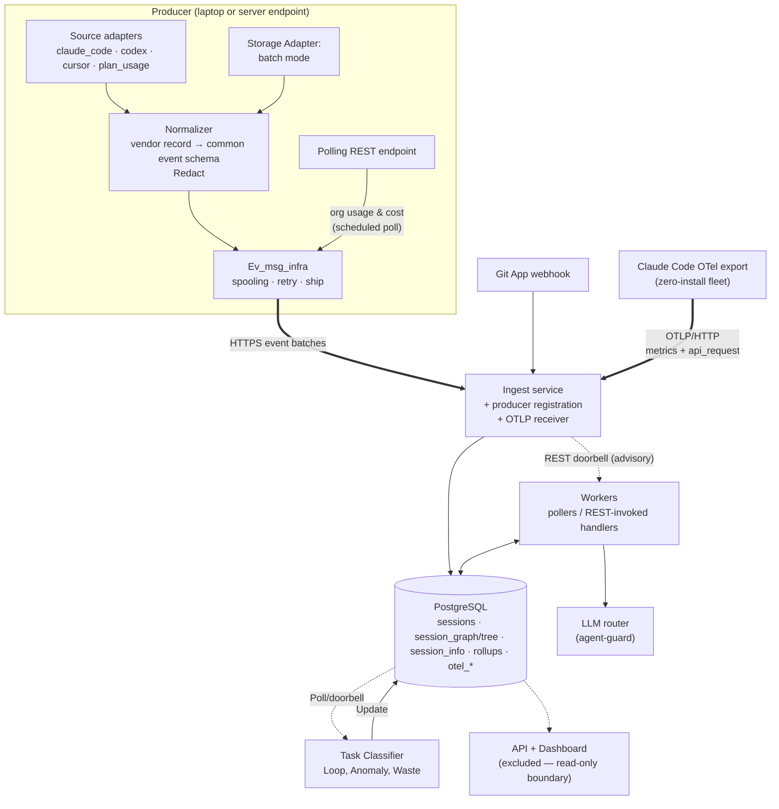
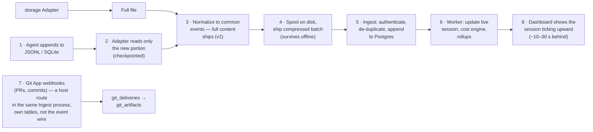
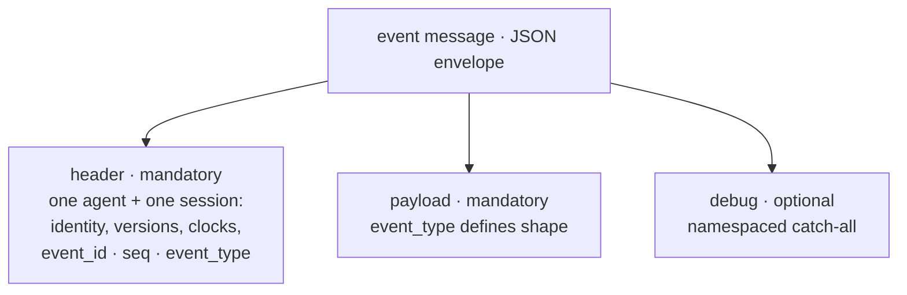
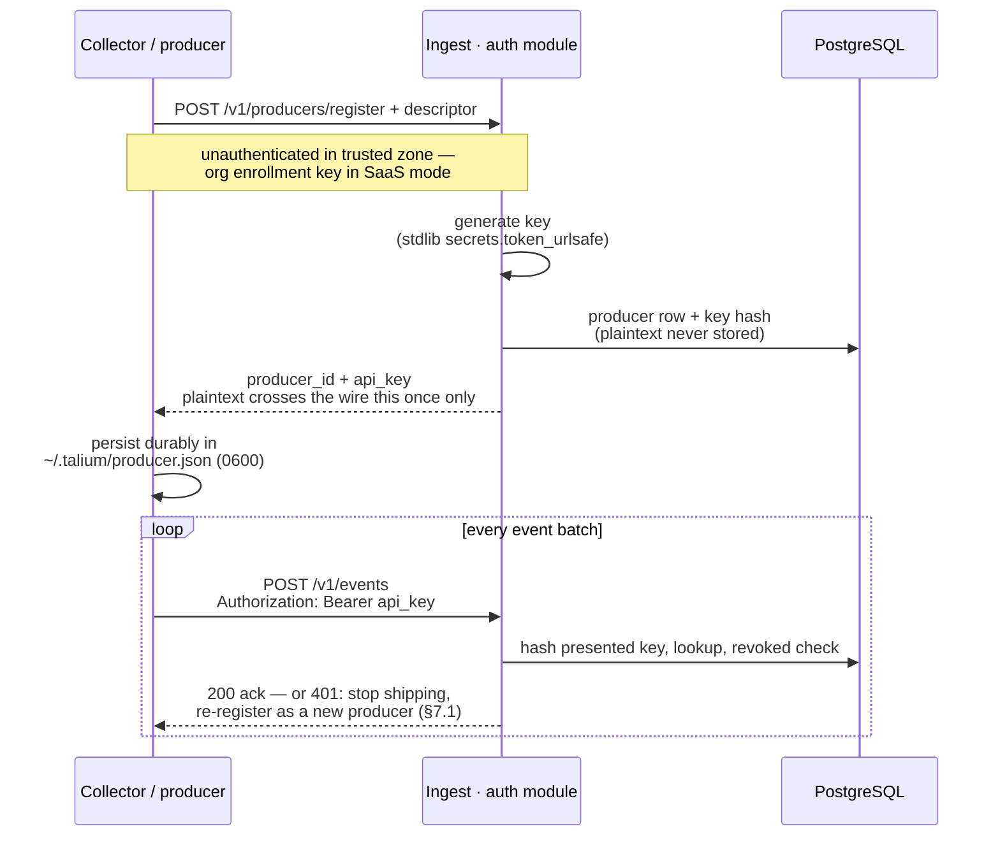
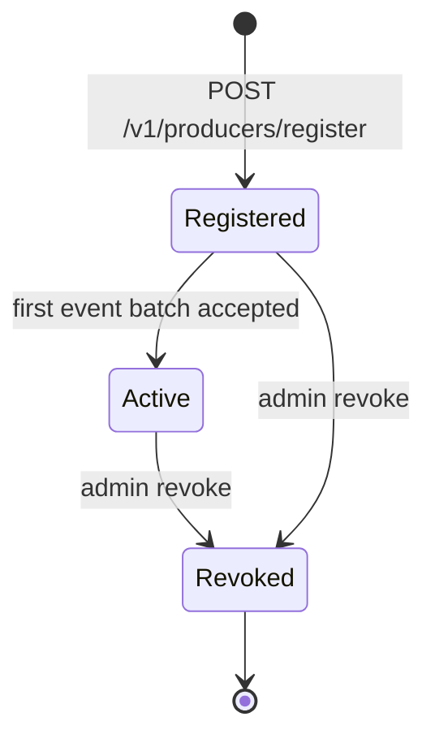
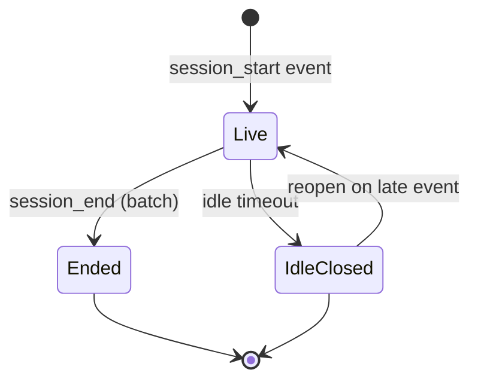

# System Architecture — Talium Coding-Agent Economics

**Status:** Draft v2 for review
**Role of this document:** the architecture reference that every module design doc cites. It
guides module design and provides the durable, oft-used pieces so each module can be defined in terms of:
*what input it takes, how it receives that input, what it processes, and what it outputs*.
Scaling, concurrency, security, and debuggability are concerns of this document,
not of individual modules.


Sections marked **⚠ proposal** have not been discussed to conclusion and are written for
review; everything else reflects settled decisions.

---

## 1. Architecture in a Nutshell

One Python 3.11+ monorepo, three process types, one database.

The system architecture below shows the major modules and connections. It is based on the following goals:
1. Clear definition of the responsibility of each module. The actual design of each module is its owner's responsibility.
2. Clean definition of interfaces and versioned messages so future changes can be easily adapted.
3. Config/data-driven implementation so code changes are minimal whenever possible. Each module has its own config, and there is a system-level config as well. YAML is the config language.
4. Minimize the number and complexity of external packages. Always choose well-maintained and widely used packages.
5. Commonly used Talium functionality is already packaged and leveraged.



---

## 2. Data Flow, End to End



The same steps, with the reasoning:

**Signal Producer**
The log file is chosen as the high-fidelity signal source. The data can be collected:
1. from a realtime working session;
2. from existing JSONL/log sources captured previously. This method is referred to as batch mode.

Data collection and the data flow support both modes.

### 2.1 Realtime Data

Realtime data requires a Talium agent/software running on each endpoint (laptop). That can be a high bar of trust for an early-stage startup.

1. A developer runs a session. The agent appends to its JSONL file (Claude Code, Codex) or
   writes rows into its SQLite database (Cursor) on the laptop.
2. The Collector's source adapter notices the change within a couple of seconds (file-change
   notification for JSONL; short-interval polling for SQLite), reads only the new portion, and
   remembers how far it has read (a checkpoint), so nothing is re-read or missed after a restart.
3. The Normalizer processes these events and does the following:
     - **Common:** converts the vendor record into the common event schema — user, assistant, tool, etc.
     - **Prompt and assistant messages:** carried in the events.
     - **Redact:** any code/file content.
     - **Tool:** tool name, input params, and the raw edit/patch record — shipped as-is.
       No output params. No classification, verb extraction, or hunk parsing — that is
       server-side (§6.2).
     - **Tokens and models:** token counts, model names. Some harnesses, like Cursor, don't expose tokens.
     - **Info:** the rest of the information is passed as-is and will be harness-dependent.

4. The **event messaging infrastructure** (§5) spools events on disk and ships compressed
   batches over HTTPS. The spool exists to guarantee at-least-once delivery: if the laptop
   is offline, it holds events until connectivity returns.
5. The Ingest Service authenticates the producer, validates the batch, discards duplicates by
   event id, and appends the events to Postgres. Ingest does **no** interpretation — it is a
   dumb, fast, always-available front door.
6. Processing Workers pull newly arrived events from Postgres in small batches, update the
   session record incrementally (a session is "live" until events stop arriving), run the cost
   engine against pricing tables, and refresh rollups. This is where all intelligence lives.
   At task/session close-out the classifier worker labels task spans in batch (§8.4) —
   off the live path, so it never delays the numbers below.
7. Git App webhooks (PR opened/merged, commits) arrive through a **host route inside the same
   Ingest process** — not as a different event type on the msging wire (`docs/modules/git-source.md`
   §3: git data has no producer identity and no session, so forcing it through the envelope would
   mean fabricating both). They land directly in git tables (`git_deliveries` → `git_artifacts`,
   §9), and a separate correlator (not yet built, `docs/modules/pr-work-classification.md`) links
   them to sessions on commit sha.
8. The Dashboard reads sessions and rollups over the query API. A session's numbers visibly
   tick upward while the developer is still typing — the "watch it as it happens" requirement —
   with an end-to-end delay of roughly 10–30 seconds (§14.3).

### 2.2 Batch/File Mode (Preferred Mode)
In this mode the producer simply makes the files available to the collector. The files can be copied from a laptop, a server, or any other source to an S3 bucket, for example; or the files can be processed on the laptop as well. The core mechanism remains unchanged, with one important difference.

For realtime data, the producer must have a software component/daemon installed on the endpoint. In batch mode the producer doesn't need to install any component.

 - The adapters point to complete log files.
 - The same read loop that does live tailing reads the file in chunks.
 - Chunks are processed just as above.


---

## 3. Terms

Terms from the master doc §2 apply unchanged. New or changed here:

| Term | Meaning |
|---|---|
| **Producer** | A registered event source: one machine or server endpoint. A laptop that restarts is the same producer. Identified by a server-issued `producer_id`. |
| **Handler** | One unit of processing responsibility inside a worker process (e.g., "fold events into sessions"). Handlers are identified by responsibility; naming and splitting are decided by their module designers. |
| **Doorbell** | An advisory wake-up call (REST) telling a worker "there may be new work." Carries at most a hint (session IDs); never authoritative. The database query is the sole authority on pending work. |
| **Batch mode** | Processing existing session history from disk (formerly "backfill"). Same pipeline as live tailing; only the feeder differs. |
| **Rollup window** | A configurable aggregation period (1h, 3h, 24h, week, month, …) over which session metrics are accumulated. |
| **Metric registry** | The config data that defines which metrics exist, their source expressions, and aggregation kinds. Adding or dropping a metric is a registry change, not code. |
| **At-least-once** | Delivery guarantee: an event may arrive more than once, never zero times. Paired with dedupe and idempotency it yields exactly-once *effects*. |
| **Idempotent** | Running the same processing twice yields the same state as running it once. Required of every write path (design rule 3). |

---

## 4. Design Rules (apply to every module)

1. **Interfaces first; REST for the majority.** Modules communicate only through declared
   interfaces. Request/response interactions are API-based (REST now; protobuf/gRPC only if
   a measured need appears). Shared durable state lives in PostgreSQL and is reached only
   through the storage module's data-access layer (§10).
2. **Durable queue.** A simple durable queue based on Postgres or Redis is fine. No need for
   Kafka, message brokers, etc. at this stage. Sizing, worst case at the 1,000-developer
   reference (§14): queue messages are pointers (session IDs, ~100 bytes), never event
   payloads — events are already durable in Postgres. Peak arrival of ~100 ev/s in
   ~10 batches/s means ≤10 queue messages/s, and collapsing to one pending wake-up per live
   session caps depth at the number of concurrently live sessions (~300). A full-day consumer
   outage accumulates ~1M messages ≈ 100 MB. Required throughput is tens of messages/s
   against stores comfortable at thousands (Postgres `SKIP LOCKED`) to tens of thousands
   (Redis) — 100–1,000× headroom, so Postgres vs. Redis is an operational choice, not a
   capacity one. If concurrent dispatch is ever needed, Redis notifications or
   Postgres-as-queue are the designated seam (design and references: §15.1).
3. **Idempotent everything.** Every write path must produce the same state if run twice;
   tests assert this explicitly. This is what makes at-least-once delivery, catch-up sweeps,
   and replay safe.
4. **Data-driven over code-driven.** Behavior that can be data must be data: SQL in named-query
   YAML, metric definitions and rollup windows in the metric registry, adapter discovery
   paths, LLM model selection — all config (§12). Dropping a metric or adding a rollup
   window must not require an implementation change.
5. **Reuse Talium packages.** All LLM calls go through the LLM router (§11); no module
   calls an LLM provider SDK directly. All database access goes through the storage
   module's data-access layer (§10); no module embeds SQL strings in Python.
6. **Libraries over hand-rolled utilities.** Identifier generation, retry, HTTP — use
   established libraries or shared Talium packages. No bespoke utility modules for solved
   problems.
7. **Structured JSON logging** per project mandate (§13): one logger per module; log-event
   names and fields declared in the module's design doc; content never appears in logs.
8. **Config layering:** defaults in code → YAML config file → environment variables. Secrets
   only via environment / `.env`, never committed, never in YAML values (§12).
9. **CLI naming** per project standard: entry points are `cli_{function}.py`, run as
   `python -m {module}.cli_{function}`; shell wrappers live in `utils/`.
10. **Tests and debuggability are design deliverables.** Every module design doc must define
   its fixtures, golden outputs, and a "how to debug this module" section (§13) before
   implementation starts.

---

## 5. Event Messaging Infrastructure

Event messages are how a producer talks to the ingest service. The messaging infrastructure is responsible for reliable at-least-once message delivery.

The infrastructure is one shared library, **`src/common/msging`**, used by both ends of
the wire: the client side (registration §7.1, spool, batching, retry) in the collector;
the server side (`verify()`/`issue()` per §18.1, ACK/NACK, producer-record store behind a
config-selected backend) in ingest. The spool belongs to this infrastructure and exists
solely to guarantee at-least-once delivery. ACK/NACK is per-msg and arrives asynchronously
over SSE, not in the POST response; the POST returns a `202` receipt. Full contract:
`docs/design/event-messaging-design.md`.

### 5.1 Shape — JSON envelope: header + events + debug

One message is one JSON envelope carrying a **single event** from one agent and session.
Batching is transport-level: the shipper sends many envelopes per HTTPS request, and
acknowledgment is whole-batch. The envelope has three parts:

- **`header` (mandatory)** — one agent and one session: producer/org/user identity,
  vendor, versions, source, clocks, and the event's identity (`event_id`, `seq`,
  `event_type`).
- **`payload` (mandatory)** — the event's body. The header's `event_type` alone defines
  its shape: the fields are event-type-specific (per-type catalog: master doc §6.1.2).
- **`debug` (optional)** — the namespaced catch-all: vendor fields the normalizer did not
  map, plus experimental extras. Consumers must ignore keys they do not understand.



```json
{
  "header": {
    "event_id":          "string · deterministic and globally unique — the vendor record id where available, else a namespaced UUIDv5 of (source identity + position); the dedupe key. Generated with stdlib/library facilities, never a bespoke hashing module.",
    "session_id":        "string",
    "seq":               "int ≥ 1 · assigned by the messaging library at send time; monotonic within the session; the within-session total order",
    "parent_id":         "string | null · vendor linkage to the parent record",
    "event_type":        "enum: session_start | user_message | assistant_message | tool_call | sub_agent_spawn | file_change | api_error | compaction | session_end | plan_usage_snapshot | unknown",
    "schema_version":    "string · e.g. \"1.0\"; major version gates header evolution",
    "producer_id":       "string · server-issued at registration (§7); the only mandatory identity field",
    "producer_type":     "enum: laptop | server | cloud | absent · with optional free-text descriptor at registration",
    "org_id":            "string | absent · defaulted server-side to the default org when absent",
    "user_id":           "string | absent · defaulted server-side from the producer's registration when absent",
    "vendor":            "enum: claude_code | codex | cursor | github | gitlab · the producing source",
    "agent_version":     "string | null",
    "collector_version": "string | null · null for server-received events (webhooks)",
    "source":            "enum: live_tail | batch | webhook | poll",
    "event_ts":          "string · ISO-8601 UTC · the source's clock",
    "collected_ts":      "string · ISO-8601 UTC · the collector's/receiver's clock"
  },
  "payload": "object · event_type-specific fields (per-type catalog: master doc §6.1.2)",
  "debug": {
    "vendor.<vendor_name>.<field>": "scalar | small object · unmapped vendor fields (the safety net)",
    "x.<name>":                     "scalar | small object · experimental extras"
  }
}
```

### 5.2 Durability, replay, and lost messages

| Concern | Mechanism |
|---|---|
| Producer offline / server down | Producer-side disk **spool**: events append to local segments and ship only after server acknowledgment; size-capped with eviction alarms. Checkpoints advance only on ack. |
| Duplicate delivery (at-least-once) | Deterministic `event_id` + insert-if-absent at ingest. Retries and batch-mode re-runs produce zero new rows. |
| Lost wake-up (worker down when doorbell rang) | Rows in Postgres are the pending-work truth; the worker's catch-up sweep (§8.2) finds them. Notifications are advisory only. |
| Replay / reprocessing | Batch mode re-reads sources from disk through the identical pipeline. Server-side, handlers can be re-run over stored events/sessions at any time — idempotency guarantees identical state, and versioned processing (e.g., classifier config version) makes relabeling history a re-run. |
| Silent producer death | `last_seen_at` per producer (§7) makes "laptop X stopped reporting Tuesday" a one-row query. |

---

## 6. Modules: What, Why, and What Else Was Considered

A **module** is a body of code with one job and a defined interface. Only some modules get
their own process (§8).

### 6.1 Source Adapters (in the Collector)

One adapter per agent vendor. Each adapter's only job: detect new session data and emit raw
vendor records with a stable per-record identity. Everything vendor-specific — file locations,
formats, quirks — is trapped here.

1. **Claude Code**: sessions are JSONL files under the Claude home directory, one file per
  session, appended as the conversation proceeds. Records carry their own unique ids and
  parent links, which we reuse for event identity.
2. **Codex**: same shape — per-session JSONL under the Codex home directory, date-organized.
3. **Cursor**: no JSONL; conversation and usage state live in local SQLite database files. The
  adapter polls on a short interval with a read-only connection and asks "which rows are new
  since my checkpoint?". Polling a live SQLite file that another process is writing needs care
  (read-only mode; fall back to copy-then-read if the database is momentarily locked) — this
  is contained entirely inside this one adapter.


**Usage poller (per vendor that exposes one)**:

   **1. Enterprise customers:** actual usage can be measured via a vendor-provided endpoint.

   **2. Plan/Team:** with fixed plans ($20/$100/$200 per month, etc.) it is difficult to get actual usage depletion. The collector has a way of using the personal token to measure the usage. The consumer must provide the actual plan, e.g. claude-pro/max and such.

  A low-frequency poll (every few minutes; it is a budget gauge, not a stream) of the vendor's
  plan-usage endpoint, authenticated with the developer's existing agent credentials already
  on the machine (the approach popularized by tools like ccusage). It emits **plan-usage
  snapshot** events: plan-window utilization, remaining budget, reset time. Session files show
  tokens *consumed*; only this endpoint knows what the plan has *left* — it is what makes plan
  depletion and burst pricing (§8.4) measured rather than modeled. It runs in the collector
  because the credential is per-user and never leaves the laptop.


**Alternatives for Signal Collection:**

| Option | Pros | Cons | Verdict |
|---|---|---|---|
| **Local files / poll local DB (chosen)** | Works for seat-plan traffic (most real spend); richest detail (tools, sub-agents, cache stats); no vendor cooperation needed; works offline | Requires a laptop agent for realtime scraping (otherwise no client installation is necessary); formats are undocumented and can change | **Chosen.** Highest fidelity. Laptop install is a huge friction. |
| OpenTelemetry export (Claude Code can emit OTel metrics) | Standard protocol, existing tooling; carries `cost_usd` and background-call spend the JSONL lacks; zero-install fleet enrollment | Claude Code-only; metrics are pre-aggregated (loses per-event detail); Codex/Cursor don't offer it | **Adopted 2026-08-04 as co-equal second source: OTel = spend truth, JSONL = session fidelity, joined on `request_id`.** Design: `docs/design/2026-08-04-otel-intake-design.md`. |
| LLM gateway logs | Central, no laptop agent | Only sees API-key traffic; seat-plan sessions never pass through a gateway; no tool visibility | Least friction, but can only be a complement to the other approaches. |

**Could vendor-hosted session data replace the laptop collector?**

Enterprise editions increasingly retain full session context server-side, which would make deployment
frictionless. What vendors *expose* today, however, is analytics aggregates and admin usage
APIs — not raw session export, so neither the per-event detail this design needs (tools,
sub-agents, cache behavior) nor the in-progress requirement is available that way.

**Batch Mode** 

The LOG files are directly processed by the normalizer since these are for past sessions. 

### 6.2 Normalizer 

The normalizer:
1. Converts common attributes into a normal shape across all agent harnesses — typically user message, assistant message, tool_name, etc.
2. Every agent also has its own attributes; they are shipped as-is after extraction.


**Redaction** The normalizer is the one point where content can be scrubbed
before it leaves the machine: config-driven patterns (secrets, credentials, org-defined
expressions) are applied to message text and tool inputs during normalization. Redaction —
removing a matched span — is the supported filter; hashing is not. Ships real data whenever
possible: redaction defaults are minimal, and what is redacted is gone from the event, so
patterns are an org's deliberate, audited choice, not a default posture.

**Tool calls — shipped raw, not interpreted.** The normalizer ships each tool call's vendor
payload as-is: tool name and input parameters (no output), and the full edit/patch record
intact. It does **not** classify tools, extract shell verbs, count lines, or parse patches.

**The dividing line (normative): a direct field read stays in the normalizer; anything
requiring a parse, classification, or computation is server-side** — done by the
session-folding worker (§8.4), where vendor knowledge already concentrates and where
re-running an improved extractor over stored events is a replay (§5.2), not a
re-collection on every laptop.

So the structured facts downstream consumers query — file paths and operation
(read/create/edit/delete), file extension, shell verb, lines added/removed, MCP server/tool
split, and **hunk line ranges** — are all extracted server-side when the session is folded.
That extraction is per-vendor, keyed on `vendor`/agent identity: a **field copy** for
Claude Code (its edit records carry structured-patch line numbers) and a **patch parse** for
Codex (which carries only V4A patch text, no pre-computed ranges). Vendors whose records
lack ranges simply yield events without them (per-vendor spike, §21). The collector never
reads files or produces diffs.


### 6.3 Spool and Shipper — part of the event messaging infrastructure (§5)

A write-ahead disk buffer plus an HTTP sender with batching, compression, and retry with
backoff. Both exist for one purpose: at-least-once delivery — laptop offline periods,
server maintenance, or crashes never lose data; the spool drains when connectivity
returns. One spool per collector process, shared by all sessions; per-session FIFO order
is preserved.

### 6.4 Ingest Service (server)

Thin, stateless front door: authenticate producer key (§18.1) → validate schema version → deduplicate
by event id → append to Postgres → acknowledge. Also hosts the **git-source webhook receiver**
(`docs/modules/git-source.md` §3–§4: verify → land in `git_deliveries` → ring the `git_map`
worker topic — a host route sharing this process and its storage layer, **not** envelopes on
the msging wire; §5.1's `event_type` enum below has no `git_event` member for exactly this
reason) and the **OTLP receiver** (`/otlp/v1/metrics`, `/otlp/v1/logs`; org-token auth; design:
`docs/design/2026-08-04-otel-intake-design.md`) — one process, three intake paths, each honest
about its own shape rather than forced into one wire protocol.

*Why so thin?* Ingestion availability must not depend on processing correctness. If a worker
has a bug or the pricing table is broken, events still land safely and are reprocessed later.
Thin also means stateless, which makes it trivially replicable later.

---

## 7. Producer Management 

A producer is one machine or endpoint that sends collected, normalized event streams. Typically a producer is associated with a single user; if an actual user_id is not available, the producer_id is used as a proxy for the user_id. The laptop that restarts fifty times is the same producer. Management is deliberately
lightweight: one table, three endpoints, one small state machine — living **inside the
ingest service process** (no additional process; it is still a distinct module with its own
design doc).

### 7.1 Producer Identity: server-issued ID at first run

On first start the collector calls `POST /v1/producers/register` with an optional descriptor
(hostname, OS, producer type, OS username). The server creates the producer row and returns
`{producer_id, api_key}` (issuance and per-request verification: §18.1). The collector
persists both **durably** in a local state file (e.g. `~/.talium/producer.json`) — that file
holds the only plaintext copy of the key in existence, since the server stores a hash — and
presents the key as its bearer credential on every ingest call. Restart = read the file =
same identity by construction.

**If the local state file is lost, the machine registers as a new producer entity — accepted
behavior.** Consequence stated honestly: orphaned producer rows accumulate over reinstalls;
pruning/merging is a recorded future concern, not designed now.

| Option | Pros | Cons | Verdict |
|---|---|---|---|
| **Server-issued ID at first-run self-registration (chosen)** | Zero human steps; stable across restarts by construction; the API key doubles as the ingest credential | Lost state file forks identity (accepted) | **Chosen.** Open registration inside the trusted zone; SaaS seam = registration requires an org enrollment key. |
| Machine fingerprint (hostname+MAC hash) | No local state | Fragile — renames, MAC randomization, VM cloning silently fork or merge identities | Rejected. |
| Manually issued tokens | Explicit control | Human copy step defeats the zero-setup home-user goal | Only if an org bans self-registration; the enrollment-key seam covers it. |

A simple protocol, as described below, with the producers table holding the API key. For actual deployments the table will point to a secret-store URL.
The `producers` table (concept; schema detail belongs to the storage module design doc):
producer id, org, user, type, descriptor, registered timestamp, `last_seen_at` (touched per
accepted batch), api-key hash (never the plaintext; §18.1), revoked flag. This one table
provides the management surface: which producers exist, which are alive, revoke this one.

The producer key's full life, issuance to per-request use:



### 7.2 User_id and Org_id

`org_id` and `user_id` are optional on the wire.
- The collector on the laptop may find out the user.
- Use the GitHub user as the user.
- Have a config file.
- For batch mode, fall back to the GitHub user or the config.

### 7.3 State machine and the producers table



Dormancy ("no data for N days") is deliberately **not a stored state** — it is derived from
`last_seen_at` at query time, so there are no timer-driven transitions to maintain.


---

## 8. Processing Model and State Machines

### 8.1 Workers: two archetypes

Every worker is either a **poller** (timer-driven: git correlator, usage reconciler) or a
**REST-invoked server** (woken by ingest's doorbell after a batch commits: session/metrics
folding, classification). There is no broker; queueing, where needed, follows design rule 2
(Postgres or Redis).

**The doorbell principle (normative):** a notification carries at most a hint (session IDs).
The worker always derives its actual work from a database query — "unprocessed events for
this session, ordered by `seq`" — never from the notification content. Consequence: a missed
notification can delay work but never lose or disorder it; the rows are still there and the
next query returns them.

### 8.2 Worker lifecycle: catch-up first, then doorbells

1. **On startup: run one catch-up sweep** — the normal poll query ("all sessions with
   unprocessed work for this handler"), processed to completion. This collects everything
   whose doorbells rang while the worker was down.
2. **Then serve doorbells**, with a slow background poll (interval per config) as the
   standing safety net for any lost wake-up.

The catch-up sweep is not new code; it is the poll routine run once, eagerly, at startup.

### 8.3 Crash-safety and ordering

- **Progress state lives in Postgres, transactionally.** A handler writes its results and
  marks its progress (processed marker or per-handler watermark — mechanism is the module
  doc's choice) **in one transaction**. A crash aborts the transaction, both vanish
  together, and restart's normal query re-finds the work. Idempotency (rule 3) makes the
  reprocessing harmless. Transaction mechanics: §10.2.
- **Ordering is a within-session guarantee**: events are consumed `ORDER BY seq`, and one
  handler instance processes a given session at a time. Across sessions, order is
  irrelevant — sessions are independent units.
- **Late and out-of-order arrivals.** With at-least-once delivery an event can arrive late.
  The check is simple: if its ID is already in the processed ledger, throw it away (a
  duplicate); if not, it is inserted — out of order. The residual issue belongs to workers
  that expect in-sequence events: a gap can be filled after the worker has already processed
  past it, and a plain high-watermark ("processed up to seq N") cannot see a filled gap —
  the progress mechanism must be able to mark individual events (constraint on D4). Each
  consuming module's design doc must carry an explicit late-arrival test.

### 8.4 Worker responsibilities (identified by responsibility, not name)

Naming is left to each worker's module designer, and **splitting one worker into several as
development proceeds is expected** — the ease-of-change property at work.

| Responsibility | Input | Input arrives via | Output |
|---|---|---|---|
| **Session & metrics folding** (graph-based) | A whole arrived session's events | Inline on arrival (ingest) + rollup doorbell | Builds the session's **causal graph** (`session_graph`), then derives `session_info` from it — models/tokens/tools/files/turns/subagents/skills/compactions + the §4.B heuristics; the subagent rollup runs over the loaded graph family (`session_tree`). See `docs/modules/ingest.md` §8 and `docs/modules/storage.md` §3.4a. |
| **Metric rollups** (§9) | Session info only — never raw events | Timer (per rollup window config) | Rollup rows per window × dimension |
| **Task classification** | Sessions with closed spans | Doorbell + catch-up poll | Task rows, behavior measures, stamped with classifier config version |
| **Git correlation** | New git artifacts (webhooks/poll) + session activity | Timer | Session↔commit/PR links with confidence scores |
| **Usage reconciliation** | Vendor org-API usage/cost | Timer | Drift reports; alarms above threshold |
| **OTel true-up** | `otel_*` rows newer than watermark | Timer | Session cost blocks with provenance (`otel` / `otel_only` / `jsonl_est`); last-value metric folds joined to JSONL on `request_id` |

### 8.5 Session lifecycle




The idle window is config. Reopen exists because collectors can deliver late; consumers that
must not see churn (the classifier) key off *closed spans*, not the session row's status.

---

## 9. Metrics Framework

**Owned by the system architecture** — module designs consume this framework; the metric
list itself is expected to change constantly, and the framework's job is to make that cheap.

1. **Source rule:** rollups are always computed from session info, never from raw events.
   Therefore any window is recomputable at any time — a bad rollup, a new period, or a
   revived metric is a re-run, not a data-recovery problem.
2. **Configurable windows:** the rollup period set (1h, 3h, 24h, week, month, …) is config
   data. Adding a period = config change + re-run.
3. **Dimensions:** per org and user, per model — and per **task** once classification lands.
   The design must expect further dimensions.
4. **Data-driven metric registry:** each metric is a config entry — name, source expression
   over session info, aggregation kind (sum, count, map-merge, …). The rollup machinery is
   generic: it iterates the registry, so adding or dropping a metric touches config only.
   Storage follows suit: a metric map (JSONB keyed by metric name) rather than a column per
   metric, so metric churn never means a schema migration.
5. **Initial metric set** (evolving; additions and deletions guaranteed): tokens,
   files touched / number of files, cost normalized to USD, tool usage.
6. **Rankings are read-time views:** "top-10 / least-used tools" is not an aggregation — the
   rollup stores the full per-window tool-usage count map, and top-K/least-K are derived at
   query time. "Show top 20 instead" is a query change, not a re-rollup.
7. **Cascading windows** (computing 24h from 1h rather than rescanning sessions) is an
   available optimization only; correctness never depends on it because sessions remain the
   source of truth.

---

## 10. Storage and DB Management

### 10.1 Decisions

PostgreSQL alone (master doc §7.1 stands). Data access is a **hybrid layer** owned by the
storage module:

- **SQLAlchemy declarative models are the single source of truth for the schema** and
  handle simple CRUD. `relationship()` and lazy loading are forbidden (§10.2) — models
  define tables and rows only; joins are written explicitly. Dynamic maps (the metric map,
  event payloads) are JSONB columns, so metric churn never forces a migration.
- **Complex queries are raw SQL in named-query YAML** (`config/queries/*.yaml`, addressed
  as file-key + query-name). A small loader reads all files once at startup and compiles
  each to a bound-parameter `text()` statement; repositories execute them on the same
  Session as ORM writes.
- **Alembic generates migrations** from the model metadata (§10.3).

**Alternatives considered for the data-access layer:**

| Option | Pros | Cons | Verdict |
|---|---|---|---|
| **Hybrid: SQLAlchemy models + YAML raw SQL (chosen)** | Schema readable in one place; automated migrations; complex SQL stays native and transparent; ORM and raw SQL share one transaction | Two idioms in one layer; needs a placement guideline (§10.2) | **Chosen.** |
| Full ORM (relationships, ORM-built queries) | Least code for reads | Opaque generated SQL, lazy-load/N+1 surprises, abstraction leaks on analytics | Rejected — analytical queries are the core workload; not revisited. |
| Raw SQL only (named queries for everything) | One uniform idiom; fully explicit | CRUD boilerplate; hand-written DDL and migrations — friction compounds as the schema evolves | Rejected; switch back only if the model layer itself becomes a source of drift. |

**Alternatives considered for the data store as a whole:**

| Option | Pros | Cons | Verdict / when we'd switch |
|---|---|---|---|
| **PostgreSQL only (chosen)** | One system; transactions; JSONB absorbs schema flux; everyone knows it; comfortable at our volumes (§14); on-prem-friendly | Analytics over billions of raw events eventually slows | **Chosen.** |
| ClickHouse for events + Postgres for the rest | Excellent large-scale event analytics; great compression | Second system to run; weak single-row updates (wrong shape for live session state); overkill below ~10⁹ rows | If raw-event analytics gets slow at big-fleet scale. |
| TimescaleDB (Postgres extension) | Stays in Postgres; automated partitioning/compression | Extension availability varies on managed hosting; plain monthly partitioning already covers our size | If events-table maintenance becomes a burden. |
| Object storage (S3) + DuckDB/parquet for events | Cheapest archival; unlimited scale | Not a live-query path; adds a lake pipeline | As a cold tier for events older than the hot retention window. |
| MongoDB | Schema flexibility | JSONB already provides that, minus transactions across the relational core | Not planned. |
| Kafka in front of everything | Industry-standard event backbone | Heavy operations for hundreds of ev/s; still need a database behind it | Only if ingest rate or consumer fan-out outgrows the doorbell model (§8). |

Detailed table schemas are **deferred to the storage module design doc**.

### 10.2 Constraints that shape every module (normative)

- **The Session is the transaction boundary.** Every atomic pattern in this architecture
  (§8.3's "write results + mark progress in one transaction") is composed on one Session:
  ORM commands and YAML raw queries participate in the same transaction.
- **No `relationship()`, no lazy loading.** Any join or aggregate is explicit SQL. This is
  the rule that keeps every query predictable and inspectable.
- **Query placement:** simple CRUD and single-row updates via the ORM; anything with a
  join, window function, or aggregate via a YAML named query. A JSONB key that keeps
  appearing in WHERE clauses of high-volume reads is promoted to a real column (a
  migration).
- **DDL is inspectable before execution.** A schema-dump CLI emits the full CREATE TABLE
  DDL offline (SQLAlchemy mock engine), and `alembic upgrade --sql` renders any pending
  migration as a reviewable SQL script. What runs is what was reviewed.

### 10.3 DB management module

The data-access layer assumes the database, role, and grants already exist. A small
**DB management module** (in the storage area, with its own `cli_{function}` entry points)
owns four operations:

- **Init:** create the database/role if absent (connecting as an admin credential from env),
  then bring the schema to head via Alembic. Purely structural; safe to run repeatedly
  anywhere.
- **Seed:** a separate operation that loads initial data (default org, pricing rows, shipped
  classifier config). Kept apart from init because seed content is environment-specific
  (dev fixtures vs. production defaults) while init is not.
- **Recreate:** drop-and-init behind an explicit confirmation flag; never reachable from
  normal service startup.
- **Import:** load from a dump or another instance (mechanism designed in the module doc).

**Migration convention (decided):**

| Option | Pros | Cons | Verdict |
|---|---|---|---|
| **Alembic (chosen)** | Auto-generates migrations from model metadata; ordered application and version stamping built in; `--sql` offline rendering for review | Autogenerated scripts still require human review (server defaults, JSONB operations, data backfills) | **Chosen.** |
| Versioned DDL named queries + `schema_version` table | No new dependency; data-driven | Every ALTER hand-written; we own the runner logic; friction compounds as the schema evolves | Rejected; switch back only if Alembic fights the deploy model. |

**Ownership rule (normative):** services and workers never create or migrate schema at
startup; they compare the database's migration revision to the expected head and fail fast
with a clear error on mismatch. A human or deploy script runs the DB management CLI.
Startup-time auto-migration is rejected: two processes can race to migrate, and a bad
migration would take down every service that restarts. Schema changes stay deliberate and
observable.

---

## 11. LLM Access — the llm-router package

Every LLM call in the system goes through the **llm-router package**: the router currently
embedded in agent-guard (`src/common/llm`), extracted into **talium-packages** as a proper
package. Vendoring a copy was rejected — vendored package copies drift from their
canonical source. Extraction parameterizes the two things
that currently pin it to agent-guard: the config-file path and the logging setup.

### 11.1 The package contract

- **A thin common API over LiteLLM — and LiteLLM is a swappable implementation detail.**
  All Talium code calls the package API, never LiteLLM directly. LiteLLM types, exceptions,
  and parameters never leak through the API surface (normative package rule). Consequence:
  the underlying routing library can be replaced without touching any caller.
- **Model registry in YAML config** (§12): friendly model names, multi-provider, per-purpose
  model selection, retry/backoff, timeout. Adding or swapping models is a config change.
- **Metering is mandatory.** Every call records token usage (input, output, cached vs.
  fresh) — captured inside the package so every Talium consumer benefits. code-econ tracks
  LLM usage **per session**; it is recorded, not necessarily user-facing. Whether it lives
  in the session table or its own table is the storage module design doc's decision.
- **Logging:** structured JSON logs with request-ID correlation; log level adjustable via
  config file (project mandate).
- **Streaming:** available as a simple pass-through parameter (off by default). Not needed
  by code-econ's batch calls; near-zero cost to expose.

### 11.2 Caching — caller declares intent, package resolves mechanism

Two different mechanisms both get called "caching"; the package supports both, and the
**caller declares intent for each** per call (with config defaults):

| Kind | What it is | Where it lives | When it helps |
|---|---|---|---|
| **Response caching** | Exact-match reuse of a previous answer: identical prompt + model + params → stored response returned, no provider call | In-process (the package), TTL/size via config | Repeated identical calls within one process lifetime |
| **Provider prompt caching** | The provider caches its processed state of a marked **stable prefix**; later calls sharing that byte-identical prefix bill prefix tokens at ~0.1× input price (one-time write premium) | Provider's servers — the client only annotates the request | Fixed large prefix + varying suffix — exactly the classifier's taxonomy + per-task-digest shape |

The API therefore distinguishes **stable prefix** from **varying suffix** (so the annotation
has a boundary to sit on), and the package translates intent into per-provider mechanism,
driven by config: Anthropic → attach the cache marker to the prefix; OpenAI → nothing
(caching is automatic server-side); Gemini → ignored at v0, its context-caching API recorded
as a seam. Metering normalizes each provider's cache-usage reporting into one uniform
cached-vs-fresh token measure.

Prompt-caching rules the doc records so callers get it right: the match is an **exact byte
prefix** (no timestamps or per-call values in the prefix); there is a **minimum cacheable
prefix size** (roughly 1–4K tokens, model-dependent); entries expire after ~5 minutes of
disuse — which suits the classifier's bursty batch pattern.

*(Verification note for the extraction work: LiteLLM's exact per-provider cache-annotation
translation is to be verified against its current documentation, not assumed.)*

---

## 12. Configuration

Directives: YAML; internal-facing (developers, not end users); restart-to-reload; one
folder; env-var references; secrets never in files.

- **Server:** one `config/` folder, one YAML file per module/concern (ingest, worker,
  metrics registry + rollup windows, LLM models, adapter discovery paths, …). The storage
  module's named-query YAMLs live in the same folder (`config/queries/`) — all behavior in one
  mountable place. The folder maps directly onto a Docker volume.
- **Layering** (rule 8): defaults in code → YAML → environment variables. `${VAR}`
  interpolation inside YAML for env references.
- **One shared loader** in `common/`: read YAML, interpolate env, validate lightly, return
  typed config. No module parses its own YAML.
- **Collector (laptop): config vs state are separate files with different owners.**
  `~/.talium/config.yaml` is user-editable configuration (server URL, user override,
  adapters on/off). `~/.talium/producer.json` and the checkpoint store are machine **state**
  — written by the collector, not meant for editing; deleting them has semantics (new
  producer identity; re-read sources from scratch).
- **Reload:** restart-to-reload for now; hot-reload is a named future seam.
- **Config vs DB line:** infra config lives in files, versioned by git, applied by restart.
  Behavioral config that needs **per-run audit** — the classifier's taxonomy/signatures,
  where "which config version labeled this row" must be answerable — lives in a versioned DB
  table, seeded from in-repo YAML. Each future module states which side of the line its
  config sits on.

---

## 13. Testability and Debuggability — **⚠ proposal (central theme)**

This is a first-class architectural concern: the infrastructure must make every module
testable in isolation and debuggable in production. Five mechanisms, all mandatory for new
modules:

1. **Structured JSON logging** (`structlog`): one logger per module; UTC timestamps; fields
   `module`, `event`, plus per-event fields declared in the module's design doc. Levels:
   state changes at info, retries/fallbacks at warning, data-loss risk and drift at error.
   **Correlation:** `session_id`, `event_id`, and (where applicable) `request_id` ride every
   log line they concern, so one session is traceable end-to-end — collector → ingest →
   each handler — with a single grep/query. **Logs never contain content** (prompts, code,
   tool inputs): content lives in the database where it is governed; logs travel to
   consoles, aggregators, and bug reports where it is not.
2. **Per-module debug dumps.** Each handler can dump its intermediate artifacts — the
   classifier's spans/graphs/digests, the metric worker's fold deltas, the correlator's
   candidate scores — to a debug area, keyed by session/task ID, enabled per module via
   config. The convention: a module must be able to *show its work* for any given session ID
   on demand, because "why did session X get labeled Y" is a support question, not a
   debugging session.
3. **Replay as the standing harness.** Batch mode over recorded fixture data is the
   integration test: fixtures in `tests/fixtures/` (recorded vendor files, golden event
   JSON, golden session/task/rollup outputs), replayed through the full stack, asserting
   final state — including the run-twice idempotency assertion. Every module design doc
   defines its fixtures and goldens before implementation (rule 10).
4. **Single-session reproduction.** Because rows are the pending-work truth and handlers are
   idempotent, any single session can be re-processed by ID against a local database — the
   debugging workflow is "pull the session's events, replay through the handler, inspect
   dumps," not "add print statements to production."
5. **Pipeline observability from existing state**, no extra machinery: producer liveness =
   `last_seen_at`; ingest health = batch stats logs; handler lag = its progress
   marker/watermark vs. newest events; end-to-end integrity = the reconciler's drift
   reports. Each is a one-query answer to a "where did my data stop" question.

Per project mandate, pytest everywhere; each module's tests mirror its source tree; a module
touched = that module's tests run.

---

## 14. Back-of-the-Envelope: Volume, Latency, and Cost

Assumptions stated first; every downstream number is simple multiplication, kept to one
significant figure — the point is the order of magnitude. The concurrency (§15) and scaling
(§16) postures are justified by these numbers.

### 14.1 Assumptions

| Quantity | Estimate | Basis |
|---|---|---|
| Events per active session per second | ~0.3 ev/s | A busy agent turn produces a handful of records over ~10 s |
| Normalized event size (compressed in transit) | ~0.5 KB metadata + content payload (varies; a large edit can be tens of KB) | v2: content ships; storage estimates gain a content term but keep order-of-magnitude headroom |
| Sessions per developer per working day | ~6 | Heavy-user assumption, deliberately high |
| Events per session | ~1,500 | ~90 min active × 0.3 ev/s, rounded up |
| Developers concurrently active in an org | ~30% of seats | Work-hours overlap |
| Reference org sizes | 10 (startup) · 100 (mid) · 1,000 (large) | |

### 14.2 Volume

Per developer-day: 6 sessions × 1,500 events × 0.5 KB ≈ **~5 MB/day** — the laptop
collector's network cost is noise (< a few KB/s while active).

| Org size | Peak event rate (seats × 30% × 0.3 ev/s) | Stored per day | Stored per year (raw) |
|---|---|---|---|
| 10 | ~1 ev/s | ~50 MB | ~13 GB |
| 100 | ~10 ev/s | ~0.5 GB | ~130 GB |
| 1,000 | ~100 ev/s | ~5 GB | ~1.3 TB |

Even the large org peaks at ~100 inserts/second (arriving as ~10 batches/s, since collectors
batch) and ~1.3 TB/year of raw events — inside a single well-kept Postgres, and the S3
cold-tier option (§10.1 alternatives) exists before it gets uncomfortable. Rollups, which
serve nearly all dashboard queries, are thousands of times smaller (org × team × day rows).

Processing cost per event is trivial (parse, add numbers to a session row): one worker CPU
handles thousands of ev/s, so the single-instance-per-handler posture (§15) is nowhere near
a throughput limit. The plan-usage poller adds one small API call per developer every few
minutes — noise on both the laptop and the vendor endpoint.

### 14.3 Latency budget (file write → visible on dashboard)

| Stage | Budget |
|---|---|
| Agent writes → adapter reads (file notify / SQLite poll) | 1–5 s |
| Spool → shipper flush (batch window) | ≤ 5 s |
| Network + ingest + insert | < 1 s |
| Worker wake-up + aggregate + rollup | 1–5 s |
| Dashboard poll interval | ≤ 15 s |
| **End to end** | **~10–30 s typical** |

That comfortably satisfies "processing as the session progresses." It is *not* fast enough
to kill a runaway loop mid-flight — by design; realtime enforcement is the Phase-2
gateway/hooks problem, and this pipeline's job is to detect and alert, where 30 s on a
multi-minute runaway is fine. The knobs (poll intervals, batch windows) trade laptop/server
load against freshness and are configuration, not architecture.

### 14.4 Batch mode

Batch mode is the first thing a customer sees (§2), so its throughput is a first-release
number, not an afterthought. One year of one developer's history ≈ 1,500 files × ~2 MB ≈
3 GB of JSONL, reducing to ~1 GB of events. At an easily sustainable 5,000 ev/s of batch
ingest, a 100-developer org's full year batch-processes in under a day. No special
machinery — just the pipeline without the wait.

### 14.5 Classifier budget and the money conclusion

Arithmetic in the companion doc (`Task-Classification-and-Analysis.md` §8); the headline at
the 1,000-developer reference (~18k tasks/day): negligible CPU (behavior graph + signature
rules), **no resident model in v1**, **~$15–25/day** of small-model LLM spend on the tasks
signatures don't decide (metered as system cost; shrinks as the shipped signature set grows
and the v2 distilled ML tier lands), and **~50 MB/day** of task-row and digest storage.
Latency is minutes, batch, at task close-out — entirely off the live path, so the §14.3
budget is untouched.

**Per-unit conclusion:** infrastructure is one modest Postgres plus a handful of small
processes; the classifier's LLM spend is the only per-event dollar cost. Total system cost is
**a few ¢/developer/day at 1,000 developers, decreasing — and cents per day at proof-point
scale**.

---

## 15. Concurrency

**Posture now:** plain synchronous Python everywhere except the ingest service (FastAPI
async, matching its I/O-bound role). **One instance per handler** — a stated limitation, not
an accident: if a worker process dies, its work pauses until restart; nothing is lost
(§8.3), and current volumes (§14) make failover pools unnecessary. Within-session
ordering (§8.3) additionally *requires* that a given session is processed by one handler
instance at a time.

**The seam, when concurrency arrives:** because handlers already consume "a session to
process" regardless of how they learned of it (doorbell principle), adding concurrent
instances later means adding a dispatcher that partitions sessions across instances —
designated mechanism: **a durable queue per design rule 2** — Postgres-as-queue (§15.1) or
Redis — carrying session IDs (pointers, never event payloads; Postgres remains the store).
Handlers do not change.

### 15.1 Postgres-as-queue: reference design

One table, one claim query, no extension required:

- **Table** `queue_jobs`: `id bigserial`, `topic`, `payload` (JSONB — a session-ID pointer,
  never event data), `run_after` (timestamptz), `attempts` (int), `status` (pending | done).
- **Claim:** a consumer takes work with
  `SELECT … WHERE status = 'pending' AND run_after <= now() ORDER BY id LIMIT k FOR UPDATE SKIP LOCKED`.
  Concurrent consumers never block each other and never double-claim: locked rows are
  skipped, not waited on.
- **Complete:** mark done (or delete the row) in the same transaction as the handler's
  results — the §8.3 pattern. A crash aborts the transaction, the row unlocks, and another
  consumer retries: at-least-once delivery, made safe by idempotency (rule 3).
- **Retry/backoff:** on failure, increment `attempts` and push `run_after` forward; park
  rows exceeding max attempts for inspection (dead-letter).
- **Latency:** poll on a short interval, optionally shortened by `LISTEN/NOTIFY` wake-ups —
  the notification stays advisory; the row remains the truth (the doorbell principle,
  unchanged).

Reference material:

- Craig Ringer, *"What is SKIP LOCKED for in PostgreSQL 9.5?"* (2ndQuadrant/EDB blog) — the
  canonical explanation of the claim pattern.
- Brandur Leach, *"Postgres Job Queues & Failure By MVCC"* (brandur.org) — the failure modes
  to design around: long-running transactions and table bloat.
- **procrastinate** (github.com/procrastinate-org/procrastinate) — actively maintained
  Python task queue built on exactly this pattern (`SKIP LOCKED` + `LISTEN/NOTIFY`); the
  candidate library before hand-rolling anything (design rule 6).
- **pgmq** (github.com/pgmq/pgmq) — Postgres extension exposing SQS-like queue semantics.
- **Solid Queue** (Rails) and **River** (Go) — production queues on the same `SKIP LOCKED`
  core; useful as design references for retry, dead-letter, and observability choices.

Redis is the alternative when lower wake-up latency or an off-database queue is wanted; no
design is recorded here — it would be adopted through its client library's standard
patterns.

---

## 16. Scaling

Not a concern at current volumes (§14: hundreds of events/second is comfortable;
one modest Postgres holds years of data) — but the growth order is recorded so nothing
blocks it:

1. **Ingest is stateless** — first thing to replicate behind a load balancer; dedupe already
   happens in the database, so replicas need no coordination.
2. **Workers scale by splitting handlers** into separate processes (already supported), then
   by concurrent instances per handler via the queue dispatch seam (§15).
3. **Postgres scales by partitioning** (`events` by month is planned from the start) and
   read replicas for the API boundary; the API never reads raw events (master doc §6.3), so
   dashboard load does not grow with event volume.
4. **The metrics framework scales by design:** rollups from sessions (not events) and
   cascading windows keep aggregation cost proportional to session count.

---

## 17. Privacy Note (recorded, not a design driver)

**Privacy does not drive any decision in this architecture.** The v1 draft let it (the
metadata-only rule, hashed `input_hash` stand-ins), and that caused real damage: hashing
destroys the intent signal analysis needs and poisons queryability. All of it is withdrawn.
The system collects, stores, and queries full content (messages, tool inputs); it runs
within the org's VPC / trusted zone, and that deployment boundary — not the application —
is where protection lives. The only content mechanism that exists is the normalizer's
config-driven redaction (§6.2), which is a capability, minimal by default, not a posture.

The rest of this section is a note for future reference only — concerns someone may raise
one day, with candidate answers. Nothing below constrains any module design:

| Concern | Possible mitigation (future) |
|---|---|
| SaaS / multi-tenant deployment | Normalizer redaction (§6.2) already exists — harden it with per-org pattern sets; add per-org content-collection toggles |
| Accidental leakage via backups/dumps | Standard at-rest encryption (disk, pg native); a deployment concern, not application complexity |
| Content in operational surfaces | Already handled: logs are content-free by rule (§13) |
| Regulated-data orgs | Retention windows per org; content-off mode falls back to metadata-only collection |

---

## 18. Security Concerns

### 18.1 REST authentication — a replaceable auth module (normative)

Every REST endpoint authenticates every request; there are no unauthenticated routes except
producer registration itself. The v0 mechanism is **server-issued bearer API keys** — but
the mechanism is deliberately not the contract. Authentication is its **own module** with a
narrow interface, and everything else in the system depends only on that interface:

- `verify(request) → principal {type: producer | service | admin, id, org} | reject`
- `issue(type, descriptor) → key`

It is attached as a FastAPI dependency on every route: handlers receive a principal, never
a header. Registration policy — open self-registration vs. requiring an org enrollment
key — lives inside this module too. Consequence: swapping the mechanism (see the JWT row
below) touches one module and zero callers.

**Key types** — creation by the system, never by a human typing a string; plaintext lives
only at the caller, the server keeps a hash:

| Key | Created by | Server side | Caller side |
|---|---|---|---|
| **Producer key** | Ingest, at `POST /v1/producers/register` | Hash in the producers table | `~/.talium/producer.json` — durable machine state (§12). **This file holds the only plaintext copy in existence**; the server cannot re-issue it (hash only). Lost file = re-register as a new producer (§7.1 accepted behavior). |
| **Service key** (doorbells) | Deploy tooling / operator, once per environment | Not stored — both sides read the same env value | K8s Secret (or `.env` in dev) → env var → `${TALIUM_SVC_KEY}` reference in YAML (config rule 8) |
| **Admin key** (revoke, DB ops) | DB management CLI (`cli_` issue/revoke operations) | Hash in Postgres | K8s Secret / operator's env |

**Mechanics:** keys are `tk_<type>_<random>` generated with stdlib `secrets.token_urlsafe`
(design rule 6) — the type prefix makes keys identifiable in logs without revealing the
secret. Server stores prefix + SHA-256 hash; plaintext is shown once at issuance. Transport
is `Authorization: Bearer <key>` over HTTPS. Verifiers cache hash lookups in-process for a
few seconds, so auth adds no per-request database pressure. Rotation = issue new key, old
key gets a grace expiry, both accepted during grace. A lost key is **replaced, never
recovered** — no key escrow anywhere.


**Service-to-service keys: hygiene, not defense.** The only service-to-service REST is the
doorbell, which is deliberately harmless — advisory, session-ID hints at most, and the
worker derives real work from its own database query. The single shared service key exists
to keep the "every endpoint authenticates" rule uniform, to turn misconfiguration into a
loud 401, and to stop a staging ingest from ringing a production worker. Per-service keys
are not warranted unless doorbells ever carry payloads or workers grow admin endpoints.

**Alternatives:**

| Option | Pros | Cons | Verdict |
|---|---|---|---|
| **Server-issued bearer API key, hash at rest (chosen)** | Already the §7.1 producer pattern; one table; revocable per caller; zero crypto infrastructure | Open registration means any client in the zone can obtain a key — a stated weakness; every verifier needs DB or env access | **Chosen for v0.** The weakness is accepted and the auth-module seam is its named fix path. |
| JWT issued by a third party (org IdP) | Stateless verification; short-lived tokens; real identity binding — closes the open-registration weakness properly | Signing-key distribution, clock/expiry handling, and a revocation list anyway; heavyweight while all processes share one Postgres | **The designated successor, not a maybe.** For enterprise deployment, third-party-issued identity is table stakes. Same module interface — swap the verifier, callers untouched. Adopt when the system is truly distributed or an enterprise requires it. |
| mTLS | Strong machine identity at the transport layer | Certificate issuance/rotation is an operational burden; overkill inside the trusted zone | Rejected for now; revisit alongside the JWT decision. |
| User/password | — | Excluded by requirement; every caller is a machine | Not considered. |

### 18.2 Other concerns (leading thoughts)

- **Webhooks:** git provider webhooks are signature-verified at ingest.
- **Secrets:** environment / `.env` only (project mandate); YAML config may reference env
  vars but never contain values.
- **Tenancy:** every read path is org-scoped; the API boundary (excluded) is read-only.
- **Not yet addressed** (recorded): TLS termination specifics, rate limiting on ingest,
  audit logging of admin actions (revoke, recreate DB).

---

## 19. External Libraries and Components

Per project standards the server and collector are Python 3.11+. Selection criteria (design
rule 6): widely used, actively maintained, permissive license; no single-maintainer
curiosities, no commercial dependencies. Dashboard/UI dependencies are outside this
document's boundary (the API/Dashboard is excluded).

| Need | Choice | Alternatives & why not |
|---|---|---|
| Database access (all durable state) | **SQLAlchemy 2.x** — declarative models (no `relationship()`) for schema + CRUD; named-query YAML via `text()` for complex SQL (§10) | Full-ORM usage (opaque queries, N+1 — forbidden §10.2); raw psycopg in app code (SQL strings scattered through Python) |
| Schema migrations | **Alembic** against model metadata; run only via the DB management CLI (§10.3) | Hand-versioned DDL scripts (rejected §10.3) |
| LLM access | **llm-router package** (talium-packages, §11) wrapping **LiteLLM** as a swappable implementation detail | Direct provider SDKs (forbidden by design rule 5 — no metering, no model registry) |
| File-change notifications (collector) | **watchdog** (the standard Python cross-platform file-watching library) | Raw OS APIs per platform (needless work); polling only (slower, but kept as fallback — watchdog degrades to it gracefully) |
| Schema definition/validation (events, API) | **pydantic v2** | attrs + manual validation (more code); jsonschema alone (no typed models) |
| HTTP server (ingest) | **FastAPI + uvicorn** (async, matching ingest's I/O-bound role, §15) | Flask (weaker typed-schema integration); Django (brings an ORM/admin world we don't need) |
| HTTP client (shipper, doorbells) | **httpx** | requests (fine, but httpx shares the pydantic-era ecosystem and adds async support) |
| Retry/backoff (shipper, workers) | **tenacity** | Hand-rolled loops (bug-prone; design rule 6) |
| Structured JSON logging (all processes) | **structlog** (§13; project mandate) | stdlib logging + JSON formatter (workable, weaker ergonomics) |
| SQLite reading (Cursor adapter) | **Python stdlib sqlite3** | No dependency needed |
| Model pricing data | **LiteLLM's open-source model-price table as imported data** (widely maintained community price map), snapshotted into our versioned pricing tables — a data dependency, not a runtime one | Maintain prices fully by hand (still possible; the table is the interface); scrape vendor price pages (brittle) |
| Collector packaging | **PyInstaller-style single binary or signed installer** — final pick at implementation; the requirement is zero-Python-setup install | pip package (unacceptable install friction for developer laptops) |

Explicitly *not* adopted now: Kafka, Flink/Spark, ORM relationship/lazy-loading features
(§10.2), commercial telemetry SDKs. Each has a named seam where it would slot in if ever justified
(§8.1, §10.1, §15).

---

## 20. Module Map

Folder-level only, by design — each module's files are decided in its own design doc. Every
module is defined by: input / how input arrives / process / output.

```
code-econ/
├── config/                 # ALL behavior-as-data: per-module YAML + queries/ (named-query SQL)
├── utils/                  # shell wrappers (collect.sh, batchprocess.sh, ingest.sh, worker.sh, db.sh)
├── src/
│   ├── common/             # event contract bindings, config loader, logging setup — no I/O beyond stdlib
│   │   └── msging/         # event messaging library (§5) — the named I/O exception in common/ (httpx, disk spool)
│   ├── collector/          # P1: adapters → normalizer → spool/ship; live tail + batch mode feeders
│   └── server/
│       ├── ingest/         # P2: event intake, dedupe, producer registration/mgmt, git webhooks, doorbells
│       │   └── otlp/       #     OTLP receiver: metrics + api_request events (otel-intake design doc)
│       ├── storage/        # SQLAlchemy models, named-query YAML, DB management CLI (§10.3)
│       └── worker/         # P3: handlers per §8.4 (folding, rollups, classify, git-correlate, reconcile)
└── tests/                  # per-module tests mirroring src; fixtures/ and replay integration harness
```

**Module design docs that follow this document** (each defines its files, schemas, and
debug/test story; suggested order). The event messaging library (§5) has its own design
doc: `docs/design/event-messaging-design.md`, with the decision record in
`docs/design/notes/event-messaging-clarifications.md`.

1. **Storage & DB management** — table schemas as SQLAlchemy models, init/migration CLI
   (§10.3). First, because everything writes through it.
2. **Event contract** — schema file, generated bindings, ID rules (§5).
3. **Ingest & producer management** — intake, dedupe, registration, doorbells (§7).
4. **Collector** — adapters, normalizer (content-carrying per the v2 correction), spool,
   batch mode.
5. **Session & metrics worker** and **rollup worker** — the metrics framework realized (§9).
6. **Classifier** — companion doc exists (`Task-Classification-and-Analysis.md`) but
   requires revision: content is now available (better digests/signatures), and prompt
   caching goes through the llm-router package's prefix/suffix API (§11.2).
7. **Git correlator** and **usage reconciler**.
   — **OTel intake & true-up** — designed: `docs/design/2026-08-04-otel-intake-design.md`
   (receiver in ingest, `otel_*` tables, true-up worker, org-token auth).
8. **llm-router package** in talium-packages (§11) — extraction from agent-guard,
   coordinated with that repo; spec is §11's contract.

---

## 21. Open Decisions and Working Assumptions

| # | Question | Status / working assumption |
|---|---|---|
| D1 | LLM router packaging | **Decided:** extracted into talium-packages as the `llm-router` package (§11); thin common API over LiteLLM, LiteLLM swappable and never leaked. |
| D2 | Router metering | **Decided:** metering inside the package, mandatory; usage tracked per session (recorded, not necessarily user-facing); session-table vs. separate-table is the storage module doc's call. |
| D3 | Data access and migrations | **Decided:** hybrid layer — SQLAlchemy models (no relationships) as schema source of truth, YAML named queries for complex SQL, Alembic migrations (§10). Init/seed/recreate/import owned by the DB management module; services fail fast on revision mismatch — no startup auto-migration. |
| D4 | Handler progress tracking: processed-marker column vs per-handler watermark table? | Module design doc decision; architecture requires only "transactional with results" (§8.3). |
| D5 | Producer's user identity | **Decided:** OS username from registration descriptor, overridable in collector YAML (§7.2). |
| D6 | Testability §13 | **Deliberately kept as a proposal/draft** — to be revisited; the ⚠ marker on §13 stays until then. |
| D7 | REST authentication | **Decided:** server-issued bearer API keys via a replaceable auth module (§18.1); registration response delivers the key; producer state file stores the only plaintext copy. Third-party-issued JWT is the designated successor — table stakes for enterprise. |
| D8 | Master doc revision | Pending pass: remove metadata-only rules (§6.1.3-4, input_hash, intent-text opt-in), rename backfill→batch, device→producer, retire "Postgres is also the queue" (§7.2). |
