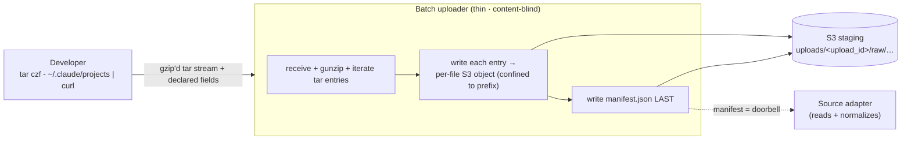

# Batch Uploader — the file front-door (`src/server/uploader`)

**Status:** Design for review · pre-implementation
**Parent RFC:** `docs/design/2026-07-19-upload-batch-ingestion.md` (§4.1/§4.2 — this doc promotes
that sketch into a full module and resolves its unpack question).
**Downstream:** the **source adapter** (`docs/modules/source-adapter.md`) discovers and reads
what this service stages. **Hands off via:** the manifest (§6), which is the source adapter's
doorbell.

---

## 1. In a Nutshell

The batch uploader is the **file front-door**: a thin, content-blind service whose whole job is
to accept a developer's uploaded `~/.claude/projects` archive, **stream-unpack** it into per-file
objects in the S3 staging bucket, and write a **completion manifest** that tells the source
adapter the upload is ready. It performs no normalization, understands no vendor formats, and
never reads file *content* — it moves opaque bytes and parses only archive structure.

Three load-bearing decisions:

1. **The service stream-unpacks the tarball into per-file objects — unpacking is mandatory, not
   optional.** This resolves the parent RFC's contradiction (§4.1 "does no parsing" vs. §4.2
   "unpacked"): the service *does* parse the **tar structure** (not content), because the source
   adapter needs individual, **seekable** objects for its ranged reads and per-file byte-offset
   cursors — and you cannot ranged-read a file inside a gzip'd tar (§5).
2. **Objects first, manifest last — the manifest is the atomicity boundary.** All per-file
   objects are written, *then* `manifest.json`. Its presence is the sole signal that an upload is
   complete and correct; a crash mid-unpack leaves objects with no manifest, which the source
   adapter simply never sees (§6, §7).
3. **Thin and unauthenticated in v1.** No login, no parsing of content, no state beyond the
   in-flight request; identity is self-declared and copied into the manifest (RFC §5). Auth,
   resumable upload, and customer-owned buckets are named seams (§11).

Scale (corrected): an upload is **hundreds of small files** (~2 MB each; master §10.4), not a
few huge ones. The aggregate archive can approach ~a GB, so the service **streams** it and never
buffers the whole thing; there is no multi-GB single-file case.



---

## 2. Terms

Reuses the RFC §2 terms (Upload, Declared fields, Manifest, Staging bucket). Sharpened here:

| Term | Meaning |
|---|---|
| **Stream-unpack** | Decompress and iterate the incoming gzip'd tar entry-by-entry, writing each entry to its own S3 object, without ever holding the whole archive in memory or on local disk. |
| **Per-file object** | One unpacked S3 object per archive entry (a `<session>.jsonl`, a `subagents/agent-*.jsonl`, a `.meta.json`) — individually addressable and ranged-readable. |
| **Manifest** | `manifest.json`, written last; the upload's completion marker and file inventory; the interface consumed by the source adapter (§6). |
| **Orphan prefix** | An `uploads/<upload_id>/` prefix with objects but **no** manifest — a crashed or abandoned upload; ignored downstream, reclaimed by lifecycle GC (§7). |

---

## 3. Responsibilities and Non-Responsibilities

| The uploader owns | It does NOT own |
|---|---|
| Receiving the archive over one HTTP request | Authentication (none in v1; a seam — §11) |
| Decompress + stream-unpack tar entries | Reading, parsing, or validating file **content** (JSONL) |
| Writing per-file objects, confined to the upload prefix | Normalization, vendor formats, the event schema (normalizer) |
| Building and writing the manifest (inventory + completion) | Reading files back / cursors / shipping (source adapter, msging) |
| Rejecting malformed archives and unsafe tar paths (§7) | Dedup / idempotency of events (source-adapter cursor + ingest) |
| Copying declared fields + synthetic `producer_id` into the manifest | Deciding identity policy (self-declared in v1; RFC §5) |

**Content-blind by design:** the service parses tar *headers* (path, size) but never the bytes
inside an entry. This keeps it thin, keeps content out of its logs (§10), and means "is this a
valid Claude Code session?" is entirely the normalizer's question, downstream.

---

## 4. Wire Contract

Promoted from RFC §4.1. One endpoint; one streamed request.

**Request:**

```
POST /v1/uploads?org=<str>&user=<str>&plan=<str|absent>&vendor=<str=claude_code>&label=<str|absent>
  Content-Type: application/gzip
  body: gzip'd tar of the ~/.claude/projects tree (streamed; not buffered)
```

The one-liner client (unchanged from RFC §4.1): `tar czf - -C ~ .claude/projects | curl … --data-binary @-`.

**Response — 201 (staged):**

```json
{
  "upload_id":   "string · server-minted uuid4 hex · the prefix key for this upload",
  "received_ts": "string · ISO-8601 UTC · when unpack finished and the manifest was written",
  "file_count":  "int · number of per-file objects written",
  "bytes":       "int · total uncompressed bytes unpacked",
  "status":      "enum: staged · objects durable in S3 and manifest written (upload is complete)",
  "declared":    { "org_id": "string", "user_id": "string", "plan": "string | null", "vendor": "string" }
}
```

**Error responses** (§7): `400` malformed/unsafe archive (with a machine-readable `reason`),
`413` over the configured size cap, `499`/timeout partial upload (no manifest written — nothing
staged). No success is reported until the manifest is durable.

---

## 5. Stream-Unpack — the core decision

The service decompresses the incoming gzip stream and walks tar entries, writing each to its own
S3 object under the upload prefix, one entry in flight at a time. Memory is bounded by the
largest single entry (a few MB), never by the archive.

**Why unpack at all (the resolution of the RFC contradiction):** the source adapter reads each
session file with **ranged GETs** and resumes from a **byte offset** within it
(`source-adapter.md` §4–7). Neither is possible inside a gzip'd tar — gzip is not randomly
seekable, and tar entry boundaries require a sequential scan. So the files **must** exist as
individual, seekable S3 objects before the adapter runs. Unpacking is therefore a requirement of
the downstream design, not a convenience — and "the service does no parsing" (RFC §4.1) is
corrected to "the service parses archive **structure**, never content."

| Option | Pros | Cons | Verdict |
|---|---|---|---|
| **Stream-unpack in the service → per-file objects (chosen)** | Downstream gets seekable objects (required §5); immediate (no extra hop); bounded memory; service stays content-blind | Service parses tar structure (still no content) | **Chosen.** |
| Store the gzip'd tar whole; adapter reads inside it | "Truly no parsing" in the service | Breaks the adapter — no ranged read / offset resume into a gzip'd tar; would force full sequential re-scan per access | Rejected — incompatible with `source-adapter.md`. |
| Store tar whole; a separate unpack worker expands it | Service is trivial | An extra process and state machine for no benefit; delays availability; still ends at per-file objects | Rejected for v1; revisit only if unpack cost ever needs its own scaling. |

---

## 6. S3 Layout and the Manifest (the interface to the source adapter)

Layout (aligned with RFC §4.2), one prefix per upload:

```
s3://<bucket>/uploads/<upload_id>/
    raw/projects/<escaped-project-dir>/<session_id>.jsonl
    raw/projects/<escaped-project-dir>/<session_id>/subagents/agent-<id>.jsonl
    raw/projects/<escaped-project-dir>/<session_id>/subagents/agent-<id>.meta.json
    manifest.json                                    ← written LAST
```

The **manifest** is this module's real output contract — the source adapter reads it to enumerate
sources and stamp identity (`source-adapter.md` §5, §6). Written only after every object is
durable:

```json
{
  "upload_id":        "string · matches the prefix",
  "received_ts":      "string · ISO-8601 UTC · unpack complete",
  "source":           "batch",
  "declared":         { "org_id": "string", "user_id": "string", "plan": "string | null", "vendor": "string · e.g. claude_code" },
  "producer_id":      "string · synthetic, uuid5(org_id/user_id) (RFC §5.2) — stamped here so the adapter need not recompute",
  "file_count":       "int",
  "files": [
    {
      "key":    "string · S3 key relative to the upload prefix, e.g. raw/projects/…/<session>.jsonl",
      "rel":    "string · the original path within ~/.claude/projects (the logical-source key basis, source-adapter §2)",
      "bytes":  "int · uncompressed size",
      "sha256": "string | absent · content hash for integrity, if computed during unpack"
    }
  ],
  "uploader_version": "string"
}
```

- **`rel`** is the archive-relative path; the source adapter forms its **logical source key** from
  `producer_id + rel`, so re-uploads of the same session (under a new `upload_id`) resume from the
  prior cursor and process only the new tail (`source-adapter.md` §4.1). This is why the manifest
  carries `rel`, not just the physical `key`.
- The adapter uses `files[]` as its authoritative source list for the upload — it need not list
  the bucket.

### 6.1 A second manifest generation (`../upload`, the Go uploader)

A second producer writes this same `manifest.json` doorbell: `talium-sync`, a standalone Go
client (sibling repo `../upload`), which replaces this module's role for new deployments while
this service keeps running unmodified for existing ones. The collector (`src/common/manifest.py`)
accepts **both** generations on the same read path — nothing above changes for the old
generation.

The wire differences, all additive except one required-field rename:

| Field | Old (this module) | New (`../upload`) |
|---|---|---|
| Scope identifier | `upload_id` (server-minted per upload) | `endpoint_id` (client-derived, stable per machine — see `../upload`'s design doc §9) |
| `vendors` | absent | `list[str]` — which vendors this endpoint has ever sent (e.g. `["claude_code"]`, eventually `+"codex"`) |
| `files[].vendor` | absent (collector treats `None` as `claude_code`) | `"claude_code"` \| `"codex"` — the collector filters to `claude_code` only, logging a count of anything else skipped |
| `files[].session_id`, `.repo`, `.repo_url`, `.branch`, `.state`, `.active`, `.mtime` | absent | present (nullable except `active`) |

`common.manifest.Manifest.scope_id` returns whichever of `upload_id`/`endpoint_id` this manifest
carries — the one thing most callers actually need. A manifest with neither fails validation.

**Repo identity now travels per-file**, replacing the interim `.talium-git-remotes.json` sidecar
this module's own upload script used to write (that mechanism and its collector-side reader are
gone as of the uploader/collector integration plan, 2026-09-22): `files[].repo_url` (preferred)
or `.repo` carries a real `git remote get-url origin`, resolved by the client at the session's
actual working directory and matched onto the file it belongs to directly, with no separate
cwd-keyed lookup on the collector side. `.state` (`"live"`/`"stale"`) means "did this file's bytes
change since the last manifest write," **not** "has the collector already processed it" — the
collector's own checkpoint identity is the sole "already collected" signal, so `.state` is read
by nobody downstream of the manifest parse itself.

**Base S3 prefix.** The Go uploader can be configured with a bucket-level prefix
(`object_store.s3.prefix` / `TALIUM_S3_PREFIX`), so a manifest may live at
`<base>uploads/<endpoint_id>/manifest.json` rather than bucket-root `uploads/<endpoint_id>/`. The
collector never reconstructs this prefix — it derives it from each manifest's own discovered S3
key (stripping `manifest.json` off the end) and reads every file relative to that, so it works
under any base prefix without configuration on the collector side, present or future. The
collector's own `--scope` sweep root (`config/collector.yaml`) must still be set to
`<base>uploads/` for the sweep to find these manifests in the first place.

---

## 7. Failure Modes and Safety

- **Atomicity (objects-first-manifest-last).** A crash or dropped connection mid-unpack leaves
  per-file objects but **no** manifest. The source adapter keys off the manifest, so a
  manifest-less prefix is simply never processed — no partial upload is ever half-ingested.
- **Orphan reclamation.** Those manifest-less prefixes accumulate; an S3 **lifecycle rule** (or a
  small sweeper) deletes `uploads/*` prefixes older than N hours that lack a `manifest.json`.
  Stated, not hand-waved.
- **Retry = a fresh upload.** There is no resume of a partial unpack in v1; the client simply
  re-runs the one-liner, producing a **new `upload_id`** and a clean prefix. The orphaned prefix
  is GC'd. (Resumable/multipart upload is the §11 seam.)
- **Malformed input.** Not gzip, not a tar, a truncated tar, or an empty archive → `400` with a
  `reason`; nothing is staged (no manifest).
- **Tar-path safety (security, normative).** Every entry path is sanitized: absolute paths,
  `..` traversal, and symlink entries are **rejected**; all writes are confined to the upload's
  prefix. A malicious archive can never cause a write outside its own prefix.
- **Concurrency & upload-level idempotency.** Each request mints a fresh `upload_id`; concurrent
  uploads are independent prefixes. The service is **not** idempotent (same content twice → two
  prefixes) — and it does not need to be: the source adapter's logical-source cursor and ingest's
  `event_id` dedup make a duplicate upload a no-op downstream (zero duplicate events).

---

## 8. Scale and Bounded Memory

Consistent with the corrected premise (many small files, not multi-GB files):

- **Stream in, stream out.** The archive is consumed as a stream and written entry-by-entry;
  neither the whole gzip nor a whole entry-set is buffered. Memory is bounded by one entry (~a
  few MB), independent of `file_count` or aggregate size.
- **Hundreds of objects per upload.** A full `~/.claude/projects` unpacks to ~1,500 small objects
  (master §10.4). Object PUTs dominate the work; large entries (rare) use S3 multipart, small ones
  a single PUT.
- **Sizing.** I/O-bound, a handful of concurrent human uploads; one small container. Onboarding is
  a one-time ~0.5 GB/developer transfer (RFC §7), spread across developers.

---

## 9. Security and Privacy

Consistent with the deployment-boundary posture (RFC §8, architecture §17):

- **No auth in v1** (trusted zone; throwaway service). Declared fields are accepted as-is; auth is
  the §11 seam (a FastAPI dependency, architecture §18.1) that turns them into verified claims
  without changing anything downstream.
- **Content-blind.** The service never reads entry bytes, so **content never enters its logs** —
  it logs `upload_id`, sizes, counts, and declared fields only.
- **At-rest & isolation** are deployment config: S3 SSE, per-org prefix/bucket isolation.
- **Tar-path sanitization** (§7) is the one security control the service itself enforces.

---

## 10. Testability and Debuggability

Per architecture §13:

- **Fixtures:** sample archives — a normal many-file `~/.claude/projects`, an archive with a
  subagents tree, a **malformed** tar, and a **path-traversal** tar (must be rejected). Goldens
  are the resulting object set + manifest.
- **Atomicity test (required):** kill the service mid-unpack; assert no `manifest.json` exists and
  the source adapter does not process the prefix; assert the orphan sweeper reclaims it.
- **Round-trip test:** unpack an archive, then have the source adapter enumerate from the manifest;
  assert every `files[]` entry resolves to a readable object.
- **Debuggability:** "why didn't upload X ingest?" is a two-step answer — does its prefix have a
  `manifest.json` (did upload finish?), and does `files[]` match the objects present. Structured
  logs carry `upload_id`, never content.

---

## 11. Phasing and Seams

**v1:** one endpoint, no auth, stream-unpack to per-file objects, manifest-last, orphan GC.

| Deferred | Seam |
|---|---|
| **Auth on upload** | FastAPI dependency (architecture §18.1): enrollment key then JWT; declared fields become verified claims; downstream unchanged. |
| **Resumable / multipart upload** | For very large aggregate archives or flaky links: chunked/resumable receive + resume of a partial unpack. v1 retries as a fresh `upload_id`. |
| **Customer-owned bucket** | The write target is config; point it at the customer's staging bucket (RFC §9) — content never leaves their cloud. |
| **Integrity `sha256` in the manifest** | Compute per-entry hashes during unpack for end-to-end integrity checks; optional in v1. |
| **Other vendors** | The service is vendor-agnostic already (it moves opaque files); a `vendor` param and the same layout serve Codex/Cursor archives. |

---

## 12. Open Items

| # | Question | Working assumption |
|---|---|---|
| U1 | Size cap for a single upload before `413` | A generous configured cap (e.g. a few GB aggregate); beyond it, the resumable seam (§11). |
| U2 | Orphan GC — S3 lifecycle rule vs. an explicit sweeper | S3 lifecycle rule on manifest-less prefixes is the low-friction default; a sweeper if finer control is needed. |
| U3 | Compute `sha256` per entry during unpack (cost vs. integrity)? | Deferred (§11); `sha256` is `absent` in v1 manifests. |
| U4 | Escaped-project-dir naming — reuse Claude Code's own escaping, or our own? | Reuse the on-disk directory names verbatim inside `raw/`; `rel` preserves the exact archive path so the logical-source key is stable. |
| U5 | Does the manifest need the declared `producer_id`, or should the adapter derive it? | Manifest carries it (stamped once here) so the adapter stays purely mechanical; confirm when joining to `source-adapter.md`. |
