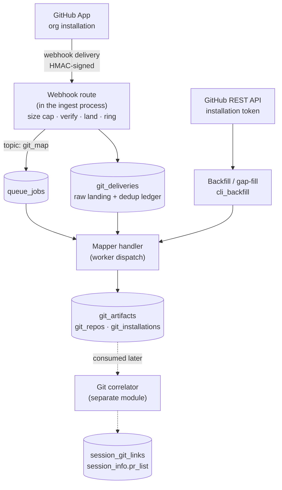
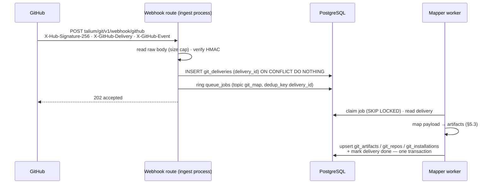
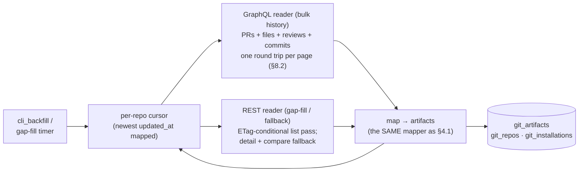

# Git Source — Design (`src/server/ingest/git`)

**Status:** Finalized for implementation (2026-08-22). Supersedes the draft; folds in the
verification pass and decisions recorded in `docs/design/notes/2026-08-19-github-signal-sources.md`.
**Parent architecture:** `docs/design/system-architecture.md` (§2 step 7, §5, §6.4, §8.4, §18.2).
**Adjacent specs:** `docs/modules/ingest.md` (the host process), `docs/modules/storage.md` §3.1/§3.5
(conventions, `users.github_user`), `docs/design/coding-econ-design-draft.md` §6.4 (webhook posture)
and §11.3 (the analyzer that consumes this module's output).
**Downstream consumer:** `docs/modules/pr-work-classification.md` — the analysis/attribution module.
It reads this module's `git_artifacts`, correlates them to sessions on **commit SHA**, and classifies
PR work by diff. This module acquires; that one interprets. The contract between them is §5.3.
**Scope boundary:** this module **acquires and normalizes repository facts** from three readers
(webhook, GraphQL, REST) into one artifact contract, and populates four tables. It does not score,
link, classify, or attribute anything — those belong to `pr-work-classification.md`.
**Verification note:** the GitHub-specific numbers here (commit cap, redelivery window, rate limits,
API versions, the permission→event gating) were checked against live GitHub docs on 2026-08-19 and a
working POC (`docs/manual-testing.md` §6). They drift; re-verify before relying on any single one.

---

## 1. In a Nutshell

A **GitHub App** installed at the account level (org or user) pushes repository events to a
signature-verified endpoint hosted **inside the ingest process**. Each delivery is landed raw and
acknowledged in milliseconds; a worker maps landed deliveries into **normalized git artifacts** —
PRs, commits, reviews, check outcomes — that the analyzer later links to sessions on commit SHA. The
**identical mapper** is fed by three readers: the webhook (live), the **GraphQL** API (bulk history
backfill — one round trip returns a PR with its files, reviews and commits), and the **REST** API
(recurring gap-fill via ETag-conditional requests, and the fallback when a GraphQL page times out or
truncates). One mapper, three readers, so they cannot drift (§4.2, §8).

Three load-bearing decisions:

1. **Git data does not travel the msging wire.** The msging rewrite made the envelope
   one-msg-per-session with producer-bearer auth and an SSE ACK peer; a GitHub delivery has none
   of those. Git facts land directly in git tables. "One front door" means one process and one
   storage path, not one wire protocol (§3).
2. **Land raw, map asynchronously.** GitHub does not automatically retry a delivery we fail, so
   the request handler's only job is verify → persist → `202`. Mapping happens on the existing
   `queue_jobs` worker, which makes a mapper bug a re-run rather than a data loss (§4.1).
3. **Backfill is v1, not later.** Webhooks only ever see the future; ROI at first customer contact
   is computed against history. The webhook mapper and the REST backfill share one mapping
   function, so they cannot drift (§8).

Headline numbers (§12): ~20,000 deliveries/day at the 1,000-developer reference — ~0.2/s average,
~100 MB/day of raw payload under a 14-day retention, ~12 MB/day of permanent artifact rows. That is
**~2% of the event volume the same system already carries**, and zero LLM spend. The one real cost
is the initial backfill's rate-limit hours (§8.3).



---

## 2. Terms

Architecture §3 terms apply unchanged. New here:

| Term | Meaning |
|---|---|
| **Delivery** | One webhook HTTP POST from GitHub, identified by the `X-GitHub-Delivery` UUID. The unit of at-least-once intake and of replay. |
| **Installation** | One GitHub App installed on one GitHub account (org or user), identified by `installation_id`. It is the unit of authorization, of rate limiting, and of `org_id` resolution. |
| **Installation token** | A short-lived (1 h) credential minted from the App's private key, scoped to one installation. Never persisted. |
| **Artifact** | A normalized repository fact — a PR, a commit, a review, or a check outcome (§5.3). The correlator's input. |
| **Mapping** | Turning a delivery payload (or a REST response) into artifacts. Deterministic and idempotent by construction. |
| **Gap-fill** | A scheduled narrow REST sweep that re-reads recently updated PRs, covering deliveries GitHub failed to deliver or we failed to land. |
| **Coverage** | The honestly reported fraction of artifacts that could be attributed — to a user (author mapping) and to a session (correlation). Reported, never assumed to be 100%. |

---

## 3. Where This Sits — and the Architecture Delta It Forces

Architecture §2 step 7 and §6.4 say git webhooks "arrive through the same Ingest front door as a
different event type," with `git_event` reserved in the envelope's `event_type` enum (§5.1). That was
written before the msging rewrite. The front door is now the msging `srv`: producer-bearer auth,
`msg_id` monotonic per producer, **one msg = one session**, ACK-after-fold delivered over an SSE
channel back to a long-lived client.

A GitHub delivery matches none of those properties. It authenticates by HMAC over the raw body, has
no producer identity and no session, holds no SSE channel, and expects a response inside GitHub's
delivery timeout. Forcing it into an envelope would mean fabricating a producer id, a session id and
an acknowledgment peer that do not exist.

| Option | Pros | Cons | Verdict |
|---|---|---|---|
| **Direct to git tables (chosen)** | Honest shapes; the raw delivery is its own replay buffer; no fabricated identities; the mapper is shared with backfill, which has no envelope at all | The `git_event` enum member becomes vestigial; architecture §2/§5.1 need an amendment | **Chosen.** The amendment is small and the alternative is fiction. |
| Wrap deliveries as msging envelopes server-side | Preserves "one door" literally | Invents `producer_id`/`session_id`/ACK peer; a REST backfill row would have to be wrapped too, for no consumer | Rejected. Revisit only if a *pushed* git source (a customer-run relay) ever appears — then it is a real producer. |
| A separate git service with its own datastore | Total isolation | A second store to run and join across, for data whose only purpose is joining to sessions | Rejected; contradicts §10.1 (Postgres alone). |

**Hosting.** The webhook route runs **inside the ingest process** as a host route alongside the
msging router (`event-messaging-design.md` §6.3: "host keeps middleware, auth, CORS, lifespan… host's
own routes").

| Option | Pros | Cons | Verdict |
|---|---|---|---|
| **In the ingest process (chosen)** | One process, one config, one deploy; shares the storage layer and `queue_jobs` directly | The ingest listener becomes internet-facing, so the producer routes share a public surface | **Chosen.** Mitigations below; the split is a named seam, not a rewrite. |
| Own process on its own port | The public surface carries only the webhook route | A second process to run even for a laptop demo | **The named seam.** The code is a router + handler with no ingest-internal coupling, and `event-messaging-design.md` §6.3 already shows path-prefix routing (`talium/git/v1/* -> :8002`). Adopt when the deployment is genuinely public. |
| Managed function (Lambda/Cloud Run) in front | Isolates the public surface without a Python service | A third deployment idiom; the function still needs DB access or a queue hop | Rejected for now. |

Accepted-and-mitigated consequences of the chosen hosting: the reverse proxy allowlists path
prefixes (`talium/ingest/v1/*`, `talium/git/v1/*`) rather than forwarding everything; the webhook
route enforces its own body cap independently of msging's; producer routes keep their bearer auth
unchanged, so a public listener does not weaken them — it only widens who can attempt them.

---

## 4. Data Flow

### 4.1 The live path (webhook)



The handler does four things and nothing else, **in this order**: **cap the size** while reading the
**raw body** (the HMAC is over raw bytes, so the route cannot use a parsed body model), **verify the
signature** with a constant-time compare, and **land the delivery**. Landing is an insert-if-absent on
the delivery id, so GitHub's manual redelivery is a no-op. Everything interpretive happens in the
worker.

**The size cap, and why it is a step of its own.** Verifying the signature requires reading the entire
raw body into memory — and "read an unbounded body into memory" is exactly what a public,
internet-facing endpoint (§3) must never do: a hostile or buggy client could POST gigabytes and
exhaust the process before a single byte is verified. The cap (`max_body_bytes`, default **25 MiB**)
bounds that read and rejects anything larger with `413 too_large` (§5.1). Two facts set the value and
make the rejection lossless: GitHub **never sends a payload over 25 MB** (beyond that it drops the
delivery entirely, §12), so a larger body is by definition not a legitimate delivery; and this cap is
**independent of the msging producer routes' 4 MiB cap** on the same listener (§3), because a git
payload is legitimately far larger than a session segment. The cap therefore comes **before** verify
in the pipeline — you cannot verify without having read the body, so the bound has to bite at read
time, not after.

**Why not map inline in the request handler?**

| Option | Pros | Cons | Verdict |
|---|---|---|---|
| **Land raw, map on the worker (chosen)** | `202` in milliseconds; a mapper bug is a re-run over landed rows, not lost data; identical handler for webhook and backfill payloads | One extra table and a poll-interval of latency (~1 s) | **Chosen.** GitHub does not auto-retry what we fail; the landing table is the durability the sender does not provide. |
| Map inline, then acknowledge | No landing table; artifacts exist the moment we answer | Any mapper defect or DB hiccup turns into a failed delivery that only a human redelivery recovers; response time now depends on mapping cost | Rejected. Matches the same reasoning that makes ingest thin (arch §6.4). |
| Acknowledge first, map from an in-memory queue | Fastest | A process restart loses everything queued — the exact failure the msging rewrite avoided by keeping durability at the client; here there is no client to hold it | Rejected. |

### 4.2 The history path (backfill and gap-fill)

Backfill and gap-fill feed the **same mapper as the webhook path** (§4.1), from the **API** instead of
a landed delivery. Two readers split the work by their rationing model (§8.2): **GraphQL** is the bulk
historic reader — one round trip returns a page of PRs *with* their files, reviews and commits; **REST**
is the gap-fill reader — an ETag-conditional list pass on a timer restricted to "updated since the
cursor," and the fallback when a GraphQL page times out or truncates. A **per-repo cursor** checkpoints
progress so a run resumes rather than restarting.

**This path bypasses both `git_deliveries` and `queue_jobs`** — the two boxes the webhook path writes.
There is no delivery to land (the API response *is* re-fetchable by definition, so it needs no replay
buffer) and no dispatch to trigger (the backfill process — `cli_backfill` or the gap-fill timer — calls
the mapper function directly, in-process). What converges is only the **mapper**: webhook, GraphQL, and
REST all produce byte-identical artifacts through it, which is the whole reason it is one shared
function (§8.2, and the reader-agreement test in §11).



Note what is absent versus §4.1: no `git_deliveries`, no `queue_jobs`, no `202` — this path is a
worker/CLI reading the API and calling the mapper, not an HTTP endpoint answering GitHub.

---

## 5. Contracts

### 5.1 The webhook HTTP contract

```
POST talium/git/v1/webhook/github
  X-GitHub-Delivery:       string · UUID · the delivery's identity and our dedup key (mandatory)
  X-GitHub-Event:          string · event name, e.g. "pull_request" (mandatory)
  X-Hub-Signature-256:     string · "sha256=<hex>" HMAC of the raw body under the app's
                                    webhook secret (mandatory; absence is a rejection)
  X-GitHub-Hook-Installation-Target-Id: string | absent · the app id, for multi-app hosts
  Content-Type:            application/json
  body:                    raw bytes · the event payload (never re-serialized before verification)
```

Responses — deliberately few, and never leaking why verification failed:

| Status | Code | When |
|---|---|---|
| `202` | `accepted` | Verified and landed (including a duplicate delivery id — same answer). |
| `204` | — | `ping` event: verified, nothing to land. |
| `401` | `bad_signature` | Missing or invalid signature. Logged content-free, payload discarded. |
| `413` | `too_large` | Body over the configured cap. |
| `503` | `unavailable` | Storage unreachable — GitHub's delivery log records the failure for manual/API redelivery. |

### 5.2 The landed delivery

```json
{
  "delivery_id":     "string · UUID from X-GitHub-Delivery · primary key, the dedup ledger",
  "event":           "string · X-GitHub-Event, e.g. \"pull_request\"",
  "action":          "string | null · payload.action where the event has one",
  "installation_id": "int | null · payload.installation.id; null for pings and app-level events",
  "repo_num":        "int | null · payload.repository.id (numeric, rename-stable)",
  "payload":         "object · the delivery body verbatim — the replay source",
  "status":          "enum: pending | done | unmapped | failed",
  "attempts":        "int ≥ 0",
  "received_at":     "string · ISO-8601 UTC",
  "mapped_at":       "string | null · ISO-8601 UTC"
}
```

`status = unmapped` is a first-class outcome, not an error: v1 subscribes to more events than it maps
(§7.2), and an unmapped delivery is simply a landed row awaiting a mapper that may never be written.
Retention (§10.3) prunes `done` and `unmapped` rows alike.

### 5.3 The normalized git artifact — the correlator's input contract

One shape for every kind, discriminated by `kind`. Additive-only evolution; consumers must ignore
keys they do not understand (the same rule as the event envelope's `debug` bag, arch §5.1).

```json
{
  "artifact_id":  "string · deterministic · \"github:<repo_num>:<kind>:<key>\" — the upsert key",
  "kind":         "enum: pr | commit | review | check",
  "repo_id":      "string · \"github:<repo_num>\" — numeric, survives rename and transfer",
  "org_id":       "string · resolved from the installation (§6.1)",
  "number":       "int | null · PR number; null for commit and check",
  "sha":          "string | null · commit sha; the head sha for pr and check. THE SESSION-JOIN
                   KEY: the analyzer (pr-work-classification.md) links a session to a commit on
                   this value, so it is indexed (§9). A `commit` artifact carries the real commit
                   sha; a `pr` carries its head sha, and the PR's constituent commit shas arrive as
                   their own `commit` artifacts (one per commit in the push / PR commit list).",
  "author_login": "string | null · GitHub login of the author/actor",
  "author_email": "string | null · commit author email; the fallback join for user mapping (§6.3)",
  "user_id":      "string | null · resolved via users.github_user; null until mapped — never guessed",
  "is_bot":       "bool · login ends in [bot] or is a known automation account (§6.3)",
  "state":        "string · kind-specific: pr → open | closed | merged · review → approved |
                   changes_requested | commented | dismissed · check → success | failure | neutral |
                   cancelled · commit → pushed",
  "title":        "string | null · PR title; metadata, never logged (§11)",
  "branch":       "string | null · head ref",
  "base_branch":  "string | null · base ref; null for commit",
  "created_at":   "string · ISO-8601 UTC · the artifact's own creation time at GitHub",
  "updated_at":   "string · ISO-8601 UTC · last change seen; drives cursor and last-writer-wins",
  "closed_at":    "string | null",
  "merged_at":    "string | null · set only when a PR actually merged",
  "merge_commit_sha":   "string | null · pr only · the sha the merge produced on the base branch;
                         the commit→PR provenance anchor the rework module blames back through (§5.7)",
  "before_sha":         "string | null · pr only · base-branch tip immediately BEFORE the merge —
                         the rework method's before state (rework-measurement-method.md §5.1)",
  "after_sha":          "string | null · pr only · base-branch tip immediately AFTER the merge",
  "integration_method": "string | null · pr only · \"merge\" | \"squash\" | \"rebase\" · determines how
                         before/after map to parents (rework §5.1.1–5.1.4)",
  "reverts_sha":        "string | null · pr/commit · the sha this change reverts, parsed from a
                         \"This reverts commit <sha>\" message; links a revert to its original (§5.6)",
  "commit_shas":        "array of string | null · pr only · the PR's constituent commit shas (its own
                         commit list, pre-merge). The membership the analyzer needs to compute a
                         commit's owning PR and dedup effort across stacked/hierarchical PRs
                         (pr-work-classification.md §6). Shas only, never diff content.",
  "stats": {
    "additions":      "int | null · null when not fetched (list-pass-only backfill, §8.3)",
    "deletions":      "int | null",
    "changed_files":  "int | null",
    "commits":        "int | null",
    "review_count":   "int | null",
    "comment_count":  "int | null"
  },
  "files": [
    { "path":      "string · repo-relative path",
      "op":        "enum: added | modified | removed | renamed",
      "additions": "int | null",
      "deletions": "int | null" }
  ],
  "parent_artifact_id": "string | null · a review or commit points at its PR",
  "labels":       "array of string · PR/issue labels — a grouping and classification key (§5.5)",
  "milestone":    "string | null · milestone title — the lightweight sprint proxy (§5.5)",
  "linked_issue": "string | null · \"github:<repo_num>:issue:<n>\" for a PR that closes an issue (§5.5)",
  "info":         "object · namespaced catch-all: \"github.<field>\" for unmapped provider fields"
}
```

One concrete instance:

```json
{
  "artifact_id": "github:41213765:pr:1184",
  "kind": "pr", "repo_id": "github:41213765", "org_id": "org_talium",
  "number": 1184, "sha": "9f3c1ab7d2e5c0114f8b2a6d9e77c31480ab5e62",
  "author_login": "akhuteta", "author_email": null, "user_id": "u_anil", "is_bot": false,
  "state": "merged", "title": "Adapter/normalizer: pair tool calls by record id",
  "branch": "adapter-normaliser-impl", "base_branch": "main",
  "created_at": "2026-07-24T09:12:04Z", "updated_at": "2026-07-26T15:41:22Z",
  "closed_at": "2026-07-26T15:41:22Z", "merged_at": "2026-07-26T15:41:22Z",
  "stats": {"additions": 412, "deletions": 96, "changed_files": 7, "commits": 4,
            "review_count": 2, "comment_count": 5},
  "files": [
    {"path": "src/collector/normalizer/claude_code.py", "op": "modified", "additions": 118, "deletions": 40},
    {"path": "tests/collector/normalizer/test_tool_pairing.py", "op": "added", "additions": 210, "deletions": 0}
  ],
  "parent_artifact_id": null,
  "merge_commit_sha": "5b1e9c0f...", "before_sha": "a0c2f5a...", "after_sha": "5b1e9c0f...",
  "integration_method": "squash", "reverts_sha": null,
  "info": {"github.draft": false, "github.merged_by": "akhuteta"}
}
```

**What is never stored, at any point:** diff text, patch hunks, file contents, review comment bodies,
PR/issue body text. Paths, counts, and titles are metadata; the rest is code and stays at GitHub.
This is the same metadata-only posture the draft states in §6.4, and it is what keeps the module out
of the content-governance conversation entirely.

### 5.4 Event → artifact mapping

| Webhook event | Actions mapped in v1 | Artifacts written |
|---|---|---|
| `pull_request` | opened, reopened, synchronize, closed, ready_for_review, edited | Upsert one `pr` artifact; `state = merged` only when the payload says merged, else `closed`. On merge, capture `merge_commit_sha` and derive `integration_method` (§5.7). Capture `labels`, `milestone`, `linked_issue` (§5.5). A title matching `^Revert "` sets `info["github.is_revert"]=true` and parses `reverts_sha` (§5.6). A `closed` with `merged_at=null` is a **recall candidate** the analyzer reads (§5.6). |
| `pull_request_review` | submitted, dismissed | Upsert one `review` artifact, `parent_artifact_id` = its PR; bump the PR's `review_count`. |
| `pull_request_review_comment` | created, deleted | No own artifact; bumps the PR's `comment_count`. Inline code-review comments only. |
| `issue_comment` (on a PR) | created, deleted | No own artifact; bumps the parent PR's `comment_count`. **PR conversation comments arrive as `issue_comment`, not `pull_request_review_comment`** — GitHub models a PR as an issue, so this event (and its **Issues** permission, §7.2) is required to count PR discussion. |
| `push` | all | Upsert one `commit` artifact per commit in the payload (**GitHub inlines up to 2048 commits**; only a >2048 push — a history import — truncates, and then the mapper records the `before..after` range and defers to the compare API in gap-fill, §8.2). A commit whose message starts `Revert ` sets `info["github.is_revert"]=true`. |
| `check_suite` | completed | Upsert one `check` artifact keyed on the suite id, `parent_artifact_id` = the PR when the payload carries one. |
| `installation`, `installation_repositories` | created, deleted, suspend, unsuspend, added, removed | Upsert `git_installations` and `git_repos`; a deleted or suspended installation is marked, never row-deleted. `installation.account.type` (`User`\|`Organization`) is recorded — a personal-account install sees only that user's repos and has no org members to map authors against (§6.3). |
| `issues` | opened, closed, reopened, labeled, milestoned | **Landed; mapping DEFERRED to v1.5.** The payloads sit in `git_deliveries` for later replay. Requires the **Issues** permission (§7.2) or GitHub never delivers them. |
| `issue_comment` (on an issue) | — | **Landed, not mapped in v1.** |
| `ping` | — | `204`, nothing landed. |

**Ordering is not assumed.** Deliveries can arrive out of order (and a backfill row can arrive after a
webhook row for the same PR). Every upsert is **last-writer-wins on `updated_at`**: an older payload
never overwrites a newer artifact. That, plus the deterministic `artifact_id`, is what makes replay
and re-backfill idempotent (arch design rule 3).

### 5.5 Grouping keys — captured at acquisition, grouped at query time

The downstream product groups cost and productivity by **sprint, project, team, epic, or repo**, and
the unit varies by customer (`pr-work-classification.md` §attribution). The acquisition layer does not
choose a grouping unit; it **captures every plausible grouping key** so grouping is a later `GROUP BY`,
never a re-backfill. Three come free in payloads §5.4 already handles and are promoted to first-class
artifact fields (§5.3): `labels` (also the tier-0 classification signal), `milestone` (the sprint
proxy for teams not on Projects v2), and `linked_issue` (the PR→issue "closes #n" reference, parsed
from the PR body's closing keywords or the timeline; the issue **text** is never stored, only the ref).

**Rule:** a key not captured now cannot be recovered without re-reading history. Labels and milestone
cost bytes; capture them from day one even before a report groups on them.

### 5.6 Revert and recall detection

Both are **negative-productivity** signals the analyzer's quality layer reads
(`pr-work-classification.md` §recall). This module only *captures* the raw evidence, content-free.

**Revert** has no webhook event of its own — it is an ordinary `pull_request`/`push` whose content
undoes a prior change. v1 detects it from the title/message prefix (`Revert "…"`, GitHub's own revert
button format), flags `info["github.is_revert"]`, and **parses `reverts_sha`** from the standard
`This reverts commit <sha>` line. That sha links a revert artifact back to the original it undoes —
metadata only, never the diff. A false positive is a mislabeled flag, never a data loss.

**Recall** (a PR opened, worked, then abandoned without merging) is captured structurally: a `pr`
artifact with `state=closed` and `merged_at=null` is a **recall candidate**. That is the whole
content-free signal this module provides; classifying *why* it was abandoned (from the closing
comment) is the analyzer's opt-in content-transit job (`pr-work-classification.md` §recall), never
stored here.

### 5.7 Merge-transition capture (for rework provenance)

The rework module (`rework-measurement-method.md`) needs the base-branch state transition a merge
produced — `before_sha`, `after_sha`, and the `integration_method` — plus `merge_commit_sha` to map
an arbitrary base-branch commit back to the PR that produced it. **This data already arrives; the work
is correlating it, not acquiring it:**

- `merge_commit_sha` comes directly from the merged `pull_request` payload.
- `integration_method` is derived from the merge commit's parent count and the merged payload
  (one parent + squash marker → `squash`; two parents → `merge`; a range of replayed commits →
  `rebase`, rework §5.1.1–5.1.4).
- `before_sha`/`after_sha` come from the **`push` event fired on the base branch at merge** (its
  `before`/`after` fields) — an event we already subscribe to. The mapper correlates that base-branch
  push to the merged PR by matching `push.after == pr.merge_commit_sha` (merge/squash) or by the
  captured branch-update range (rebase, which the rework doc §5.1.4 flags as the case that *needs* the
  captured push rather than historical reconstruction).

Capturing these four fields at merge is the one addition rework requires of acquisition; everything
else it needs (commit artifacts, PR association, merge times) this module already stores. Persisting
`before_sha`/`after_sha` explicitly — rather than leaving rework to re-derive them from parents — is
what makes the rebase-merge case reliable (rework §5.1.5).

**Commit→PR membership.** A commit can belong to **several** PRs (feature→sprint→main, stacked PRs), so
`parent_artifact_id` (singular) cannot express it. The `pr` artifact therefore carries `commit_shas` —
the PR's own commit list, from the push payload or the PR commits API (this is also the membership
source for fork PRs, whose fork-side pushes we never receive). The analyzer reads these lists across
PRs to assign each commit an **owning PR** and dedup effort (pr-work-classification.md §6.4). Shas only;
no diff content.

---

## 6. Identity and Mapping

### 6.1 Installation → org: discovery and tenant binding

One installation maps to exactly one `org_id`. Two problems: **discovering** that an installation
exists, and **binding** it to one of our tenants.

**Discovery — two paths, both used.** The `installation` webhook (`action: created`) is the real-time,
HMAC-signed notification; it lands in `git_deliveries` and upserts the `git_installations` row (§5.4).
`GET /app/installations` (App JWT) is the authoritative reconcile — it enumerates **every** installation
of the App regardless of whether any webhook was received, so it recovers installs that arrived while
the receiver was down (past the 3-day redelivery window, §10) and is what `cli_installations` runs. Same
posture as gap-fill: webhook for freshness, the list endpoint for completeness.

**Binding `installation_id → org_id` — three mechanisms, best first:**

1. **`state`-carried, product-initiated install (self-serve, automatic).** The customer clicks "Connect
   GitHub" inside our product while authenticated as `org_id`; we send them to
   `https://github.com/apps/<slug>/installations/select_target?state=<nonce>` (the plain install URL
   **drops `state`** — `select_target?state=` is the form that preserves it), remembering `nonce → org_id`.
   GitHub redirects to our Setup URL with `installation_id` and `state`; the nonce resolves the tenant.
   **Caveat:** the redirect's `installation_id` is **spoofable**, so the signed `installation.created`
   webhook is the authoritative install record — `state` binds the tenant, the webhook confirms the
   install.
2. **Account-login match.** If onboarding captured the customer's GitHub org, match
   `installation.account.login` to their org record. As trustworthy as the name they supplied.
3. **Operator mapping / default org (fallback).** A `cli_installations` verb maps `installation_id →
   org_id`; until mapped, the install resolves to the **default org** so no data is lost (the same
   defaulting rule the event header uses for absent `org_id`, arch §5.1). This is the catch-all for
   out-of-band installs (installed directly from GitHub, not through our flow).

**An "API-only" org needs nothing special.** Installation *is* the grant — there is no API-access mode
separate from installing the App — so an org that wants only API access (or blocks our webhook endpoint)
still installs the App, and its `installation_id` is discovered by `GET /app/installations`, independent
of webhooks entirely; everything then runs through backfill/gap-fill (§8). The only case with no
`installation_id` at all is an org that refuses the App and hands us a token — the PAT fallback (§7.1),
outside this model.

### 6.2 Repository identity

`repo_id = "github:<numeric repo id>"`. The numeric id is stable across renames and transfers; the
`owner/name` string is carried on `git_repos` as a **label**, not a key. This matters because the
collector-side session must produce the *same* identity from a git remote URL — a rename would
otherwise silently fork one repo into two and break correlation for every session before the rename.

| Option | Pros | Cons | Verdict |
|---|---|---|---|
| **Numeric GitHub repo id (chosen)** | Rename- and transfer-stable; unambiguous | The collector cannot know it from a remote URL alone without an API call | **Chosen** server-side. The collector ships `github:<owner>/<name>` and the mapper resolves it to the numeric id via `git_repos` (populated at install), keeping one canonical key. |
| `owner/name` string as the key | Derivable anywhere with no API call | A rename forks identity; a transfer merges two histories wrongly | Rejected as the key; retained as the collector's wire form and as a label. |
| Remote URL hash | No provider coupling | Same rename problem, plus SSH/HTTPS/`.git` variants hash differently | Rejected. |

### 6.3 Author → user: the honest gap

**This is the weakest joint in the ROI chain and is stated plainly rather than assumed away.** Git
artifacts identify people by **GitHub login**; sessions identify people by whatever the collector
knows — today, nothing, and by design (arch D5) an **OS username** from the registration descriptor.
Those are different namespaces. `users.github_user` exists precisely to bridge them (storage §3.5),
but nothing currently populates it.

Three sources, applied in order, none of them assumed to succeed:

1. **Collector-supplied.** The collector discovers the developer's GitHub identity locally where it
   can (the `gh` CLI's authenticated login, or `git config user.email`) and ships it at registration.
   Architecture §7.2 already sanctions exactly this ("use the GitHub user as the user"). Strongest
   signal, and free where the developer uses `gh`.
2. **Email match.** Commit author emails from artifacts matched against org member emails from the
   API. Covers developers whose laptops offer no GitHub identity; defeated by GitHub's `noreply`
   privacy addresses, which is common — so it is a supplement, not a plan.
3. **Operator mapping.** A small `login → user_id` import for the residue.

Whatever remains unmapped is **counted and reported**, not hidden: the coverage number
("N% of PRs attributed to a user") is a product-visible honesty metric, the same posture the draft
takes for correlation coverage (§11.3, "82% of PRs attributed"). Bot authors (`*[bot]`, dependabot,
renovate) are flagged `is_bot` and excluded from ROI denominators — otherwise automation inflates
"PRs per developer" for free.

### 6.4 The upstream dependency: a collector-side git-hook plugin

Everything this module joins to a session originates on the **collector side**, at the developer's
machine, and three needs converge on one component: a **collector git-hook plugin** — client-side git
hooks (installed by the collector; `prepare-commit-msg` for trailers, a repo-resolution step at session
start / commit time), the local mirror of the server-side acquisition here. It is **its own component
with its own design doc: `docs/modules/collector-hook-plugin.md`** (which also gives the plugin a
second, larger role — the authenticated per-session JSONL uploader, with the Claude Code
`SessionEnd`/`transcript_path`/sub-agent-tree constraints that role turns on). This section only
records what git-source and the analyzer *consume* from it and how they degrade without it.

The plugin delivers three things:

1. **Real repository identity — replacing today's path-guess.** `src/collector/normalizer/claude_code.py:251`
   sets `repo_id: None` behind a TODO, and the current stopgap infers the repo from the working
   directory *path*, which is unreliable. The plugin instead reads the session's **git remote**
   (`git remote get-url`, and `gh` where available), normalizing to the `github:<owner>/<name>` form the
   mapper resolves to a numeric `repo_id` (§6.2). `repo_id` narrows the correlation candidate set and is
   the fallback dimension when a sha is missing.
2. **Commit shas + the session trailer.** The plugin records the sha of each commit the session created
   (reliably, from a hook — not by scraping the agent's shell output), and writes a `Talium-Session:
   <session_id>` **commit trailer** into the message. The trailer is the rewrite-proof correlation key
   — it survives `rebase -i`, `--amend`, squash and cherry-pick, where the raw sha does not (the sha is
   a hash over lineage the rewrite changes; the message the trailer lives in is preserved). The analyzer
   uses precedence `trailer > sha > heuristic` (`pr-work-classification.md` §4.2).
3. **An extensible metadata seam.** Branch and base-branch, the developer's `gh`-authenticated GitHub
   login (a strong author→user signal, §6.3), and future local metadata all ride the same plugin rather
   than accreting one-off capture paths.

**Consumed when present, degraded gracefully when absent.** The server side hard-depends on none of it:
without the plugin, `repo_id` falls back to the path-guess, correlation runs on `sha` only
(`method = "sha"`), and author→user leans on email match — all with **honestly reported coverage** (§6.3,
`pr-work-classification.md` §7). The plugin is a **quality-and-coverage uplift, integrated when it lands**
— not a gate on v1. git-source simply carries any `Talium-Session:` trailer through in `info`, and
resolves whatever `repo_id` the session supplies, so **enabling the plugin is a collector change with no
server-side rework.**

**Status:** the plugin is **designed-in but deferred** (an explicit decision). v1 ships the server side
against the degraded inputs; the plugin is a distinct collector workstream (implementation plan Part C)
whose outputs integrate at the identity phase and at the analyzer's correlation.

---

## 7. The GitHub App

### 7.1 App type

| Option | Pros | Cons | Verdict |
|---|---|---|---|
| **GitHub App (chosen)** | Org-level install with per-repo selection; fine-grained read-only permissions; short-lived installation tokens; rate limit scales with the installation, not a person; survives the installer leaving the company; one place to configure webhooks | Requires app registration, a private key to hold, and a JWT step before every token mint | **Chosen.** It is the only option whose lifetime is the org's, not an individual's. |
| OAuth App | Familiar login flow | Acts as a user, sees what that user sees, dies with their account; per-user rate limit | Rejected except as a future "connect your account" UX on top of the App. |
| Personal access token | Zero setup | One person's credential, one person's rate limit, one person's blast radius; broad scopes | **Pilot fallback only** — acceptable for a single-repo proof, never for a customer. |
| Deploy keys / SSH | Repo-scoped | Git protocol only: no PRs, no reviews, no webhooks | Not applicable. |

### 7.2 Permissions and subscriptions

All permissions are **read-only**; the app never writes to a customer repository.

**Events are gated by permissions.** This is not a convenience — it is a hard GitHub rule, and getting
it wrong fails silently: *if the App lacks the permission an event requires, the event does not appear
as a subscribable option, and GitHub delivers nothing.* (Confirmed against a live POC: an install
missing this saw zero `pull_request`/`push` deliveries, no error anywhere — `docs/manual-testing.md`
§6.) So the permission set and the subscription set are one decision, mapped here explicitly:

| Signal | Event | Required permission (read) |
|---|---|---|
| PR lifecycle, merge | `pull_request` | Repository → Pull requests |
| Reviews (approve / changes) | `pull_request_review` | Repository → Pull requests |
| Inline code-review comments | `pull_request_review_comment` | Repository → Pull requests |
| **PR conversation comments** | `issue_comment` | **Repository → Issues** (a PR is an issue) |
| Commits / pushes | `push` | Repository → Contents |
| CI outcome | `check_suite` | Repository → Checks |
| Issues (v1.5) | `issues` | Repository → Issues |
| Install lifecycle | `installation`, `installation_repositories` | (app-level, always delivered) |
| Repo identity | (all deliveries) | Repository → Metadata (mandatory) |
| Author → user | (REST org member list) | Organization → Members |

**Permission set (all read-only): Metadata, Pull requests, Contents, Issues, Checks, Members.** This
is one wider than the draft, which omitted **Issues** while still subscribing `issues`/`issue_comment`
— that would have silently delivered nothing (the exact POC failure). Issues is required now because
PR *conversation* comments ride `issue_comment`, and it is the permission the v1.5 issue mapper needs.

Subscribed events: `pull_request`, `pull_request_review`, `pull_request_review_comment`, `issue_comment`,
`push`, `check_suite`, `issues`, `installation`, `installation_repositories`.

**Settle this list before the first customer install.** Adding a permission later requires **every**
existing installation's owner to re-approve (GitHub emails them; it does not take effect until they
act), whereas removing one is immediate. Over-requesting is cheap to undo; under-requesting is a
customer-blocking migration. The mitigation for a security review is that every permission is
read-only and the module stores no code (§5.3).

**`check_suite`, deliberately not `check_run`.** A single push commonly produces one suite and ten or
more runs; subscribing to runs multiplies delivery volume roughly tenfold (§12) for a signal we
consume at suite granularity. If per-job CI analysis is ever wanted, `check_run` is a subscription
change plus a mapper, and the volume budget must be revisited first.

### 7.3 Credentials

Two **independent** credentials run in opposite directions, and conflating them is the common
confusion (POC §6h): the **private key** is asymmetric and signs our *outbound* JWT (GitHub holds only
the public half); the **webhook secret** is symmetric and verifies GitHub's *inbound* deliveries
(both sides hold the same bytes, HMAC-SHA256). The private key plays no part in webhooks; the webhook
secret plays no part in the API.

| Secret | Form | Where |
|---|---|---|
| App ID / Client ID | Not secret | `config/github.yaml` |
| Private key (PEM) | Secret, asymmetric | Env only: `TALIUM_GITHUB_PRIVATE_KEY` (or `..._PATH`), `${VAR}` from YAML (arch rule 8, §18.2). GitHub generates the keypair and hands the PEM once; up to 25 live keys allow zero-downtime rotation. |
| Webhook secret | Secret, symmetric | Env only: `TALIUM_GITHUB_WEBHOOK_SECRET`; the value we type into the App registration form |
| Installation tokens | Secret, 1 h TTL | **Minted on demand, cached in-process to expiry, never written to disk or database** |

The token flow, stated so implementation does not improvise: sign a short-lived JWT (**RS256, `iss` =
Client ID** — GitHub's current recommendation over App ID; `iat` backdated 60 s for clock drift, `exp`
≤ 10 min) with the private key → `POST /app/installations/{id}/access_tokens` to exchange it for an
installation access token scoped to one installation → use that token as the bearer for **both REST
and GraphQL** until it nears expiry, then re-mint. The JWT itself can do nothing but mint tokens — it
cannot read a repo. A revoked or suspended installation surfaces as an auth failure, which marks the
installation row rather than retrying forever.

**Customer isolation** lives in the `installation_id` in the mint URL, not in the key: the one shared
private key mints a *differently scoped* token per installation, and GitHub enforces the boundary
server-side (token A cannot read installation B's repos). The key is our identity, not our access. Its
compromise is therefore multi-tenant — so it belongs in a managed secret store, not a bare env var,
the first thing to harden past the pilot; the webhook secret shares the blast radius (a leak lets an
attacker forge deliveries for any installation) and rotates the same way.

### 7.4 HTTP client

| Option | Pros | Cons | Verdict |
|---|---|---|---|
| **`httpx` + `PyJWT` behind a thin client (chosen)** | Both already-approved shapes (`httpx` is the project's HTTP client, arch §19); retry via `tenacity`, already a dependency; nothing leaks a provider SDK's types into our code | We own paging, rate-limit handling, and conditional requests | **Chosen.** One new dependency (`PyJWT[crypto]`) for one job. |
| `githubkit` | Typed, generated from the OpenAPI spec, actively maintained | A large generated surface and an async-first idiom; its types would leak into the mapper unless wrapped anyway | Reasonable second choice; adopt if the endpoint count grows past a dozen. |
| `PyGithub` | Long-established, widely used | Object-graph API that hides paging and rate limits — exactly the two things we need to control; heavier than the need | Rejected. |

The client (the POC's `GitHubClient`, `docs/manual-testing.md` §6) exposes one surface for all three
readers: `rest_get()` and a `graphql()` method (a plain `httpx` POST — a GraphQL client library buys
nothing for ~4 query documents), both bearing the same installation token, plus `list_installations`
and `installation_token` on the App JWT. **`graphql()` sends no `X-GitHub-Api-Version` header** — the
GraphQL endpoint does not accept it, and sending it is a documented 404 cause (POC §6h). Retryable
failures (5xx, 429, network) back off via `tenacity`; a 4xx is surfaced with its response body, not
retried. Query documents live as `.graphql` files, and every query requests
`rateLimit { cost remaining nodeCount resetAt }` so the throttle **measures** the score rather than
estimating it.

---

## 8. Backfill and Gap-Fill

### 8.1 Why it is v1

A customer's ROI question is about the last quarter, not the next one. Webhooks cannot answer it, and
a correlator with no historical PRs has nothing to link the historical sessions the batch-mode
uploader has already ingested (arch §2.2 makes batch mode the *preferred* mode — history is the
normal case, not the exception).

### 8.2 Mechanism — three readers, one mapper

Backfill and gap-fill feed the **same mapper** as the webhook, from a different reader, checkpointed so
they resume. Per repo, a cursor records the newest `updated_at` already mapped.

Two readers split the history work by their rationing model (the analysis behind the split is
`docs/design/notes/2026-08-19-github-signal-sources.md` §3):

- **GraphQL — the bulk historic reader (v1).** One query returns a page of PRs *with* their files,
  reviews and commits — the whole artifact in one round trip. GitHub scores it by summing the
  underlying requests each connection would need, divided by 100: ~25 PRs-with-detail per point. A
  100-developer year (~25,000 PRs) costs ~1,000 points against the same hourly budget REST spends
  ~100,000 requests on — ~75× denser, so a full-history detail pass runs in minutes, not hours, and
  concurrency helps (it is latency-bound on the 10-second query timeout, not budget-bound). This is
  what makes **re-backfills cheap** — history is re-read every time the mapper gains a field or fixes a
  bug, which is the case the draft mis-scoped as "a one-time run."
- **REST — the recurring gap-fill and fallback reader.** ETag-conditional (`If-None-Match`): a `304`
  does not count against the primary limit, so a repeat gap-fill of mostly-unchanged PRs is nearly
  free — GraphQL has no such conditional caching. REST also fails per-resource with an honest HTTP
  status, where GraphQL returns HTTP 200 with a **partial `data` + `errors[]`** on a timeout or
  permission gap; the reader treats any non-empty `errors[]` as a failed page and **never maps partial
  data** (a null `mergedAt` that means "we timed out" must not read as "not merged"). REST is the
  fallback when a GraphQL page times out or a `files(first:100)` connection truncates on a huge PR.
- **Compare fill** — only for a >2048-commit push (§5.4), the compare API fills the `before..after`
  range. A rare edge case, not a routine path.

Both readers write byte-identical artifacts for the same PR — the reader-agreement test (§11) is what
lets the module keep all three safely.

### 8.3 The rate-limit reality (verified)

Rate limit is **per installation**: 5,000 requests/hour base, +50/hr per repo over 20 and per user
over 20, capped at 12,500/hr; **15,000/hr flat** for Enterprise Cloud orgs (GraphQL: 5,000 points/hr,
10,000 flat for EC). The binding secondary limit for a tight backfill loop is **900 points/minute**
(REST GET = 1 point, writes = 5) and **100 concurrent requests** — this is what the client's throttle
must respect, and it is easy to miss because it is not the number people quote.

| Pass | REST | GraphQL |
|---|---|---|
| List/detail, 100-dev org, 1 yr (~25,000 PRs) | ~100,000 requests → **~20 h** serial | ~1,000 points → **~50 min** serial, ~10 min with modest concurrency |
| Bound by | the hourly budget (concurrency does not help) | the 10-second query timeout (concurrency helps) |

The plan stays **two-speed** regardless of reader: run the cheap list pass over all available history
immediately (PR counts, merge rates, velocity trends, and the long "before agents / after agents"
baseline — arguably the single most valuable historic output), and run the detail pass over the window
where sessions exist to correlate against. Under GraphQL the detail pass is nearly free, so the window
mainly bounds the first run for a customer with enormous repos.

**Redelivery vs gap-fill (a correction).** GitHub does not auto-retry a failed delivery, and its manual
redelivery reaches only the **past 3 days**. So gap-fill is the **primary** recovery path, not an
optimization: the list pass restricted to "updated since the cursor," on a timer, and the cursor must
be able to walk back **further than 3 days** — an outage discovered on day 4 is unrecoverable by
redelivery but trivially recovered by a gap-fill whose cursor still points at the last good sweep.

---

## 9. Storage — the four acquisition tables (scoped)

Tables are **defined once, in the storage module** (storage §3.1); `schema/git.py` holds these four.
All follow the existing conventions: **no FKs on the intake path** (plain indexed columns, so a row
never blocks on another table's row arriving first), `timestamptz` UTC (`ts`), JSONB for shapes that
churn (`jsb` object, `jsl` list — the shared annotations from storage §3.1). This module owns exactly
these four; the derived tables that link and classify (`session_git_links`, `pr_classification`) are
**not here** — they belong to `pr-work-classification.md`.

**`git_installations`** — the `installation_id → org_id` authority (§6.1), and the account-type record
(§5.4). One row per App installation.

```
installation_id   int    PK                         -- GitHub's numeric installation id
org_id            str    index                      -- resolved org (§6.1); default org until mapped
account_login     str                               -- the org or user the App is installed on
account_type      str                               -- "Organization" | "User" (§6.3 relevance)
repo_selection    str                               -- "all" | "selected"
state             str    index                      -- "active" | "suspended" | "deleted" (never row-deleted)
installed_at      ts
updated_at        ts
info              jsb
```

**`git_repos`** — repo identity (§6.2), the collector's `owner/name → repo_id` resolution table, and
the per-repo backfill checkpoint. One row per repo the App can see.

```
repo_id           str    PK                         -- "github:<repo_num>" (rename/transfer-stable)
repo_num          int    index                      -- GitHub's numeric repo id
full_name         str    index                      -- "owner/name" LABEL, not a key (§6.2)
owner             str
default_branch    str
private           bool
installation_id   int    index
org_id            str    index
backfill_cursor   ts     nullable                   -- newest updated_at mapped; resumable, walks back past 3 days (§8.3)
backfill_state    str                               -- "pending" | "listing" | "detailing" | "done"
first_seen_at     ts
updated_at        ts
info              jsb
```

**`git_artifacts`** — the normalized fact (§5.3), one table discriminated by `kind`. Upsert
**last-writer-wins on `updated_at`**. This is the analyzer's input.

```
artifact_id         str    PK                       -- "github:<repo_num>:<kind>:<key>" (deterministic)
kind                str                             -- "pr" | "commit" | "review" | "check"
repo_id             str
org_id              str
number              int    nullable                 -- PR number
sha                 str    nullable  index           -- the SESSION-JOIN key (§5.3, §6.4)
author_login        str    nullable  index
author_email        str    nullable
user_id             str    nullable  index           -- resolved via users.github_user; null until mapped, never guessed
is_bot              bool
state               str                             -- kind-specific (§5.3)
title               str    nullable                 -- metadata; never logged (§11)
branch              str    nullable                 -- head ref
base_branch         str    nullable
created_at          ts
updated_at          ts
closed_at           ts     nullable
merged_at           ts     nullable  index
stats               jsb                             -- additions/deletions/changed_files/commits/review_count/comment_count
files               jsl                             -- [{path, op, additions, deletions}] — paths+counts only, never content
parent_artifact_id  str    nullable  index           -- review/commit → its PR
labels              jsl                             -- grouping + tier-0 classification key (§5.5)
milestone           str    nullable                 -- sprint proxy (§5.5)
linked_issue        str    nullable                 -- "github:<repo_num>:issue:<n>" ref only, never issue text (§5.5)
merge_commit_sha    str    nullable  index           -- pr only · commit→PR provenance anchor for rework (§5.7)
before_sha          str    nullable                 -- pr only · base-branch tip before the merge (§5.7)
after_sha           str    nullable                 -- pr only · base-branch tip after the merge (§5.7)
integration_method  str    nullable                 -- pr only · "merge" | "squash" | "rebase" (§5.7)
reverts_sha         str    nullable  index           -- the sha this change reverts; links revert→original (§5.6)
commit_shas         jsl                             -- pr only · the PR's own commit shas; membership for owning-PR dedup (§5.7)
info                jsb                             -- namespaced catch-all incl. github.is_revert (§5.6)

indexes: (repo_id, kind, updated_at)  ·  (sha)  ·  (user_id)  ·  (author_login)  ·  (merged_at)  ·  (parent_artifact_id)  ·  (merge_commit_sha)  ·  (reverts_sha)
```

The `(sha)` index is the concrete cost of the SHA-join decision (§6.4): the analyzer resolves a
session's commit sha to a `commit` artifact through it, so it is not optional.

**`git_deliveries`** — the raw landing, dedup ledger, and replay buffer (§5.2). Pruned after the
retention window (§10.3). Replaces the POC's JSONL sink.

```
delivery_id       str    PK                         -- X-GitHub-Delivery UUID; insert-if-absent = dedup
event             str                               -- X-GitHub-Event
action            str    nullable
installation_id   int    nullable
repo_num          int    nullable
payload           jsb                               -- the delivery body verbatim — the replay source
status            str                               -- "pending" | "done" | "unmapped" | "failed"
attempts          int
received_at       ts     index
mapped_at         ts     nullable

index: (status, received_at)   -- the claim scan and the retention prune both walk this
```

`user_id` on an artifact stays null until mapping succeeds (§6.3) — never back-filled with a guess,
because a wrong attribution is worse than a missing one in a report a VP reads. `status = unmapped` is
a first-class outcome (§5.2), not an error: v1 subscribes to more events than it maps.

This adopts storage §3.6's "Goods / PR — **TBD**": that row is now `git_artifacts`, and
`session_info.pr_list` remains the denormalized read view (storage §3.4).

---

## 10. Failure Modes, Idempotency, Retention

| Concern | Mechanism |
|---|---|
| Duplicate delivery (redelivery, retry) | Insert-if-absent on `delivery_id`; the mapper's upserts are keyed on deterministic `artifact_id`. Re-running a delivery changes nothing. |
| We are down when GitHub delivers | GitHub records a failed delivery; **it does not retry automatically**, and manual redelivery reaches only the **past 3 days**. So gap-fill (§8.2) on a timer is the **primary** recovery — its cursor walks back past 3 days — and redelivery is a convenience for a just-noticed short outage, not the safety net. This is why gap-fill is v1, not an optimization. |
| Mapper defect | Deliveries are landed raw and retained (§10.3): fix the mapper, re-run over `git_deliveries` for the affected window. Same replay principle as `sessions.signal_blob` (arch §5.2). |
| Out-of-order events (close before open, backfill after webhook) | Last-writer-wins on `updated_at` per artifact; no state machine that can be entered backwards. |
| Truncated push payload (>2048 commits) | Recorded as a `before..after` range and completed by the compare API in gap-fill (§5.4). A rare edge case, not a routine path. |
| Rate-limit exhaustion mid-backfill | Cursor is persisted per repo; the run backs off (`tenacity`) and resumes where it stopped. A backfill is always resumable and never restarts from zero. |
| Installation suspended or removed | Marked on the row; scheduled work skips it; artifacts are retained (history does not disappear because an install did). |
| Unsigned or forged POST | Constant-time HMAC compare, `401`, payload discarded and never logged. |

**Retention (§10.3 above, stated once):** `git_deliveries` rows in `done` or `unmapped` state are
pruned after a configured window (default 14 days) — long enough to cover a mapper fix-and-replay,
short enough that raw payloads never become a store. `git_artifacts` is permanent; it is small (§12).

---

## 11. Configuration, Logging, Testing, Debugging

**Configuration** (`config/github.yaml`, layered defaults → YAML → env per arch rule 8): app id and
**client id**, base URLs (GHES-ready), API version pin, webhook path, body cap, `${VAR}` references for
the private key and webhook secret, subscribed-event allowlist, delivery retention days, backfill
window and page size, gap-fill interval, per-installation `org_id` map, bot-login patterns. The worker
gains topic `git_map` in `config/worker.yaml`. (The POC already ships this file — `config/github.yaml`,
`docs/manual-testing.md` §6.)

**Logging** (structlog, logger `git_source`, content-free per arch §13): `delivery_received
{delivery_id, event, action, repo_id}`, `delivery_rejected {reason}` — reason only, never the body —
`delivery_mapped {delivery_id, artifacts, kinds}`, `delivery_unmapped {delivery_id, event}`,
`installation_changed {installation_id, state, repos}`, `backfill_progress {repo_id, page, prs,
cursor}`, `rate_limit_wait {seconds, remaining}`, `author_unmapped {repo_id, login}`. PR titles,
issue bodies, and comment text never appear in a log line.

**Testing** (pytest, mirroring the source tree):

- **Signature:** valid, invalid, absent, and a body mutated after signing — all four asserted.
- **Mapper goldens:** recorded, sanitized deliveries in `tests/fixtures/github/` for every mapped
  event and action → golden artifact JSON. Sanitization strips bodies and tokens the way
  `tests/fixtures/normalizer/recorded/sanitize.py` already does for sessions.
- **Idempotency:** the same delivery twice, and a backfill row over a webhook row, both leave state
  byte-identical. Out-of-order (`closed` before `opened`) converges to the newer payload.
- **Backfill:** paging, cursor resume mid-run, and rate-limit backoff against recorded HTTP responses
  (`respx`, matching REST by URL and GraphQL by request **body**, since both hit one endpoint).
- **Reader agreement:** a GraphQL-backfilled artifact and a REST-backfilled artifact for the same PR
  are **byte-identical**. This is what lets the module keep all three readers behind one mapper (§8.2);
  the GraphQL reader also treats any non-empty `errors[]` as a failed page and never maps partial data.
- **Coverage counters:** a fixture set with deliberately unmappable authors asserts the reported
  coverage number rather than silently dropping them.

**How to debug this module** (arch rule 10): every question is answerable from `git_deliveries` plus
one CLI. "Did we receive it?" — look up the delivery id GitHub shows in its delivery log. "Did we map
it right?" — re-run the mapper for that delivery id and diff the artifact. "Why is this PR
unattributed?" — the artifact row shows `user_id` null and `author_login` set, which points at §6.3,
or the correlator's own dump if the user mapped but no session linked.

---

## 12. Back-of-the-Envelope

### 12.1 Assumptions

| Quantity | Estimate | Basis |
|---|---|---|
| PRs per developer per working day | ~1 | Agent-assisted developers open more, smaller PRs; deliberately not conservative |
| Deliveries per PR lifetime | ~20 | ~8 `pull_request` (open, synchronize ×n, review_requested, close) + ~2 review + ~5 review comment + ~3 push + ~2 `check_suite` |
| Webhook payload size | ~20 KB average | `pull_request` payloads embed full repo and user objects (~40 KB); review and check payloads are smaller |
| JSONB storage compression | ~4× | Postgres TOAST on repetitive JSON |
| Artifact row size | ~2 KB | Metadata plus a file list |
| Delivery retention | 14 days | §10 |
| Reference org sizes | 10 · 100 · 1,000 developers | Architecture §14.1 |

### 12.2 Volume

At the 1,000-developer reference: 1,000 PRs/day × 20 deliveries = **20,000 deliveries/day** ≈ 0.2/s
average; concentrating into working hours gives a peak near **2/s**. Raw payload is
20,000 × 20 KB ≈ **400 MB/day**, compressing to ~**100 MB/day** stored, and the 14-day window holds
~**1.4 GB** steady state. Artifacts are ~6,000 rows/day (PRs + commits + reviews) × 2 KB ≈
**12 MB/day**, or ~**4 GB/year**, permanent.

| Org size | Deliveries/day | Peak rate | Delivery store (14 d) | Artifacts/year |
|---|---|---|---|---|
| 10 | ~200 | ~0.02/s | ~15 MB | ~40 MB |
| 100 | ~2,000 | ~0.2/s | ~150 MB | ~400 MB |
| 1,000 | ~20,000 | ~2/s | ~1.4 GB | ~4 GB |

Against the same reference org's ~5 GB/day of session events (arch §14.2), git traffic is **about 2%
of the pipeline's data** and a rounding error on its insert rate.

The `check_run` counterfactual is the one number worth keeping visible: subscribing to runs instead
of suites turns 20,000 deliveries/day into roughly 120,000 and 400 MB/day into ~2.4 GB/day — still
survivable, but a tenfold cost for a signal we consume at suite granularity (§7.2).

### 12.3 Latency

Webhook `202` inside ~10 ms (verify + one insert + one enqueue). Mapping follows within one worker
poll interval (~1 s). Correlation runs on the correlator's own timer, in minutes. **None of this is
on the live session path** (arch §14.3 budget is untouched), which is correct: a PR merged now does
not need to appear in a dashboard this second.

### 12.4 Cost

The GitHub API is free at these volumes; there is no LLM call anywhere in this module. Marginal
infrastructure is ~100 MB/day of transient storage and a handful of worker CPU-seconds per day.
**Per-unit conclusion: the git integration adds roughly 2% to stored volume, no per-event dollar
cost, and one bounded setup expense — a few hours of rate-limited backfill per customer, once.**

---

## 13. Clarifying Questions and Working Assumptions

Nothing below blocks implementation; each has an assumption this design proceeds under.

| # | Question | Working assumption used here |
|---|---|---|
| Q1 | How does an installation learn its `org_id`? | Operator maps it after install (`cli_installations`); default org until then (§6.1). |
| Q2 | Which source of author→user mapping does the first customer actually have? | Collector-supplied GitHub login where `gh` is authenticated, email match as fallback, operator import for the residue; coverage reported honestly (§6.3). |
| Q3 | What happens to a session spanning several repositories? | The session carries one `repo_id` (its working directory's remote); other repos fall back to time+author signals in the correlator. Flagged for the correlator's doc, not solved here. |
| Q4 | Fork PRs and bot authors | Bots flagged `is_bot` and excluded from ROI denominators; fork PRs mapped normally, with the head repo recorded in `info`. |
| Q5 | GitHub Enterprise Server / GitLab | Same mapper seam, different translator and base URL (draft §6.4). The base URL is config from day one so GHES needs no code change. |
| Q9 | Fork-based workflows (head repo ≠ base repo) | **Explicit non-goal.** Common in open-source, rare within a team, and not our target audience. Dropping it *simplifies* the design: `repo_id` is reliable (a session's repo equals the artifact's repo, no cross-repo forks), and author→user mapping needs no external-contributor path. If it ever returns, correlation still works (the SHA/trailer keys are repo-agnostic), but it is not designed for. |
| Q6 | Do we need issue/comment data? | Subscribed and landed, not mapped (§5.4) — a decision that costs bytes and buys optionality. |
| Q7 | Is the public exposure of the ingest process acceptable long-term? | Accepted for now per the hosting decision (§3), with the separate-process split as a named seam. |
| Q8 | Does the `git_event` envelope type survive? | **This design contradicts arch §2/§5.1 and says so:** git data does not travel as envelopes. The enum member should be retired or re-scoped in the architecture doc's next pass. |

---

## 14. Phasing and Seams

**v1 — this design.** GitHub App registration and credentials; the webhook route (verify, land,
ring); the mapper for PRs, reviews, review/conversation-comment counters, pushes, check suites, and
installation lifecycle; the **GraphQL** bulk-history reader and the **REST** gap-fill/fallback reader,
both with per-repo cursors; gap-fill on a timer; grouping keys (labels, milestone, linked_issue);
**the merge-transition capture** (`merge_commit_sha`, `before_sha`, `after_sha`, `integration_method`,
§5.7) and **revert/recall evidence** (`reverts_sha`, closed-unmerged state, §5.6) that the rework and
quality layers depend on; delivery pruning; author→user mapping with reported coverage; **and the two
collector dependencies** — `repo_id` and per-session commit shas (§6.4) — without which the analyzer's
SHA join cannot run.

**v1.5 — cheap follow-ons.** The `issues`/`issue_comment` (issue-side) mapper over already-landed
deliveries; richer review-turnaround measures; per-repo coverage reporting in the dashboard's honesty
column.

**v2 — named seams, deliberately not built now.**

| Seam | Slot |
|---|---|
| Separate public process | The webhook router moves to its own process and port; path-prefix routing already exists (§3). |
| GitLab / Bitbucket / GHES | New translator against the same artifact contract (§5.3); nothing downstream changes. GHES needs only the base-URL config that is already present. |
| `check_run` granularity | A subscription change plus a mapper, gated on re-doing the volume budget (§12.2). |
| `Talium-Session:` commit trailer (hook) | The rewrite-proof correlation key — **designed in** as method `trailer` (top precedence, `pr-work-classification.md` §4.2), carried through in `info` when present. Only the **collector hook that emits it is deferred**, by decision; enabling it is a collector change with no server-side rework. Turn it on when coverage reporting shows rewrite-driven misses (stacked-PR / rebase-heavy teams). |

**Promoted out of v2 into v1:** GraphQL backfill (was a v2 seam) is now the primary historic reader —
re-backfills are frequent, not one-time, so the ~75× density pays for itself (§8.2). Diff/hunk-range
analysis moved to its **own module** (`pr-work-classification.md`), which owns the content-transit
policy.
