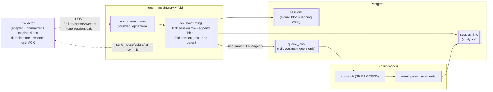

# Ingestion & Session Processing — Design (`src/server/ingest`, `src/server/worker`)

**Status:** Revised for the msging-rewrite (fire-and-forget + SSE, `docs/design/event-messaging-design.md`).
This supersedes the `event_queue`-staging draft — see §14 for what changed and why.
**Parent architecture:** `docs/design/system-architecture.md`.
**Builds on:** the wire contract (`docs/design/event-messaging-design.md`), the session tables
(`docs/modules/storage.md` §3.3–3.4), subagent linkage (`docs/modules/normalizer.md` §5–6).
**Scope boundary:** this doc designs the **intake + fold** (`src/server/ingest`, which is the msging
`srv` server plus the arrival-time fold) and the **rollup worker** (`src/server/worker`). It
**abstracts the metric work** the fold performs, consumed through one `SessionFold` seam (§8).

---

## 1. In a Nutshell

The msging rewrite moved two things that reshape this module: **durability is now the client's**
(the collector keeps every msg until it sees an ACK), and **one msg carries one whole normalized
session** (not one event). Together those dissolve the old `event_queue` staging tier — there are no
loose events to buffer or group, and no need for a server-side durable copy.

- **Ingest is the msging `srv` server *and* the fold.** It mounts `srv_init("ingest")`, registers
  `on_event(handler)`, and the msging worker pool calls that handler once per received msg. The
  handler folds the arrived session **directly** into `sessions` + `session_info`, then sends the
  ACK. There is no batch, no `event_queue`, no separate drain step.
- **`sessions.signal_blob` is the landing zone.** The session's events go straight into their
  permanent home; durability up to that point is the client's durable store (at-least-once). The
  ACK is sent **only after the fold commits**, so a crash before the ACK is just a client resend.
- **A subagent is just another session** — its own msg, its own fold. Folding a child **rings its
  parent** through the one remaining queue (`queue_jobs`), and a worker re-rolls the parent's
  economics **replace-by-`child_session_id`** (§7). `queue_jobs` now carries only session-keyed
  triggers (rollup today; `cost`, `git_correlate` later) — never event data.

**Load-bearing decisions:**

1. **Client-side durability replaces `event_queue`.** The collector holds each msg until ACK; the
   server ACKs only after the session is committed. Lose the in-memory server queue on a crash and
   the client resends (msging's `server_epoch` sweep / `sent_timeout_s`). No durable server-side
   staging is needed, so `event_queue` is deleted (§14).
2. **The fold runs at arrival, in `on_event`.** One msg = one session, so folding is a single inline
   step (append blob + own `session_info`), not a queue-drained batch. `send_notice(ack)` is the
   commit's release — ACK means "durably folded" (§3.3, §6).
3. **Per-session serialization is a row-lock, not a queue.** Two msgs for the *same* session (a
   resend, or a longer re-upload) can hit two msging workers at once; a `SELECT … FOR UPDATE` on the
   `sessions` row serializes them. The old coalesced-job serialization is gone with the queue it
   rode on.
4. **`queue_jobs` shrinks to the async-trigger table.** It no longer dispatches every fold — it only
   carries the parent-rollup trigger (and future topics), one coalesced pending row per session.



---

## 2. Boundaries & Responsibilities

| Component | Owns | Must **not** |
|---|---|---|
| **Collector** (upstream) | normalize → one msg per session → durable store → send at-least-once, resolve NACKs (event-messaging §2.2, §6.1) | touch the DB, sessions, or folding |
| **msging `srv`** (`src/common/msging/srv`) | HTTP routes, auth, the in-memory inbound queue + worker pool, the SSE channel, `send_notice` delivery | interpret payloads, fold, touch `sessions` |
| **Ingest** (`src/server/ingest`) | register `on_event`; **fold the arrived session** (lock → append blob → `session_info`); ring the parent; `send_notice(ack/nack)` | parse the wire / manage the queue / SSE (msging's job); define metric shapes (the fold's job) |
| **`queue_jobs`** (storage table) | coalesced session-keyed async triggers (rollup; later cost/git) | hold event data (pointers only) |
| **Rollup worker** (`src/server/worker`) | claim triggers, recompute a parent's subagent rollup, retries; future async topics | the arrival-time fold (ingest's job now) |
| **Fold** (abstracted, §8) | append blob, compute `session_info`, rebuild the subagent rollup | — the metric *meaning*, designed with the fold module |

The hard boundary is still **the fold seam** (§8): everything below it is mechanism (receive, lock,
commit, trigger, retry); the fold owns what a token/tool/cost *is*.

---

## 3. Ingest Service (`src/server/ingest`)

### 3.1 Layout

```
src/server/ingest/
├── __init__.py
├── app.py            # mounts srv_init("ingest"); registers on_event(handler) + on_close; srv lifecycle
├── fold_handler.py   # the on_event handler: lock → dedup+append blob → fold → ring parent → ack (§3.3)
├── repo.py           # repository over storage's Session/SessionInfo + the query catalog
├── config.py         # IngestConfig (pydantic; YAML-loadable)
├── errors.py
└── cli_serve.py      # `python -m server.ingest.cli_serve` (wrapper utils/ingest.sh)
```

Ingest **is a msging `srv` host** (event-messaging §6.2/§6.3): `app.py` calls `srv_init("ingest")`
to get the router mounted at `talium/ingest/v1/*`, registers the fold via `on_event(handler)`
**before** `srv_start()` (§6.2 ordering), and lets msging own the wire, the SSE channel, auth, and
the bounded in-memory queue. Ingest supplies only the handler and the DB work.

### 3.2 The wire (owned by msging, not re-specified here)

`send()` on the collector makes **one POST per session** to `talium/ingest/v1/event` with a gzip'd
flat `Envelope` (`event-messaging-design.md` §7): transport identity at the top level (`producer_id`,
`msg_id`, `service_name`), the session's events in `payload.events`, and the session/routing identity
in `info` (`session_id`, `vendor`, `agent_version`, `source`, `parent_session_id`, `org_id`,
`user_id`). The msging server answers `202` at the door and dispatches the msg to a worker that calls
`on_event`; the **outcome** (ACK/NACK) rides back later over the SSE channel via `send_notice`.

### 3.3 The handler lifecycle (one msg = one session = one transaction)

```
on_event(envelope):                                        # msging worker pool, one msg
  1. identity   sid = envelope.info["session_id"]; parent = envelope.info["parent_session_id"]
  2. lock       SELECT … FROM sessions WHERE session_id = sid FOR UPDATE    # per-session serialize
                (creating the row on first sight from envelope.info)
  3. dedup      new = [e for e in envelope.payload["events"]
                       if e["record_id"] not in session.folded_ids]         # ledger in signal_blob
  4. fold       fold(session, new)          # ABSTRACTED (§8): append blob + update session_info
  5. trigger    if parent: ring_fold(parent)                                # coalesced rollup job
  6. commit     one session_scope transaction over steps 2–5
  7. ack        send_notice(producer_id, msg_id, "ack")                     # only after commit
```

Steps 2–6 are **one `session_scope` transaction** (storage §4.2). The ACK in step 7 fires **after**
the commit, so ACK means "durably folded." Any failure before step 7 → `send_notice(nack, reason)`
instead; the collector resolves it (RETAIN → resend, PURGE → drop). A crash between commit and ACK is
harmless: the collector resends, and the fold re-runs as a **no-op** (step 3 dedups the whole
already-folded session).

**Why not ACK at the door and fold later?** Because durability is the client's up to the ACK — ACK
before the fold would need a durable server-side copy (the deleted `event_queue`) to avoid loss.
ACK-after-fold keeps at-least-once with no server-side staging. (ACK-after-*land* — commit only the
blob append at step 4, defer `session_info` — is a documented seam, §12 item 1.)

### 3.4 Parsing posture

msging has already parsed the `Envelope` before `on_event` sees it; ingest reads `payload.events` and
`info` directly. The msging handler runs on the server event loop, so the DB work is offloaded per
msging's own rule (§6.4) — a sync fold hands off to the storage threadpool (storage §4).

---

## 4. The Queue (`queue_jobs` only)

`event_queue` is **gone** (§14). One table remains, defined in the storage module (storage §3.1) but
scoped here.

### 4.1 `queue_jobs` — coalesced async triggers

```python
class QueueJob(Base):
    __tablename__ = "queue_jobs"
    id:          Mapped[int] = mapped_column(BigInteger, primary_key=True)
    topic:       Mapped[str]     # 'rollup' today; 'cost', 'git_correlate' later
    dedup_key:   Mapped[str]     # session_id — coalesces repeated triggers → 1 pending job
    payload:     Mapped[jsb]     # pointer only: {"session_id": ...}
    status:      Mapped[str] = mapped_column(default="pending")
    run_after:   Mapped[ts]
    attempts:    Mapped[int] = mapped_column(default=0)
    enqueued_at: Mapped[ts]
    claimed_at:  Mapped[ts | None]
    __table_args__ = (
        Index("uq_queue_jobs_pending", "topic", "dedup_key",
              unique=True, postgresql_where=text("status = 'pending'")),   # one pending per session
        Index("ix_queue_jobs_claim", "topic", "status", "run_after", "id"),
    )
```

It is a **generic background-work queue of pointers**, unchanged in shape from the prior draft — what
changed is that it no longer sits on the arrival path. The arrival fold happens inline in `on_event`;
`queue_jobs` only carries work that is inherently *deferred and cross-session*: the parent rollup
(§7), and future async topics. `payload` is always a pointer; the data lives in `sessions`.

### 4.2 Named queries (`config/queries/ingest.yaml`, `config/queries/rollup.yaml`)

```sql
-- ingest.yaml : lock_session       (per-session serialization; creates on first sight elsewhere)
SELECT session_id, signal_blob, parent_session_id FROM sessions
WHERE session_id = :session_id FOR UPDATE;

-- ingest.yaml : ring_rollup         (coalesced parent trigger, fired when a child commits)
INSERT INTO queue_jobs (topic, dedup_key, payload, run_after, enqueued_at)
VALUES ('rollup', :parent_session_id,
        jsonb_build_object('session_id', :parent_session_id), now(), now())
ON CONFLICT (topic, dedup_key) WHERE status = 'pending' DO NOTHING;

-- rollup.yaml : claim_job           (worker; k=1)
SELECT id, payload FROM queue_jobs
WHERE topic = :topic AND status = 'pending' AND run_after <= now()
ORDER BY id FOR UPDATE SKIP LOCKED LIMIT :k;

-- rollup.yaml : children_of         (a parent's children, for replace-by-key rollup)
SELECT session_id FROM sessions WHERE parent_session_id = :session_id;
```

There is no `stage_events`, no `drain_events`, no `delete_drained`, no `sweep_orphans` over staged
events — those existed only to move loose events through the deleted `event_queue`.

---

## 5. The Rollup Worker (`src/server/worker`)

The worker no longer runs the primary fold — ingest does. It shrinks to the **deferred, cross-session
work** on `queue_jobs`:

```
src/server/worker/
├── dispatch.py      # generic claim/complete/retry loop over queue_jobs (topic-agnostic)
├── rollup.py        # the 'rollup' handler: lock parent → materialize the causal-graph family → rebuild rollup
├── graph_fold.py    # GraphFold — the SessionFold impl (§8), SHARED by ingest's on_event and this worker
├── graph_build.py   # build_graph → upsert session_graph; materialize_tree → session_tree; DB resolver
├── graph_service.py # GraphService.load_family (one-fetch session_tree → fallback row-assembly)
├── segments/        # vendored beat-detection + Tier-0 classification, driven by the graph turn model
├── config.py
└── cli_work.py      # `python -m server.worker.cli_work` (wrapper utils/worker.sh)
```

`dispatch.py` is generic: poll (short interval, optionally shortened by `LISTEN/NOTIFY`) → `claim_job`
→ run the topic handler → `done`, or `failed` with backoff. The `rollup` handler locks the parent
row, loads the parent's **causal-graph family** (its subagent graphs, via `GraphService.load_family`),
and calls `fold.rollup_from_family(...)` (§8) — replace-by-key over the graph, triggered by
`queue_jobs` instead of an event drain. The worker may run in the ingest process or as its own; the
queue makes them independent.

---

## 6. Idempotency & Ordering

| Property | Mechanism |
|---|---|
| **At-least-once** | The collector's durable store holds each msg until ACK; the server ACKs only after commit. A crash before ACK ⇒ resend ⇒ re-fold. |
| **Exactly-once economics** | `sessions.signal_blob` is the dedup ledger: an event whose `record_id` is already in the blob is skipped (§3.3 step 3), so a resent/duplicated session merges to the same result. |
| **Per-session serialization** | `SELECT … FOR UPDATE` on the `sessions` row ⇒ concurrent arrivals of the same session fold one at a time. Different sessions fold in parallel (msging's worker pool). |
| **Ordering** | One msg already carries a session's events in order (the collector). Across resends/reships, order is irrelevant because identity is `record_id`, not position, and the fold is dedup+additive / replace-by-key. |
| **Rollup convergence** | Child commit → `ring_rollup(parent)`; the coalesced job + re-trigger + a periodic sweep converge regardless of child-first/parent-first arrival (§7). |

**Recompute fallback.** Because `signal_blob` retains the full normalized signal, a metric-definition
change can trigger a **blob-replay** recompute of one session (a `recompute` topic on `queue_jobs`)
without re-reading S3. Additive/dedup is the fast path; blob-replay is the correctness backstop (§8).

---

## 7. Subagents & Rollup

A subagent is **just another session** — `session_id = agentId`, `parent_session_id` set by the
normalizer and carried in `envelope.info`. It arrives as its own msg and folds inline in `on_event`
like any session (its own `sessions` row + own `session_info`). Parent and child event streams are
**disjoint** (the normalizer never folds child content into the parent), so the two folds never
double-count.

The only subagent-specific logic:

1. **Upward trigger (child-driven).** When a session with a `parent_session_id` commits (§3.3 step 5),
   it rings the **parent's** `rollup` job. The child knows its parent from `info.parent_session_id`,
   so linkage holds even if the parent's own `sub_agent_spawn` event is late or its msg not yet
   arrived.
2. **Parent rollup (replace-by-key).** The rollup worker locks the parent, **materializes its
   causal-graph family** — assembling the master graph + every subagent graph from the `session_graph`
   rows into a `session_tree` cache and loading it via `GraphService.load_family` — and rebuilds the
   parent's `session_info` (own fields + the `subagents` map keyed by `child_session_id`, storage §3.4)
   directly from that graph, via `GraphFold.rollup_from_family`:

   ```
   session_info.own_cost        = this session's own graph (tokens/tools/files from graph named-APIs)
   session_info.subagents       = { child_session_id: {tokens, inclusive_tokens, tools, files, ...}, ... }
   session_info.inclusive_cost  = own + Σ subagents[*].inclusive       # the ROI headline
   ```

Keyed replacement is idempotent — a child resume just re-upserts its `session_graph` row and the
family re-materializes. **Nested subagents compose bottom-up:** a grandchild committing rings its
parent, whose refreshed `inclusive` total rings *its* parent (the family walk resolves grandchildren
as flat entries linked by `parent_session_id`). Convergence holds because each side re-triggers the
other until stable; arrival order never matters. (Rollup now reads the graph family, not the children's
`session_info` rows — the graph is the source of truth, storage §3.4a.)

---

## 8. The Abstracted Fold Seam

The seam (`server/worker/fold_api.py`) still owns the *meaning* (what a token/tool/file is) while the
handler owns the *mechanism* (lock, commit, trigger, retry). The one implementation is **`GraphFold`**:
`fold()` builds this session's **causal graph** from its full deduped event blob and derives the
self-scoped `session_info` from the graph's named-APIs/node surface (returning the graph JSON for the
handler to upsert into `session_graph`); `rollup_from_family()` recomputes the tree-scoped fields from
an already-loaded family. A few signals the graph doesn't model as nodes are still read from the event
stream directly (`pr_link`, the interrupt sentinel, per-message practice fields, the per-record story
curve, beat patterns) — targeted reads, not a residual fold (see the graph-integration Step-5 close-out).

```python
class SessionFold(Protocol):
    def fold(self, session: SessionState, session_events: list[dict]) -> SessionFoldResult:
        """Fold one arrived session's events into the session. One msg = one whole session, so the
        fold dedups POSITIONALLY (append-only prefix-extension) and recomputes analytics from the full
        blob. MUST be idempotent. Returns the mutations to persist — including the built graph JSON."""

    def rollup_from_family(self, parent: SessionState, family) -> SessionInfoDelta:
        """Recompute parent's COMPLETE session_info (own fields + subagents map + inclusive totals)
        from an already-loaded causal-graph Family (its descendants resolved). MUST be idempotent
        (keyed replacement, not addition) and return a COMPLETE SessionInfo (full replace)."""
```

`on_event` (ingest) calls `fold` and upserts the returned graph into `session_graph`; the rollup
worker materializes the family and calls `rollup_from_family`. The mechanism is split across ingest and
the worker, but the *meaning* has a single home. Swapping extraction is a change behind this seam only.
(The prior event-summing fold, `EconFold`, was retired once GraphFold reproduced every `session_info`
field from the graph — the graph is now the sole source of truth.)

---

## 9. Configuration

```yaml
# config/ingest.yaml
ingest:
  # storage + msging configs load from their own module YAML; ingest references, never re-declares.
  msging_config: config/msging.yaml     # the srv side (service 'ingest')
  # msging owns max_msg_bytes, the queue bound, auth — set them there, not here.

# config/worker.yaml
worker:
  topics:          ["rollup"]           # later: "cost", "git_correlate", "recompute"
  poll_interval_s: 1.0
  claim_batch:     1
  max_attempts:    5
```

Config loads defaults-in-code → YAML → env (arch §20). Both services build their own `StorageConfig`.

---

## 10. Logging

structlog loggers `ingest` and `worker` (structured JSON per CLAUDE.md rule 1):

- **ingest:** `session_received {session_id, msg_id, events}`, `session_folded {session_id, new_events,
  dropped_dupes}`, `session_nacked {session_id, msg_id, code, reason}`, `parent_rung {parent_session_id}`.
- **worker:** `job_claimed {topic, session_id, job_id}`, `subagent_rollup {parent_session_id, children}`,
  `job_done {job_id}`, `job_failed {job_id, attempts}`.

`session_id`, `msg_id`, and `parent_session_id` ride every line they concern. **Payload contents and
bound parameter values never appear** — logs stay content-free.

---

## 11. Testing

Real Postgres (storage §9 — JSONB + `ON CONFLICT` + `SKIP LOCKED` are load-bearing; no SQLite).
msging's own suite covers the wire/SSE/queue; this module tests the fold and the seam:

- **Ingest fold:** a session msg → one `sessions` row + `session_info`, ACK sent after commit; a fold
  error → NACK, no partial row; a **resent** session → zero economic change (dedup vs blob); **two
  concurrent** msgs for one session → serialized by the row-lock, single consistent result.
- **Rollup:** child-first and parent-first arrivals converge to the same inclusive total; a child
  resume → parent `subagents[child]` replaced; two-level nesting propagates up; a lost trigger is
  recovered by the sweep.
- **Crash safety:** kill between commit and `send_notice` → resend re-folds as a no-op.

---

## 12. Open Items & Named Seams

| # | Item | Working assumption / seam |
|---|---|---|
| 1 | ACK-after-fold vs ACK-after-land | **ACK-after-fold** in v1 (§3.3): commit `sessions` + `session_info` before the ACK. ACK-after-land (commit only the blob append, defer `session_info` to a `refold` trigger) is the seam if fold cost ever dominates ACK latency. |
| 2 | `LISTEN/NOTIFY` on `ring_rollup` | Poll + coalesce in v1; add NOTIFY to cut rollup latency (arch §15.1). |
| 3 | Rollup lock ordering | Rollup takes only the *parent's* row-lock; the child never holds two session locks. Synchronous cross-session rollup was rejected to avoid cascade-while-locked (§7). |
| 4 | Blob-replay recompute | A `recompute` topic re-derives a session from `signal_blob` on a metric change (§6). |
| 5 | Worker co-location | The rollup worker may run in the ingest process or separately; `queue_jobs` decouples them (arch §15). |
| 6 | Git webhooks | Enter through msging/ingest as a different route/topic (`git_correlate`), designed with the git correlator. |

## 13. Configuration & Storage-Doc Amendments (cross-module)

- **`event_queue` is dropped** from the storage schema (`schema/event_queue.py` removed) — it existed
  only to stage loose per-event envelopes, which the per-session msg + client-side durability make
  unnecessary (§1, §14).
- **`queue_jobs` is retained** but re-scoped to async triggers (rollup/cost/git), off the arrival path.
- The durable normalized signal stays in `sessions.signal_blob` (storage §3.3), doubling as the fold's
  dedup ledger and blob-replay source. These are reviewed amendments to `docs/modules/storage.md`
  §3.3/§3.6, landing with this module.

## 14. What changed from the `event_queue` draft (and why)

| Prior draft | Now | Why |
|---|---|---|
| Ingest stages every event into `event_queue`, ACKs the batch | Ingest folds the whole session in `on_event`, ACKs the msg after commit | one msg = one session; durability is the client's, so no server-side staging |
| A separate worker drains `event_queue` and folds | Fold is inline at arrival; the worker only does rollup/async topics | nothing to drain — the session arrived whole and already ordered |
| Whole-batch synchronous ACK/NACK | Per-msg async ACK/NACK over SSE (`send_notice`) | the rewrite made delivery fire-and-forget with SSE outcomes |
| Per-session serialization via one coalesced `queue_jobs` row | `SELECT … FOR UPDATE` on the `sessions` row | serialization no longer needs the queue that grouped events |
| `event_queue` + `queue_jobs` | `queue_jobs` only (triggers) | the staging tier dissolved; the trigger tier remains |
