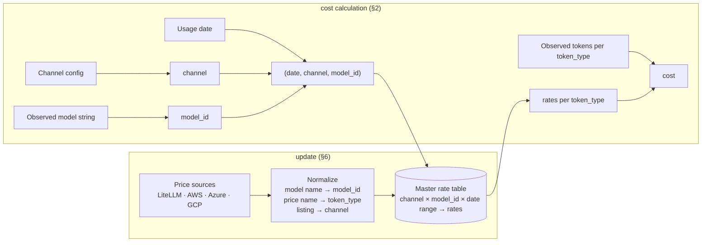

# Model pricing (`src/common/model_pricing`)

**Status:** Implemented; dashboard migration (#68) done
**Consumers:** budget (`econ-forecast/docs/design/budget-module-design.md` §12); dashboard API, ingest, worker (fold, OTel true-up) and the synthetic org generator ([#68](https://github.com/talium-ai/code-econ/issues/68), design `docs/design/2026-10-07-pricing-migration-design.md`).
**Replaced (#68):** `src/common/pricing.py`, `config/pricing.yaml` (deleted; their consumers use `Pricer`, §9.2).
**Related issues:** [#67](https://github.com/talium-ai/code-econ/issues/67) cache-write tokens in usage data; [#70](https://github.com/talium-ai/code-econ/issues/70) service tier (fast mode).
**Updated:** 2026-10-07

---

## 1. Summary

- Prices live in one **master rate table**. Every cost calculation and price report reads only this table.
- A price is looked up by **(`date`, `channel`, `model_id`)**. A row holds one `(channel, model_id)`,
  its `start_date`, and one USD rate per **normalized token type**. Rows from all catalog versions
  together form the price history (§3.4).
- `date` is the day the tokens were (or are forecast to be) consumed, supplied by the caller.
- `channel` comes from the **channel config** (optional; default = the model's vendor).
- `model_id` comes from the **observed model string**, normalized.
- `update` builds the table from several price sources (LiteLLM, AWS, Azure, GCP), normalizing their
  model names and token names into these keys.



## 2. How we calculate cost

### 2.1 Cost key

```text
cost key = (date, channel, model_id)
```

| Part | Where it comes from | Example |
|---|---|---|
| `date` | The caller: the day the tokens were consumed (actuals) or are forecast to be consumed (each forecast day). | `2026-10-01` |
| `channel` | Channel config entry for the org and the model's vendor (§4.3). Not configured → the vendor channel (`anthropic`, `openai`, `gemini`). | `aws_bedrock:us-east-1:regional` |
| `model_id` | Observed model string, normalized (§5). | `us.anthropic.claude-sonnet-5` → `claude-sonnet-5` |

The vendor of a model (needed to pick the org's channel) is looked up from `model_id` in the model
registry (§5.2).

### 2.2 Normalized token types

Every source names prices differently. All are normalized to these five token types (§6.3):

| `token_type` | Meaning |
|---|---|
| `input` | Uncached input tokens. |
| `output` | Output tokens, including reasoning tokens. |
| `cache_read` | Input tokens served from the prompt cache. |
| `cache_write_5m` | Input tokens written to the cache, 5-minute TTL (or the channel's only cache-write price). |
| `cache_write_1h` | Input tokens written to the cache, 1-hour TTL. |

A rate is USD per **one** token. A missing rate is `None`, never 0.

### 2.3 Formula

```text
cost(date) = Σ over token_type of  tokens[date, token_type] × rate[date, channel, model_id, token_type]
```

- `tokens[date, token_type]` comes from usage data (or a forecast) for that day. If a token type has tokens > 0 and its rate is `None`, the
  cost is **unpriced** (no partial total).
- Usage data today folds cache writes into `input` (#67). Until then the consumer splits
  `input` with a configured cache-write fraction; this module only supplies rates.

### 2.4 Lookup steps

1. `model_id = normalize(observed model string)` (§5). Not resolvable → **unmatched**.
2. `vendor = registry[model_id].vendor`.
3. `channel = channel_config[org][vendor]`, default `vendor`.
4. `row` = the row for `(channel, model_id)` in effect on `date` (§3.4). No row for `(channel, model_id)`
   in any version → **unmatched**; model retired before `date` → **retired**.
   **No fallback** to another channel: the org does not buy there.
5. Apply the formula.

Steps 1–3 do not depend on the date and can be resolved once per model; step 4 runs per date. A
forecast prices each future day with the rate valid on that day, so a price change inside the horizon
changes cost from that day on.

Example — org `talium.ai` runs Claude on Bedrock us-east-1 (regional) and Codex on the OpenAI API;
`date` = 2026-10-01; rates from rows valid on that date (USD per 1M tokens):

| Observed model | `model_id` | vendor | `channel` | input | output | cache_read | cache_write_5m | cache_write_1h |
|---|---|---|---|---|---|---|---|---|
| `claude-sonnet-5` | `claude-sonnet-5` | anthropic | `aws_bedrock:us-east-1:regional` | 2.20 | 11.00 | 0.22 | 2.75 | 4.40 |
| `us.anthropic.claude-sonnet-5` | `claude-sonnet-5` | anthropic | `aws_bedrock:us-east-1:regional` | 2.20 | 11.00 | 0.22 | 2.75 | 4.40 |
| `claude-haiku-4-5-20251001` | `claude-haiku-4-5` | anthropic | `aws_bedrock:us-east-1:regional` | 1.10 | 5.50 | 0.11 | 1.375 | 2.20 |
| `gpt-5.6-sol` | `gpt-5-6-sol` | openai | `openai` | 4.00 | 20.00 | 0.40 | 5.00 | — |

Same Sonnet 5 usage in an org with no config → channel `anthropic` → 2.00 / 10.00 / 0.20 / 2.50 / 4.00.

### 2.5 What the key does not cover (yet)

| Not priced | Today | How it will fit |
|---|---|---|
| **Service tier** — fast mode (Codex 2.5×), batch, flex, priority | All rates are standard tier. Usage does not record the tier. | #70: add `tier` to the key → `(channel, model_id, tier)`, default `standard`; existing rows become `standard` rows. |
| **Long context** (e.g. > 200K / 272K tokens per request) | Base-context rates only. Daily aggregates cannot tell per-request context size. | Needs per-request data; would be a `tier`-like key part. |
| **Anthropic fast mode** — Opus 5 / Opus 4.8 at 2x (e.g. $10 input / $50 output) | Not priced; standard rates only. | Request-level signal: the `speed: "fast"` attribute of Claude Code's `api_request` event (kept in `attrs`). A rate lookup keyed on speed (#70). |
| **Anthropic data residency** — 1.1x on every category for `inference_geo: "us"`, Claude 4.6 and later | Not priced. | Request-level signal: `inference_geo` on the request. A multiplier applied after lookup (#70). |
| **Anthropic batch API** — 50% off input and output | Not priced. | Request-level signal: TBD (not something an interactive agent hits). Multiplier after lookup (#70). |
| **Negotiated / per-org discounts** | List prices only. | Per-org multiplier or override rows, applied after lookup. |
| **Credit billing** (ChatGPT/Codex credits) | Not priced. | A channel whose rates are in credits plus a configured USD per credit (#70). |

### 2.6 Adding a channel

1. Add a source adapter (§6.2) that emits rows `(channel, model_id, rates by token_type)`, with that
   source's model-name and price-name normalization (§5, §6.3).
2. Add the channel ID to `channels` in `model_pricing.yaml` (§4.2).
3. Orgs reference it in their config.

The key, the rate table, the lookup, and all consumers are unchanged.

## 3. Master rate table

### 3.1 Row

| Column | Meaning |
|---|---|
| `channel` | Key part 1 (§4). |
| `model_id` | Key part 2 (§5). |
| `start_date` | Build date of the version the row belongs to (§3.4). |
| `retired_on` | Retirement date if a source publishes one (LiteLLM `deprecation_date`); else absent. |
| `input`, `output`, `cache_read`, `cache_write_5m`, `cache_write_1h` | USD per token; absent = `None`. |
| `source` | Where the rates came from: `litellm`, `aws_price_list`, `azure_retail`, `gcp_billing`. |
| `source_key` | The model's name in that source, e.g. `Claude Sonnet 5 (Amazon Bedrock Edition)`. |
| `derived` | Rates not read from the source (§6.5), e.g. `cache_write_billed_as_input`. |
| `litellm_rates` | Present only when a non-LiteLLM source won **and** LiteLLM has a row for the same key; LiteLLM's rates, for the diff report. Absent otherwise. |

### 3.2 Example rows (USD per 1M tokens; AWS publication 2026-09-22, LiteLLM `d3462c65`)

| `channel` | `model_id` | input | output | cache_read | cw_5m | cw_1h | `source` |
|---|---|---|---|---|---|---|---|
| `anthropic` | `claude-sonnet-5` | 2.00 | 10.00 | 0.20 | 2.50 | 4.00 | `litellm` |
| `aws_bedrock:us-east-1:regional` | `claude-sonnet-5` | 2.20 | 11.00 | 0.22 | 2.75 | 4.40 | `aws_price_list` |
| `aws_bedrock:us-east-1:global` | `claude-sonnet-5` | 2.00 | 10.00 | 0.20 | 2.50 | 4.00 | `aws_price_list` |
| `aws_bedrock:us-east-1:regional` | `claude-opus-4-8` | 5.50 | 27.50 | 0.55 | 6.875 | 11.00 | `aws_price_list` |
| `openai` | `gpt-5-6-sol` | 4.00 | 20.00 | 0.40 | 5.00 | — | `litellm` |
| `openai` | `gpt-5-5` | 5.00 | 30.00 | 0.50 | 5.00 | 5.00 | `litellm` (cw derived) |
| `azure:eastus2:data_zone` | `gpt-5-6-sol` | 4.40 | 22.00 | … | 5.50 | — | `azure_retail` |
| `azure:eastus2:global` | `claude-sonnet-5` | 2.00 | 10.00 | 0.20 | 2.50 | 4.00 | `litellm` (not in Azure Retail) |

### 3.3 File

One immutable JSON file per version: `config/model_pricing/catalog/<version>.json`, committed to git.

```json
{
  "schema_version": 1,
  "version": "2026-09-25-3fa1c2d9",
  "built_on": "2026-09-25",
  "unit": "usd_per_token",
  "sources": {
    "litellm": {"commit_sha": "d3462c65…", "commit_date": "2026-09-24T18:08:09Z"},
    "aws_price_list": {"publication_date": "2026-09-22T16:44:18Z", "regions": ["us-east-1"]},
    "azure_retail": {"fetched_at": "2026-09-25T09:00:00Z", "regions": ["eastus2"]},
    "gcp_billing": {"status": "skipped", "reason": "GCP_BILLING_API_KEY not set"}
  },
  "models": {
    "claude-sonnet-5": {"vendor": "anthropic", "names_seen": ["claude-sonnet-5"]}
  },
  "rates": [
    {"channel": "aws_bedrock:us-east-1:regional", "model_id": "claude-sonnet-5",
     "start_date": "2026-09-25",
     "input": "0.0000022", "output": "0.000011", "cache_read": "0.00000022",
     "cache_write_5m": "0.00000275", "cache_write_1h": "0.0000044",
     "source": "aws_price_list", "source_key": "Claude Sonnet 5 (Amazon Bedrock Edition)",
     "derived": [],
     "litellm_rates": {"input": "0.0000022", "output": "0.000011", "cache_read": "0.00000022",
                       "cache_write_5m": "0.00000275", "cache_write_1h": "0.0000044"}}
  ],
  "excluded": [],
  "unmapped": []
}
```

| Field | Meaning |
|---|---|
| `version` | `<date>-<hash8>`; `hash8` = first 8 hex of SHA-256 over the served prices only: per row `channel`, `model_id`, the five rates, `retired_on` (rows sorted by `(channel, model_id)`). Excludes `start_date`, `source`, `source_key`, `derived`, `litellm_rates`, timestamps — unchanged prices give the same hash. |
| `built_on` | Build date; the date the fetched prices were observed. |
| `sources` | Provenance per source. |
| `models` | Model registry (§5.2). |
| `rates` | Prices published at build time; one row per `(channel, model_id)`, all with `start_date` = `built_on`. |
| `excluded` | Rows rejected by validation (§6.6), with reason. |
| `unmapped` | Source records whose model or price name could not be normalized, with reason. |

`catalog/index.json` lists versions in order; the last is current.

### 3.4 Prices over time

**Update:** every `update` stamps **every** row with its build date (`start_date = built_on`). No
per-row comparison with earlier versions. If no rate changed (same `hash8`), nothing is written; a new
version therefore exists only when some price changed. A table form for a database is simply the union
of all versions' rows: `(channel, model_id, start_date, rates…)`.

**Lookup** of `(date, channel, model_id)`, using the bound version and all earlier versions (§9):

| Rule | Case | Result |
|---|---|---|
| Forward | Rows with `start_date ≤ date` exist | Row with the latest such `start_date`. |
| Backward | `date` is before the key's first row | The key's earliest row. Anything before the first version's date gets the first version's price. |
| Retired | Latest row for the key has `retired_on` and `date > retired_on` | No rate (`retired`). Set by a source's retirement date or by §3.5. |
| None | No row for the key in any version | `unmatched`. |

Example (versions built 2026-09-25 and 2026-12-01):

| `start_date` | `channel` | `model_id` | input $/M | output $/M |
|---|---|---|---|---|
| 2026-09-25 | `anthropic` | `claude-x` | 3.00 | 15.00 |
| 2026-12-01 | `anthropic` | `claude-x` | 2.00 | 10.00 |

| Lookup date | Rule | input / output $/M |
|---|---|---|
| 2026-07-15 | backward | 3.00 / 15.00 |
| 2026-10-20 | forward | 3.00 / 15.00 |
| 2027-01-10 | forward | 2.00 / 10.00 |

- A forecast prices each future day with the row in effect; until a source publishes a change, that is
  the current price.
- A price change is dated to the `update` that saw it (daily → within a day).
- Price history = consecutive versions; the refresh report lists what changed.
- A model whose `model_id` changes (e.g. a new name) is a new key with its own rows.

### 3.5 Retirement — a price no source publishes any more

Principle: every live model has a public price for its channel (vendor list via LiteLLM, AWS Price List,
Azure Retail Prices). If no source publishes a price for `(channel, model_id)` any more, the model is
retired on that channel.

| Case at build date `D` | Effect |
|---|---|
| Key in the previous version (not already retired), no source publishes it now | New **retirement row**: last known rates, `source = retired`, `start_date = D`, `retired_on = D − 1`. Reported as retired. |
| Key already retired in the previous version, still unpublished | Retirement row carried unchanged (keeps the version hash stable). |
| Retired key published again | Normal row; the latest row has no `retired_on`, so the key is live again. |
| Source publishes a retirement date (LiteLLM `deprecation_date`) | Normal row with `retired_on` set. |

Lookup (§3.4): dates up to `retired_on` get the last price; later dates get **retired** (no rate). The
retired key no longer has a price going forward; its history stays for past dates.

Example: Bedrock regional `claude-x` priced in the 2026-09-25 version; absent from AWS and LiteLLM on
2026-12-01 → retirement row `retired_on = 2026-11-30`. Lookup 2026-11-15 → last price; 2026-12-05 →
retired.

## 4. Channels and configuration

### 4.1 Channel IDs — what a channel is

| Channel ID | Meaning | Sources (first → fallback) |
|---|---|---|
| `anthropic` | Anthropic API | LiteLLM |
| `openai` | OpenAI API | LiteLLM |
| `gemini` | Google Gemini API | LiteLLM |
| `aws_bedrock:<region>:<scope>` | AWS Bedrock; `scope` = `regional` (in-Region or geo cross-Region profile; AWS prices both the same) or `global` (global cross-Region profile) | AWS Price List → LiteLLM |
| `azure:<region>:<scope>` | Azure (OpenAI deployments; Claude via Foundry); `scope` = `global` or `data_zone` | Azure Retail Prices → LiteLLM |
| `gcp_vertex:<region>:<scope>` | Google Vertex; `scope` = `regional` or `global` | GCP Billing Catalog (optional) → LiteLLM. Until the GCP adapter exists (§12), LiteLLM only. |

Vendor channels (`anthropic`, `openai`, `gemini`) are always priced. Cloud channels are priced only when
listed in the build config (§4.2).

### 4.2 Build config — which cloud channels to price (`config/model_pricing/model_pricing.yaml`, optional)

```yaml
schema_version: 1
channels:                      # cloud channels to price; default: none
  - aws_bedrock:us-east-1:regional
  - aws_bedrock:us-east-1:global
  - azure:eastus2:data_zone
geo:                           # region → LiteLLM geo prefix, for LiteLLM fallback (§6.4); default: built-in map
  us-east-1: us
  eastus2: us
sources:                       # default: all enabled; gcp_billing enabled only when its API key is set
  aws_price_list: {enabled: true}
  azure_retail: {enabled: true}
  gcp_billing: {enabled: auto}
```

File absent → vendor channels only, all defaults.

### 4.3 Channel config — which channel an org buys each vendor's models through (`config/model_pricing/channel_config.yaml`, optional)

Orgs deploy agents through one managed configuration (model ID, inference profile, credentials), so the
channel is an org-wide fact per vendor. Only orgs that do **not** use a vendor's own API need an entry.

```yaml
schema_version: 1
orgs:
  talium.ai:
    anthropic: aws_bedrock:us-east-1:regional    # Claude via Bedrock
    # openai not listed → openai (OpenAI API)
  acme:
    openai: azure:eastus2:data_zone
```

| Case | Channel used |
|---|---|
| File absent, org not listed, or vendor not listed | The vendor channel (`anthropic`, `openai`, `gemini`). |
| Vendor listed | That channel. It must be priced (§4.2), else `ConfigError` when loaded. |

### 4.4 Required vs optional inputs

| Input | Required? | Absent → |
|---|---|---|
| Network access to LiteLLM (GitHub) | **Required** for `update` | `update` fails (exit 1). |
| A catalog version (`catalog/*.json` + `index.json`) | **Required** for cost lookup | `load_catalog` raises `CatalogError`; run `update` first. |
| Build config (`model_pricing.yaml`) | Optional | Vendor channels only; defaults. |
| Channel config (`channel_config.yaml`) | Optional | Every org uses vendor channels. |
| Aliases (`aliases.yaml`) | Optional | Only `norm` / `canon` mapping (§5.3). |
| `GCP_BILLING_API_KEY` (`.env`) | Optional | `gcp_vertex` channels priced from LiteLLM. |
| AWS / Azure network access | Required only if a channel of that cloud is listed | `update` fails (exit 1). |

## 5. `model_id` normalization

### 5.1 Functions

| Function | Steps | Example |
|---|---|---|
| `norm(x)` | lowercase; drop text up to the last `/`; drop leading region (`us.`, `eu.`, `global.`, `apac.`, `au.`, `jp.`, `us-gov.`) then vendor (`anthropic.`, `openai.`); `.` → `-` | `us.anthropic.claude-sonnet-5` → `claude-sonnet-5`; `gpt-5.6-sol` → `gpt-5-6-sol` |
| `strip_date(x)` | repeatedly drop trailing `-YYYYMMDD`, `-YYYY-MM-DD`, `@YYYYMMDD`, `@default`, `-vN:N`, `-vN` | `claude-haiku-4-5-20251001-v1:0` → `claude-haiku-4-5` |
| `canon(x)` | `strip_date(norm(x))` | `gpt-5.5-2026-04-24` → `gpt-5-5` |

### 5.2 Model registry

Built from LiteLLM's vendor-channel entries (vendors `anthropic`, `openai`, `gemini`), **plus** models
that only an official cloud price list publishes (§6.1 step 2). Keys are grouped by `canon`:

- rates identical → one model, `model_id = canon(key)`;
- rates differ → each key its own model, `model_id = norm(key)`; `canon(key)` recorded as ambiguous.
  Real case: `gpt-4o`, `gpt-4o-2024-05-13`, `gpt-4o-2024-08-06`, `gpt-4o-2024-11-20` differ → four models.

`registry[model_id] = {vendor, names_seen}`.

**Official-source models.** An AWS or Azure price record whose reduced model string (§5.3) does not
normalize to a LiteLLM model is added to the registry: `model_id = canon(model string)`, vendor from the
name prefix (`claude` → `anthropic`, `gpt` / `o<digit>` → `openai`, `gemini` → `gemini`; configurable
`vendor_prefixes` in `model_pricing.yaml`). No known prefix → `unmapped` (e.g. Cohere). Records are grouped by
model string first (one model may have different prices on different channels, e.g. Bedrock regional
vs global); two *different* model strings with the same `canon` and different rates → ambiguous. These models have rows only on the cloud
channels that publish them; on the vendor channel they are `unmatched` (the vendor API no longer sells
them). Real case: AWS publishes Claude 3 Haiku, 3.5 Sonnet, Opus 4, Sonnet 4, … that LiteLLM's vendor
list has dropped.

### 5.3 `normalize(x)` — used for observed usage strings and for source model names alike

1. `aliases.yaml[x]` exists → that `model_id` (for IDs no rule can read, e.g. Bedrock application
   inference-profile ARNs).
2. `norm(x)` is a registry `model_id` → it.
3. `canon(x)` recorded ambiguous → **ambiguous**. Checked before step 4: with the `gpt-4o` family,
   `gpt-4o` is both a model (the bare key) and an ambiguous canon; `gpt-4o-2024-08-06` matches at step 2,
   bare `gpt-4o` at step 2, an unseen `gpt-4o-2025-06-01` is ambiguous here.
4. `canon(x)` is a registry `model_id` → it.
5. Else **unmatched**.

No fuzzy, prefix, or substring matching: `claude-sonnet-4` and `claude-sonnet-4-5` differ in price.

Source model names are first reduced to a model-string form by their adapter, e.g. AWS `servicename`
minus ` (Amazon Bedrock Edition)`, lowercased, spaces → `-`: `Claude Sonnet 5 (Amazon Bedrock Edition)` →
`claude-sonnet-5`; Azure `productName` `GPT<n>` → `gpt-` + the `meterName` version tokens left after
removing known context/type/tier/scope/unit tokens: `GPT5` + `5.6 sol` → `gpt-5.6-sol`.

## 6. How the table is built (`update`)

### 6.1 Steps

1. **Acquire** — fetch every enabled source (§6.2). Any enabled source fails → update fails (exit 1);
   the current version stays. A failed source never silently becomes a fallback.
2. **Registry** — build the model registry from LiteLLM's vendor-channel entries (§5.2), then add
   official-source models from AWS / Azure records that do not match it (§5.2). Must precede step 3.
3. **Normalize** — per source record (LiteLLM cloud entries, AWS, Azure, GCP): model name → `model_id`
   (§5.3), listing → `channel` (§6.4), price name → `token_type` (§6.3). Unreadable → `unmapped`.
4. **Merge** — one row per `(channel, model_id)` (§6.4).
5. **Derive** missing cache-write rates (§6.5); **validate** (§6.6).
6. **Retire** — keys in the previous version that no source publishes now get retirement rows; already
   retired keys are carried (§3.5).
7. **Stamp** — every row gets `start_date = built_on` (§3.4); a new retirement row keeps
   `retired_on = built_on − 1`.
8. **Version** — compute `hash8` (rates only); unchanged → no-op (exit 0). Else write `<version>.json`,
   the refresh report, and append `index.json` (atomic).

### 6.2 Acquisition

| Source | Endpoint | Access | Provenance recorded |
|---|---|---|---|
| LiteLLM | `BerriAI/litellm` `model_prices_and_context_window.json`, downloaded at the latest commit SHA | Public | commit SHA, date |
| AWS Price List | `pricing.us-east-1.amazonaws.com/offers/v1.0/aws/AmazonBedrockFoundationModels/current/<region>/index.json`, per built region | Public | `publicationDate`, `version` |
| Azure Retail Prices | `prices.azure.com/api/retail/prices`, `serviceName eq 'Foundry Models'`, per built region, paged | Public | fetch time |
| GCP Billing Catalog | Cloud Billing Catalog API | API key `GCP_BILLING_API_KEY` (`.env`); absent → skipped | fetch time |

### 6.3 Price-name → `token_type` normalization

| `token_type` | LiteLLM field | AWS `usagetype` (newer / older scheme) | Azure `meterName` tokens | GCP |
|---|---|---|---|---|
| `input` | `input_cost_per_token` | `input_tokens_standard` / `InputTokenCount` | `Inp` | [open] |
| `output` | `output_cost_per_token` | `output_tokens_standard` / `OutputTokenCount` | `Opt` | [open] |
| `cache_read` | `cache_read_input_token_cost` | `cache_read_tokens_standard` / `CacheReadInputTokenCount` | `Cd Inp` | [open] |
| `cache_write_5m` | `cache_creation_input_token_cost` | `cache_write_tokens_standard` / `CacheWriteInputTokenCount` | `Cd Wr` | [open] |
| `cache_write_1h` | `cache_creation_input_token_cost_above_1hr` | `cache_write_tokens_1h_standard` / `CacheWrite1hInputTokenCount` | — | [open] |
| unit → USD/token | as is | `1M tokens` ÷ 1,000,000 | `1M` ÷ 1,000,000 | [open] |

Only standard-tier, base-context prices are read; everything else is ignored:

| Source | Ignored |
|---|---|
| LiteLLM | `*_above_200k_tokens`, `*_above_272k_tokens`, `*_batches`, `*_flex`, `*_priority`, audio/image/search/per-second |
| AWS | `*Batch*`, `Reserved_*` |
| Azure | `LongCo`, `Batch`, `PP`; kept: `ShortCo` with `Std` or no tier token |

AWS: both naming schemes occur (e.g. Opus 4.8 newer, Haiku 4.5 older); both give the same meaning. If both
exist with different rates, the newer wins (warning). Azure tokens are case-insensitive (`cd inp` =
`Cd Inp`).

### 6.4 Listing → `channel`, and merge

Listing → channel:

| Source | Rule |
|---|---|
| LiteLLM | bare key of vendor `anthropic`/`openai`/`gemini` → vendor channel; `global.<vendor>.…` → `aws_bedrock:<r>:global` for each built region `r`; `us.`/`eu.`/`jp.`/`apac.`/`au.` + vendor → `aws_bedrock:<r>:regional` for built regions of that geo; `vertex_ai/…` → every built `gcp_vertex` channel; `azure/<m>`, `azure_ai/<m>` → `azure:<r>:global`; `azure/us/<m>`, `azure/eu/<m>` → `azure:<r>:data_zone` for built regions of that geo |
| AWS | region of the file + `_global`/`_Global` in `usagetype` → `global`, else `regional` |
| Azure | `armRegionName` + `Gl` → `global`, `DZ` → `data_zone` |

Region → geo (for LiteLLM fallback) is configured: `geo: {us-east-1: us, eu-central-1: eu, eastus2: us, westeurope: eu, …}`.

Merge per `(channel, model_id)`: the **first source** of the channel (§4.1) wins if it has `input` and
`output`; else the **LiteLLM fallback**; else no row. A row takes all rates from one source; rates are
never mixed across sources.

Known limitation (V1): a token type the winning source lacks stays `None`, even if LiteLLM has it
(e.g. Azure Retail lists no short-context standard `cache_read` meter for a model). Such a row is
unpriced for usage of that token type; the refresh report shows the LiteLLM value in `litellm_rates`.

### 6.5 Derived rates

| Condition | Result | `derived` flag |
|---|---|---|
| No cache-write rate at all | `cache_write_5m` = `cache_write_1h` = `input` | `cache_write_billed_as_input` |
| `cache_write_5m` published, `cache_write_1h` absent | `cache_write_1h` = `cache_write_5m` (the vendor's one write price) | `cache_write_1h_billed_as_5m` |
| Only `cache_write_5m` absent (`cache_write_1h` published) | stays `None` — never priced at the dearer 1h rate | — |
| `cache_read` absent | stays `None` (input would overstate) | — |

### 6.6 Validation

| Check | Outcome |
|---|---|
| `input` or `output` missing / negative / non-numeric | Row → `excluded`. |
| Other rate invalid | That rate → `None`; warning. |
| Change > 50% vs previous version | Warning. Skipped on the first build (no previous version). |
| `cache_read ≥ input` or `output < input` | Warning. |
| First source ≠ `litellm_rates` | Listed as `source_diff` in the refresh report. |
| Row in previous version, absent now | Retirement row (§3.5); listed as `retired`. |

Warnings never block.

## 7. Reports

| Report | Content |
|---|---|
| Refresh summary (`catalog/<version>.refresh.md`), for people | **Header:** version, build date, run time (UTC), previous version (or first version), result (new version / no-op). **Summary:** sources table (status, provenance, rows won, unmapped count); channels table (rows, first source, LiteLLM fallback); counts of added / changed / retired; unmapped counts by source and reason; source-diff count. **Errors:** excluded rows and warnings, one line each, or "None". No per-record lists. |
| Refresh detail (`catalog/<version>.refresh.json`), for machines | Everything: run time, provenance, channel counts, full `added`, `changed` (old → new, %), `retired`, `source_diff`, `unmapped`, `excluded`, `warnings`. Used when investigating a problem. |
| Mapping (`match` CLI; `mapping_report` API, §9) | Per observed model: string → `model_id` (which step of §5.3) → vendor → channel (configured or default) → row source / `source_key` → rates (USD / 1M) → flags / reason. Failures first. |

## 8. CLI

`utils/model_pricing.sh <command> [options]` → `python -m common.model_pricing.cli_<command>`.

| Command | Options | Does | Exit |
|---|---|---|---|
| `update` | `[--dry-run] [--litellm-commit SHA]` | §6. `--dry-run` prints the refresh report, writes nothing. | 0 new version or no-op; 1 failure |
| `match` | `--org ORG --models a,b,… [--catalog VERSION] [--format md\|json]` | Mapping report. | 0; 2 if any model not matched |
| `show` | `--model M [--org ORG] [--catalog VERSION]` | Rows for one model across all channels; marks the org's channel. | 0; 2 if unknown |
| `versions` | `[--limit N]` | Versions with provenance and row counts. | 0 |

```bash
./utils/model_pricing.sh update
./utils/model_pricing.sh match --org talium.ai --models claude-sonnet-5,gpt-5.6-sol,claude-sonnet
```

Results on stdout. Logs: structured JSON on stderr via `common.msging.log` (`configure_logging`, `get_logger`), component `model_pricing`; events `source_fetched`, `source_failed`, `registry_built`, `version_written`, `update_noop`.

## 9. API

```python
from common.model_pricing import load_catalog, TOKEN_TYPES

catalog = load_catalog(version=None)                 # None = current version
prices = catalog.for_org("talium.ai")                # applies channel config (§4.3)
match = prices.resolve("claude-sonnet-5")            # model_id, vendor, channel, status, row
prices.rate(match, "output", date(2026, 10, 1))      # rate valid on that date: Decimal("0.000011") or None
results = prices.mapping_report(["claude-sonnet-5", "claude-sonnet"])   # list[MatchResult]
render_mapping(results, fmt="md")                    # str; "json" also; used by the match CLI
```

| Call | Contract |
|---|---|
| `load_catalog(version)` | Reads one version; verifies `hash8`. |
| `for_org(org_id)` | Unknown org → vendor channels. |
| `resolve(x)` | §2.4 steps 1–4; returns `status` `matched` / `ambiguous` / `unmatched` and the reason. |
| `rate(match, token_type, date)` | Rate from the row in effect on `date` (§3.4); `None` if not matched, retired, or the rate is absent. |
| `mapping_report(ids)` | `resolve` for each ID; failures first. |
| `render_mapping(results, fmt)` | Markdown or JSON text of a mapping report. |

**Version binding.** A `Catalog` and every view from it (`for_org`, `resolve`, `rate`) read the
version they were loaded from **and earlier versions** (the price history up to it, §3.4); never later ones. `load_catalog(None)` picks the current
version at load time. To reproduce an earlier calculation, pass the `version` it recorded.

Errors (`errors.py`):

| Exception | Raised by | When |
|---|---|---|
| `ConfigError` | loading `model_pricing.yaml`, `channel_config.yaml`, `aliases.yaml` (`load_catalog`, `for_org`, `update`) | Invalid file; channel config names a channel that is not priced; alias target not in registry. |
| `CatalogError` | `load_catalog` | No version exists; version unknown; file unreadable; `hash8` mismatch. |
| `SourceError` | `update` only | A source fetch or parse fails. |

`resolve` never raises for unknown models; it returns `unmatched` / `ambiguous`.

### 9.1 Rate sheet — date-range extract (`rate-sheet/1.0`)

A single call for a caller (cost, a price report) that wants every model's price over a
date range at once, rather than resolving and looking up rate-by-rate itself:

```python
from datetime import date
from common.model_pricing import rate_sheet

sheet = rate_sheet("talium.ai", ["claude-sonnet-5", "claude-sonnet"],
                    date(2026, 10, 1), date(2026, 10, 31))
sheet.to_json()   # by_alias + exclude_none baked in -- the exact shape below
```

```json
{
  "org_id": "talium.ai",
  "start": "2026-10-01",
  "end": "2026-10-31",
  "price_version": "2026-09-25-a950f989",
  "models": [
    {
      "usage_model_id": "claude-sonnet-5",
      "status": "matched",
      "model_id": "claude-sonnet-5",
      "vendor": "anthropic",
      "channel": "anthropic",
      "match_step": "normalized",
      "segments": [
        {"from": "2026-10-01", "to": "2026-10-31",
         "rates": {"input": "0.000003", "output": "0.000015", "cache_read": "0.0000003",
                   "cache_write_5m": "0.00000375", "cache_write_1h": "0.000006"}}
      ]
    },
    {
      "usage_model_id": "claude-sonnet",
      "status": "ambiguous",
      "reason": "ambiguous model id: 'claude-sonnet' matches several dated variants that price differently",
      "candidates": ["claude-sonnet-4-5", "claude-sonnet-5"]
    }
  ]
}
```

| Field | Rule |
|---|---|
| `status` | `matched` \| `unmatched` \| `ambiguous` (`resolve`'s own three, §2.4/§9). Non-`matched` → `reason`, `candidates`, no `model_id`/`vendor`/`channel`/`match_step`/`segments` keys. |
| `match_step` | `resolve`'s `step`: `alias` \| `normalized` \| `canonical`. |
| `candidates` | Other `model_id`s sharing the ambiguous canon (§5.3 step 3); `[]` for `unmatched`. |
| `segments` | Cover `start…end` inclusive, no gaps; one `rate()` call per date per token type, collapsed: consecutive dates with an identical rate dict merge, so a price change is two segments and a retirement is a segment with every rate `null`. |
| `rates` | Exact decimal strings (`decimals.to_rate_str`, same as a catalog row), all five `TOKEN_TYPES` keys always present; `null` = no price, never `"0"`. |
| `price_version` | The bound `Catalog.version` (§9 version binding) -- traces the sheet back to the exact catalog it was built from. |

`rate_sheet` does not reimplement matching or the date rules: it is `resolve()` once per
model plus `rates()` once per date, on top of the same `OrgPrices` any other caller uses.
`catalog=None` (the default) calls `load_catalog()` for the current version; pass a
`Catalog` (e.g. one loaded with an explicit `version`) to reproduce a past sheet, same as
any other version-bound call.

`start > end` raises `ValueError` -- a caller error, not a catalog/config/source failure,
so it does not join `errors.py`'s three (§9).

### 9.2 `Pricer` — per-request pricing for services (#68)

The version-bound, org-bound handle the dashboard API, ingest, the worker (fold and OTel
true-up) and the synthetic org generator use. It wraps `Catalog.for_org(org_id)` plus the
curated `history.yaml` rows and gives the call shapes those consumers had before the
migration:

```python
from common.model_pricing import Pricer, price_to_micros

pricer = Pricer.load(org_id="talium.ai", version=None)   # also root=, config_root=, history_path=
pricer.price_tokens("claude-sonnet-5", {"input": 1_000_000, "cache_write": 1_000_000}, "2026-10-01")
# Decimal('6.00'): a combined `cache_write` is charged at the 1-hour rate
pricer.rates(model, at)              # {token_type: Decimal | None} USD per token; None if unresolved
pricer.models(at)                    # {registry id: rates}: anthropic models on the org's channel, retired omitted
pricer.resolve(model)                # MatchResult (status, registry model_id, channel)
pricer.effective_from(model, at)     # start_date of the row in effect on `at`
pricer.fingerprint                   # catalog version (+ "+h<hash8>" when history rows exist)
```

| Rule | Behaviour |
|---|---|
| Unknown / ambiguous / retired model, or a missing rate for a token kind with tokens > 0 | `price_tokens` returns `None`; never 0, never a partial total. |
| `at` | `date`, `datetime` or ISO string (`Z` accepted); `None` raises `ValueError`. |
| Cache-write split | `split_cache_write` (an explicit TTL detail wins; a combined `cache_write` is charged at 1h). `price_to_micros` converts USD to integer micros (half-even). |
| `history.yaml` | Curated rows dated **before** a key's first catalog row, read beneath the catalog; rates USD per million (as the legacy file), `(channel, model_id, start_date)` unique, `model_id` must be a registry id (`ConfigError` otherwise). Ships empty. History never interacts with `retired_on`. |
| Fingerprint | Identifies the whole price table a cost was computed under; the OTel true-up stores it in `session_info.otel.pricing_fingerprint` and recomputes on a mismatch. |
| Absent catalog | `Pricer.load` raises `CatalogError`; services catch it, log a warning and run unpriced. |

Service configs (`ApiConfig`, `WorkerConfig`, `IngestConfig`) select the org and version with
`pricing_org` and `pricing_version` (`None` = vendor channels / current version).
`python -m server.worker.cli_pricing_report` compares stored computed costs with this
pricing, and `utils/fit_prices.py` verifies the catalog against vendor-reported costs.

## 10. Source layout

```text
src/common/model_pricing/
├── __init__.py            # load_catalog, Catalog, OrgPrices, MatchResult, TOKEN_TYPES, Pricer
├── README.md
├── config.py              # model_pricing.yaml, channel_config.yaml, aliases.yaml
├── normalize.py           # norm, strip_date, canon, normalize (§5)
├── sources/               # one adapter per source: acquire + normalize (§6.2–6.4)
│   ├── litellm.py
│   ├── aws_price_list.py
│   ├── azure_retail.py
│   └── gcp_billing.py
├── build.py               # registry, merge, derive, validate, version (§6)
├── catalog.py             # read versions, OrgPrices, resolve, rate
├── rate_sheet.py          # rate_sheet, RateSheet (§9.1)
├── pricer.py              # Pricer, split_cache_write, price_to_micros, history.yaml loader (§9.2)
├── reports.py
├── errors.py
├── cli_update.py
├── cli_match.py
├── cli_show.py
└── cli_versions.py

config/model_pricing/
├── model_pricing.yaml     # optional: cloud channels to price, geo map, sources (§4.2)
├── channel_config.yaml    # optional (§4.3)
├── aliases.yaml           # optional (§5.3)
├── history.yaml           # curated dated rows before the catalog begins (§9.2); may be empty
└── catalog/               # versions + index.json + refresh reports

utils/model_pricing.sh
utils/pricing_report.sh    # before/after report of stored costs vs Pricer (#68)
tests/common/model_pricing/   # offline; see §10.1
```

### 10.1 Tests

- **Fixtures:** one small captured response per source in `tests/common/model_pricing/fixtures/`
  (LiteLLM JSON subset; AWS `index.json` subset for one region; Azure Retail pages incl. `NextPageLink`).
  Include: both AWS naming schemes; Azure mixed-case meters, `LongCo`/`Batch`/`PP` to be ignored; a
  LiteLLM dated-variant conflict (`gpt-4o` family); a model without cache-write fields.
- **No network:** source adapters split into `fetch()` (network) and `parse(payload)` (pure); tests call
  `parse` on fixtures. `update` takes injectable fetchers.
- **Determinism:** building twice from the same fixtures gives the same `hash8`; building again with
  unchanged prices is a no-op.
- **Examples as tests:** the rows in §2.4 and §3.2, the `canon` table in §5.1, and the §3.4 lookup
  table (backward, forward, retired), and the §3.5 retirement cases.

## 11. Decisions

| Decision | Why |
|---|---|
| Lookup = `(date, channel, model_id)`; every row stamped with its version's build date; forward/backward rules | Actuals and each forecast day use the price in effect that day; `update` stays a plain snapshot; rows map directly to a DB table. |
| Row identity = `(channel, model_id)` | Same model costs differently per channel (Sonnet 5: $2.00 Anthropic API, $2.20 Bedrock regional). |
| Channel from channel config, default = vendor | Orgs deploy one managed configuration; most use the vendor API. |
| One master table from many sources | Consumers read one versioned table; provenance per row. |
| Official cloud list first, LiteLLM fallback | Official lists are authoritative; LiteLLM fills gaps (Claude on Azure). |
| Normalize model and price names per source into one vocabulary | Sources name models and prices differently; the key and token types must not. |
| No fallback across channels; failed source fails the update | Prices never silently change meaning. |
| JSON in git, content-hash versions | Diffable, offline, reproducible. |

## 12. Open / deferred

- **[open]** GCP Billing Catalog: model and price-name normalization; coverage of Claude on Vertex.
- **[deferred]** Service tier (fast mode, batch, flex, priority) and credit billing — #70 (§2.5).
- **[done]** Dashboard / ingest / worker migration — #68 (`Pricer`, §9.2; history rows ship empty).
- **[deferred]** Announced future price changes (e.g. a promotion end date) entered ahead of time; V1 learns
  a change only when a source publishes it.
- **[deferred]** Negotiated discounts; scheduled `update`.
