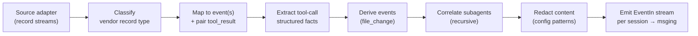

# Normalizer (`src/collector/normalizer`)

**Status:** Design for review · pre-implementation
**Parent architecture:** `docs/design/system-architecture.md` §6.2 (the authority).
**Master doc:** `docs/design/coding-econ-design-draft.md` §6.1 (the event schema it targets).
**Feeder:** `docs/design/2026-07-19-upload-batch-ingestion.md` §6 (the source-adapter boundary
it consumes; this doc closes the open items that RFC deferred to the normalizer).

**Depends on (prerequisite):** the extended event schema — `api_error`, `compaction`,
`reasoning_tokens`, `cache_write_detail`, `cache_miss_tokens`, `server_tool_use` — on branch
`design/agent-neutral-schema-fidelity`. This design targets that schema (decision: design
against the extended contract, not main's current one). Where a field below does not yet exist
on `main`, it exists on that branch and is a prerequisite for implementation.

---

## 1. In a Nutshell

The normalizer converts one vendor's raw session records into the project's **common event
schema** (master §6.1) — the single most important contract in the system. Everything
server-side speaks only that schema; adding a vendor never touches the server. It is the one
place vendor-specific knowledge lives.

Three load-bearing decisions:

1. **Strict header, loose *and* lossless payload.** Only the **header** is a strict, typed
   contract (identity, `event_type`, clocks). The **payload is deliberately open** — a flexible
   structure whose fields vary by vendor (Claude Code vs. Codex), not a strict per-type pydantic
   model; forcing one rigid payload shape across vendors now would cost more than it buys (a
   deliberate relaxation of the master doc's strict-payload stance, §4). Two rules keep this
   safe: the header carries the **vendor identifier**, so a consumer always knows whose payload
   it is; and normalization is **lossless** — the normalizer extracts the high-signal fields it
   knows how to (for queryability) but **carries the complete raw record through**, so nothing
   the vendor wrote is ever dropped (§9). Fidelity lost here is gone forever; fidelity preserved
   lands in the database, where workers can be taught to mine it later.
2. **A stream transformer; the whole file at once (for now).** One Claude Code `assistant`
   record fans out to an `assistant_message` plus one `tool_call` per tool-use block; an `Edit`
   tool call additionally *derives* a `file_change`. In the batch/upload path the **entire file
   is available at once**, so the normalizer processes it whole and emits **one event stream per
   file** — no chunking. (Chunking and incremental mid-file processing are a **laptop live-tail**
   concern, added later — §13; the build model that isolates all this per vendor is §4.)
3. **The normalizer owns subagent correlation.** It reads a session's `subagents/` streams
   (delivered co-located by the source adapter), emits a `sub_agent_spawn` linking each child,
   and normalizes each child transcript as its **own** event stream carrying that child's own
   model and per-turn tokens — the correlation the parent JSONL no longer folds in.

It is **source-agnostic**: it consumes record streams from the source adapter (S3 batch upload
today, live tail later) and never touches disk, S3, or the network itself.



---

## 2. Responsibilities and Non-Responsibilities

| The normalizer owns | It does NOT own |
|---|---|
| Vendor record type → common `event_type` mapping | The event schema itself (event-contract module `src/common/events`; this doc *targets* it) |
| Extracting high-signal fields (tokens, models, files) for queryability | Physical I/O — reading files/S3, tailing, torn-tail handling (source adapter) |
| Deriving `file_change` from tool calls; `session_start` synthesis (§8) | `session_end` synthesis — left to the server-side idle close-out (§8) |
| Subagent correlation across `subagents/` streams (§7) | Transport: spool, batching, `event_id`/`seq` stamping (msging library) |
| Setting `record_id` = the vendor's stable id (dedup, §9) | Dedup insert (ingest); cost/session folding (workers) |
| Config-driven redaction of content (§10) | Deciding org redaction policy (that is config authored by the org) |
| **Preserving the complete raw record — lossless** (§9) | Interpreting events (server derives tool class, file kind, team, cost) |
| **Preserving every metric-input field** and filling per-event gaps where the raw context exists (§3.4) | **Computing** metrics — workers aggregate fields into session metrics (§3.4, architecture §9) |

---

## 3. The Mapping Contract — Claude Code records → events

This is the crispest part of the doc: a reader must be able to implement it from here. Claude
Code writes one JSONL record per line, typed by a `type` field, each carrying its own `uuid`
(the dedup key, §9) and `parentUuid`. The mapping:

| CC record (`type`, shape) | → common event(s) | Notes |
|---|---|---|
| `user`, string `message.content` | `user_message` | text, `char_count`; `slash_command` if the text is a `/command`; `plan_mode` from mode records nearby |
| `user`, `tool_result` content | *(no standalone event)* | merged into the matching `tool_call` by `tool_use_id` — supplies `exit_status`, `duration_ms`, result size |
| `assistant`, `message.content[]` | `assistant_message` **+** one `tool_call` per `tool_use` block | the message's tokens/model on `assistant_message`; each `tool_use` becomes its own event |
| `tool_use` block, `name = Agent`/`Task` | `sub_agent_spawn` (**not** a `tool_call`) | `agent_type` from input/meta; `child_session_id` = the child `agentId` (§7) |
| `tool_use` block, `name = Edit`/`Write`/`MultiEdit` | `tool_call` **+ derived** `file_change` | `file_change.derived_from_event_id` = the tool_call's `event_id` |
| `system`, `isApiErrorMessage`/`subtype:"api_error"` | `api_error` | neutral core from status/retry fields; vendor header (`x-should-retry`) → `debug`. **Emitted for completeness, but the graph extraction drops it** — the retries are server-side and non-actionable (measured 2026-08-29), so `session_info.errors`/`error_count` are not produced (graph-integration §4.C). |
| `system`, `subtype:"compact_boundary"` (`compactMetadata`) | `compaction` | `tokens_before/after/reclaimed`, `trigger`; CC internals → `debug` |
| first record in the stream that carries a `cwd` | **synthesized** `session_start` | `cwd`, `git_branch` from that record's context (§8) — **not** literally record 0, which on current clients is a context-free `queue-operation` record. `repo_id` here is always `null`; the real inference happens at fold time (§6.2) |
| `pr-link` (`prNumber`, `prUrl`, `prRepository`) | `pr_link` | Claude Code's own record of a PR it opened; `prRepository` (`owner/name`) is the highest-provenance signal available anywhere in the transcript for repo identity (§8) — feeds `session_info.pr_list` and the `repo_id` evidence ladder |
| `mode`, `permission-mode`, `last-prompt`, `file-history-snapshot`, `ai-title`, `attachment`, `frame-link` | `unknown` (passthrough) | low-signal UI/meta — **not dropped**; shipped as a passthrough event carrying the full raw record, so nothing is lost (§9). `frame-link` (`path`, `frameUrl`, `title`) marks a published artifact; rare enough (3 occurrences across a 44-session corpus) that it doesn't yet earn a structured event, but the record type itself is documented so it isn't rediscovered as a mystery `unknown` blob |
| any unrecognized `type` | `unknown` (passthrough) | forward-compat: the full raw record rides in the payload — never silently lost (§9) |

### 3.1 `assistant_message` — token/usage field mapping (extended schema)

**Content classification (issue #24).** Real Claude Code records emit **one content-block
type per JSONL record for a turn** — a `thinking`-only record, then a `text`-only record, then
a `tool_use`-only record, all sharing one `message.id` — so mapping all of them to a uniform
`assistant_message` forces every consumer to re-parse `raw` just to tell a reasoning turn from
a final answer from a tool call. The normalizer classifies this at normalization time instead,
purely from `message.content[]` block types (no new record parsing):

```
content_kind       ← "text" | "thinking" | "tool_use" | "mixed" | "empty" — the coarse bucket:
                       "tool_use" only when every block is tool_use (an Agent/Task spawn block
                       still counts here even though it becomes a sub_agent_spawn, not a
                       tool_call — this is a shape classification, not a tool-call tally);
                       "thinking" covers both thinking and redacted_thinking; anything else
                       with more than one distinct block type is "mixed"; no blocks is "empty"
block_types        ← the exact ordered list of content[].type, e.g. ["thinking"], ["text"],
                       ["tool_use", "tool_use"] — for finer detail without falling back to raw
text_char_count     ← len() of concatenated text blocks; null unless a text block is present
thinking_char_count ← len() of concatenated thinking blocks; null unless a thinking block is
                       present — note redacted_thinking carries no plaintext (an opaque `data`
                       blob per the Claude API), so it classifies as "thinking" but this field
                       stays null for it
```

CC's `message.usage` object maps to the extended `assistant_message` payload:

```
input_tokens        ← usage.input_tokens
output_tokens       ← usage.output_tokens
reasoning_tokens    ← null (v1) · CC usage exposes no reasoning subtotal; thinking-block-size
                      derivation is a flagged option (§14, Q-reasoning)
cache_read_tokens   ← usage.cache_read_input_tokens
cache_write_tokens  ← usage.cache_creation_input_tokens          (the universal total)
cache_write_detail  ← [ {ttl_s:300,  tokens: usage.cache_creation.ephemeral_5m_input_tokens},
                        {ttl_s:3600, tokens: usage.cache_creation.ephemeral_1h_input_tokens} ]
                      · omit (absent) when usage.cache_creation is not present
cache_miss_tokens   ← null (v1) · not exposed by CC (§14, Q-cachemiss)
server_tool_use     ← usage.server_tool_use  (e.g. {web_search: n, web_fetch: n}); omit if all zero
model               ← message.model
stop_reason         ← message.stop_reason
duration_ms         ← null on the message (CC carries tool durations, not turn duration)
extras (service_tier, inference_geo, speed, iterations[], …): not extracted, but NOT lost —
                      they ride in the full raw-record passthrough (§8), queryable in the DB later
```

### 3.2 `tool_call` — structured feature extraction

Per architecture §6.2, alongside the full `input` (content ships, v2) the normalizer extracts a
few high-signal structured facts so consumers need not parse tool inputs for the common cases.
Extraction is **best-effort convenience over a lossless passthrough** (§8): the full raw input
is always present, so a field we choose not to extract is never a field we lose.

```
tool_name    ← the tool_use name
mcp_server / mcp_tool  ← parsed from an MCP tool name (namespaced), else absent
files[]      ← from Edit/Write/Read inputs: {path, operation (read|create|edit|delete),
               lines_added, lines_removed, hunks}  ·  hunks COPIED from the vendor's
               structuredPatch only, never computed (architecture §6.2)
input        ← the FULL tool input, verbatim (content; redacted per §9). For Bash this is the
               ENTIRE command — we deliberately do NOT extract a "verb": commands pipe, chain,
               and prefix env vars, so a first-token verb is unreliable and low-value. Ship the
               whole command; a worker can parse it later if a metric ever needs it.
input_chars  ← len(input)
bytes_read   ← from a Read result when available
exit_status, duration_ms  ← paired from the tool_result record (§3.3)
```

### 3.3 Pairing `tool_use` ↔ `tool_result`

A `tool_use` (in an `assistant` record) and its `tool_result` (in a later `user` record) share
the tool-use `id`. The normalizer pairs them within the session to complete the `tool_call`
(`exit_status`, `duration_ms`, result size). Because results arrive after the call, the
normalizer either buffers open tool-use ids until their result appears, or emits the
`tool_call` on the call and treats the result as an enrichment — the module chooses; the
requirement is that a `tool_call` is never emitted twice and its identity is the tool-use id.
For an `Agent`/`Task` call the paired result is the subagent's fold-back summary (§7).


## 4. The Hybrid Mapping Model

- **Header = a typed contract; payload = an open structure.** The **header** models are
  pydantic v2 in `src/common/events` (identity, `event_type`, clocks) — strict and stable. The
  **payload is an open dict**, not a strict per-`event_type` model: `event_type` plus the
  header's `vendor` tell a consumer the rough shape, but fields vary by vendor and unmapped/extra
  data rides through untouched (§9). This deliberately **relaxes** the master doc's "one typed
  object per event_type" / strict-pydantic-payload stance (master §6.1.2–6.1.3) — a revision to
  carry into the event-contract doc (§14, Q-payload). It is the right call *now*: a rigid
  cross-vendor payload would force-fit Codex/Cursor data and cost more than it buys.
- **Per-vendor normalizer = code behind one interface.** A `VendorNormalizer` (§11) per vendor;
  a registry selects it by `header.vendor`. Vendor parsing, derivations, and correlation are
  code — they must be, and the doc says so plainly rather than pretending they are config.
- **Flat field maps = config.** The tabular "vendor field → event field" rows (e.g. the
  §3.1 usage map) live in a per-vendor YAML the normalizer loads, so the common,
  non-derivational mappings change without code. Config knobs also cover: the ignore-list
  (§3), the MCP-name parse pattern, and redaction patterns (§10).

| Option | Pros | Cons | Verdict |
|---|---|---|---|
| **Hybrid: schema-as-code + per-vendor module + tabular config (chosen)** | Contract is one typed place; common maps are data; derivations stay honest code; adding a vendor is one module + one config | Two idioms (code + config); a placement guideline needed | **Chosen.** |
| Fully declarative YAML rules engine | Maximally data-driven; matches design rule 4 literally | Derivations (`file_change`, subagent correlation, `api_error` extraction) become an ad-hoc DSL; opaque, hard to test | Rejected — the derivations are the normalizer's real work. |
| Per-vendor code, no config | Simplest; most flexible | Every mapping change is code; loses the cheap-change property for the tabular 80% | Rejected; the tabular maps are genuinely data. |

---

## 5. Output Interface

The normalizer is transport-agnostic. It yields, per discovered session, the context needed to
open a msging session plus an ordered stream of `EventIn` (the msging input type,
`docs/design/event-messaging-design.md` §3). **The adapter engine** (source-adapter §4; the normalizer
runs *inside* it, source-adapter §3.1) opens one msging `SessionSender` per yielded session and
ships the events via the **msging client** — which wraps each `EventIn` into the wire `Envelope`
(header + payload + debug) and lands the **open payload opaque in the DB's JSONB** for workers
(source-adapter §3.1). The normalizer knows nothing of spool/seq/`event_id`.

```
NormalizedSession:
    vendor:        str            · e.g. "claude_code"
    session_id:    str            · the CC session UUID (parent) or the agentId (a subagent, §7)
    source:        str            · "batch" | "live_tail"
    agent_version: str | None
    parent_session_id: str | None · set on subagent sessions → their spawning session (§7)
    events:        Iterator[EventIn]   · ordered; per event-messaging.md §3

normalize(src: SessionSource) -> Iterator[NormalizedSession]
    # src exposes: the header identity context (org/user/producer, stamped upstream),
    #   the main record iterator, and the co-located subagent record streams keyed by
    #   toolUseId / agentId. Yields the main session first, then one NormalizedSession per
    #   (recursively) discovered subagent.
```

`EventIn` carries `event_type`, `payload` (an **open dict** — the §3 extracted fields **plus the
full raw record**, §9), `record_id` (the CC `uuid`, §9), `parent_id` (from `parentUuid`),
`event_ts`. msging stamps `event_id`, `seq`, and identity.

**One file → one stream (for now).** Because the batch/upload path delivers a complete file, the
normalizer consumes it whole and the `events` iterator for that `NormalizedSession` is the file's
**entire** event stream — no chunking (§1). A subagent file is its own `NormalizedSession` (§7).
Incremental, chunked emission is the laptop live-tail addition (§13).

---

## 6. Event Payload Reference — Fields, Origin, and Significance

§5 gives the output *interface* (`NormalizedSession`/`EventIn`); this section is every field
an event actually carries — the fields on `EventIn` itself (§6.1) and, per `event_type`, the
contents of `payload` (§6.2–§6.11) — with where each one comes from in the raw CC record and
what it's for. Every example below is pulled from a real Claude Code session
(`tests/sample-data/normaliser-result.json`, one session, 67 events, no subagents) — not a
synthesized fixture. Where a type isn't present in that sample (`sub_agent_spawn`,
`api_error`, `compaction` — this particular session had no spawns, errors, or compactions),
the example is labeled illustrative instead.

### 6.1 Every event's shape: the fields outside `payload`, plus `payload.raw`

Each `EventIn` (§5) carries four fields alongside `payload` — this is what a consumer sees at
the same level as `payload` in the actual output (`cli_normalize.py`'s dumped JSON, or
whatever `NormalizedSession.events[]` holds in memory):

| Field | Origin | Significance |
|---|---|---|
| `event_type` | Set by whichever handler produced the event (§3's mapping table) | One of the 8 types in §6.2–6.10; selects which payload shape applies |
| `record_id` | Usually the record's own `uuid`; for `tool_call`/`sub_agent_spawn` it's the *nested* `tool_use` block's own `id` instead (§9); `None` for derived events (`session_start`, `file_change`) | The dedup key once shipped — msging copies this straight into the wire header's `event_id` (event-messaging.md §3), or synthesizes one when it's `None` |
| `parent_id` | Usually the record's own `parentUuid`; for `tool_call`/`file_change` it's the *enclosing* record's `uuid` instead | Which record this followed, within this session — see §6.12 for how this chains into turn reconstruction |
| `event_ts` | The record's own `timestamp` | The source's clock; `null` when the record itself had none |

**This is not the wire `header`.** Once an event ships, msging builds a separate, larger
header (event-messaging.md §5.1) — `event_id`, `seq`, `producer_id`, `org_id`, `user_id`,
`session_id`, `vendor`, `agent_version`, `collector_version`, `source`, `schema_version`,
`collected_ts` — none of which the normalizer itself ever sets (§5); most of it is stamped by
`open_session()`/`send()` from context the normalizer never sees at all (producer/org/user
identity, `seq`). The four fields above are everything the normalizer's own output carries
outside `payload`; the wire header is a separate, later, larger thing built on top of them.

Every event's `payload` also includes a `raw` key: the complete, untouched original record
(or, for `tool_call`/`file_change`, the enclosing `assistant` record). This is the concrete
mechanism behind losslessness (§9) — whatever the fields below don't extract is still sitting
right there. When a field looks unpopulated, check `raw` before assuming it's lost.

### 6.2 `session_start` — synthesized once, emitted first

Not a real CC record — synthesized from context, but **not from record 0**. Current clients
open every session with a `queue-operation` record, and only `user`/`assistant` records carry
`cwd`/`gitBranch`/`timestamp` — reading record 0 literally left this null on 100% of live
sessions (a version-sensitive regression: record 0 was a `user` record on older clients, which
is why this went unnoticed for months). The normalizer scans for the first record in the stream
that actually carries a `cwd` and reads context from *that* one instead, while still emitting
`session_start` first in the event list — a change to which record is read, not to where the
event is placed. Falls back to record 0 (i.e. nulls) when no record in the stream carries a
`cwd` at all, which is a legitimate metadata-only/empty session — the fallback is never
synthesized, only genuinely absent data.

| Field | Origin | Significance |
|---|---|---|
| `cwd` | First record with a `cwd`'s `cwd` | Working directory context for the session |
| `git_branch` | Same record's `gitBranch` | Branch at session start |
| `repo_id` | — | **Always `null` here, structurally** — see below |
| `parent_session_id` | The normalizer's own recursion state (§7) | `None` for a top-level session; the parent's `session_id` for a subagent — the *only* place that linkage reaches the wire, since `EventIn`/`EnvelopeHeader` have no field of their own for it |

Real example:
```json
{"cwd": "/Users/user/projects/talium/code-econ", "git_branch": "main", "repo_id": null,
 "parent_session_id": null,
 "raw": {"type": "user", "uuid": "15c3e23b-...", "timestamp": "2026-07-10T00:25:30.306Z"}}
```

**`repo_id` is computed one layer up, not here — and that's deliberate, not a gap.** It's an
evidence-backed inference (dashboard plan §2) needing evidence that can arrive *anywhere* in
the session — a `pr-link` record, a `git remote -v` Bash call — potentially long after
`session_start` is synthesized from a single early record, before the rest of the stream is
even dispatched. `session_start` structurally cannot see forward into events that don't exist
yet, so its own `repo_id` field stays `null` unconditionally; the real value is computed at
fold time (`src/server/worker/fold/metrics.py`'s `repo_info`, §8 below), which has the whole
session's events available at once, and lands in `session_info.info.repo.repo_id` alongside a
`repo_id_provenance` naming which evidence tier produced it.

### 6.3 `user_message` — a `user`-type record with real text content

| Field | Origin | Significance |
|---|---|---|
| `text` | `message.content` (or joined `text` blocks) | Full message content ships (v2, §1) |
| `char_count` | `len(text)` | Cheap queryable length |
| `slash_command` | First token of `text`, if it starts with `/` | Near-free task labeling |
| `plan_mode` | — | **Always `null`** — correlation to nearby `mode` records not implemented (tracked gap) |

Real example (text truncated here for length):
```json
{"text": "Help me fix these Claude Code settings issues...", "char_count": 715,
 "slash_command": null, "plan_mode": null,
 "raw": {"type": "user", "uuid": "15c3e23b-868c-4fe1-aced-e116bd7284d7", "parentUuid": null}}
```

### 6.4 `assistant_message` — every `assistant`-type record

| Field | Origin | Significance |
|---|---|---|
| `content_kind` | `message.content[]` block types (§3.1, issue #24) | Coarse turn shape: `text`/`thinking`/`tool_use`/`mixed`/`empty` — lets a consumer tell a reasoning turn from a final answer from a tool call without parsing `raw` |
| `block_types` | Same, exact ordered list | Finer detail than `content_kind` (e.g. distinguishing `redacted_thinking`) |
| `text_char_count`, `thinking_char_count` | Concatenated `text`/`thinking` block lengths | `null` unless that block type is present; `thinking_char_count` stays `null` for `redacted_thinking` (no plaintext to measure) |
| `model` | `message.model` | Model-mix accounting |
| `stop_reason` | `message.stop_reason` | Why the turn ended |
| `provider_request_id` | Record's `requestId` | **The join key to the OTel signal** (otel-intake design §3): OTel is authoritative for spend, JSONL for structure, and this is what makes them one row. Several records can share one `requestId` (a request that streamed multiple messages), so a consumer joining on it must dedup — the 2026-08-02 reconciliation matched 36/36 requests exactly only after doing so. Not a Talium id; same field name as `api_error`'s |
| `duration_ms` | — | **Always `null`** — CC carries tool durations, not turn duration, at this level |
| `input_tokens`, `output_tokens`, `cache_read_tokens`, `cache_write_tokens` | `message.usage.*` via the `usage_field_map` (§4) | The primary cost-accounting fields |
| `reasoning_tokens` | — | **Always `null`** — CC's `usage` has no subtotal; real `thinking` blocks *are* present in `message.content[]`, but nothing derives from them yet (§14 Q-reasoning is the open decision on whether/how to) |
| `cache_miss_tokens` | — | **Always `null`** — confirmed not exposed anywhere in CC's `usage` object |
| `cache_write_detail` | `message.usage.cache_creation.*` | Per-TTL-tier cache-write breakdown; key is **absent entirely** when CC didn't report tiers |
| `server_tool_use` | `message.usage.server_tool_use` | Provider-billed hosted-tool counts; absent when all-zero (the common case) or not present |

Real example (a turn with tiered cache writes):
```json
{"model": "claude-sonnet-5", "stop_reason": "tool_use", "duration_ms": null,
 "reasoning_tokens": null, "cache_miss_tokens": null,
 "input_tokens": 3384, "output_tokens": 239,
 "cache_read_tokens": 19245, "cache_write_tokens": 7652,
 "cache_write_detail": [{"ttl_s": 300, "tokens": 0}, {"ttl_s": 3600, "tokens": 7652}]}
```

Real `usage` also carries `iterations[]`, `service_tier`, `inference_geo`, `speed` — these
are the "extras" §3.1 already calls out as deliberately not extracted (Tier-A, riding in
`raw` only); confirmed present in real data, not a gap.

### 6.5 `tool_call` — one per `tool_use` block (except spawns)

| Field | Origin | Significance |
|---|---|---|
| `tool_name` | The `tool_use` block's `name` | Tool usage / success-rate metrics |
| `mcp_server`, `mcp_tool` | Parsed from `tool_name` via the configured MCP pattern (§4) | Absent unless `tool_name` is namespaced |
| `input` | The `tool_use` block's `input`, verbatim | Content ships (v2); identical-call detection compares this directly — **except** `Write`/`Edit`/`MultiEdit`'s generated-content fields, scrubbed to a placeholder unconditionally (§10, issue #23) |
| `input_chars` | `len(input)` serialized | Cheap queryable size |
| `files` | Derived from `Edit`/`Write`/`Read` inputs (§3.2) | Files touched; `hunks`/`lines_*` filled in only once the paired result arrives (§3.3) — **often stay absent even on success**, if the vendor's own result didn't report them |
| `bytes_read` | The paired `tool_result`'s content length | `null` until/unless a result arrives |
| `exit_status` | The paired result's `exitCode`, else its `is_error` flag | Success/failure; `null` if no result ever arrived |
| `duration_ms` | The paired result's `durationMs` | **Frequently `null` even on a matched, successful result** — the vendor doesn't always report it |

Real example (`Bash`, no files):
```json
{"tool_name": "Bash", "input_chars": 161, "bytes_read": 58, "exit_status": 0, "duration_ms": null}
```
Real example (`Edit`, with files/hunks — `lines_added`/`lines_removed` are `null` even though
`hunks` is populated, because this real result carried a `structuredPatch` but not
`linesAdded`/`linesRemoved`; don't assume one implies the other):
```json
{"tool_name": "Edit", "input_chars": 244, "bytes_read": 145, "exit_status": 0, "duration_ms": null,
 "files": [{"path": "/Users/sumandra/.claude/settings.json", "operation": "edit",
            "lines_added": null, "lines_removed": null,
            "hunks": [{"start": 97, "len": 9}]}]}
```

### 6.6 `file_change` — derived, alongside an `Edit`/`Write`/`MultiEdit` tool_call

| Field | Origin | Significance |
|---|---|---|
| `path` | The tool input's `file_path` | File touched |
| `extension` | `Path(path).suffix` | Raw fact only — file-*kind* classification (code/doc/config) is a server-side derivation (§2), not this |
| `operation` | `Write` → `create`, else `edit` | Churn accounting |
| `lines_added`, `lines_removed`, `hunks` | Same paired-result enrichment as `tool_call.files[]`, same "often absent" caveat | Churn metrics — `hunks` is the more reliably-present signal |
| `derived_from_event_id` | The paired `tool_call`'s `record_id` | Which `tool_call` this came from — this *is* what becomes that event's real `event_id` once shipped |

Real example:
```json
{"path": "/Users/sumandra/.claude/settings.json", "extension": ".json", "operation": "edit",
 "lines_added": null, "lines_removed": null,
 "derived_from_event_id": "toolu_01HgF92CHnszTmKJQDKNrSJy", "hunks": [{"start": 97, "len": 9}]}
```

### 6.7 `sub_agent_spawn` — illustrative (absent from this sample; this session had no subagents)

| Field | Origin | Significance |
|---|---|---|
| `agent_type` | The `Task` tool_use's `subagent_type` input, or the child's `meta.json` `agentType` | What kind of subagent this is |
| `child_session_id` | The child `SubagentStream`'s `agent_id` (§7) | The spawned session's id — cost isn't here, it's on the *child's own* `assistant_message` events; roll up via this id |

From a controlled demo, real values verified working (not from this sample):
```json
{"agent_type": "Explore", "child_session_id": "agent-1"}
```

### 6.8 `api_error` — illustrative (absent from this sample)

| Field | Origin | Significance |
|---|---|---|
| `error_class` | Mapped from `status` | Neutral bucket for reliability metrics |
| `http_status` | Record's `status` | Raw status code |
| `retryable`, `retry_count`, `retry_after_ms` | Record's own fields | Retry bookkeeping |
| `provider_request_id` | Record's `requestId` | Cross-references vendor logs, not a Talium id |
| `message` | Record's `message` | Human-readable text |

### 6.9 `compaction` — illustrative (absent from this sample)

| Field | Origin | Significance |
|---|---|---|
| `trigger` | `compactMetadata.trigger` | `auto` \| `manual` |
| `tokens_before`, `tokens_after` | `compactMetadata.{preTokens,postTokens}` | Context size either side |
| `tokens_reclaimed` | Derived, only when both are known | Context-waste metric |
| `duration_ms` | `compactMetadata.durationMs` | Time spent compacting |

### 6.10 `pr_link` — illustrative (absent from this sample)

Emitted from a `pr-link` record — Claude Code's own note that it opened a PR. Has no
`uuid`/`parentUuid` of its own (it isn't part of the conversation tree), so `record_id` and
`parent_id` are both `None`.

| Field | Origin | Significance |
|---|---|---|
| `pr_number` | Record's `prNumber` | The PR number on the host (GitHub) |
| `pr_url` | Record's `prUrl` | Full PR URL |
| `pr_repository` | Record's `prRepository` | `owner/name` — authoritative repo identity, straight from the vendor, no inference |

Real example (sanitized, from `tests/fixtures/normalizer/recorded/session-turns.jsonl`):
```json
{"pr_number": 9, "pr_url": "https://github.com/talium-ai/code-econ/pull/9",
 "pr_repository": "talium-ai/code-econ",
 "raw": {"type": "pr-link", "sessionId": "1cc0fed2-...", "prNumber": 9, ...}}
```

### 6.11 `unknown` — passthrough, not a dropped or error record

Payload is just `{"raw": <the complete original record>}`. In the real sample, 29 of 67
events (43%) are `unknown` — a genuinely interesting breakdown: `attachment` (7, tool-
availability deltas), `file-history-snapshot` (6), `system`/`turn_duration` (4 — see §6.12),
`mode` (3), `permission-mode` (3), `ai-title` (3), `last-prompt` (3). None are dropped —
every one carries its full record in `raw`.

### 6.12 How turns are identified — and a real gotcha in doing it

**There is no `turn_id` field.** Nothing in the output says "these N events are turn #7." A
consumer reconstructs turn boundaries from three signals:

1. **A `user_message` conventionally starts a turn** — everything until the next
   `user_message` belongs to it.
2. **`parent_id` chains the records together** within that span, in order.
3. **Claude Code marks the end of a turn itself** — a real `system` record with
   `subtype: "turn_duration"`, found in the sample and currently shipped as `unknown` rather
   than specially extracted:
   ```json
   {"parentUuid": "27940b60-...", "type": "system", "subtype": "turn_duration",
    "durationMs": 86408, "messageCount": 24, "uuid": "2025844e-..."}
   ```
   `parentUuid` points at the *last* record of the turn being closed out, and `messageCount`
   (24, in this real instance) counts how many records made up it — real, vendor-native
   turn-boundary information, just not promoted to its own field today.

**Walking the `parent_id` chain — a real slice, annotated** (events 5–14 of the sample):

```
[5]  user_message       record_id=15c3e23b...   parent_id=None          <- turn starts
[6]  unknown            record_id=b8bb057b...   parent_id=15c3e23b...
[7]  unknown            record_id=32cd9bc1...   parent_id=b8bb057b...
[8]  unknown            record_id=770f0fdd...   parent_id=32cd9bc1...
[9]  unknown            record_id=None          parent_id=None          <- a passthrough
                                                                            type with no uuid
[10] assistant_message  record_id=1f108cd8...   parent_id=770f0fdd...
[11] assistant_message  record_id=fc303baa...   parent_id=1f108cd8...
[12] assistant_message  record_id=fc893300...   parent_id=fc303baa...
[13] tool_call          record_id=toolu_01Ntcj  parent_id=fc893300...
[14] assistant_message  record_id=3d21c5c3...   parent_id=9b847204...   <- GAP, see below
```

Each row's `parent_id` matches the row above's `record_id` — a clean linked list — **until
event [14]**, whose `parent_id` matches *nothing* in the visible event list. This is not a
data bug: it's the `tool_result` record for [13]'s tool call. A `tool_result` never becomes
its own event (§3: it's merged into the preceding `tool_call` in place), so its `uuid` is
consumed and never surfaces anywhere in the output, even though the *next* real record's
`parentUuid` still points at it. In this one real 67-event sample, **7 of the `parent_id`
references are "dangling" this exact way**. Reconstructing chains by matching
`parent_id → record_id` will hit a break at every tool call — the missing link is always the
merged-away `tool_result`, not lost data.

### 6.13 Known gaps — fields reliably `null`/absent in v1

| Field | Event type | Status |
|---|---|---|
| `repo_id` | `session_start` | Always `null` — structural, not a gap; see §6.2. The fold-level inference (`session_info.info.repo.repo_id`) can itself be `null` too, when no evidence (pr-link, remote, even a `cwd`) exists anywhere in the session |
| `plan_mode` | `user_message` | Always `null` — correlation mechanism not implemented |
| `reasoning_tokens`, `cache_miss_tokens` | `assistant_message` | Always `null` — not exposed by CC's `usage` object (§14 Q-reasoning, Q-cachemiss) |
| `lines_added`, `lines_removed` | `tool_call.files[]`, `file_change` | Populated whenever the paired `Edit`/`MultiEdit` result carries a `structuredPatch`, or a `Write` create's content — which is effectively every successful edit; `null` only for a tool call whose result never arrived at all (§8) |
| `duration_ms` | `tool_call` | Frequently `null` even on a matched result — same reason |
| *(no field)* | — | There is no `turn_id` — see §6.12 |

Every one of these is a tracked, intentional gap (a `TODO(normalizer)` comment sits at its
exact spot in `claude_code.py`), not a bug to chase.

---

## 7. Subagent Correlation (the normalizer's job)

Claude Code stores each subagent's transcript in a sibling file
(`<session>/subagents/agent-<agentId>.jsonl` + `.meta.json`); the parent JSONL keeps only a
summary and **does not** fold in the child's tokens or model (established empirically —
subagents use different models, e.g. parent `fable`, children `sonnet`/`haiku`). The normalizer
reconstructs the tree so each child's real economics are captured. The join keys: a parent
`Agent`/`Task` `tool_use.id` == the child's `meta.json.toolUseId` == the paired
`tool_result.tool_use_id`; the `agentId` is the child transcript's identity.

Algorithm, per session stream:

```
for each Agent/Task tool_use block T in the main stream:
    emit sub_agent_spawn:
        agent_type       = T.input.subagent_type or meta[T.id].agentType
        child_session_id = agentId(T.id)                 # from meta.json / fold-back
        parent_id        = the assistant record's uuid
    child = subagent stream for T.id                     # delivered co-located by the adapter
    yield a NormalizedSession for `child`:
        session_id        = agentId
        parent_session_id = current session_id
        events            = normalize(child)             # RECURSE — same rules, its own model/tokens
    # the paired tool_result (toolUseResult: resolvedModel, toolStats, totalTokens) is a
    # CROSS-CHECK and completion signal only — never the cost source (its totalTokens is the
    # final-turn footprint, not cumulative).
```

Two edge cases are normative:

- **Incomplete subagent** — a spawn whose `tool_result` never arrived (child ran but didn't
  return; its transcript ends on a non-assistant turn). The child stream is still normalized
  and shipped, so its cost is never lost. The `sub_agent_spawn` is emitted; the missing result
  is simply absent enrichment.
- **Nesting** — `meta.spawnDepth > 1`: a child transcript may itself contain `Agent` tool
  calls. The recursion above handles it; the adapter delivers the deeper streams co-located.

Child events carry their own `session_id` (the `agentId`) and are linked to the parent by the
`sub_agent_spawn.child_session_id`, so the worker folds them as their own session and rolls cost
up to the parent — matching the classifier's "sub-agents do one task; cost rolls up to the
parent" (companion doc §4).

---

## 8. Session Lifecycle Synthesis

- **`session_start` — synthesized by the normalizer** from the first record in the stream
  that carries a `cwd` (main or child; not necessarily record 0, §6.2), giving every session
  an anchor carrying its working context, which the id-less early records would otherwise
  strand. CC has no explicit start record. `repo_id` on this event is always `null` by
  design — the evidence-backed inference happens one layer up, at fold time (§6.2), where the
  whole session's events (a later `pr-link` record, a later `git remote -v` call) are visible
  at once.
- **`session_end` — NOT emitted by the normalizer.** Left to the server-side idle close-out
  (master §6.1.2: "idle close-out synthesized server-side"), so live and batch sessions share
  one end-of-session definition. A completed uploaded file is simply a session whose activity
  all happened before we read it; the worker's idle timer closes it like any other.

---

## 9. Losslessness and Forward-Compatibility

- **Lossless (normative — the governing rule).** Normalization **adds** structure; it never
  subtracts. Every record ships, and every event's payload carries the **complete raw record** —
  both the fields the normalizer extracted (for queryability, §3) and everything it did not. No
  vendor field, and no whole record, is ever dropped. The rationale is asymmetric risk: fidelity
  lost here is gone forever, whereas fidelity preserved sits in the database and a worker can be
  taught to make sense of it later. This is *why* the payload is open (§1, §4).
- **Unmapped fields ride through.** Extra fields inside a mapped record are kept in the payload
  passthrough (namespaced where useful, e.g. `debug["vendor.claude_code.<field>"]`, master
  §6.1.3) — a convenience layer over the raw record, not a filter.
- **Records without a rich mapping still ship.** Types the normalizer does not map to a specific
  event (`mode`, `permission-mode`, `ai-title`, …) *and* any **unrecognized** type become a
  passthrough `unknown` event carrying the full raw record — surfaced, never dropped. There is no
  silent ignore-list.
- **Dedup key (normative).** Every event derived from a CC record sets `record_id` = that
  record's `uuid`, so `event_id` is the intrinsic vendor id (upload RFC §4.4 Tier 1). This is
  the single dependency the re-upload idempotency guarantee rests on; it is not optional.
- **Version-aware.** `agent_version` (the CC `version` field) rides every event;
  `collector_version` is the normalizer's version. Parsing may branch on vendor version when a
  format changes; the safety net covers the gap until it does.
- **Never crash on new input** (must-ignore inputs). A normalizer bug is fixed server-side by
  reprocessing stored events / re-running batch mode — not a fleet redeploy (architecture §6.2).

---

## 10. Redaction

The normalizer is the one point where content can be scrubbed before it leaves the collection
process (architecture §6.2). Config-driven patterns (secrets, credentials, org expressions) are
applied to content-bearing fields — message text, tool `input` — during normalization.
Redaction is span removal, never hashing (hashing poisons queryability and the intent signal,
master §9). Defaults are minimal: what is redacted is gone, so patterns are an org's audited,
deliberate choice, not a default posture.

**Generated file content is a second, unconditional axis (issue #23).** Unlike pattern-based
redaction above, `Write`/`Edit`/`MultiEdit` inputs (`content`, `old_string`/`new_string`,
`edits[].old_string`/`new_string`) are scrubbed to a placeholder regardless of whether any
`redaction_patterns` match — content an agent writes to disk is categorically sensitive
(proprietary source), not merely secret-shaped, so this defaults **on**
(`NormalizerConfig.redact_generated_file_content`). It is applied once per assistant record
(`_scrub_record_for_raw`) and reused as the shared `raw` passthrough for every event derived
from that record — `assistant_message`, `tool_call`, and any derived `file_change` — so the
same content scrubbed from the extracted `input` field can never survive verbatim in `raw`.
`input_chars` is measured before scrubbing, so the code-volume signal survives even though the
code itself does not.

---

## 11. The `VendorNormalizer` Interface

```
class VendorNormalizer(Protocol):
    vendor: str
    def normalize(self, src: SessionSource) -> Iterator[NormalizedSession]: ...

# Registry: vendor string → VendorNormalizer, selected by the source's declared vendor.
# v1 ships one implementation: ClaudeCodeNormalizer. Codex/Cursor are added as new
# implementations against this same interface and the same common event schema — no
# server-side change (§13).
```

`SessionSource` (provided by the source adapter, upload RFC §4.3): the header identity context,
the main record iterator, and the co-located subagent streams keyed by `toolUseId`/`agentId`.
The normalizer never opens a file or an S3 object.

---

## 12. Testability and Debuggability

Per architecture §13 (mandatory for new modules):

- **Fixtures = recorded CC sessions + golden events.** `tests/fixtures/normalizer/` holds
  recorded `<session>.jsonl` + `subagents/` trees and the golden `EventIn` streams they must
  produce. A **mixed-model subagent session** (parent `fable`, children `sonnet`/`haiku`,
  including one incomplete subagent) is a required fixture — it exercises §7 end to end.
- **Replay is the harness.** Fixtures replay through `normalize()`; assert the golden output and
  the **run-twice idempotency** invariant: identical input → identical events with identical
  `event_id`s (the §9 dedup key makes this hold).
- **Per-session debug dump.** On demand (config), dump the record→event decisions for one
  session id — "why did this record become these events" is a support answer, not a debugging
  session.
- Structured JSON logs, content-free (architecture §13): record counts, event counts by type,
  dropped/unknown counts, subagents discovered — never content.

---

## 13. Phasing and Seams

**v1:** the `ClaudeCodeNormalizer` against the extended schema, fed by the S3 batch source
(upload RFC), owning subagent correlation and `session_start` synthesis.

| Deferred | Seam |
|---|---|
| **Codex, Cursor** | New `VendorNormalizer` implementations behind §11; same event schema; no server change. Cursor's SQLite rows arrive as records from the Cursor source adapter — the normalizer contract is unchanged. |
| **`reasoning_tokens` / `cache_miss_tokens` for CC** | Currently null (§3.1); fill from thinking-block measurement / a confirmed vendor field when pinned (§14 Qs). Additive. |
| **Live-tail mode** | Same normalizer; the source adapter feeds live records instead of S3 batch. Source-agnostic by construction (§1). |
| **Chunking / incremental mid-file processing** | Not in v1 — the batch path has the whole file at once, so it emits one stream per file (§1, §5). Chunking (reading a growing file in bounded pieces with mid-file checkpoints) is added for the **laptop live-tail** adapter; the source-adapter tail-with-checkpoint model already anticipates it. |
| **Deferred vendor extras** (`service_tier`, `iterations[]`, `inference_geo`) | Sitting in `debug` today (§3.1); promote to typed fields via the schema's Tier-B rule if a consumer needs them. |

---

## 14. Open Items

| # | Question | Working assumption |
|---|---|---|
| Q-reasoning | `reasoning_tokens` feeds the reasoning-spend metric (§3.4) but CC `usage` has no subtotal. Derive at the normalizer from thinking-block size (tokenizer vs. character proxy), or defer? | v1: `null`, flagged as a **metric gap** (§3.4). The normalizer is the derivation point once decided — it alone holds the thinking blocks. |
| Q-cachemiss | Does CC expose cache-miss tokens anywhere? | `cache_miss_tokens = null` in v1, flagged as a **metric gap** (§3.4, cache waste); carry any vendor diagnostic to `debug` if found. |
| Q-pairing | Buffer open `tool_use` ids until the result, or emit-then-enrich? | Module's choice; requirement is exactly-once `tool_call` keyed by tool-use id (§3.3). |
| Q-childsession | Is `agentId` an acceptable `session_id` for a subagent stream? | Yes — distinct, stable; linked to the parent via `sub_agent_spawn.child_session_id` (§7). Confirm against the storage module's session key. |
| Q-source-boundary | Does the source adapter deliver subagent streams keyed and co-located, or does the normalizer discover them? | Adapter delivers co-located + keyed (upload RFC §4.3); normalizer correlates. To confirm when the two designs are joined. |
| Q-payload | The loose, lossless payload (§1, §4, §9) relaxes the master doc's strict per-`event_type` pydantic payload (§6.1.2–6.1.3). | Applied here (header strict, payload open, full raw record preserved). The master/event-contract revision is a follow-up on the schema-fidelity branch — the header contract and `must-ignore` rules stay; the per-type payload strictness is dropped. |
