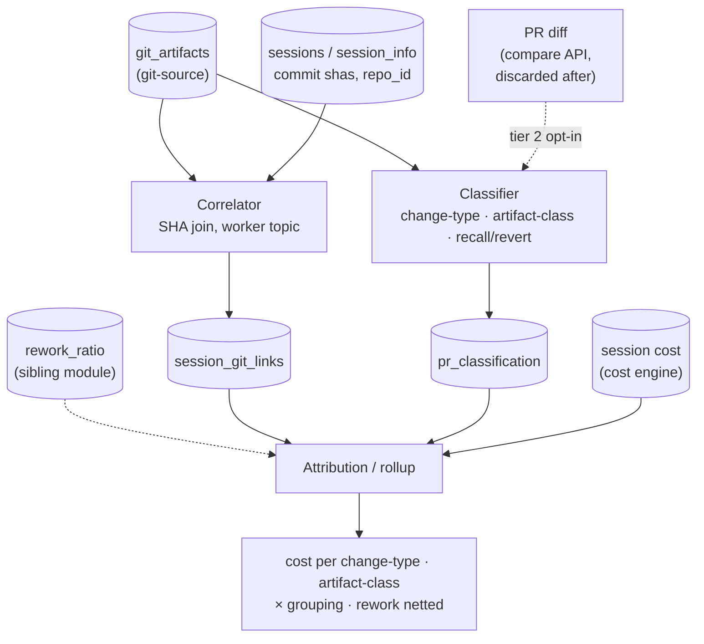

# PR Work Classification & Attribution — Design (`src/server/worker/pr_class`)

**Status:** Draft for review (2026-08-22).
**Parent architecture:** `docs/design/system-architecture.md` (§8.4 git correlation as a worker
responsibility, §9 metric registry, §13 content-free posture).
**Upstream producer:** `docs/modules/git-source.md` — this module **reads** its `git_artifacts` and
**never** re-fetches what that module already normalized. The contract between us is git-source §5.3.
**Adjacent specs:** `docs/modules/storage.md` §3.1/§3.4/§3.5 (conventions, `session_info.pr_list`,
`users.github_user`), the cost engine (prices a session; this module attributes that price to work).
**Sibling module:** `docs/design/rework-measurement-method.md` (on `main`) — the **rework** measure is
computed there, cross-PR, and this module **consumes** its `rework_ratio` as an input dimension; it
does not recompute rework (§5.6).
**Product frame:** `Docs/ProductSpec/Engineering ROI — Coding agent Effect.md` — PR = unit of goods;
cost attributed by project/team/module/repo; quality proxied by recall/revert and rework. This module
is the engine under that spec's §1–§2.
**Scope boundary:** this module turns acquired repository facts into **answers** — it (1) links a
session to the PR its commits landed in, (2) classifies the *kind* and *artifact class* of work a PR
represents, (3) flags recall/revert quality signals, and (4) attributes session cost to work-type,
artifact class, and grouping dimension. It acquires nothing and stores no code. Rework is measured by
the sibling module and joined in here.

---

## 1. In a Nutshell

`git-source` gives us *what happened* in a repo — PRs, commits, reviews, merges — as normalized
artifacts. The cost engine gives us *what a session cost* — tokens, dollars, model mix. This module is
the **weld between them**, and the weld is the commit:

```
COST (cost engine)          LINK (this module)              PRODUCTIVITY (git-source)
session ──has──> commit(sha) ──SHA join──> git_artifacts ──> PR ──> {merge, reviews, change-type}
   │                                                                       │
   └─ tokens, $, model                                                     └─ classified work unit
                              the two sides meet at the COMMIT SHA
```

Three load-bearing decisions:

1. **Correlation is an equality join, not a scoring model.** A session links to a PR through the
   commits it produced, on one of two exact keys — a `Talium-Session:` commit **trailer** or the commit
   **sha** — with precedence `trailer > sha > heuristic` (§4). Deterministic, cheap, explainable. v1
   runs on `sha`; the trailer (rewrite-proof, closes the §4.3 gap) is **designed in but its collector
   hook is deferred**, so enabling it later is a collector-only change, no schema change (§4.2).
2. **Classification is content-free by construction, and heuristic before it is ever an LLM.** Work
   is classified in tiers, each a pure function of signals we already hold or can **fetch-and-
   discard**. **No LLM in v1.** The tier that reads a diff reads it (via the GitHub compare API, no
   local clone — §5.2) in memory, extracts structural features, and **discards the patch** — only
   `{label, confidence}` is stored (§5). The analyzer is an interface, so an LLM backend can slot in
   later without changing the store (§5.5). The content boundary is **storage, not transit**: transient
   analysis-then-discard is allowed and gated opt-in; persisting code or prose never is.
3. **The grouping unit is chosen at query time, never at collection time.** Sprint, team, project,
   epic, module, repo — the unit varies by customer and even by question. Artifacts already carry
   every grouping key (git-source §5.5), so attribution is a `GROUP BY`, and this module commits to
   none of them (§6).

Alongside change-type, the module emits an **artifact class** (coding vs documentation — the product
spec's cost-of-goods split, §5.4) and **recall/revert** quality flags (§5.6), and it joins in the
sibling module's **rework_ratio** (§5.7). There is **no LLM spend and no new infrastructure** in v1:
the readers are git-source's existing client, the classifier is arithmetic over metadata and diff
structure, and even the diff comes from the API — no repository clone (§5.2).



---

## 2. Terms

Architecture §3 and git-source §2 terms apply unchanged. New here:

| Term | Meaning |
|---|---|
| **Work unit** | A merged PR (default) — the smallest thing a cost is attributed to and a classification is assigned to. A repo without PRs falls back to a merge-commit-to-`main` as the unit (§6.3). |
| **Change-type** | The label: `feature`, `fix`, `refactor`, `docs`, `test`, `chore`, `revert`, `integration`, `unknown`. A closed enum; additive-only. |
| **Artifact class** | `coding` \| `documentation` \| `mixed` — the product spec's cost-of-goods split (§5.4). A separate axis from change-type. |
| **Tier** | Which evidence a change-type used: 0 self-reported, 1 metadata, 2 diff-structure. Config selects which run and how they combine (§5.3). |
| **Recall / revert** | Quality signals: a revert (undoes a prior change) or a recall (PR abandoned closed-unmerged), feeding `PR_recall_rate` (§5.6). |
| **Rework ratio** | The share of a PR's change that removed/replaced recently produced code — **computed by the sibling module** (`rework-measurement-method.md`), consumed here as a dimension (§5.7). |
| **Correlation coverage** | The reported fraction of sessions linked to a merged PR, and of PRs linked to at least one session. Product-visible honesty metric, never assumed 100%. |
| **Attribution** | Assigning a session's cost to a work unit, a change-type, an artifact class, and a grouping dimension. |

---

## 3. Where This Sits

A worker module, not a service: it runs on the existing `queue_jobs` dispatch (git-source §4.1, arch
§8.4 "git correlation as a worker responsibility"), on two topics — `git_correlate` (fires when a new
`commit`/`pr` artifact lands, or a session finishes) and `pr_classify` (fires when a `pr` artifact
reaches a terminal state — merged or closed). Both are idempotent re-runs over durable inputs, the
same replay principle git-source uses for its mapper: a classifier-logic fix is a re-run over
`git_artifacts`, not a re-acquisition.

It reads three sources and writes two tables. It **never** calls GitHub for data git-source already
holds; the one exception is the tier-2 diff fetch (§5.2), which is content this module deliberately
does not persist and which git-source therefore does not acquire.

### 3.1 Evaluation scope — a configurable branch filter

Not every PR is a unit of work worth evaluating. Promotion merges (`main→staging→production`),
cherry-picks to `release/*`, and the aggregate PRs of a multi-level flow are noise for cost/quality —
and evaluating them is where double-counting and wasted diff analysis come from. So, like a CI/CD
`on: push: branches:` filter, the customer declares **which base branches carry units of work**, and
we evaluate only those:

```yaml
# config/pr_class.yaml
eval_scope:
  base_branches:              # evaluate PRs merging INTO these (globs); default: the repo's default branch
    - "<default-branch>"
  exclude_head_branches:      # skip promotion/port PRs by their SOURCE branch
    - "release/*"
    - "staging"
    - "production"
  per_repo:
    "github:41213765": { base_branches: ["develop"] }   # Git Flow: work lands on develop
```

**Acquire everything, evaluate the scoped subset.** git-source still ingests *all* PR metadata (cheap,
and grouping/history may want it); this filter gates only the *expensive* work — correlation,
classification (incl. the diff fetch), attribution, and rework. It **subsumes** the cherry-pick-to-release
and promotion-merge cases declaratively, so they never reach the classifier. It is the **primary** scope
control; the owning-PR dedup (§6.4) and integration detection (§5.8) are the safety nets for a config
that puts more than one integration branch in scope. **The rework module honors the same `eval_scope`**
(or measures churn on out-of-scope promotions). Fork workflows are an explicit non-goal (git-source §13
Q9).

---

## 4. Correlation — session ↔ PR

### 4.1 Two keys, one join

A session (collector side) is linked to a PR through the commits it produced. There are **two keys**
for that link, both ideally emitted by the **same collector-side git hook** (git-source §6.4), and one
join shape:

- **Trailer** — a `Talium-Session: <session_id>` line the hook writes into each commit **message**.
  Read back off the commit (via the PR's commit list / API), it names the session directly. It is
  **content-free** (message metadata, never diff text) and **rewrite-proof** (§4.3).
- **SHA** — the session records the **shas** of the commits it produced; a `git_artifacts` row of
  `kind = commit` carries a `sha`. Equality matches them.

Either key resolves to the same join:

```
link(session S, commit C)  where  C.trailer names S   OR   C.sha ∈ S's recorded shas
    ⇒  link(S, C's PR)   [via commit→PR membership; effort deduped per the owning-PR rule of §6.4]
```

The SHA match is an indexed equality join on `git_artifacts.sha` (the index git-source §9 serves); the
trailer match parses one message line. Neither is a probabilistic scorer. When a commit has no PR yet
(pushed, PR not opened), the link waits on the `git_correlate` topic re-firing when the PR artifact
arrives — last-writer-wins ordering (git-source §5.4) makes arrival order irrelevant.

### 4.2 Method precedence: trailer > sha > heuristic

`session_git_links.method` records which key resolved a link, in this precedence:

| Method | When | Confidence | Robustness |
|---|---|---|---|
| **`trailer`** | the commit carries a `Talium-Session:` trailer | 1.0 | **rewrite-proof** — survives rebase, amend, squash, cherry-pick (§4.3) |
| **`sha`** | no trailer, but the recorded sha matches | 1.0 | breaks under local pre-push history rewriting (§4.3) |
| **`heuristic`** | neither — file-overlap × time-proximity × author, within one `repo_id` | <1.0 | last resort; noisy; flagged lower-confidence in coverage |

Both deterministic keys are exact (confidence 1.0) and explainable to a customer ("this session made
these commits, which landed in this PR"); the trailer simply survives history rewrites the raw sha does
not. GitHub's own "linked PRs of a commit" is used only as a cross-check, never as the key — it is
GitHub's association, not ours, and is absent for un-pushed work.

**What runs in v1.** The trailer is produced by the **collector git-hook plugin** (git-source §6.4) —
the same client-side component that supplies real repo identity and commit shas — and **that plugin is
deferred, not built in v1** (an explicit decision). So today correlation runs on **`sha`** (with
`heuristic` as the fallback), and `method = "trailer"` is a **reserved, designed-in path**, not a live
one. The design carries it now so that turning it on later is a **collector-only** change — the plugin
writes the trailer in the same hook that captures shas, and this module starts parsing it. **No schema
or analyzer change is needed**: `session_git_links.method` already admits `"trailer"`, and the
precedence above already prefers it. The plugin is a distinct collector workstream (implementation plan
Part C); this module consumes its outputs when present and reports honest coverage without them (§7).

### 4.3 The rewrite gap — why the trailer is the closer

The `sha` key holds **iff** the sha a session recorded is the sha GitHub received. It breaks under
**local history rewriting before push** — `git rebase -i`, `git commit --amend`, squash-before-push —
which mints new shas while the session logged the old ones. This is not hypothetical: **stacked-PR and
rebase-heavy workflows rewrite constantly**, so `sha` degrades exactly where those teams work.
(GitHub-*side* merge choices — merge commit / squash / rebase-merge — do **not** break `sha`, because
git-source reads the PR's own commit list, not `main`'s post-merge state, git-source §5.4.)

The trailer survives all of it, for a concrete reason: a commit's **sha is a hash over its lineage**
(`parent`) and application metadata (`committer`), which a rebase changes — while the **message**,
where the trailer lives, is carried over verbatim. Rebase gives a commit a new *identity* but preserves
its *content*. So the trailer is the rewrite-proof key, and it is the designed closer for this gap.

Until the hook lands, the residue is **measured, not hidden**: correlation coverage reports "N% of
sessions linked to a merged PR," and unlinked sessions are a named bucket (§7). If that number shows
rewrite-driven misses hurting a real customer, the trailer hook is the fix — and because it is already
designed in (§4.2), enabling it is a collector change, not a redesign.

### 4.4 Unlinked cost is a signal, not an error

Not every session lands a merged commit: exploration, abandoned branches, review-only sessions. That
cost is **real and attributable to "no merged output"** — reported as its own bucket, never amortized
silently into merged work, because "38% of agent spend produced no merged code" is itself a headline
(waste / churn). Symmetrically, a commit with no session is human work with zero agent cost — kept, as
the denominator for agent leverage.

---

## 5. Classification — change-type, artifact class, quality flags

Classification produces, per PR: a **change_type** (§5.1–5.3), an **artifact_class** (§5.4), and
**recall/revert** quality flags (§5.6); it also joins in the sibling module's **rework_ratio** (§5.7).
All classifiers are **heuristic and LLM-free in v1**, and the content boundary is **storage, not
transit** (§5.8).

### 5.1 Change-type — three tiers

Each tier is an independent classifier over different evidence; config selects which run (§5.3).

| Tier | Evidence | Cost | Content? |
|---|---|---|---|
| **0 — self-reported** | Conventional-commit prefix (`feat:`/`fix:`/`refactor:`/`revert:`…) on the PR title or commits; PR **labels** (git-source §5.5); the `github.is_revert` flag (git-source §5.6) | free — already in `git_artifacts` | none |
| **1 — metadata heuristic** | File **paths**/extensions, add/delete counts, added-vs-modified ratio, new-file presence, renames, test-file presence, PR size, `linked_issue` | cheap — already in `git_artifacts.files`/`stats` | none (paths/counts only) |
| **2 — diff-structure heuristic** | The PR **diff**, via the GitHub compare API (§5.2): hunk shape, new-definition vs modified-line ratio, moved-code detection, test-to-source ratio, whitespace/comment-only detection | one API call per PR; **patch discarded immediately** | transits memory, **never stored** (§5.8) |

**Rework is deliberately *not* a tier here.** It is measured cross-PR by the sibling module and joined
in as a dimension (§5.7) — the earlier plan to compute it from `git blame` in tier 1 is dropped, so
tier 1 needs no repository access at all.

The honest calibration point stands: `docs`/`test`/`chore`/`revert` are reliable from paths and flags;
the `feature`/`fix`/`refactor` split is genuinely noisy from inference, and **tier 0 (author-declared
intent) is the only high-confidence source for it.** Report classification coverage by confidence
band, and calibrate thresholds against a hand-labeled sample per pilot repo (§7).

### 5.2 The tier-2 fetch-and-discard mechanism — no clone

Tier 2 reads a diff, and only like this:

```
fetch PR diff via GitHub compare API  GET /repos/{o}/{r}/compare/{before_sha}...{after_sha}
  (git-source client, installation token — NO local clone)
  → extract structural features (counts, ratios, hunk shapes)   -- no line text retained
  → run the heuristic classifier over features → {label, confidence}
  → DISCARD the patch (never written to disk, DB, log, or S3)
  → store only {label, confidence, tier:2, features_digest}
```

The diff comes from the **API, not a repository clone** — the compare endpoint returns per-file patch
text between two SHAs, so v1 needs no `git clone` (the earlier "maintained mirror" idea is dropped).
A local clone returns only as a **v2 scale seam** for PRs past the compare API's 300-file limit or
where the API budget bites (§9). The patch never becomes a row, file, or log line; what persists is a
label, a confidence, and a **non-reversible feature digest** (the counts/ratios behind the decision,
for auditability of *why* — never the code).

### 5.3 Combining tiers — config

```yaml
# config/pr_class.yaml
pr_class:
  change_type:
    tier0_self_reported: true      # conventional commits + labels
    tier1_metadata:      true      # paths, churn, test presence — NO rework, NO clone
    tier2_diff:          false     # fetch (compare API) + discard; off by default (content transit, opt-in)
    combine: "tier0_authoritative" # "tier0_authoritative" | "highest_confidence" | "agree_or_unknown"
    unknown_below:       0.5       # below this confidence, emit `unknown` rather than guess
  artifact_class:        true      # coding vs documentation (§5.4)
  recall_revert:         true      # structural recall + revert flags (§5.6)
  recall_reason:         false     # closing-comment reason enrichment — content transit, opt-in (§5.6)
  analyzer: "heuristic"            # "heuristic" (v1) | "llm" (future backend, §5.5)
```

Each enabled tier emits a candidate `{label, confidence}`; `combine` resolves them. **`tier0_authoritative`
(the default) trusts a conventional-commit prefix over any inference** — the author told us — falling
to tier 2, then tier 1, then `unknown`. `highest_confidence` takes the strongest signal;
`agree_or_unknown` labels only where enabled tiers concur (for a customer who prefers `unknown` to a
guess). Defaults ship tier 0+1 **on**, tier 2 **off** — off because it transits content, not because
it is expensive.

### 5.4 Artifact class — coding vs documentation

The product spec (§1) wants cost split by artifact class, because agents produce copious documentation
that is itself a cost but a different *kind* of good. From the same file-category composition tier 1
already computes:

```
artifact_class = "documentation"  if ≥ threshold of changed lines are docs (*.md, docs/, README, *.rst)
               = "coding"         if ≥ threshold are code/test/config
               = "mixed"          otherwise
```

This is a separate axis from `change_type` (a `docs` change_type and a `documentation` artifact_class
usually agree, but a code PR that also updates its README is `feature`/`coding` with a documentation
fraction recorded in the digest). Content-free — paths only.

### 5.5 The analyzer is an interface (LLM later, not now)

The classifier is a function `features → {label, confidence}` behind a named interface. v1's only
implementation is `heuristic`. A future `llm` backend classifies the same features (or the in-memory
diff) and returns the same shape, so **the store, schema, and attribution layer do not change** when
it lands. The LLM backend reintroduces spend and a stronger content-transit posture, so it is a
deliberate, config-gated, opt-in switch — never a silent upgrade. This is the flexibility asked for.

### 5.6 Recall and revert — the quality signals

The product spec §2.1 wants a `PR_recall_rate`. Detection is **two-layer**, splitting on the content
boundary:

- **Structural (content-free, always on).** A **revert** is `git-source.info["github.is_revert"]`
  plus the `reverts_sha` link back to the PR it undoes (git-source §5.6). A **recall** is a PR with
  `state=closed AND merged_at=null` — worked, then abandoned without merging. Both come straight from
  `git_artifacts`, no content. This is the default signal.
- **Reason enrichment (content transit, opt-in).** *Why* a PR was abandoned (genuine abandonment vs
  superseded vs duplicate) needs the closing comment. Under the `recall_reason` opt-in this is the
  same fetch-and-discard pattern as tier 2: read the closing comment via the API, classify the reason,
  **store only `{reason_class, confidence}`, discard the text.** The comment is never stored. Because
  prose about people is at least as sensitive as code, this sits behind the **same or higher** consent
  bar as tier-2 diff analysis, never the default.

`PR_recall_rate = reverted-or-recalled PRs / merged PRs`, reported per module/project/team (§6).

### 5.7 Rework — consumed, not computed

Rework is measured by `docs/design/rework-measurement-method.md` (sibling module, on `main`): a
cross-PR `before_sha → after_sha` diff, blame provenance of deleted lines, and a 14-day sliding
lookback, producing a `rework_ratio` per merged PR. This module **does not recompute it** — it reads
`rework_ratio` (and `rework_cost`) as an attribution dimension (§6), the same way it reads change_type.
The four fields that method depends on — `merge_commit_sha`, `before_sha`, `after_sha`,
`integration_method` — are acquired by git-source (§5.7 there), so nothing new is captured here. The
sibling method is itself API-native (compare + GraphQL blame, no clone) per the same §5.2 reasoning.

### 5.8 Integration PRs — detect and skip, never diff

An aggregate/integration PR (sprint→main, a promotion merge, a "PR of PRs") is not a unit of work — its
diff is huge and its classification meaningless. It is detected **without** its diff, from commit
ownership (§6.4):

```
already_owned_ratio(PR) = commits whose owning PR is an EARLIER-OPENED PR / total commits
  ≥ integration_threshold  →  change_type = "integration"
      • do NOT fetch or classify its diff (the expensive, useless step is skipped)
      • zero incremental cost (its work was owned/costed on the inner PRs, §6.4)
```

Branch scope (§3.1) already excludes most of these declaratively; this is the detector for an aggregate
that still lands on an in-scope branch. Corroborating signals (head branch is a shared `sprint`/`develop`/
`release` branch, many distinct authors) raise confidence but the owned-ratio is the primary test.
`integration` is a first-class `change_type` value alongside the others.

### 5.9 What is never stored, at any point

Diff text, patch hunks, file contents, commit-message bodies beyond the title git-source holds,
review/PR-comment text, issue text. Only labels, confidences, counts, ratios, digests, and the shas
that link artifacts. The content boundary is **storage and consent**, not "never look": transient
fetch-analyze-discard (tier 2, recall reason) is allowed under an explicit opt-in; persistence of code
or prose never is. This keeps the module on the same side of the line as git-source (§5.3 there).

---

## 6. Attribution and Grouping

### 6.1 The rollup

With `session_git_links` (cost side linked to PRs) and `pr_classification` (PRs labeled), attribution
is a join over three result axes and any grouping key:

```
cost per change-type    = Σ session.cost over sessions linked to PRs of a given change_type
cost per artifact-class = the same, split coding vs documentation (the spec's cost-of-goods, §5.4)
rework cost             = Σ (attributed PR cost × rework_ratio)   [rework_ratio from §5.7]
cost per <grouping>     = any of the above, GROUP BY <grouping key>
ROI proxy               = value(work shipped) / cost, per-change-type weighted, rework netted out
```

### 6.2 Grouping is a query dimension, not a collected fact

The grouping unit varies by customer and question, so this module **commits to none**. Every
dimensional key needed is already on `git_artifacts` (repo_id, author/user, branch, base_branch,
labels, milestone, linked_issue — git-source §5.5) or `sessions`. Sprint, team, project, epic, repo
differ only by which key a report groups on. The corollary is git-source's collection rule: capture
every plausible key now; a key not captured cannot be recovered without a re-backfill.

**Module/System (spec §1.2.3)** is the one grouping dimension not directly on an artifact: a monorepo's
module structure. It is derived, not acquired — a **config-driven path→module map** (`config/pr_class.yaml`,
`modules:` globs), since monorepos are laid out module-first and the mapping is static. A PR's module
is the dominant module of its changed paths; a cross-module PR records the split in the digest. Where a
customer's tickets name the module, `linked_issue` corroborates it. This is a lookup, not code
understanding — the spec's own caveat that true module structure needs reading the code stands, and we
do not attempt it.

### 6.3 The unit of attribution

Default work unit is a **merged PR**. Two fallbacks, both reported as such: a repo with no PR workflow
attributes to a **merge commit on the default branch**; a change-type mix within one PR (a `fix` and a
`feature` in the same PR) attributes to the PR's dominant label with the secondary recorded in the
digest. Attribution is never split across a boundary the data cannot support — it is stated coarsely
and honestly rather than precisely and wrongly.

### 6.4 Owning-PR dedup — counting effort once across multiple PRs

A commit can appear in **several** PRs. In a feature→sprint→main flow the same commits ride the
feature→sprint PR *and* the sprint→main PR; in stacked PRs they ride the whole stack until the lower
ones merge (git-source carries the membership as `commit_shas`, §5.7 there). A naïve "PR cost = Σ
linked-session cost" would then count that effort once per PR. The dedup rule:

> **owning_pr(commit) = the PR opened first — earliest `created_at`, with `merged_at` as a deterministic
> secondary tiebreak — among all PRs whose `commit_shas` contain that sha.** Cost is summed **per commit,
> once**, to its owning PR.

First-to-**open** wins, so the PR that first formed around a commit (feature→sprint) owns the effort; a
later aggregate PR (sprint→main) re-includes already-owned commits and therefore owns **zero new cost** —
correct, because the aggregate merge *moved* work, it did not *produce* it. The atomic cost-bearing unit
is thus the **commit-with-owning-PR**, not the PR. This runs after branch scope (§3.1), which already
excludes most aggregates; it is the safety net for the residual when more than one in-scope branch lets
commits propagate between two in-scope PRs.

> **Why `created_at`, not `merged_at`.** The tiebreak was originally earliest-`merged_at`, which assumes
> the *originating* PR always merges before any PR that inherits its commits. A **stacked child PR**
> (opened on top of a parent PR's branch, so it carries the parent's commits) that is **merged before its
> parent** violates that assumption: `merged_at` would hand the parent's own commit to the child, leaving
> the originating PR owning zero commits and mis-flagged `integration`. `created_at` is a better proxy for
> "this commit's home" — the PR opened first — and is unchanged by reopen, so re-runs stay byte-identical
> (§7). It still yields the correct feature→sprint→main result (the feature PR opens before the aggregate).

Two honest limits, both recorded rather than papered over: **conflict-resolution commits** created
during an aggregate merge are new shas owned by that aggregate PR — correctly counted as its (small)
real effort; and **cherry-picks/backports** duplicate a commit's *content* under a *new* sha, which the
sha/trailer keys treat as new work (content-level dedup is out of scope, and branch scope usually keeps
the ported PR out anyway).

Interaction with change-type: an aggregate PR whose commits are ~all already-owned is flagged
`integration` and its diff is not analyzed (§5.8) — commit ownership tells us there is nothing new in it
without paying for the (massive) diff.

---

## 7. Coverage, Failure Modes, Idempotency

| Concern | Mechanism |
|---|---|
| Session sha ≠ GitHub sha (local rewrite) | Reported as unlinked-session coverage (§4.3); not an error. |
| PR with no linked session | Human work; kept as the agent-leverage denominator (§4.4). |
| Unclassifiable PR (tiers disagree / no signal) | Label `unknown`, counted; never a forced guess. Coverage reports classification rate. |
| Re-run of correlation or classification | Deterministic over durable inputs (`git_artifacts`, `session_git_links`); a logic fix is a re-run, byte-identical result. |
| Ordering (commit before PR, session before either) | The `git_correlate` topic re-fires on each arrival; last-writer-wins upserts converge. |
| Diff fetch fails (tier 2) | Fall back to the tier-0/1 label; record `tier` actually used; never block on the diff. |
| A classification is wrong | It is a label with a confidence and a digest of why — inspectable and re-derivable, unlike a stored opinion. |

**Reader-agreement / determinism test:** classify the same PR twice → identical `{label, confidence}`.
Correlate the same session/PR set twice → identical links. This is what makes the module safe to re-run
on every logic change.

---

## 8. Storage — two derived tables

Owned here, defined in the storage module per storage §3.1's single-definition rule (`schema/pr_class.py`).
Conventions as everywhere: no FKs on the write path, `timestamptz` UTC, JSONB for churn.

**`session_git_links`** — the correlation output (git-source §9 explicitly defers this table here).

```
session_id     str                             -- the cost side
artifact_id    str                             -- the git_artifacts row (a commit or its PR)
method         str                             -- "trailer" | "sha" | "heuristic" — precedence order (§4.2); v1 runs "sha"/"heuristic", "trailer" reserved
confidence     numeric                         -- 1.0 for a sha match; <1 for heuristic
signals        jsb                             -- what matched (sha, or the file/time/author evidence)
created_at     ts
PRIMARY KEY (session_id, artifact_id)
index: (artifact_id)   -- reverse lookup: which sessions fed this PR
```

**`pr_classification`** — one row per classified work unit. **Never holds code or prose.**

```
artifact_id       str    PK                    -- the pr (or fallback merge-commit) artifact
change_type       str    index                  -- feature|fix|refactor|docs|test|chore|revert|integration|unknown
change_confidence numeric
change_tier       int                           -- which tier produced the winning label (0|1|2)
artifact_class    str                           -- "coding" | "documentation" | "mixed" (§5.4)
is_revert         bool                           -- structural revert flag (§5.6)
is_recall         bool                           -- closed AND not merged — recall candidate (§5.6)
recall_reason     str    nullable                -- opt-in reason enrichment; "abandoned"|"superseded"|"duplicate"|null; text discarded (§5.6)
recall_confidence numeric nullable
module            str    nullable                -- config path→module map (§6.2)
rework_ratio      numeric nullable               -- JOINED from the rework module (§5.7); null until that module runs
features_digest   jsb                            -- non-reversible counts/ratios behind the decisions — never code/prose
analyzer          str                            -- "heuristic" (v1) | "llm" (future)
classified_at     ts
index: (change_type)  ·  (artifact_class)  ·  (module)   -- attribution GROUP BYs
```

`rework_ratio` is denormalized here for query convenience but is **owned by the rework module**; this
table caches the value, it does not compute it. `session_info.pr_list` (storage §3.4) remains the
denormalized read view a dashboard hits; these two tables are the normalized truth it projects from.

---

## 9. Phasing

**v1 — this design.** The SHA correlator on `git_correlate` (with `method="trailer"` reserved, §4.2);
the **`eval_scope` branch filter** (§3.1); tier 0 + tier 1 change-type classifiers (self-reported +
metadata, **no rework computation, no clone**); **owning-PR dedup** (§6.4) and **integration-PR
detection** (§5.8); `artifact_class` (coding vs docs); structural recall/revert flags; the module
path-map dimension; the two tables; attribution rollups by change-type, artifact-class, and every
grouping key, deduped per owning-PR, with `rework_ratio` joined from the sibling module when present;
coverage reporting (correlation and classification, by confidence band). No diff fetch, no LLM.

**v1.5 — the diff tier and reason enrichment.** Tier 2 (compare-API fetch-and-discard diff heuristics),
config-gated off by default; the closing-comment `recall_reason` enrichment (same opt-in content-transit
bar); the feature-digest audit trail; per-repo classification coverage in the dashboard honesty column.

**v2 — named seams.**

| Seam | Slot |
|---|---|
| `llm` analyzer backend | Same interface (§5.5), same tables; classifies features or the in-memory diff. Reintroduces spend + a content-transit posture; opt-in, never silent. |
| Local clone for tier 2 | Only for PRs past the compare API's 300-file limit or where the API budget bites (§5.2). A targeted on-demand shallow clone, not a standing mirror. |
| `Talium-Session:` trailer correlation | Closes the §4.3 rewrite gap; produced collector-side, carried in git-source `info`. Built only if coverage warrants. |
| Heuristic (file-overlap) correlation fallback | The `method = "heuristic"` secondary join for sessions with no capturable sha (§4.2). |
| Issue-side work units | When git-source's v1.5 issue mapper lands, attribute cost to issues/epics, not only PRs (spec §1.2.1 project/initiative attribution). |
