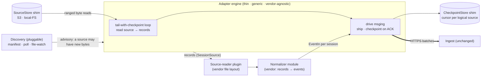
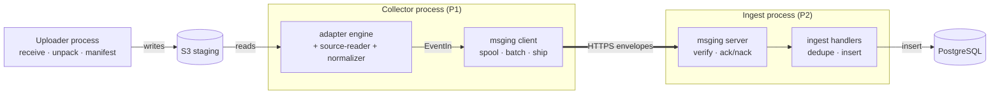

# Source Adapter — the Collector engine (`src/collector`)

**Status:** Design for review · pre-implementation
**Parent architecture:** `docs/design/system-architecture.md` §6.1 (source adapters), §5.3
(checkpoint-then-acknowledge), master doc §11.1 (tail-with-checkpoint).
**Contains:** the **Normalizer** (`docs/modules/normalizer.md`) as its interpretation module.
**Ships via:** the **msging** client (`docs/design/event-messaging-design.md`).
**Deployment today:** the server-side batch feeder of `docs/design/2026-07-19-upload-batch-ingestion.md`
(this doc promotes that RFC's §4.3 sketch into a real module).

---

## 1. In a Nutshell

The source adapter is the Collector's **engine**: the thin, generic control loop that turns a
vendor's session files into shipped events. It is deliberately dumb — it reads bytes, hands
records to the normalizer, ships them, and remembers how far it got. All *interpretation* lives
in the normalizer (a module inside it); all *vendor file-layout* knowledge lives in a
source-reader plugin; all *transport* lives in msging. The engine itself holds no vendor
knowledge and is reused unchanged across vendors **and** across deployments (server batch today,
laptop live-tail later).

Three load-bearing decisions:

1. **Tail-with-checkpoint is the core, from the parent design** (master §11.1). The engine reads
   a source, hands its records to the normalizer, ships, and advances a persisted checkpoint
   **only after the server ACKs** (architecture §5.3). The **checkpoint granularity is
   deployment-specific**: the **batch/upload** path has each file complete, so it reads the
   **whole file at once** and checkpoints **per file** — no chunking, no mid-file offsets
   (matching the normalizer's one-stream-per-file, normalizer §1/§5); a crash redoes the
   in-flight file whole and idempotency drops the overlap. The **laptop live-tail** path (later,
   §9) reads a *growing* file and checkpoints a **byte offset**, resuming mid-file and processing
   only the new tail. Same loop, same cursor — the offset is just the file's end (batch) or a
   live position (live-tail). No queue, no redelivery infra.
2. **The cursor keys on the *logical* source, not the physical object.** A checkpoint is keyed
   by `producer + relative-path` (≈ the session), stable across restarts and re-uploads. In
   **batch**, this lets the engine recognize an already-seen file: an *unchanged* re-upload is
   skipped, and a *longer* one is reprocessed **whole** with idempotency dropping the overlap
   (RFC §4.4). In **live-tail**, the same logical key + a byte offset is what lets a *growing*
   file resume from its offset and process only the new tail — the parent design's "process
   after the offset." Batch keeps it simple now; the tail-skip is the live-tail refinement.
3. **Storage is a thin shim; nothing locks to a vendor.** Byte access (`SourceStore`) and cursor
   persistence (`CheckpointStore`) are small interfaces. S3 is one implementation today; local-FS
   is the implementation for laptop adapters later. **Moving to laptops is a shim swap, not a
   redesign** — the explicit requirement this design protects.



---

## 2. Terms

| Term | Meaning |
|---|---|
| **Source** | One unit the engine reads and checkpoints: one session's `<session>.jsonl` (and, via the source-reader, its sibling `subagents/` files). |
| **Logical source key** | The checkpoint key — `producer_id` + relative path (≈ session) — stable across restarts, re-uploads, and file growth. Distinct from the physical location (an S3 object, a laptop file). |
| **Cursor / checkpoint** | The persisted marker of how far a source has been durably shipped, plus a file-identity fingerprint. Granularity is deployment-specific: **per-file** (done / not-done) in batch; a **byte offset** in live-tail (§1). |
| **Discovery / doorbell** | An advisory signal that a source may have new bytes (a completion manifest, an S3 event, a poll tick, a file-change notification). Never authoritative — the cursor is the truth. |
| **SourceStore** | The byte-access shim: list sources, ranged-read a source, stat its size. S3 / local-FS implementations. |
| **CheckpointStore** | The cursor-persistence shim: get/commit an offset per logical source key. |
| **Source-reader** | The vendor plugin that turns a source's raw bytes into the normalizer's `SessionSource` (records + keyed subagent streams). Owns vendor *file layout*. |

---

## 3. Composition and Ownership

The adapter is one thin engine plus, **per vendor**, a `{source-reader, normalizer}` plugin
pair. Nothing is double-owned:

| Concern | Owner |
|---|---|
| Discovery (manifest / poll / file-watch) → "a source may have work" | **Engine** (pluggable trigger) |
| Ranged, bounded-memory byte reads | **Engine** via `SourceStore` |
| Tail-with-checkpoint loop; torn-tail; resume; checkpoint-on-ACK | **Engine** (generic) |
| Cursor persistence per logical source | **Engine** via `CheckpointStore` |
| Vendor file layout → `SessionSource` (records + keyed subagent streams) | **Source-reader** (vendor) |
| `SessionSource` → `NormalizedSession` events | **Normalizer** (vendor) |
| Open a msging session per `NormalizedSession`, ship, flush | **Engine** (drives msging) |
| Spool, batching, ACK/NACK, `event_id`/`seq` | **msging** (already designed) |

"Add a vendor" = a new `{source-reader, normalizer}` pair behind these interfaces — no engine
change (§8 genericity). "Move to laptops" = a different `SourceStore`/`CheckpointStore`
implementation and a file-watch discovery — no engine change (§9).

### 3.1 Process boundaries

The modules above map onto **three server-side processes** plus Postgres (architecture §5,
P1/P2). The messaging engine is **not** a process — it is one library (`event-messaging.md`)
whose two halves sit on either side of the ingest hop:



- **Collector process (P1)** — the source-adapter engine, its `{source-reader, normalizer}`
  plugin pair, **and the msging client** (spool, batch, ship). The normalizer is a module
  *inside* the engine; the msging client is the engine's **ship stage** (§4). One process — and
  the *same* process on the laptop later (§9).
- **Ingest process (P2)** — the msging **server** (`verify`/`ack`/`nack`) and the ingest
  handlers (dedupe by `event_id`, insert). Unchanged by this design.
- **The boundary is the single HTTPS hop** between the msging client and server. The msging
  library is imported by *both* ends (`event-messaging.md` §1); it is the only thing that crosses
  the wire. It is never a standalone process.
- **The uploader is upstream, separated by S3** — it never talks to the Collector directly; the
  manifest is the handoff (`batch-uploader.md` §7, source-adapter discovery §A2).

**The payload that lands in the DB.** The normalizer emits `EventIn` (`event_type`, the open
payload, `record_id`, `parent_id`, `event_ts`); the msging client stamps
`event_id`/`seq`/clocks and wraps it into the **Envelope** — `header` + `payload` + `debug`
(`event-messaging.md` §5.1) — which it **never parses**: the payload is opaque to msging. Ingest
inserts the Envelope: `header` → indexed columns, **`payload` + `debug` → JSONB**. So the loose,
lossless payload the normalizer produces is exactly what reaches the database, untouched, for the
workers to mine. msging's opaque-payload contract and the normalizer's open payload (normalizer
§1, §8) are the same decision seen from the two ends of the wire.

---

## 4. The Tail-with-Checkpoint Loop (the core)

Reused from master §11.1; the only change is that the byte source is a `SourceStore`, not a raw
file handle. Per source, driven by an advisory discovery signal or a startup sweep:

```
on discover(source) or startup_sweep(source):
    ckpt   = CheckpointStore.get(logical_key(source))         # offset + file-identity, or empty
    if source.identity() != ckpt.identity:                    # new / rotated / truncated
        ckpt = reset(source)                                  # start at 0 (see §4.1)
    bytes  = SourceStore.open(source, from=ckpt.offset, to=EOF)   # RANGED, streamed, never slurped
    records, torn_tail = split_lines(bytes)                   # torn last line waits for next round
    for session in source_reader.group(records):              # main + keyed subagent streams
        for nsession in normalizer.normalize(session):        # parent + subagents (own sessions)
            sender = msging.open_session(nsession)             # one msging session per NormalizedSession
            sender.send(nsession.events); sender.end()
    pending = ckpt.offset + consumed_bytes(records)           # candidate offset — NOT yet durable

on msging_ack(batch covering up to `pending`):
    ckpt.offset = pending
    CheckpointStore.commit(logical_key(source), ckpt)          # advance ONLY after the server has it
```

Two invariants make this crash-safe and idempotent:

- **Checkpoint-on-ACK** (architecture §5.3): the offset advances only after msging reports the
  server ACKed the batch. A crash before ACK leaves the old offset; restart re-ships those
  records; ingest dedups by `event_id` (RFC §4.4). Effects are exactly-once.
- **Within-session order** is preserved: records are read and shipped in file order; msging
  assigns `seq` per session at send time.
- **Commit granularity (deployment-specific).** In **batch**, a file is read whole and the
  checkpoint commits **per file** — the source is marked done only when its last batch ACKs, so a
  crash redoes the whole (small) file. In **live-tail**, the offset commits as batches ACK, so
  resume is mid-file (§1). The pseudocode above is the general form; batch is its degenerate
  single-pass, per-file-commit case (no mid-file offsets, no chunking).

### 4.1 File identity, growth, and re-uploads

The cursor stores a **file-identity fingerprint** (size + a hash of the first N bytes) alongside
its position, so the engine tells "the same source" from "a grown source" from "a different
source". The response depends on the deployment:

- **Batch (per-file):**
  - *Unchanged re-upload* (identity + size match a source already marked done) → **skipped**
    entirely; nothing re-normalized.
  - *Longer re-upload* (identity matches, size grew) or *rewritten/truncated* (identity differs)
    → reprocessed **whole**; `event_id` dedup drops the overlap (RFC §4.4). Batch does **not**
    read "from the offset" — it re-reads the file, keeping the engine simple where files are small
    and complete.
- **Live-tail (byte offset):** a **grown (append)** file — identity matches, size larger — is read
  from `offset` to new EOF, so old bytes are never re-normalized. This is the parent design's
  "process after the offset"; it is the live-tail path's optimization, not batch's.

So RFC §4.4's "re-normalize the whole file, let dedup drop it" **stands for batch**; the
tail-skip is what live-tail adds.

### 4.2 Repo identity and object keys travel per-file, from the manifest

Repo identity (`session_start.git_remote`, `worker/graph_fold.py::repo_info`'s `remote` tier)
comes from the manifest's own `files[].repo_url` (preferred) / `.repo` — a real
`git remote get-url origin`, resolved by the uploader client at each session's real working
directory and matched onto the file it belongs to directly. (An earlier interim mechanism read a
separate `.talium-git-remotes.json` sidecar keyed by `cwd`; that sidecar and its reader are gone
— see `batch-uploader.md` §6.1.) A subagent transcript has no `cwd` of its own and inherits its
parent session's resolved repo, never resolved independently.

Object read keys are likewise never reconstructed from a hardcoded `uploads/<id>/` join: each
manifest is discovered at its own S3 key, and every file in it is read relative to that key with
`manifest.json` stripped off the end — correct under any bucket-level base prefix the uploader is
configured with, without the adapter needing to know that prefix exists.

---

## 5. Crash-Resume (closing review gap #1)

There is no separate "processing-state" store and no infra-specific redelivery. **The cursor set
is the processing state.**

- **On auto-restart:** the engine runs a **catch-up sweep** (architecture §8.2) — list known
  sources via `SourceStore`, and resume any source not yet marked done. Fully-shipped sources
  (identity match, done) are skipped; new sources appear in the listing and start fresh.
- **Where it resumes (deployment-specific):** in **batch**, at **file granularity** — the
  in-flight file is redone whole (small, and dedup drops the overlap), and the hundreds of
  already-done files in the upload are skipped (§7). In **live-tail**, **mid-file** at the last
  ACKed byte offset. Either way, worst-case redo is one file (batch) or one un-ACKed batch
  (live-tail) — never the whole upload.
- **Discovery is advisory** (the doorbell principle): a lost manifest/notification only delays a
  source; the startup sweep and the standing poll find it anyway. The cursor, not the
  notification, is authoritative.

---

## 6. Storage Shims — S3 is a page of glue

Two small interfaces keep the engine vendor-neutral. Neither S3 nor any cloud primitive appears
in the engine.

```
class SourceStore(Protocol):
    def list(self, scope) -> Iterable[SourceRef]: ...          # discover sources in a scope
    def open(self, ref: SourceRef, start: int, end: int|None) -> ByteStream: ...  # RANGED read
    def size(self, ref: SourceRef) -> int: ...
    def identity(self, ref: SourceRef) -> str: ...             # cheap fingerprint (size + head hash)

class CheckpointStore(Protocol):
    def get(self, logical_key: str) -> Checkpoint | None: ...
    def commit(self, logical_key: str, ckpt: Checkpoint) -> None: ...   # durable before it returns
```

| Deployment | SourceStore | CheckpointStore |
|---|---|---|
| **Server batch (today)** | `S3SourceStore` (ranged `GetObject`) | a small durable store (S3 object / Postgres row / KV) behind the shim |
| **Laptop live-tail (later)** | `LocalFsSourceStore` (`watchdog` + ranged file read) | `LocalFileCheckpointStore` (`~/.talium/checkpoints`) |

Backend selection is config (design rule 4), the same pattern msging uses for its producer store
(`event-messaging.md` §5). The S3 implementation is intentionally thin — ranged GET, list,
head-hash — so "we're on S3 for now" never becomes a design commitment.

| Option | Pros | Cons | Verdict |
|---|---|---|---|
| **Storage behind `SourceStore`/`CheckpointStore` shims (chosen)** | Engine is source-agnostic; laptop move is a shim swap; no cloud lock-in | Two small interfaces to maintain | **Chosen** — directly serves the "don't redesign for laptops" requirement. |
| Engine reads S3 (and stores cursors in S3) directly | Less indirection now | Bakes S3 into the engine; a laptop port becomes a rewrite; vendor lock-in | Rejected. |
| Durable queue (SQS) drives resume | At-least-once for free | Cloud-coupled; no laptop analogue; redundant with the cursor we already keep | Rejected — the cursor already gives crash-safety without it. |

---

## 7. Bounded Memory and Many Files per Upload (closing review gap #4)

The scale is in the **file count, not per-file size**. An upload is **hundreds of small files**
(master §10.4: ~1,500 files over a year, ~2 MB average); an individual session file does **not**
reach a GB. The engine handles this by processing **one file at a time** with per-source cursors,
under two normative requirements:

- **Streamed reads (normative):** the engine reads a file **line-by-line** and **never** loads a
  whole object into memory — so memory stays bounded even when the *aggregate* upload is large
  (hundreds of files ≈ up to ~a GB). Batch reads the **whole (small) file** as a stream; live-tail
  reads ranged from an offset. `SourceStore.open(ref, start, end)` supports both (S3 ranged
  `GetObject`, local ranged file reads).
- **Bounded engine buffers (normative):** the only in-flight state is the torn-tail (one partial
  line) and the normalizer's within-session pairing/correlation state (open tool-use ids,
  §3.3/§6 of the normalizer). These are bounded by concurrent-open-tool-calls, **not** by file
  or upload size — no unbounded lookahead is permitted.
- **Crash-resume across many files:** a crash partway through an upload resumes from the
  per-file cursors (§5); already-done files are skipped and only the **one in-flight file** is
  redone (whole, in batch). The **per-file** cursor — not a coarser upload-level grain — is what
  keeps a 300-file upload from restarting wholesale, without needing mid-file offsets.
- **Within-file offset is a live-tail feature, not a batch one.** Batch checkpoints per file
  (whole file or nothing). The byte offset earns its keep only when a file *grows* — a laptop
  live-tail appending in real time — where resuming from the offset and processing only the new
  tail matters (§4.1, §9).

---

## 8. Genericity — adding Codex (closing review gap #3)

The engine is vendor-agnostic; a vendor is a `{source-reader, normalizer}` pair. For Codex:

- **Source-reader:** Codex's per-session JSONL under its own home, date-organized → the same
  `SessionSource` shape. If Codex has no subagent side-files, the keyed subagent map is simply
  empty; if its sub-task model differs, that is contained in this plugin and the `sub_agent_spawn`
  mapping in its normalizer.
- **Normalizer:** a new `VendorNormalizer` against the agent-neutral schema (normalizer §12).
- **Two assumptions to validate for Codex, not presume** (carried from the review): whether Codex
  records carry a **stable per-record id** (else dedup falls to the fragile fallback — normalizer
  §8 / RFC §4.4 Tier-2), and whether its session/sub-task layout maps to the `SessionSource`
  shape. Both are the plugin's concern; the engine is unaffected either way.

The `SessionSource` subagent keying is described abstractly (a spawn-key → child-stream map) so
the vocabulary is not Claude-Code-specific.

---

## 9. Laptop Portability — the seam this design protects

The server-side adapter is a temporary departure from the parent design's laptop collector; the
engine is built so that departure costs nothing to reverse:

| What changes for a laptop adapter | What does **not** |
|---|---|
| `SourceStore` → `LocalFsSourceStore` (watchdog + ranged file reads) | The tail-with-checkpoint loop (§4) |
| `CheckpointStore` → `LocalFileCheckpointStore` | The cursor model and checkpoint-on-ACK (§4) |
| Discovery → OS file-change notifications | The normalizer, msging, and the event contract |
| **Checkpoint granularity → byte offset** (mid-file resume, tail-skip, chunking of a growing file) | The `SourceStore`/`CheckpointStore` interfaces |
| `source: batch` → `source: live_tail` on the header | Everything else |

Most of the port is a **shim swap**; the one genuine *addition* is the finer checkpoint
granularity — batch checkpoints per file, live-tail checkpoints a byte offset so it can resume
mid-file and chunk a file that is still growing (§1, §4). It is the same loop and the same
interfaces, exercised at a finer grain. Batch is that loop against a file whose growth all
happened before we arrived; live-tail is it against a file being appended in real time. There is
no separate "live" and "batch" engine — the parent design's point, preserved.

---

## 10. Testability and Debuggability

Per architecture §13:

- **Crash-resume test (required):** process a many-file upload, kill the engine partway, restart,
  assert already-done files are skipped, the in-flight file is redone **whole** (batch grain), and
  the final event set is identical (idempotency). *(Live-tail variant: kill mid-file, assert
  resume at the last ACKed offset.)*
- **Re-upload test:** process a session, then a **longer** copy of it; assert **no duplicate
  events** are shipped — batch reprocesses the file whole and `event_id` dedup drops the overlap;
  an *unchanged* re-upload is skipped entirely. *(Live-tail variant: a growing file processes only
  the new tail.)*
- **Fixtures:** recorded sources (incl. a **many-file upload** — hundreds of small files — and a
  mixed-model subagent tree, shared with the normalizer's fixtures); goldens are the shipped
  `EventIn` streams.
- **Debuggability:** per-source cursor state and per-source event counts are one-query answers;
  structured logs carry the logical source key, never content (architecture §13).

---

## 11. Interfaces

```
# The engine's entry points (config-driven; one process, per §5.1 of the parent):
run_once(scope) -> None        # a batch pass: sweep sources in scope, process to completion, exit
run_forever(scope) -> None     # serve discovery signals + standing poll; catch-up sweep on start

# Plugins the engine loads by vendor + deployment (all config-selected):
SourceStore, CheckpointStore   # §6 (deployment)
SourceReader.group(records) -> Iterable[SessionSource]   # §3 (vendor)
VendorNormalizer.normalize(SessionSource) -> Iterable[NormalizedSession]   # normalizer §10 (vendor)
```

`SessionSource`, `NormalizedSession`, `EventIn` are defined by the normalizer doc (§5, §10) and
msging (§3). The engine composes them; it defines no event shapes of its own.

---

## 12. Open Items

| # | Question | Working assumption |
|---|---|---|
| A1 | Server-side `CheckpointStore` backend — S3 object, Postgres row, or KV? | Behind the shim; pick at implementation. Postgres row is the low-friction default (the system already runs Postgres); it is **not** a design commitment. |
| A2 | Discovery for server batch — manifest doorbell, S3 events, or poll? | Manifest doorbell (RFC §4.3) as the trigger; standing poll + startup sweep as the backstop. All advisory; the cursor is truth (§5). Pluggable. |
| A3 | Logical source key across a producer's re-registration / lost state file | `producer_id` + relative path; if the producer forks identity (RFC §5), the new producer re-processes from 0 (dedup makes it safe). Acceptable. |
| A4 | File-identity fingerprint — head-hash window | A fixed small head window (size + hash of first N KB); cheap and constant regardless of file count. Tune N at implementation. |
| A5 | Subagent files arriving incrementally in live-tail (not all present as in batch) | Batch: manifest guarantees completeness. Live: the source-reader groups a session's subagents as they appear / at session close; carried to the live-tail design. |
