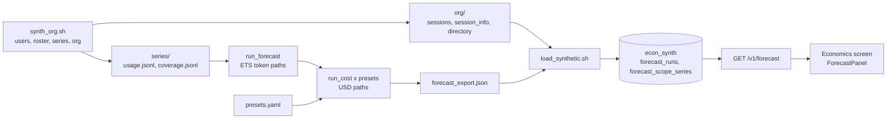

# Forecast in the dashboard (synthetic demo, scenario presets): implementation plan

| | |
|---|---|
| **Status** | **Hold lifted 2026-10-08** (§0.1). Decisions in §2 confirmed 2026-10-08: D1–D3 and D5–D11 as proposed, D4 (calibration) dropped, D12 (budgets) added. T1–T8 are done (2026-10-09); the branch is ready for review. |
| **Branch** | `feat/forecast-dashboard-integration-2`, cut from `main` at `f76471a` (#84). The first branch, `feat/forecast-dashboard-integration`, was merged as #80. |
| **Scope** | `econ-forecast/` (synthetic-org port, new `forecast.dashboard` package) and `code-econ` mainline (storage, API, web UI, synthetic loader). Synthetic data only. |
| **Process** | Each task T2..T8 runs through `talium-impl-workflow` (brief, handshake, worktree, tests, persisted report, review against this plan, land on the branch). |
| **Related** | [module architecture](../../econ-forecast/docs/arch/module-architecture.md), [forecasting README](../../econ-forecast/src/forecast/forecasting/README.md), [cost README](../../econ-forecast/src/forecast/cost/README.md), [synthetic-org README](../../econ-forecast/src/forecast/synthetic/org/README.md), [web UI rules](../../src/webui/AGENTS.md) |
| **Issues** | **#85** tracks this work (commits carry `Refs #85`). #67 (closed by #82) and #68 (closed by #84) were the prerequisites. #81 (5-minute cache writes priced at the 1-hour rate) is the remaining 0.33% at the seam. |

There is no separate design doc. §3 is the contract the tasks implement.

---

## 0.1 Hold: lifted 2026-10-08

Decided 2026-10-05: this integration does not proceed until all three hold on `main`.
Sequence decided 2026-10-06: (1) the demo line is merged into `main` (#80, `dee721c`); (2) #67 and #68 are fixed on `main`; (3) this integration resumes on a branch cut from that `main`. Steps 1 and 2 are done.

| # | Prerequisite | State on `main` (`f76471a`), measured 2026-10-08 |
|---|---|---|
| P1 | #67 fixed: `cache_write_5m` / `cache_write_1h` in the daily contract, `input` is uncached input only. | Merged as #82 (`72142c2`). |
| P2 | #68 fixed: one pricing module for dashboard, OTel true-up and budget. | Merged as #84 (`f76471a`). |
| P3 | All tests pass. | `pytest tests econ-forecast/tests -m "not slow"` with both requirements files installed: 3200 passed, 1 failed, 586 skipped. The failure is `test_plot_forecast_browser.py` (Playwright's Chromium is not installed on this machine). The skips include the database-backed directories, which were **not** run for this measurement (no `TALIUM_TEST_DSN`). |

What the two fixes changed for this plan (measured on `f76471a`, scratch directory, synthetic org ending 2026-10-08):

- **T2 holds on `main`.** `synth_org.sh --end-date today` completes with no port needed; #67 and #68 updated the org package themselves.
- **F4's gap is gone.** `cache_write_acceptance.sh` over the 28 days to 2026-09-30: cost run / request-level USD is 1.0000 for all three models; dashboard / request-level is 1.0033 (#81). D4, §3.3 and T4's calibration half are dropped (confirmed 2026-10-08).
- **F5 changed**, budgets are now $200 per developer (D12), and the narrow band is fixed in the example org (F7).

## 0. What this delivers

The Economics screen's "Budget forecast" section stops using the flat-rate projection
(`server/api/forecast.py::budget_burnup`, `TODO(X5-trend)`) and shows the ETS forecast instead:

1. A burn-up for the current and next month: actual spend to date, expected landing, p10–p90 band,
   budget line, and the chance of staying within budget.
2. A daily cost chart: recent actuals, then the forecast with its band.
3. **Scenario presets**: buttons that switch the forecast between precomputed what-ifs (move Opus
   work to Sonnet, usage grows 20%, …). Switching is instant because every preset is in one response.
4. **Budget runway** (added 2026-10-06, §3.8): will this month's budget last, how likely is it to run
   out, and around which date.
5. **Budget planner** (added 2026-10-06, §3.8): what each team and project needs next month, in dollars
   and in tokens per model, next to its current budget.

Everything is precomputed by a batch step when the synthetic dataset is generated. The API fits
nothing and imports nothing from `forecast.*`.



## 1. Measured facts this plan rests on

Measured 2026-10-05 on the merged branch, synthetic org (35 rostered users, 3 teams, 6 projects,
60 days ending 2026-10-05), in a scratch directory. Nothing from the spike is committed.

| # | Fact | Consequence |
|---|---|---|
| F1 | After the merge, `econ-forecast/tests/synthetic/org` has 8 failures and 83 errors. Main made `users.locale` required and moved the Layer 1 series config to `schema_version: 2` (`daily_zero_probability`, `weekend_reduction_*`, `events.spike_rules`); the org package, its example config and its test fixtures are still v1. | T2. The demo generator does not run until this is ported. |
| F2 | With `series.yaml` converted to v2 by hand, the whole chain (`synth_org.sh`) completes, and the forecaster accepts the org's `series/` directory unchanged. | No preparation module is needed for synthetic data. |
| F3 | `forecast.sh --origin 2026-09-30 --unit month --offset 1 --periods 2` gives a gapless 61-day run (Oct + Nov), all 10 scopes `complete`, in 11.5 s. A cost run is 1.6 s. All three models are priced by `common.model_pricing`. | D1 works with no forecaster change. The whole batch is under a minute. |
| F4 | Dashboard actual cost is **1.40x** what the forecast's rates give for the same tokens (28 days to Sep 30, org: $17,361 vs $12,445). Two causes, measured separately: **cache writes 1.23x** on every model (about 47% of the contract's `input` is cache writes, priced as plain input, #67) and **price table 1.13x**, all of it `claude-sonnet-5` ($2/$10 in `common.model_pricing`, $3/$15 from 2026-09-01 in `config/pricing.yaml`, #68). Per model: Haiku 1.22x, Opus 1.23x, Sonnet 1.85x. | Was the reason for D4. **Re-measured 2026-10-08 after #67 and #68: 1.0033 (§0.1), so D4 is dropped.** |
| F5 | Measured 2026-10-08 on the example org (120 days, D12 budgets, team curves of F7), baseline, October landing = actual to Oct 8 + forecast: org **$9.6k** against $7,000 ($274 per developer); Development $6.5k against $4,000 ($327); Platform $1.8k against $2,000 ($181); QA $1.2k against $1,000 ($235). Chance of running out: org 100% (around Oct 21–26), Development 100% (Oct 19–22), Platform 2%, QA 95% (Oct 25–29). (2026-10-05, before #67 and #68 and with the old $25k org budget: $13.1k.) | One team clearly over, one under, one near the line, with no budget tuning. Development and the org are far enough over $200 per developer that their probability still reads 100%; the date range and the planner figures carry the uncertainty there. |
| F6 | The forecaster only saves whole future calendar periods (`offset >= 1`). Days between the origin and the first period are simulated but not saved. | D1. |
| F7 | **Band width, resolved 2026-10-08.** With fixed per-user profiles and independent daily variation the monthly band was about ±2% at org level (days in a sample uncorrelated; the forecast was correct for that data: actual Oct 1–8 sat at its 20th percentile). The example org now binds a phase curve to Development (about ±11%) and Platform (about ±19%) (`0ec89c2`). Whole-month band, baseline, series ending Oct 8: October org ±12%, Development ±18%, Platform ±7%, QA ±14% (no curve); November ±21%, ±37%, ±11%, ±21%. | Budget probability, runway range and planner percentiles now carry information. The width depends on the date the series ends, because the model is chosen per fit: across end dates Sep 30, Oct 8 and Oct 20 (scratch) October was org ±9–13%, Development ±10–18%, Platform ±7–20%. Dated busy periods (`spike_rules`) were tried first and rejected: the band swung between ±2% and ±21% with the end date. |

> **Superseded 2026-10-10:** the example org's data changed (power users, spikes, a team with margin; see [synthetic demo realism](2026-10-10-synthetic-demo-realism.md) §7). The F5 and F7 figures above and the dollar figures in the T3-T8 results describe the earlier data.

## 2. Decisions (confirmed 2026-10-08)

| # | Decision | Why | Cost |
|---|---|---|---|
| D1 | **Forecast origin = last day of the previous month, two monthly periods.** If the data ends on a month-end, origin = that day. | Gapless current + next month with zero forecaster changes (F3, F6). The current month's elapsed days show forecast against actuals, which is a useful picture. | The forecast ignores the current month's actuals, so it is up to 30 days stale late in a month. Labelled "as of {origin}". A "from today" option in the forecaster is deferred (§7). |
| D2 | **Batch precompute, stored in Postgres, loaded by the synthetic loader.** | The deployed demo is a SQL dump of `econ_synth` (`utils/synth_dump.sh`), so a table rides along with no new deploy step. Keeps numpy and statsmodels out of the API image and keeps the rule that mainline never imports `forecast.*`. | Changing a preset means rerunning the batch (under a minute) and reloading. |
| D3 | **All presets in one response.** | Instant switching, no spinner, no cache logic. About 2,800 numbers per scope across the 7 presets, well under 100 KB of JSON. | None at this size. |
| D4 | ~~Effective-rate calibration per (scope, model).~~ **Dropped 2026-10-08.** | It covered F4's 1.40x gap; #67 and #68 closed it to 1.0033. | A 0.33% step at the seam until #81. |
| D5 | **Presets are org-wide.** The cost module applies an org change to every team and project. | One preset list for every scope the picker can show. | No "only team X switches" preset in v1. |
| D6 | **Where it shows:** Economics screen, replacing the "Where the window lands" section. The flat-rate chart stays as the fallback when no forecast is loaded. | The slot, the scope picker and the gate already exist. Mock mode and real-data deployments keep working. | Overview's forecast tile is not touched (§7). |
| D7 | **Series history 60 → 120 days** in the org example config. | Keeps 28+ days before a month-start origin on any day of the month, with room for the weekly-seasonal tier. | Larger dataset; regenerating changes every demo number (it does anyway, F1). |
| D8 | **Budget probability is computed in the API** from a stored 21-point quantile grid of period totals. | Budgets are editable on the Configure screen; the probability must follow an edit without rerunning the batch. | Linear interpolation between 5-point quantiles; exact enough for a percentage. |
| D9 | **Runway is computed in the API from per-date quantile grids of cumulative cost** (§3.8). | Follows a budget edit with no batch rerun (as D8). Cumulative cost never decreases, so "ran out by date d" is the same event as "cumulative cost on d exceeds what is left": the per-date distributions are enough, no sample paths in the database. | 21 numbers per date instead of 3. Against the 1,000 paths the 21-point grid was off by at most 0.03 in probability on the scratch run. |
| D10 | **The planning figure is dollars; tokens are shown per model as information.** | Seats and budgets moved from tokens to dollars on 2026-09-26 because a token is not a fixed amount of money and cache reads dominate the count. A per-model token figure is still what someone needs to size a provider commitment. | No single "token budget" number per team. |
| D11 | **"Who" means org, team and project.** | These are the scopes the forecaster fits. | No per-person need; a seat's share stays team budget / members. |
| D12 | **Example budgets are $200 per developer per month** (added 2026-10-08): team budget = roster count × 200, org = the sum (Development $4,000, Platform $2,000, QA $1,000, org $7,000). | The figure the user hears the industry using; one rule for every team. A seat's allowance (team budget / members) is then $200 for everyone. | The org as a whole is over budget in the baseline (F5); that is the demo's starting point, not a tuning error. |

Preset list (D5), all `token_factor: 1.0`, effective from the day after the data ends:

| id | Label | Group | Changes |
|---|---|---|---|
| `baseline` | Current trajectory | | none |
| `opus-to-sonnet-30` | Move 30% of Opus work to Sonnet | Model mix | `model_transfer` 0.3 |
| `opus-to-sonnet-60` | Move 60% of Opus work to Sonnet | Model mix | `model_transfer` 0.6 |
| `sonnet-to-haiku-30` | Move 30% of Sonnet work to Haiku | Model mix | `model_transfer` 0.3 |
| `usage-up-20` | Usage grows 20% | Usage | `growth` 1.2 |
| `usage-down-15` | Usage drops 15% | Usage | `growth` 0.85 |
| `usage-up-20-opus-to-sonnet-50` | Grow 20%, move half of Opus to Sonnet | Combined | `growth` 1.2, then `model_transfer` 0.5 |

## 3. Contract

### 3.1 Terms

| Term | Meaning |
|---|---|
| `data_through` | Last date in the series dataset (`series/manifest.json` `end_date`). |
| `origin` | Forecast cutoff (D1). History after it is not used for fitting. |
| period | One calendar month in the run. The **current period** contains `data_through`. |
| remaining | Forecast days of the current period after `data_through`. |
| preset | `baseline` or one named scenario; one cost run each. |
| scope | Dashboard identity: `org`, `team`, or `repo` plus `scope_id`. |

### 3.2 Scope mapping (forecast name → dashboard id)

| Forecast scope | Dashboard scope | `scope_id` source |
|---|---|---|
| `organization` | `org` | the org row of `org/budgets.jsonl` |
| `team <team_name>` | `team` | `forecast.synthetic.org.ids.team_slug(team_name)`, must exist in `org/directory_teams.jsonl` |
| `project <name>` | `repo` | `configs/org.yaml` `repos[].project` → the matching row of `org/repositories.jsonl` |

A forecast scope with no dashboard id is an export error, not a skipped row.

### 3.3 Calibration (removed)

Dropped with D4 on 2026-10-08. The export carries the cost run's USD paths unchanged. The section number is kept so later references stay valid.

### 3.4 `forecast_export.json` (schema `dashboard-forecast/1.0`)

All money is integer `usd_micros`. Arrays under a scope align with the `dates` they name.

```json
{
  "schema": "dashboard-forecast/1.0",
  "generated_at": "2026-10-05T04:10:00Z",
  "timezone": "Asia/Kolkata",
  "origin": "2026-09-30",
  "data_through": "2026-10-05",
  "band": {
    "low": 10,
    "high": 90
  },
  "quantile_grid": [0, 5, 10, 15, 20, 25, 30, 35, 40, 45, 50, 55, 60, 65, 70, 75, 80, 85, 90, 95, 100],
  "dates": ["2026-10-01", "...", "2026-11-30"],
  "periods": [
    {
      "start": "2026-10-01",
      "end": "2026-10-31",
      "from": "2026-10-06"
    },
    {
      "start": "2026-11-01",
      "end": "2026-11-30",
      "from": "2026-11-01"
    }
  ],
  "presets": [
    {
      "id": "opus-to-sonnet-30",
      "label": "Move 30% of Opus work to Sonnet",
      "group": "Model mix",
      "description": "30% of Opus tokens run on Sonnet instead, at the same token volume.",
      "assumptions": ["scenario_constant_tokens"]
    }
  ],
  "scopes": [
    {
      "scope_type": "team",
      "scope_id": "development",
      "name": "Development",
      "series": {
        "opus-to-sonnet-30": {
          "status": "complete",
          "daily": {
            "expected": [0],
            "low": [0],
            "high": [0]
          },
          "periods": [
            {
              "cumulative": {
                "expected": [0],
                "low": [0],
                "high": [0]
              },
              "total": {
                "expected": 0,
                "quantiles": [0]
              }
            }
          ]
        }
      }
    }
  ]
}
```

| Field | Rule | Consumer |
|---|---|---|
| `periods[].from` | First forecast date counted in that period: `data_through + 1` for the current period, else `start`. | API burn-up |
| `series.<preset>.daily.*` | Pointwise mean and band percentiles of the scope's daily USD, one value per `dates` entry. | Daily chart |
| `…periods[i].cumulative.*` | Mean and band percentiles of the running sum from `from` to each date through `end`. | Burn-up line and band |
| `…periods[i].total.expected` / `.quantiles` | Mean and `quantile_grid` percentiles of the per-sample sum from `from` to `end`. | Landing figure, budget probability |
| `status` | The cost run's scope status. Only `complete`, `conditional`, `inactive` carry numbers; `incomplete` carries none. | UI state |

A scope's USD path is the sum of its series' cost-run paths **per sample**; percentiles are taken after summing.

### 3.5 Storage

| Table | Columns | Notes |
|---|---|---|
| `forecast_runs` | `run_id` text pk, `origin` date, `data_through` date, `generated_at` ts, `meta` jsonb (`timezone`, `band`, `quantile_grid`, `dates`, `periods`, `presets`), `loaded_at` ts | One row per loaded export. The API reads the latest `loaded_at`. |
| `forecast_scope_series` | `run_id`, `scope_type`, `scope_id`, `preset_id` (composite pk), `status`, `payload` jsonb (`daily`, `periods`) | No FKs (storage.md §3.1). |

The loader replaces everything: one run at a time. Both tables join `truncate_all`.

### 3.6 `GET /v1/forecast?scope_type=&scope_id=`

Gated by `_gate_scope` like `/v1/economics`. Returns `Envelope[BudgetForecast]`.

```text
BudgetForecast
  scope_type, scope_id
  forecast: ForecastView | None          # None = no run loaded, or this scope is not in it
ForecastView
  origin: date
  data_through: date
  band_low: int, band_high: int
  budget_usd_micros: int | None          # the scope's monthly budget
  presets: [ForecastPreset]              # id, label, group, description, assumptions
  actual_daily: [{date, usd_micros}]     # 28 days before the first period .. data_through
  series: [ForecastSeries]               # one per preset, baseline first
ForecastSeries
  preset_id: str
  status: str
  daily: [{date, expected_usd_micros, low_usd_micros, high_usd_micros}]
  periods: [ForecastPeriod]
ForecastPeriod
  start: date, end: date
  forecast_from: date                    # first forecast day of the period (T4 `from`); the period is current iff > start
  actual_to_date_usd_micros: int         # spend on days start..forecast_from-1; 0 for a future period
  projected: [{date, expected_usd_micros, low_usd_micros, high_usd_micros}]   # actual_to_date + cumulative
  landing: {expected_usd_micros, p10_usd_micros, p50_usd_micros, p90_usd_micros}
  within_budget_probability: float | None   # None when no budget is set
  delta_vs_baseline_usd_micros: int      # landing.expected minus baseline's; 0 for baseline
```

- `actual_daily` and `actual_to_date` come from the same session fetch `/v1/economics` uses (one cost source), bucketed by date in the run's `timezone`.
- `landing` = `actual_to_date` + `total`. `within_budget_probability` = P(`total` ≤ budget − `actual_to_date`), by linear interpolation on `quantile_grid`; 0 below the grid, 1 above it.
- Worked example (becomes a unit test): quantiles for grid 0..100 step 5 are `1000, 1050, …, 2000` (step 50). Budget 1700, actual to date 200 → threshold 1500 → probability 0.50. Threshold 1525 → 0.525. Threshold 900 → 0. Threshold 2100 → 1.

### 3.7 Web UI

`ForecastPanel` (new, `src/webui/src/components/ForecastPanel.tsx`) replaces the section at
`EconomicsScreen.tsx` "Budget burn-up". It renders through `<Block>`.

| Element | Content |
|---|---|
| Preset buttons | Grouped by `group`; `baseline` selected by default. Selection is local state, no refetch. |
| Headline | "On the current trajectory, October lands at $18.2k (likely $16.0k–$21.1k)." With a budget: "62% likely to stay within the $19k budget." With a preset: "$1.9k less than the current trajectory." |
| Burn-up chart | Actual cumulative (solid), expected (dashed), band (area), budget line. When a preset is selected, baseline stays as a faint line. Toggle: this month / next month. |
| Daily chart | 28 days of actual daily cost, then expected daily cost with band through the end of next month. |
| Footnote | "Forecast as of {origin}. Model moves assume the same token volume." |
| No forecast | `forecast: null` → the existing flat-rate `BudgetBurn` chart, unchanged. |

Chart rows are built by a pure, tested helper (`src/webui/src/present/forecast.ts`). Strings pass
`npm run lexicon`. Types come from `npm run gen:types`; nothing hand-typed.

### 3.8 Budget runway and budget planner (added 2026-10-06)

Both read the same saved USD paths as the rest of §3. Nothing is refitted.

| Symbol | Definition |
|---|---|
| $B$ | The scope's monthly budget. |
| $A$ | Actual spend in the current period through `data_through`. |
| $R = B - A$ | What is left. |
| $C_d$ | Forecast cost summed from `data_through + 1` through date $d$, per sample. |
| $E$ | Last date of the period. |

$$P(\text{out by } d) = P(C_d > R) \qquad P(\text{out}) = P(C_E > R)$$

**Runway** (current period, per preset):

| Output | Rule |
|---|---|
| `runs_out_probability` | $P(\text{out})$; equals `1 - within_budget_probability`. |
| `runs_out_on.{p10,p50,p90}` | Earliest date $d$ with $P(\text{out by } d) \ge q \cdot P(\text{out})$ for $q$ = 0.1, 0.5, 0.9: the date it runs out, given that it does. `null` when $P(\text{out})$ < 0.05. |
| `days_short` | $E$ minus `runs_out_on.p50`, in days. |
| `status` | `lasts` when $P(\text{out})$ < 0.2, `runs_out` when > 0.8, else `at_risk`; `exhausted` when $R \le 0$ (then `runs_out_on` is the actual date spend crossed $B$). Thresholds live in `ApiConfig.forecast`. |

Worked example, scratch run of 2026-10-05 with org-level price factors, spend to date taken as the forecast mean for Oct 1–5 (illustrative: it predates #67, #68 and the D12 budgets, so neither the dollars nor the budgets are the demo's):

| Team | Budget | Lands at (p10–p90) | $P(\text{out})$ | Runs out around |
|---|---|---|---|---|
| Development | $9,000 | $12,739 ($11,455–$14,301) | 100% | Oct 23 |
| Development, 30% of Opus on Sonnet | $9,000 | $11,981 ($10,788–$13,432) | 100% | Oct 24 |
| Platform | $6,000 | $3,193 ($2,762–$3,689) | 0% | — |
| QA | $5,000 | $2,242 ($1,973–$2,570) | 0% | — |

**Planner** (each period, every team and project, per preset):

| Output | Rule |
|---|---|
| `needed.{expected,p50,p80,p90}` | Mean and percentiles of the per-sample period total; for the current period, $A$ plus the remaining total. |
| `gap_usd_micros` | `needed` at `ApiConfig.forecast.planning_confidence` (default 0.8) minus $B$. `null` with no budget. |
| `tokens_by_model[].{expected,p90}` | Per-sample token total for the period. Token paths are the series' USD paths divided by that series' per-date effective rate from the cost run's `daily_expected.jsonl` (USD / tokens), so scenario presets need no second kernel. |

Same scratch run, November:

| Team | Expected | p80 | p90 | Current budget |
|---|---|---|---|---|
| Development | $11,884 | $12,955 | $13,628 | $9,000 |
| Platform | $2,847 | $3,179 | $3,440 | $6,000 |
| QA | $2,100 | $2,309 | $2,479 | $5,000 |

Additions to the earlier sections:

| Where | Addition |
|---|---|
| §3.4 export | `…periods[i].cumulative.quantiles`: one `quantile_grid` row per date (replaces `low`/`high`, which are grid entries). `…periods[i].tokens_by_model`: `[{model, expected, p90}]`. |
| §3.6 `ForecastPeriod` | `runway: {status, runs_out_probability, runs_out_on, days_short} | None` (`None` with no budget or for a future period). |
| §3.8 planner fields (added in T7) | `BudgetPlan.planning_confidence` (the configured confidence) and `PlanPeriodFigures.plan_for_usd_micros` (the plan-for figure the gap is measured from, `gap = plan_for - budget`; present even without a budget), so the UI labels its "Plan for (N% likely enough)" column from the response. |
| New `GET /v1/forecast/plan` | Org-gated like `/v1/teams`. `Envelope[BudgetPlan]`: `periods`, `presets`, and `rows: [{scope_type, scope_id, name, budget_usd_micros, by_preset: [{preset_id, periods: [{needed, gap_usd_micros, tokens_by_model}]}]}]` for every team and project in the run. |
| §3.7 `ForecastPanel` | Runway headline ("At this pace the $9,000 budget runs out around Oct 23, 8 days early." / "The $6,000 budget lasts the month; $2,800 likely left."). A marker on the burn-up at `runs_out_on.p50` with the p10–p90 range shaded. |
| §3.7 new `BudgetPlanner` | On the Economics screen at org scope, under the forecast: one row per team and project with expected, plan-for figure, current budget, gap, and tokens per model on expand. Follows the selected preset. |
| Configure screen | A "suggested" figure beside each budget input, from the planner's next-period plan-for value. Stretch. |

## 4. Tasks

**T0 — issue [done 2026-10-08]**
- Raised as #85. Commits carry `Refs #85`.

**T1 — merge `origin/main` [done, `1219218`]**
- Files: `econ-forecast/src/forecast/synthetic/cli_synt_gen.py` (conflict), `econ-forecast/config/synthetic/org/users.yaml` (`locale`).
- Accept: `pytest econ-forecast/tests` outside `synthetic/org` green (413 passed before the first org error, F1).
- Mainline `pytest tests -m "not slow"`: 2205 passed; 92 failed and 52 errors, all in `tests/common/msging`. Not caused by the merge's content: the directory passes alone (777 passed) and fails only after `tests/common/model_pricing` in the same session, whose CLI tests leave structlog bound to a closed stream. Same on `origin/main`. Tracked separately, not part of this plan.

**T2 — port synthetic-org to Layer 1 series v2 [T1] [done]**
- Result: `pytest econ-forecast/tests/synthetic/org` 112 passed with assertions unchanged (only the fixtures' config dicts and the retiming test's lookup path changed); `synth_org.sh --end-date today` completes (9,224 root sessions, 92 s); on a scratch `*_synth` database `tests/server/storage` and `tests/server/api/test_synthetic_smoke.py` 115 passed, which covers the loader's post-load rollup check.
- Two judgement calls in the example config, both reversible: weekends are `weekend_reduction_probability: 1.0` with factor 0.11 (0.06 for Platform), which keeps v1's average weekend level (realized 0.093x a weekday) but leaves low activity on every weekend instead of none on most; spikes are off, because a v2 rule fires for every targeted user on a date and the v1 numbers would produce whole-org 3–5x days.
- Not verified here: invariants I2a/I2b/I6 on the example config beyond what the suite asserts on its own fixtures.
- Files: `econ-forecast/config/synthetic/org/series.yaml`, `econ-forecast/src/forecast/synthetic/org/cli_synth_org.py` (`_retime_series`: shift `spike_rules` date ranges and `zero_periods`, drop `dated_spikes`), `econ-forecast/tests/synthetic/org/conftest.py` and the fixtures that build v1 configs, org README.
- v1 → v2 field map: `weekday_zero_probability` → `daily_zero_probability`; `weekend_zero_probability` / `weekend_usage_multiplier` → `weekend_reduction_probability` / `weekend_reduction_factor` (not the same semantics: document the realized weekend drop before and after); `events.random_spikes` → one untargeted `spike_rules` entry.
- `series.days: 120` (D7): done 2026-10-08 (`14b4e1a`). `synth_org.sh --end-date today` then takes about 5 minutes (30,274 root sessions) instead of 1.5. Budgets per D12: `0a61d46`.
- Team usage curves (F7): `econ-forecast/config/synthetic/org/curves/`, bound in `series.yaml`; `cli_synth_org.py` now resolves `curve.artifacts` against the config dir (`d9d6b6d`).
- Do not change Layer 1.
- Accept: `pytest econ-forecast/tests/synthetic/org` green with no test removed or weakened; `synth_org.sh --end-date today` completes; `load_synthetic.sh --replace` passes its post-load rollup check; invariants I1–I7 in the org README hold; `tests/server/api/test_synthetic_smoke.py` green.

**T3 — `forecast.dashboard`: presets and runs [T2] [done 2026-10-08, `a9645c5` + fixes]**
- Files: `econ-forecast/src/forecast/dashboard/{__init__,presets,runner,errors}.py`, `econ-forecast/config/dashboard/presets.yaml`.
- `presets.py`: load and validate `presets.yaml` (§2 table); render one `scenario/1.0` file per preset with `effective_from = data_through + 1`; ids unique, `baseline` reserved.
- `runner.py`: resolve `data_through` and `origin` (D1); write `forecast.yaml` with the org, every team and every project from the series config; call `run_forecast` (month, offset 1, periods 2) and `run_cost` once per preset, through their Python APIs.
- Accept: on the T2 dataset, forecast and all 7 cost runs exit 0 with every scope `complete`; origin rule unit-tested for mid-month, first-of-month and month-end; fewer than 28 history days before the origin is an `InputError`.
- Result: on the example dataset (data through 2026-10-08) origin 2026-09-30, 10 scopes, forecast and all 7 cost runs complete in about 19 s; org October expected baseline $9,657, `opus-to-sonnet-30` $8,815, `opus-to-sonnet-60` $7,974, `sonnet-to-haiku-30` $9,372, `usage-up-20` $11,063, `usage-down-15` $8,602, combined $9,380. `pytest econ-forecast/tests/dashboard` 95 passed (report under `docs/test/reports/forecast-dashboard-*`). Verified in three independent passes; every finding is fixed except the two listed below as known.
- Added beyond the list above: `presets.yaml` schema `dashboard-presets/1.0` (strict keys, `baseline` first, no `effective_from`); the entry point takes the series directory (`<org-demo>/series`), an optional forecast template (default `config/forecasting/forecast.yaml`) and an optional pinned price catalog; the output must be separate from the series directory; `force` removes only `forecast.yaml`, `scenarios/`, `forecast/`, `cost/`.
- Known and left: with `force`, an input only the forecaster or the cost module rejects is found after the earlier run is cleared; YAML merge keys (`<<:`) with an override are refused as duplicate keys; `TODO(#85)` in `runner.py` (the cost run reads the live price catalog, the org dataset pins its own).

**T4 — `forecast.dashboard`: export [T3] [done 2026-10-08, `849f683` + fixes]**
- §3.8: per-date cumulative quantile grids and `tokens_by_model`. Accept: for every scope, preset and date, the grid is non-decreasing across quantiles and across dates; $P(\text{out by } d)$ from the grid is within 0.05 of the same figure from the 1,000 paths for three budgets (below p10, near p50, above p90 of the period total); token total for a `model_transfer` preset with `token_factor: 1.0` equals baseline's within rounding.
- Files: `econ-forecast/src/forecast/dashboard/{scopes,export,cli_dashboard_forecast}.py`, `README.md`, `econ-forecast/utils/dashboard_forecast.sh`.
- `scopes.py`: §3.2. `export.py`: §3.4, reading runs only through `load_run` / `load_cost_run`, one scope in memory at a time.
- CLI: `dashboard_forecast.sh --org-demo <dir> [--presets <yaml>] [--output <dir>] [--force]`; default output `<org-demo>/forecast/`; JSON summary on stdout, structured logs on stderr; exit 0 / 1 / 2 as the other forecast CLIs.
- Accept: seam check: the org baseline's mean expected daily cost over the current period is within 15% of the dashboard's mean daily cost over the 28 days ending `data_through`; for every scope and period, `usage-up-20` total expected > baseline > `opus-to-sonnet-30`; `opus-to-sonnet-60` saves more than `opus-to-sonnet-30`; export validates against §3.4; rerun with the same inputs is byte-identical apart from `generated_at`.
- Result (example dataset, data through 2026-10-08, `dashboard_forecast.sh --org-demo … --force`): exit 0 in about 22 s, peak memory 287 MB for the whole run; `forecast_export.json` is 1,030,867 bytes (96–110 KB per scope, about 15 KB per scope and preset), 10 scopes × 7 presets, all `complete`, scope ids `default`, `development`, `platform`, `qa` and the six `github:acme/…` repositories. Org October baseline $9,657 (from Oct 9 on: $7,030; November $9,240). Seam: forecast mean daily cost over October $311.5 against $317.6 actual over the 28 days to Oct 8 (−1.9%; −3.8% over Oct 9–31 only). Relations hold for all 10 scopes and both periods (`usage-up-20` > baseline > `opus-to-sonnet-30` > `opus-to-sonnet-60`; org from-date totals, October: $8,436 > $7,030 > $6,188 > $5,346). P(out by d) from the grid against the 1,000 paths: largest difference 0.031 over 11,130 cases (every scope, preset, period, date and three budgets). Token total of the three `model_transfer` presets against baseline: largest difference 1 token. Rerun into another directory: identical apart from `generated_at`. `pytest econ-forecast/tests/dashboard` 260 passed (report under `docs/test/reports/forecast-dashboard-*`). Verified by an independent pass that recomputed every number from the raw cost-run arrays (0 mismatches over 140 scope/preset/period blocks), ran 40 source mutants against the tests and tried corrupted inputs; its minor findings are fixed.
- Decisions taken in the brief: `scopes.py` imports `forecast.synthetic.org.ids.team_slug` (lazily; the only such import in the package) because the directory's display names do not reproduce the id (`QA` is stored as `Qa`); the org id is the org manifest's `directory_org_id` (cross-checked against the `budgets.jsonl` org row when there is one), not read from the budgets file, so an org without budgets still maps; a repo scope's `name` is the repository label (`acme/auth-service`); `presets[].assumptions` is the sorted union of the preset's cost-run scope assumptions (unfiltered, so it also carries the forecaster's own codes; the UI picks the ones it words); the CLI maps scopes before it runs anything, so a mapping error exits 2 before the output directory is touched; `--force` also removes a stale `forecast_export.json`.
- **Consequences for later tasks.** (1) *Month end:* when the data ends on a month's last day, D1 makes the origin that day and both periods are future months (`from == start` for both). No period is current: T6 must give both periods `actual_to_date` 0 and no runway, and T7 must not label either one "this month". A period is current exactly when `from > start`. On the demo this happens on the last day of any month if the dataset is regenerated with `--end-date today`. (2) *Tokens:* `tokens_by_model` covers `from`..`end` only, so for the current period it is the remaining days; actual tokens to date are not in the export. (3) *Size:* the export is about 1 MB, not "well under 100 KB" as D3 estimated before the per-date grids (§3.8); each `forecast_scope_series` row in T5 is about 15 KB, still fine for jsonb. (4) The cumulative arrays cover `from`..`end` only; the date axis is `dates[position of from .. position of end]`.

**T5 — storage and loader [T4 for the real file; a fixture export unblocks it earlier] [done 2026-10-08, `3dacaff`..`1909e59`]**
- Files: `src/server/storage/schema/forecast.py` (+ `schema/__init__.py`), an alembic migration, `config/queries/forecast.yaml`, `src/server/storage/forecast_load.py`, `src/server/storage/cli_load_forecast.py`, `utils/load_forecast.sh`; `synthetic_load.py` and `cli_load_synthetic.py` gain `--forecast-export`; `config/queries/synthetic.yaml` `truncate_all`; `utils/synth_dump.sh` passes the export when `<org-demo>/forecast/forecast_export.json` exists.
- The loader reads the JSON as plain dicts and imports nothing from `forecast.*`. Unknown major schema version is refused.
- Accept: migration applies and downgrades on a scratch database; load is idempotent; loading a second export leaves exactly one run; a malformed export changes nothing (one transaction).
- Result: tables `forecast_runs` / `forecast_scope_series` (migration `231990ad3837`, applies and downgrades on a scratch database, no model drift), loader `server.storage.forecast_load` (`parse_export`, `replace_run`, `load_forecast_export`), `cli_load_forecast.py` + `utils/load_forecast.sh`, `--forecast-export` on `cli_load_synthetic`, both tables in `truncate_all` and `row_counts`, `utils/synth_dump.sh` passes `<org-demo>/forecast/forecast_export.json` when it exists. On the example org: `cli_load_synthetic --replace --forecast-export` exits 0 in about 2 minutes (the forecast part takes under 120 ms), 1 run and 70 scope-series rows, all 70 payloads equal to the source JSON, relation size 819 KB (payload column 705 KB compressed, largest row 11 KB); reloading leaves the same run and moves only `loaded_at`; loading a changed export leaves exactly one run; truncated, schema-2.0 and foreign-scope exports exit 2 with every table identical before and after. One real `synth_dump.sh` run (docker, once) produced a dump with both tables and the 70 rows; the verifier replayed its argument logic only. `pytest tests/server/storage` plus the budgets migration test: 354 passed with a scratch `_synth` database (the DB-backed ones skip cleanly without); 261 new or extended tests in `docs/test/reports/forecast-storage-*`. Verified by an independent pass (46 source mutants, about 50 adversarial exports, a forced failure after the forecast write, two concurrent loaders); its findings are fixed.
- Decisions taken in the brief: `run_id` = first 16 hex of the sha256 of the file's bytes; the standalone loader applies the same `_synth` name guard as the synthetic loader (synthetic data only, no override); `meta` additionally carries `schema` and `scopes` (`[{scope_type, scope_id, name}]` in export order) because the display names exist nowhere else and differ from the directory's (`QA` against `Qa`); `payload` is the series entry without `status` (the column holds it); an `org` scope is optional (at most one); the loader checks the document's shape, not the numbers or the timezone name; the synthetic loader refuses an export whose org, team or repo ids are not in the dataset, before any database work; `replace_run` takes a SHARE ROW EXCLUSIVE lock so two loaders cannot leave two runs.
- **For T6.** (1) Read the run's scope names from `meta.scopes`, not from the directory. (2) `loaded_at` is the load transaction's start, up to the whole synthetic load before the write; with one run at a time "latest `loaded_at`" is still the only run. (3) The loader does not verify array contents or that `meta.timezone` is a real zone: `compose_period` must cope with a bad value rather than assume. (4) `synthetic_load --replace` truncates both tables, which blocks readers of them for the length of the load (about 2 minutes on the example). (5) Dates in `meta.dates` run from the first forecast day; per-period arrays cover `from`..`end` of `meta.periods[i]`.

**T6 — API [T5] [done 2026-10-08, `28e923c`..`46bbaea`]**
- §3.8: `runway` on `ForecastPeriod` (pure helper `budget_runway` in `server/api/forecast.py`), `GET /v1/forecast/plan`, the two `ApiConfig.forecast` settings. Accept: `runs_out_probability + within_budget_probability == 1`; `exhausted` when spend already exceeds the budget; `runs_out_on` is `null` below 0.05; raising the budget never raises `runs_out_probability`, and `P(out by d)` never falls as `d` grows, with `runs_out_on.p10 <= p50 <= p90` (the date `p50` is **not** guaranteed never to move earlier when the budget rises: the ratio `P(out by d) / P(out)` is not monotone in the budget unless the distributions are hazard-rate ordered; on the example run 44 of 28,000 budget steps moved it one day earlier, always at `P(out)` between 0.051 and 0.091); planner rows cover exactly the run's teams and projects.
- Files: `src/server/api/forecast.py` (pure helpers: `quantile_cdf`, `compose_period`), `src/server/api/manager/service.py` (`budget_forecast`), `src/server/api/schemas/manager.py`, `src/server/api/app.py`, regenerated `openapi.json`.
- Accept: §3.6's worked example passes; `forecast: null` with no run and for a scope outside the run; gate behaves as `/v1/economics` (401/403 cases); `actual_daily` total for a window equals the same window's cost from `/v1/economics`'s session fetch; `utils/export_openapi.sh` and `npm run gen:types:check` clean.
- Result: `GET /v1/forecast?scope_type=&scope_id=` and `GET /v1/forecast/plan` (schemas in `schemas/manager.py`, pure helpers `quantile_cdf`, `quantile_value`, `compose_period`, `budget_runway` in `server/api/forecast.py`, the stored-run reader `manager/forecast_store.py`, `service.budget_forecast` / `budget_plan`; `economics()` now shares the scope session fetch, output byte-identical). `ApiConfig.forecast` gains `runway_lasts_below` 0.2, `runway_runs_out_above` 0.8, `runway_min_probability` 0.05, `planning_confidence` 0.8. `openapi.json` and `api-types.ts` regenerated, both drift checks clean (`utils/gen_api_types.sh` is now executable). On the example org (30,419 sessions, scratch `_synth` database): every baseline `landing.expected - actual_to_date` equals the export's `total.expected` exactly; `actual_to_date` equals an independent SQL sum for org, the three teams and the repos; October baseline runway: org `runs_out` 100% (Oct 21 / 23 / 26), Development 100% (Oct 19 / 20 / 22), QA 95.07% (Oct 24 / 27 / 29), Platform `lasts` at 3.96% (the grid cannot resolve a tail that small; F5 measured 2%); org October landing by preset: baseline $9,601, `opus-to-sonnet-30` −$842, `opus-to-sonnet-60` −$1,684, `sonnet-to-haiku-30` −$285, `usage-up-20` +$1,406; raising the org budget to $12,000 through the existing PUT changes the probability and the runway on the next request; the planner has 3 team + 6 repo rows, November Development needs $6,363 against $4,000. Latency (median of 10, in process): `/v1/forecast` org 209–241 ms, team 164 ms, repo 96 ms, `/v1/forecast/plan` 231–262 ms, against `/v1/economics` 230–270 ms. `pytest tests/server/api tests/server/storage` 1074 passed with a scratch database (607 passed, 467 skipped without); 250 T6 tests (`docs/test/reports/forecast-api-*`). Verified in two passes: the verifier recomputed 5,890 fields from the export and SQL with 0 mismatches, ran about 130 source mutants, 134 stored-run corruption cases, 13 timezones and the gate matrix. Its one Major (a stored run with an extreme `data_through` gave a 500 or a 1.8 GB response) is fixed: the reader now requires `data_through + 1` to be the current period's `forecast_from` (or the first period's start when none is current), caps the actuals window at 400 days, and reads the dates as text.
- Decisions taken in the brief: all dollars are plain integer `*_usd_micros`; a scope not in the run, no run, or an unreadable run gives `forecast: null` (`/v1/forecast`) or `data: null` + `unavailable(block="forecast")` (plan), never a 500, with a `forecast.run_unreadable` log; `actual_to_date` is the scope's spend on days `start..forecast_from-1` in the run's timezone, so a future period has 0; `actual_daily` runs from 28 days before the first period to `data_through` (36 days on the example, 28 in the month-end case); landing percentiles are interpolated on the stored grid; status thresholds are compared after rounding to 12 decimals; a non-finite budget is no budget and a negative or spent budget is `exhausted`; the planner gap uses the quantile at `planning_confidence` plus the actual spend.
- **For T7.** (1) `projected` starts at `forecast_from`; there is no point at `data_through`, so the burn-up joins the actual cumulative to the first projected point. (2) `forecast_from` and `current` tell which period is under way; in the month-end case neither is, and `runway` is null for both. (3) `runway` is null for a future period and for a scope with no budget (repos have none on the example). (4) The cold-start shapes differ: `forecast: null` inside a 200 for the scope endpoint, `data: null` + `unavailable` for the plan. (5) A team lead gets 200 on `/v1/forecast/plan` and sees every team's budget and plan, as on `/v1/teams`. (6) `tokens_by_model` covers `forecast_from..end`, while `needed` includes the actual spend to date. (7) `actual_daily` is 36 days on the example; slice the 28 to show. (8) The Platform tail (3.96%, no dates) is real: the headline must handle a `lasts` scope with null dates.

**T7 — web UI [T6] [done 2026-10-09, `b6b3dfb`..`f77b0f2`]**
- §3.8: runway headline and burn-up marker in `ForecastPanel`; `BudgetPlanner` (`src/webui/src/components/BudgetPlanner.tsx`) on the Economics screen at org scope; mock fixtures for both. Accept: the headline and marker move when a preset is selected; a budget edit on Configure changes them on reload; the planner's gap column sorts; strings pass `npm run lexicon`.
- Files: `src/webui/src/data/source.ts` (`forecast()` on both sources), `src/webui/src/data/mock-source.ts` and `mock.ts` (a fixture that conforms to the generated type), `src/webui/src/present/forecast.ts`, `src/webui/src/components/ForecastPanel.tsx`, `src/webui/src/components/charts.tsx` (band and budget line on the burn-up; daily fan chart), `src/webui/src/screens/EconomicsScreen.tsx`, `src/webui/AGENTS.md`.
- Accept: `npm run typecheck`, `npm run test`, `npm run lexicon` clean; in the browser against the synthetic API: switching presets changes headline, burn-up and daily chart with no network request; scope picker works for org, a team and a project; with no run loaded the old chart renders; phone width has no horizontal scroll.
- Result: `ForecastPanel` (preset buttons grouped by `group`, headline and runway sentences, This month / Next month toggle, burn-up chart with likely range, budget line, run-out marker and range, baseline overlay for a selected preset, 28-day daily chart with forecast fan, footnote), `BudgetPlanner` (org scope only: one row per team and project, expected, plan-for, gap with a sortable header, tokens per model on expand, stacked cards on a phone), `forecast()` / `forecastPlan()` on both data sources with a mock fixture that conforms to the generated types, and the pure, tested helpers in `present/forecast.ts`; the old flat-rate chart is the fallback when a scope has no forecast. Small backend addendum: `planning_confidence` and `plan_for_usd_micros` on the plan response (§3.8 Additions). In a browser against the example org (scratch `_synth` database, real API): switching among the 7 presets issued 0 requests (9 clicks, resource count unchanged) and changed the headline, both charts and the planner scenario; org October reads "lands at $9.6k (likely $8.6k–$10.6k). 0% likely to stay within the $7,000 budget. At this pace the $7,000 budget runs out around Oct 23, 8 days early."; "Move 30% of Opus work to Sonnet" gives "$842 less than the current trajectory" and Oct 26; Development "$6.5k ... runs out around Oct 20, 11 days early"; auth-service (no budget) shows no probability or runway sentence; the Engineering team (not in the run) shows the old chart ($9,571); a budget edit to $12,000 through PUT changed the panel on reload to "99% likely ... The $12,000 budget lasts the month; $2.4k likely left." and the Configure save flowed through live; the planner gap column cycles descending / ascending / response order within Teams and Projects with nulls last; no horizontal scroll at 375, 768, 1024 and 1440 px; dark mode legible; month-end data shows "November"/"December" with no actual rows and no runway. `npm run typecheck`, `npm test` (107 passed, also under three time zones), `npm run lexicon` (45 files), `npm run build` and `npm run gen:types:check` clean; `pytest tests/server/api tests/server/storage` 1074 passed. Verified in two passes by an independent verifier (browser, independent recomputation of every sentence and chart row across scopes, presets and periods with 0 mismatches, 113 source mutants, retry, keyboard and mock-mode checks): no Major; its minor findings are fixed (token table readability and a billions tier, a valid sort-button label instead of `aria-sort`, a live region on the headline, distinct group names, legend entries only for drawn series, generated types for tokens, stronger band fill for dark mode, safer formatters, three test gaps).
- Decisions taken in the brief: the forecast is fetched once per scope at the top of the Economics screen (the timeframe toggle does not refetch it); the org scope id for the forecast is `"default"` (the Configure screen's constant, now shared), so an org whose id differs falls back to the flat chart; preset and month switches are local state; budgets print in whole dollars and model outputs compact; the planner defaults to the first period that is not current; `ForecastPreset.assumptions` is not shown.
- Known and left: the planner fetches twice on a scope switch (stale body mount) and again on a timeframe change; mock budgets are static, so a Configure edit does not move the mock forecast; a team lead sees every team's budget on the planner (T6 decision); the scope picker lists numeric repo ids from the example data's `git_repos` rows (they have no forecast and fall back); Configure's "suggested" budget figure (stretch) is not built; component rendering has no unit tests (no jsdom), it is covered by the browser checks and the pure helpers.

**T8 — demo refresh, budgets, docs [T7] [done 2026-10-09, `516922d`..`32e2b3e`]**
- Files: `utils/synth_demo_refresh.sh` (generate → forecast → load → optional dump), org README, `docs/plan/2026-09-23-aws-team-deployment.md` (refresh steps), this plan's status.
- Budgets are set by D12 and need no retuning (F5); the band is settled (F7).
- Accept: §6 end to end from a clean checkout of the branch.
- Result: `utils/synth_demo_refresh.sh [--output] [--end-date] [--config-dir] [--presets] [--force] [--dsn] [--dump] [--dry-run]` runs generate, forecast, an optional load (`--dsn`, database name must end `_synth`, no default) and an optional AWS seed dump (`--dump`); it validates before any work (real calendar date, no empty values, config files present, config and presets outside the output), moves an earlier refresh aside (`<output>.prev-<pid>`, allowlist `configs pricing org roster series users forecast`) and restores it if generate fails or is interrupted, masks DSN passwords, and ends stdout with one JSON line. Docs: org README (quick start, forecast needs, staleness), forecast README ("Refreshing the demo"), the AWS plan (refresh steps). Measured on the example org (100 users, 120 days, end date 2026-10-09, scratch output and `_synth` database): generate 292-343 s, forecast 23-36 s, load 128-136 s, dump 165-248 s, about 10-12 minutes in all; export 10 scopes x 7 presets, all `complete`, identical across runs except `generated_at`; the load gives 1 `forecast_runs` row and 70 `forecast_scope_series` rows; the dump carries both tables. §6: step 1-2 as above; step 3 `landing.expected - actual_to_date` = 6,640,805,992 micros = the export's `total.expected` (exact); step 4 the actual line meets the projected line with no step; step 5 "Move 30% of Opus work to Sonnet" lands $795 below the baseline with the baseline overlay; step 6 a budget PUT of $12,000 moved the run-out probability from 1 to 0.011 with no rerun (restored to $7,000); step 7 was exercised by restoring the dump with the same `gunzip | psql` that `aws_synth_load.sh` uses into a scratch database and reading the forecast through the API and UI. `aws_synth_load.sh --local --replace` itself was NOT run: `aws_up.sh --local` starts a collector that reads the production S3 bucket with the user's `~/.aws` credentials. 112 tests in `tests/utils/test_synth_demo_refresh.py` (130 in `tests/utils`), also run backgrounded; verified in two passes by an independent verifier (79 + 53 mutants, signal and path adversarial cases, evidence recomputed): no Major; both Major findings of the first pass (an impossible date or an empty value losing the earlier demo under `--force`) and all Minors are fixed.
- Known and left: no lock (two refreshes on one `--output` at once corrupt each other; documented in the script header); a stage that ignores SIGTERM is not killed; the old demo is deleted as soon as generate succeeds, so a forecast failure leaves a new dataset without a forecast and no old copy; `load_synthetic.sh` and `load_forecast.sh` need an activated venv and `PYTHONPATH=src` (the refresh script supplies both); the generate stage takes about 5 minutes, not the 15 s the org README used to say; the pre-existing org README link to `docs/plan/2026-09-18-synthetic-org-implementation.md` is broken (6 `../` levels).

## 5. Tests

| File | Covers |
|---|---|
| `econ-forecast/tests/synthetic/org/*` (existing) | T2: unchanged assertions on v2 configs |
| `econ-forecast/tests/dashboard/test_presets.py` | preset validation, scenario rendering, `effective_from` |
| `econ-forecast/tests/dashboard/test_runner.py` | origin rule, scope list, history floor |
| `econ-forecast/tests/dashboard/test_scopes.py` | §3.2 mapping, unmapped scope is an error |
| `econ-forecast/tests/dashboard/test_export.py` | §3.4 shape, per-sample summing before percentiles, ordering checks, determinism |
| `tests/server/storage/test_forecast_load.py` | load, replace, malformed export, version refusal |
| `tests/server/api/test_forecast_helpers.py` | `quantile_cdf` worked example, `compose_period` |
| `tests/server/api/test_forecast_endpoint.py` | response shape, null cases, gate, actuals agree with economics |
| `tests/server/api/test_forecast_runway.py` | `budget_runway`: statuses, conditional dates, monotonic in budget, exhausted case |
| `tests/server/api/test_forecast_plan_endpoint.py` | planner rows, gap at the configured confidence, gate |
| `econ-forecast/tests/dashboard/test_export_runway.py` | per-date grids vs paths, token paths from USD and effective rate |
| `src/webui/src/present/present.test.ts` (extended) | chart-row builder |

Reports go to `docs/test/reports/` (`forecast-dashboard-junit.xml`, `forecast-dashboard-test-report.md`).

## 6. Verification (end to end)

1. `utils/synth_demo_refresh.sh --end-date today` completes with every stage exit 0.
2. `forecast_export.json` has 10 scopes × 7 presets, all `complete`.
3. `GET /v1/forecast?scope_type=org&scope_id=<org>` returns 7 series; baseline's current-period `landing.expected` minus `actual_to_date` equals the export's `total.expected`.
4. Economics screen, org scope: burn-up's actual line meets the projected line with no step at `data_through`.
5. Select "Move 30% of Opus work to Sonnet": landing drops, delta is negative, baseline stays visible.
6. Change the org budget on the Configure screen; the probability changes on reload with no batch rerun.
7. `utils/synth_dump.sh` then `utils/aws_synth_load.sh --local --replace`: the forecast renders from the dump.

## 7. Out of scope

- Real (non-synthetic) data: needs the `preparation` module (Postgres → daily contract).
- Live sliders: needs an in-memory entry point in `forecast.cost` and a what-if service.
- A "forecast from today" origin in the forecaster (removes D1's staleness).
- Presets that need a refit: a declared launch spike (`known_events`), trend or seasonality off. The export format already allows them as extra presets backed by a second forecast run.
- Overview's forecast tile and the cost-per-PR cone.
- #81: the dashboard prices 5-minute cache writes at the 1-hour rate (0.33% at the seam).
- Forecast for parent or group teams that Layer 1 does not know.

## 8. Effort (estimate, working days, one developer)

| Task | Days |
|---|---|
| T2 synthetic-org port | 1–1.5 |
| T3 presets and runs | 1 |
| T4 export | 1.5–2 |
| T5 storage and loader | 1 |
| T6 API | 2–2.5 |
| T7 web UI | 4–5.5 |
| T8 refresh, budgets, docs | 0.5–1 |
| **Total** | **11–14.5** |

History of this estimate: 6–7.5 days before the merge and the spike; 8.5–11.5 after adding T2 (F1) and calibration (F4);
11.5–15.5 after adding the runway and planner on 2026-10-06 (T4 +0.5–1, T6 +1, T7 +1.5–2);
11–14.5 after dropping calibration on 2026-10-08 (T4 −0.5–1). T2 (1–1.5) is already done, which leaves 10–13.
