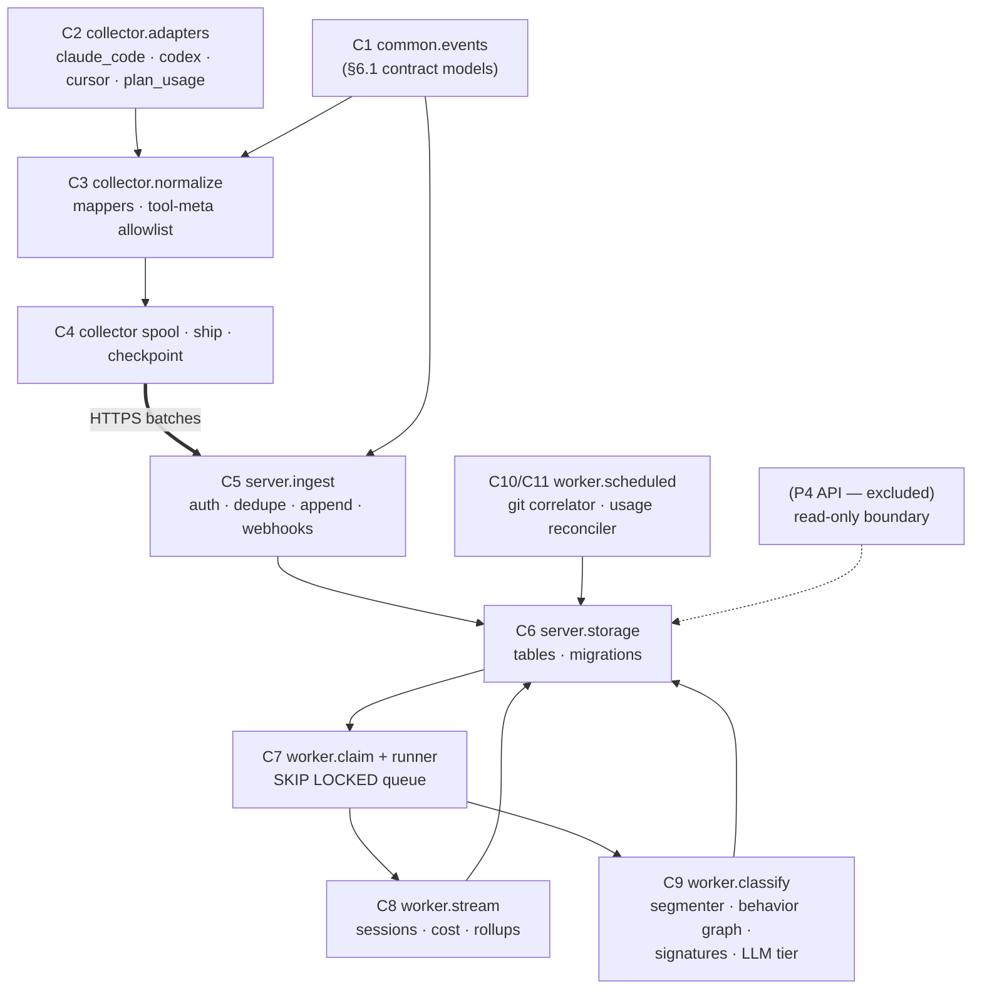

# Component Design and Implementation Plan

**Status:** Draft v1 · **Parent design:** `coding-econ-design-draft.md` (architecture, event schema §6.1)
**Companion:** `Task-Classification-and-Analysis.md` (classifier worker internals)
**Scope:** component-level design and build plan for the Collector (P1), Ingest (P2),
Processing Workers (P3), and Storage (P5). **The API + Dashboard (P4) is deliberately
excluded** — only its boundary (read-only access to sessions/rollups/tasks) is stated.

---

## 1. Plan in a Nutshell

One Python 3.11+ monorepo, one installable package with dependency extras, **three runnable
processes** (collector, ingest, worker) sharing one contract package (`common.events`, the
§6.1 event message as pydantic models). Eleven components (C1–C11, §5) map one-to-one onto
source directories (§4); every component talks to its neighbors only through the four parent
interfaces (event message, events-table queue, sessions/rollups tables, git webhooks), so
components are buildable and testable in isolation. Delivery is six milestones (§9) ordered
around the business priority: **M1 is the backfill proof point** — existing Claude Code
JSONL files → events → sessions → costs, end to end — reachable with only five of the eleven
components. Estimated effort: **~10–12 person-weeks to M4** (proof point at ~3–4 weeks).



---

## 2. Terms

Parent doc §2 terms apply unchanged. New here:

| Term | Meaning |
|---|---|
| **Component** | One source directory with one responsibility and a stated public interface; the unit of this doc (C1–C11). |
| **Worker type** | Deployment flavor of the worker process (stream / scheduled / classifier), selected by a CLI flag (parent §4.5). |
| **Milestone (M0–M5)** | A shippable increment with acceptance criteria; the implementation plan's unit (§9). |
| **Extras** | Optional dependency groups of one Python package (`pip install .[collector]`), so laptops never install server dependencies and vice versa. |

---
<!-- AI_NOTE: Explain Woker type: scheduled time driven,
   Classifier: that is componenet, there will be many such. I am curious why we need to have this. A registration of worker broadly makes sense, but what was your rational?
-->

## 3. Design Rules (apply to every component)

1. **Contract-first.** All inter-process data is `common.events` models; all intra-server
   handoff is database rows. No component imports another's internals — only `common.*` and
   its own subtree.
   <!-- AI_NOTE: The IPC can be and should be API based. COuld be REST, protbuf whatever. 
        If durability is necessary then db row based communication is fine. However this needs to be abstracted. It could be db based, queue and so on.   -->
2. **Idempotent everything** (parent §5.3): every write path must produce the same state if
   run twice; tests assert this explicitly.
3. **Structured JSON logging** per project mandate: `structlog`, one logger per component,
   log-event names and fields declared in that component's section (§5) — the module
   provides its JSON format.
4. **CLI naming** per project standard: entry points are `cli_{function}.py`, run as
   `python -m {module}.cli_{function}`; shell wrappers live in `utils/`.
5. **Config layering:** defaults in code → config file → environment variables; secrets only
   via environment / `.env` (never committed).
6. **Tests:** pytest, one test package per component, fixtures are recorded vendor files and
   golden event JSON; the replay set (backfill through the full stack) is the integration
   harness.
   <!--  AI_NOTE: 
     7. Every calls must be going thru llm router, choose the most common llm_router. A config file will point to model used, we may use multiple model, control caching etc. Take a look at the agent-guard repo, it is locally present
   -->

---

## 4. Source Layout
<!-- AI_NOTE: 
 Various notes on code orgization and packages.
 1. the talium-package repo contains a db-core package, that provides interaction with db. The package is data driven. You will read it to understand and use it create, query and update db.
 2. The backfill is pretty confusing name, I have called it as batch mode. The batch mode is kicked off to process existing session history. utils/backfill.sh should be called utils/batchprocess.sh
 3. src/common/events:
       These is supposed to be JSON, why do we have .py files? 
       For examle ids.py probably a config driven or auto generated enum. 
       What is payloads.py.
       It seems that your plan is assuming a lot of things too early. I see the rationale for 
       the folder, but do we need to lock all of it right now. 
  You will need to think and explain.

  I asked for basic folder layout, not all of the consituent files other than we are mostly sure about. The goal is to create module specific folders and let the individual design docs drive the actual code planning. This is an architectural document that purposely didn't delve into details of design.
     - src/classify: the design doc -> implemtation plan -> code that is where the actual files etc. will planned. 
-->

```
code-econ/
├── pyproject.toml                  # package talium-econ · extras: [collector] [server] [dev]
├── requirements.txt                # pinned, updated on every dependency add
├── utils/                          # shell wrappers (project standard)
│   ├── collect.sh                  # → python -m collector.cli_collect
│   ├── backfill.sh                 # → python -m collector.cli_backfill
│   ├── ingest.sh                   # → python -m server.ingest.cli_ingest
│   └── worker.sh                   # → python -m server.worker.cli_worker --type <t>
├── src/
│   ├── common/                     # shared by laptop + server; no I/O beyond stdlib
│   │   ├── events/                 # C1 — THE contract (parent §6.1)
│   │   │   ├── header.py           #   EventHeader model + enums (event_type, vendor, source)
│   │   │   ├── payloads.py         #   one model per event_type; discriminated union
│   │   │   ├── envelope.py         #   Event = header + payload + ext; (de)serialization
│   │   │   └── ids.py              #   deterministic event_id, per-session salted input_hash
│   │   ├── logging_setup.py        #   structlog JSON configuration, log-event helpers
│   │   └── config.py               #   layered config loader (defaults < file < env)
│   ├── collector/                  # P1 — laptop process
│   │   ├── adapters/               # C2 — one file per source, trapped vendor knowledge
│   │   │   ├── base.py             #   SourceAdapter protocol + SourceRef, VendorRecord
│   │   │   ├── claude_code.py      #   JSONL tailer (watchdog + offset checkpoints)
│   │   │   ├── codex.py            #   JSONL tailer (date-organized dirs)
│   │   │   ├── cursor_db.py        #   SQLite poller (read-only, copy-on-lock fallback)
│   │   │   └── plan_usage.py       #   vendor plan-endpoint poller (per-user credentials)
│   │   ├── normalize/              # C3 — vendor record → Event
│   │   │   ├── registry.py         #   vendor → mapper dispatch
│   │   │   ├── claude_code_map.py  #   field mappings incl. structuredPatch → hunks
│   │   │   ├── codex_map.py
│   │   │   ├── cursor_map.py
│   │   │   └── tool_meta.py        #   per-tool allowlist extraction (paths, verbs, shapes)
│   │   ├── spool.py                # C4 — append-only disk segments + read cursor
│   │   ├── ship.py                 # C4 — batcher, gzip, httpx sender, tenacity retry
│   │   ├── checkpoint.py           # C4 — file-identity + offset store (local sqlite)
│   │   ├── runtime.py              #   wires adapters → normalize → spool → ship
│   │   ├── cli_collect.py          #   live-tail mode
│   │   └── cli_backfill.py         #   batch mode — same runtime, directory feeder
│   ├── server/
│   │   ├── storage/                # C6 — the only component that owns SQL
│   │   │   ├── tables.py           #   SQLAlchemy Core table definitions (§6)
│   │   │   ├── repo.py             #   typed insert/claim/upsert functions per table
│   │   │   └── alembic/            #   migrations from day one
│   │   ├── ingest/                 # C5 — thin front door (FastAPI)
│   │   │   ├── app.py              #   POST /v1/events (batch) · POST /v1/webhooks/github
│   │   │   ├── auth.py             #   device-token check → org/user/device
│   │   │   ├── dedupe.py           #   event_id conflict-ignore append
│   │   │   ├── github_map.py       #   webhook → git_event Events (metadata only)
│   │   │   └── cli_ingest.py       #   uvicorn runner
│   │   └── worker/                 # P3 — one codebase, three types
│   │       ├── claim.py            # C7 — SKIP LOCKED session-claim queue
│   │       ├── runner.py           # C7 — batch loop, type dispatch, idle backoff
│   │       ├── cli_worker.py       #   --type stream|scheduled|classifier
│   │       ├── stream/             # C8
│   │       │   ├── session_builder.py  # fold events → session + session_metric
│   │       │   ├── cost_engine.py      # list / plan-attributed / billed (+burst)
│   │       │   ├── liveness.py         # idle close-out, reopen (parent §11.4)
│   │       │   └── rollups.py          # incremental day × team × model upserts
│   │       ├── scheduled/
│   │       │   ├── git_correlator/ # C10
│   │       │   │   ├── candidates.py   # repo+author+time-window candidate pairs
│   │       │   │   ├── signals.py      # trailers · correlator tokens · file overlap · proximity
│   │       │   │   └── scoring.py      # weighted score → session_git_link rows
│   │       │   └── usage_reconciler.py # C11 — vendor org-API poll + drift report
│   │       └── classify/           # C9 — companion doc §5–§6
│   │           ├── segmenter.py        # boundary markers → task spans
│   │           ├── behavior_graph.py   # action–resource graph per span
│   │           ├── signatures.py       # Tier 0 engine over shipped signature config
│   │           ├── measures.py         # rework · loops · anomaly flags
│   │           ├── digest.py           # task digest builder (few hundred tokens)
│   │           ├── llm_tier.py         # Tier 1 batch calls, cached prefix, metering
│   │           └── clf_config.py       # versioned classifier config model
│   └── utils/                      # small shared helpers (time, paths); no business logic
└── tests/
    ├── common/ · collector/ · server/     # unit tests mirroring src layout
    ├── fixtures/                          # recorded JSONL snippets, cursor DB, golden events
    └── integration/                       # replay-set harness: backfill → assert sessions/tasks
```

**Layout decision — one package, extras, `src/` roots as top-level modules:**

| Option | Pros | Cons | Verdict |
|---|---|---|---|
| **One package, dependency extras (chosen)** | One version, one CI, shared contract trivially importable; laptop installs stay lean via `[collector]` extra | Discipline needed so server code never imports collector code (enforced by review + import-linter later) | **Chosen** |
| Separate packages per process | Hard import boundaries | Contract package must be published/version-synced across three repos-in-repo; heavy for a team of this size | When teams/release cadences diverge |
| Single flat package, no extras | Simplest | PyInstaller collector bundle drags FastAPI/SQLAlchemy onto laptops | Rejected — collector must stay near-invisible (parent §5.1) |

**Concurrency model decision:**

| Option | Pros | Cons | Verdict |
|---|---|---|---|
| **Sync everywhere except ingest (chosen)** — collector: watchdog callbacks + worker thread; workers: plain loops; ingest: FastAPI async | Matches the workload (I/O-light loops, parent §10); debuggable; no async contagion | Throughput ceiling far above requirements is unused | **Chosen** |
| asyncio throughout | Uniform | Complexity tax on every component for no measured need | If a component proves I/O-bound at scale |

---

## 5. Component Detailed Design

Each component states: responsibility, public interface, internals, failure handling, log
events, and tests. Interfaces are given as annotated signatures — they are the contract;
bodies are not shown.

### C1 `common.events` — the contract package

- **Responsibility:** the parent §6.1 event message as pydantic v2 models; the only code
  shared across the wire.
- **Interface:**
  - `EventHeader` — all §6.1.1 fields, enums for `event_type`, `vendor`, `source`.
  - `payloads.py` — `SessionStart | UserMessage | AssistantMessage | ToolCall |
    SubAgentSpawn | FileChange | SessionEnd | GitEvent | PlanUsageSnapshot | Unknown`,
    discriminated on `header.event_type`.
  - `Event(header, payload, ext)` with `to_wire() -> bytes` / `from_wire(bytes) -> Event`
    (strict on header, must-ignore on unknown payload/ext keys — §6.1.3 rules encoded as
    model config).
  - `ids.deterministic_event_id(vendor_record) -> str` (vendor id where present, else
    hash of source identity + position); `ids.input_hash(tool_input: str, session_salt) ->
    str`.
- **Failure handling:** validation errors never crash callers — the normalizer downgrades an
  unparseable record to `event_type: unknown` with the raw *metadata* fields in `ext`.
- **Log events:** none (pure models).
- **Tests:** golden wire JSON round-trips; unknown-key tolerance; id determinism across
  processes; schema-version gate.

### C2 `collector.adapters` — source adapters

- **Responsibility:** detect new vendor data, emit `VendorRecord`s with stable identity.
  All vendor quirks trapped here.
- **Interface (protocol):**
  - `discover() -> list[SourceRef]` — session files / conversation rows now visible.
  - `read_new(ref: SourceRef, ckpt: Checkpoint) -> tuple[list[VendorRecord], Checkpoint]`
    — records after the checkpoint plus the *candidate* new checkpoint (not persisted here).
  - `SourceRef` carries file identity (inode/size/signature), not just path (rotation
    detection, parent §11.1).
- **Internals:** `claude_code`/`codex` share a JSONL tail helper (watchdog notification →
  read from offset → torn-line hold-back). `cursor_db` polls read-only sqlite3 with
  copy-then-read fallback on lock. `plan_usage` is a timer, not a watcher — emits
  plan-usage-snapshot records every few minutes using the vendor credential on the machine.
- **Backfill:** `cli_backfill` points the same adapters at a directory; `discover()` returns
  completed files, `read_new` consumes them in bounded chunks from offset 0 (parent §3.2 —
  no separate batch code path).
- **Failure handling:** unreadable file → log + skip + retry next tick; never crash the
  collector loop. Checkpoint only advances after server acknowledgment (C4).
- **Log events:** `adapter.discovered`, `adapter.read {ref, records, bytes}`,
  `adapter.rotation_detected`, `adapter.locked_fallback`.
- **Tests:** fixture JSONL grown incrementally (torn lines, rotation, truncation); locked
  sqlite simulation; chunked backfill of a large fixture asserting bounded memory.
  <!-- AI_NOTE:
   *discover* is config driven e.g. ~/.cluade/projects etc. The layout itself needs a config directory. The whole design needs to be data driven as much as possible. Shouldn't touch py codes.
     - Configs are yaml file.
  1. These are internal config files, not exposed to the users, unless devs know. For now restart of config will be necessary to load any changes. This is actually directive for your planning. 
  2. It is best to keep the config ymal files in one folder. A config file can typically be mapped easily onto a docker as well. 
  3. Config files can point to env var as necessary. 
  -->

### C3 `collector.normalize` — vendor record → Event

- **Responsibility:** produce §6.1 events; enforce the privacy line at the source.
- **Interface:** `normalize(rec: VendorRecord, ctx: SessionContext) -> list[Event]` via
  `registry.mapper_for(vendor)`. One record may yield several events (a tool call also
  yields derived `file_change` events).
- **Internals — `tool_meta.py` is the sensitive part:** a per-tool allowlist table
  (config data) mapping tool input fields → `files[] (path, operation)`, `command_verb`
  (first token only), shape measures, `hunks` copied from vendor structured-patch fields
  only, `input_chars`, `input_hash` (C1 ids, per-session salt), MCP server/tool names.
  Everything else is dropped; the `ext` writer explicitly excludes tool input/output keys
  (§6.1.3 rule 4 enforced in code, with a test).
- **Failure handling:** unmapped record types → `unknown` event with metadata-only ext;
  mapper exception → quarantine log + `unknown` event (never lose the position).
- **Log events:** `normalize.mapped {vendor, event_type}`, `normalize.unknown_type`,
  `normalize.quarantined {error}`.
- **Tests:** golden vendor-record → event JSON pairs per vendor; **negative tests: no
  content field ever appears in output** (assert on serialized bytes for known content
  markers); hunk copy from `structuredPatch`; input_hash stability within session.

### C4 `collector` spool / ship / checkpoint

- **Responsibility:** never lose an event; never re-read source data; survive offline.
- **Interface:** `spool.append(events)`, `spool.next_batch(max_bytes) -> Batch`,
  `ship.send(batch) -> Ack`, `checkpoint.advance(source, ckpt)` called only on `Ack`.
- **Internals:** spool = append-only segment files + read cursor (crash-safe, size-capped
  with oldest-first eviction warning); shipper = gzip batch → HTTPS POST (httpx), tenacity
  exponential backoff, at-least-once; the ack carries accepted event ids (dedupe happens
  server-side anyway).
- **Failure handling:** offline → spool grows to cap; corrupt segment → skip + alarm log;
  duplicate send is normal and safe.
- **Log events:** `spool.appended {n}`, `ship.sent {n, bytes, ms}`, `ship.retry {attempt}`,
  `spool.evicting` (alarm), `checkpoint.advanced`.
- **Tests:** kill-mid-batch resume; offline soak (spool cap); ack-then-crash idempotence
  (server sees duplicates, state unchanged).
  <!-- AI_NOTE: Needs a design for actual implementation -->

### C5 `server.ingest` — front door

- **Responsibility:** authenticate, validate, deduplicate, append; translate git webhooks.
  No interpretation (parent §4.4).
- **Interface (HTTP):** `POST /v1/events` — gzip batch of wire events; response `{accepted,
  duplicates, rejected[]}`. `POST /v1/webhooks/github` — signature-verified, reduced to
  `git_event` events (metadata only), same append path. `GET /healthz`.
- **Internals:** device token → (org, user, device) lookup; header-only validation (payload
  stays JSONB as received — must-ignore); `INSERT ... ON CONFLICT (event_id) DO NOTHING`.
- **Failure handling:** auth failure → 401 (no partial accept); malformed header → reject
  that event, accept the rest (per-event rejects in response); DB down → 503, collector
  retries (spool holds).
- **Log events:** `ingest.batch {org, n, dup, rejected, ms}`, `ingest.webhook {repo,
  action}`, `ingest.auth_failed {device}`.
- **Tests:** duplicate batch replay → zero new rows; mixed-validity batch; webhook signature
  verification; throughput smoke (parent §10: hundreds of ev/s is comfortable).

### C6 `server.storage` — tables and migrations
<!-- AI_NOTE 
  The server storage needs to use the db-core package. 
  The detailed tables, schema needs to be designed. The db-core package forces the implmenter to think thru it and
  put a detailed schema.

  When it is created. Needs a script or init routing to inteeligently create it if not present, recreate, perhaps even import from another place. What is the process/script worker is dedicated to that?
  -->

- **Responsibility:** own all DDL and SQL; give every other server component typed
  functions, never raw strings.
- **Tables (columns abridged to the load-bearing ones):**

| Table | Key columns | Notes |
|---|---|---|
| `events` | event_id PK · session_id · seq · org/user/device · event_type · event_ts · processed_at (nullable) · payload JSONB · ext JSONB | header fields = real columns (§6.1 storage mapping); monthly partitions; partial index on `processed_at IS NULL` |
| `sessions` | session_id PK · org/team/user/device · vendor · status live/ended · started_at · last_event_at | denormalized tenancy |
| `session_metrics` | session_id PK · tokens by kind × model JSONB · tool_counts · files_touched · cache stats · list_cost · plan_cost · billed_cost | updated in place while live |
| `tasks` | task_id PK · session_id · span (first_seq, last_seq) · label · sub_label · confidence · classifier_version · cost_share | companion doc output |
| `task_measures` | task_id PK · rework counts · loop stats · anomaly flags JSONB | behavior measures (companion §5) |
| `git_artifacts` | artifact_id PK · org · repo · kind pr/commit/review · branch · pr_number · commit_ids · files JSONB | from webhooks/poll |
| `session_git_links` | session_id + artifact_id PK · score · signals JSONB | many-to-many with confidence |
| `rollups_daily` | org · team · user · day · vendor · model → tokens, costs, sessions, task-label mix | upsert-only |
| `orgs / teams / users / devices / device_tokens` | tenancy + enrollment | minimal for now (open question Q2, parent §14) |
| `pricing_models / plans / plan_usage` | versioned prices; seat plans; snapshots | never delete price versions |
| `classifier_config` | version PK · config JSONB · active flag | shipped signatures + org overlays |
- **Interface:** `repo.append_events`, `repo.claim_sessions`, `repo.upsert_session_metric`,
  `repo.insert_tasks`, `repo.upsert_rollup`, … — each a thin, tested function.
- **Tests:** migration up/down; idempotent upserts; partition pruning sanity.

### C7 `worker.claim` + `runner` — the queue

<!-- AI_NOTE: What is it for? Is this the durable queue that we talked about.
     Is this the method that creates a durable queue which is used by client side producers?-->

- **Responsibility:** the parent §7.2 pattern, encapsulated once.
- **Interface:** `claim_sessions(worker_type, batch) -> list[SessionWork]` — sessions with
  unprocessed events for that type, locked via `FOR UPDATE SKIP LOCKED`;
  `complete(work, results)` — one transaction: write results + mark events processed.
  `runner.main(worker_type)` — loop: claim → dispatch to C8/C9/C10/C11 → complete → idle
  backoff when empty.
- **Per-type work selectors:** stream = any unprocessed events; classifier = sessions whose
  spans closed (idle window or session_end); scheduled = timer-driven, no claim needed.
- **Failure handling:** crash mid-batch → transaction never commits, locks vanish, rows
  return to pool (parent §7.2); poison batch → after N failures, mark events
  `processed_error` + alarm log, never wedge the queue.
- **Log events:** `worker.claimed {type, sessions, events}`, `worker.completed {ms}`,
  `worker.poison {session, error}`, `worker.idle`.
- **Tests:** two concurrent claimers never share a session; crash-resume; poison isolation.

### C8 `worker.stream` — sessions, cost, rollups
<!-- AI_NOTE: worker.stream: why do you call stream, it seems more like post processing, rollups etc.   Stream, what is being streamed here. This doesn't seem like a commonly understood naming here. Suggest something else. Or I will -->

- **Responsibility:** fold events into live session state; money; summary tables.
- **Interfaces:**
  - `session_builder.apply(session_state, events) -> session_state'` — pure fold,
    idempotent by construction (recomputes from per-event facts, keyed on event_id set).
  - `cost_engine.price(session_metric, pricing, plan_usage) -> (list, plan_attributed,
    billed)` — parent §4.5 three numbers; burst = usage after a depleted window snapshot.
  - `liveness.close_idle(now)` / reopen on late event (parent §11.4).
  - `rollups.apply(delta)` — incremental upserts only; the API never reads raw events.
- **Log events:** `session.updated {session, ev}`, `session.closed {reason}`,
  `cost.priced {session, billed}`, `rollup.upserted {day, org}`.
- **Tests:** replay same events twice → identical state; late-event reopen; burst pricing
  against synthetic plan-usage snapshots; rollup equals recompute-from-scratch on fixtures.

### C9 `worker.classify` — task classification and analysis

Internals are the companion doc's design; component contract here:

- **Pipeline per claimed session (spans closed):**
  `segmenter.spans(events) -> [TaskSpan]` →
  `behavior_graph.build(span) -> Graph` →
  `signatures.evaluate(graph, span, config) -> LabelDecision | None` (Tier 0) →
  `measures.compute(graph) -> TaskMeasures` →
  residue: `digest.build(span, graph)` → `llm_tier.classify_batch(digests) ->
  [LabelDecision]` (Tier 1, cached taxonomy prefix, temperature 0, forced choice) →
  `tasks` + `task_measures` rows, stamped `classifier_version`.
- **Config:** `clf_config.py` models the versioned object (taxonomy, shipped signatures,
  org overlays, thresholds, prompts, audit rate); loaded from `classifier_config` table;
  replaying events with config vN+1 relabels history.
- **Metering:** every LLM call emits a `plan_usage`-style system-cost event so classifier
  spend appears in the org's own dashboard (companion §6).
- **Failure handling:** LLM unavailable → tasks stay label=MISC/confidence=0 with
  `pending_llm` flag, re-claimed next cycle; segmentation never fails hard (worst case =
  one span per session).
- **Log events:** `clf.segmented {session, spans}`, `clf.tier0 {label, signature}`,
  `clf.llm_batch {n, tokens, cost}`, `clf.measures {task, loops, rework}`,
  `clf.audit_sampled`.
- **Tests:** golden spans on fixture sessions; signature engine table-driven tests (one per
  shipped signature, incl. no-progress via input_hash); digest snapshot tests; LLM tier
  mocked with recorded responses; end-to-end replay → task rows match golden labels.

### C10 `worker.scheduled.git_correlator`

- **Responsibility:** parent §11.3 — link sessions ↔ commits/PRs with confidence scores.
- **Pipeline (scheduled, e.g. every 10 min):**
  `candidates(new git_artifacts) -> [(artifact, session)]` — same repo, same author-mapped
  user, activity windows overlapping ± slack →
  `signals.extract(pair) -> SignalSet` — trailer/token exact match (score 1.0 path),
  file overlap (weighted toward files the session *wrote*), time proximity →
  `scoring.score(SignalSet) -> float` — transparent weighted sum, weights in config →
  upsert `session_git_links` above floor; ambiguous links stored with scores, never forced.
- **v2 seam (recorded, not built):** hunk-range region matching as a tie-breaker; requires
  server-side diff fetch, extract ranges, discard content immediately (parent §11.3).
- **Log events:** `gitcorr.candidates {n}`, `gitcorr.linked {artifact, session, score}`,
  `gitcorr.ambiguous {artifact, candidates}`.
- **Tests:** fixture repo timeline (sessions + commits) with known ground truth; trailer
  exact-match precedence; absent-marker fallback quality; idempotent re-runs.

### C11 `worker.scheduled.usage_reconciler`

- **Responsibility:** poll vendor org/admin usage+cost APIs (hourly/daily); cross-check
  against event-derived totals; capture org-level API spend that never touches a laptop.
- **Interface:** `reconcile(vendor, window) -> DriftReport` persisted + logged; drift above
  threshold is an alarm (collector or pricing bug — surfaced, not hidden).
- **Log events:** `reconcile.ran {vendor, window}`, `reconcile.drift {pct}` (alarm level
  when above threshold).
- **Tests:** recorded vendor API fixtures; drift math; missing-API-window tolerance.

### P4 boundary (excluded from design)

The API/Dashboard reads `sessions`, `session_metrics`, `tasks`, `task_measures`,
`session_git_links`, `rollups_daily` — read-only, tenancy-scoped. Nothing in C1–C11 may
depend on it. Its design is a separate document.

---

## 6. Logging Contract (project mandate)

`common.logging_setup` configures structlog: JSON lines, UTC timestamps, per-component
logger names, fields `component`, `event`, plus the per-event fields listed in §5. Log
levels: state changes at info, retries/fallbacks at warning, data-loss risks and drift at
error. No content (prompts, code, command args) is ever loggable — the same allowlist
discipline as the wire.

---

## 7. Back-of-the-Envelope (build effort)
<!-- AI_NOTE: No need for this section. What does this section help with? -->

Assumptions: one senior engineer full-time with agent assistance; sizes are new-code
estimates to one significant figure; tests included in the size.

| Component | Est. size | Est. effort |
|---|---|---|
| C1 events contract | ~1 kLOC | 3 days |
| C2 adapters (claude_code + backfill first) | ~2 kLOC | 1.5 weeks (cursor_db is the risky one, spiked in M4) |
| C3 normalize + tool_meta | ~1.5 kLOC | 1 week |
| C4 spool/ship/checkpoint | ~1 kLOC | 4 days |
| C5 ingest | ~1 kLOC | 3 days |
| C6 storage + migrations | ~1.5 kLOC | 4 days |
| C7 claim/runner | ~0.5 kLOC | 2 days |
| C8 stream worker | ~1.5 kLOC | 1 week |
| C9 classifier | ~2 kLOC | 1.5 weeks |
| C10 git correlator | ~1 kLOC | 4 days |
| C11 reconciler | ~0.5 kLOC | 2 days |
| **Total** | **~14 kLOC** | **~10–12 person-weeks to M4** (M1 proof point ≈ 3–4 weeks in) |

---

## 8. Clarifying Questions (working assumptions used above)

| # | Question | Working assumption |
|---|---|---|
| Q1 | LLM provider/model for the classifier's Tier 1? | Anthropic Haiku-class via API key in server env config; provider behind `llm_tier`'s one call site so it is swappable. |
| Q2 | Enrollment flow for device tokens (parent §14.2)? | M1 uses manually issued tokens seeded in the DB; real enrollment is its own later design. |
| Q3 | Org/team/user provisioning source? | Manual seed data for proof point; SSO/SCIM later. |
| Q4 | Does the proof point need Codex/Cursor? | No — Claude Code backfill first (M1); Codex M2, Cursor spiked M4 (parent §14.3). |
| Q5 | Import-boundary enforcement (one package)? | Code review for now; add import-linter in CI at M2 if violations appear. |
| Q6 | Where do shipped signature defaults live? | In-repo config data under `src/server/worker/classify/` shipped with releases, loaded into `classifier_config` by migration — customers overlay via DB rows, never author files. |

---

## 9. Implementation Plan (milestones = phasing)

Each milestone ends green: its tests pass, its acceptance demo runs from a clean checkout.

1. **M0 — Skeleton (week 1).** Repo scaffolding (`pyproject`, extras, `utils/` wrappers),
   C1 events contract complete with golden tests, C6 initial migrations, logging setup, CI
   running pytest. *Accept:* `Event` round-trips the §6.1.4 example byte-for-byte.
2. **M1 — Backfill proof point (weeks 2–4).** C2 claude_code adapter (backfill feeder +
   chunked reads), C3 normalizer with tool_meta allowlist, C4 spool/ship, C5 ingest, C7
   claim, C8 session builder + list-price cost. *Accept:* `utils/backfill.sh` over a real
   Claude Code home directory populates sessions with correct token totals and list costs;
   re-running changes nothing (idempotence); no content bytes on the wire (negative test).
3. **M2 — Live tail + second vendor (weeks 5–6).** Watchdog live tailing with checkpoints
   and rotation handling, Codex adapter, rollups, liveness close-out/reopen, dedupe soak.
   *Accept:* a live Claude Code session ticks upward in `session_metrics` within ~30 s.
4. **M3 — Classifier v0 (weeks 7–8).** C9 complete per companion doc v0: segmenter,
   behavior graph, shipped signatures, LLM tier with metering, measures; classifier worker
   type deployable; dogfood gold set started. *Accept:* replay of the frozen fixture set
   yields task rows with ≥ the companion doc's v0 targets on the dogfood gold set; classifier
   spend visible as system cost.
5. **M4 — Git correlation + money completion (weeks 9–10).** C5 webhook receiver, C10
   correlator, C2 plan_usage poller, C8 plan-attributed + burst pricing, C11 reconciler,
   Cursor adapter spike (go/no-go per parent §14.3). *Accept:* fixture repo replay links
   ≥ known-linkable PRs with correct precedence; billed cost respects a depleted plan window.
6. **M5 — Hardening + packaging (weeks 11–12).** PyInstaller collector binaries per OS,
   poison-queue handling, spool eviction alarms, import-linter if needed (Q5), replay-set
   integration suite as the standing regression gate. *Accept:* clean-machine collector
   install → events flowing with zero Python setup.

Deferred beyond M5, with named seams: local ML tier (companion §6, config flip), hunk-range
correlation (C10 v2 seam), API/Dashboard (P4 boundary), enrollment (Q2), governance hooks.
