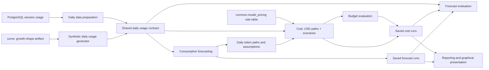

# Forecasting Module Architecture

**Status:** Agreed module boundaries and code layout; the synthetic generator is implemented and reviewed. Other modules are specified and implemented incrementally.

**Last updated:** 2026-09-27. Forecasting model details: [forecasting model design](../design/forecasting-model-design.md). Cost/pricing/scenario details: [cost module design](../design/cost-module-design.md).

## 1. Purpose

This document defines the modules, their relationships, and the code organization for forecasting under `econ-forecast`. It is the starting point for the individual module specifications.

The overall forecasting architecture will be documented separately. Detailed algorithms, data schemas, persistence formats, database queries, and deployment decisions belong in subsequent architecture or design documents.

## 2. Modules

| Module | Responsibility | Main output |
|---|---|---|
| `synthetic` | Generate reproducible daily usage with configurable history, scopes, agent types, AI models, token categories, weekday/weekend patterns, inactivity, spikes, growth, and model-mix changes. Represent collection gaps separately from inactivity. | Daily usage input, collection-coverage information, and separate synthetic ground truth. |
| `preparation` | Read collected session usage from PostgreSQL and prepare daily forecasting input. Preserve model and token-category identity, attribute consumption to the day it occurred, aggregate by the requested scope, and distinguish inactivity from collection gaps. | The same daily usage contract produced by the synthetic generator, with data-quality context. |
| `forecasting` | Forecast token consumption by scope and AI model for the requested period. Resample observed covered weekdays, apply configured per-user weekend reductions, estimate billing-category shares, and save daily token paths. | Expected token consumption, daily paths, and the assumptions and configuration used. |
| `common.model_pricing` | One master per-token USD rate table across vendors and channels (Anthropic/OpenAI/Gemini APIs and the cloud channels an org deploys through), keyed by `(date, channel, model_id)`. Matches a usage model string to a price, applying retirement and forward/backward date rules; `cost` is its only consumer with pricing logic of its own. | A rate sheet (`rate_sheet()`) for a run's models over its date range; a price-mapping report for operators. |
| `cost` | Price a saved forecast run's token paths into USD (per scope/model series, mean + p10/p50/p90). Apply named scenarios (model transfer, agent transfer, growth) to those token paths via an exponentially-weighted mix and attribution-based propagation across scope levels (declared scope, its sub-scopes, its parent scopes), then price the result the same way as the baseline. | USD paths, daily/period summaries, mix and rate-sheet provenance, report and charts, one saved run per baseline or scenario. |
| `budget` | Evaluate a configured budget against a saved cost run's USD paths (no pricing of its own; reads `cost` via `load_cost_run`). | Budgets for selected coverage probabilities, probability of budget sufficiency or exhaustion, and exhaustion timing conditional on exhaustion occurring. |
| `evaluation` | Compare saved forecasts with subsequent observations, run historical backtests, and compare the current ETS model with other explicit candidates. | Accuracy, bias, coverage calibration, quantile loss, budget-crossing evaluation, and model-comparison results. |
| `reporting` | Present saved forecast/cost/budget results through a default report and graphical representations, separately from numerical forecasting. Requires its own functional specification and detailed design. Specific-question/interactive APIs are deferred. | Human-readable report and charts, with assumptions and completeness visible. |
| `curve` | Author a reusable, duration-normalized growth-shape curve (a dimensionless multiplier over normalized time), independent of consumption data or calendar semantics. Consumed by the synthetic generator's series stage. | Saved curve artifact (shape config + sampled values + preview + manifest). |

`scenarios` is not a separate module: scenario application (model transfer, agent transfer, growth) lives inside `cost` (design rationale: one kernel prices both the baseline and every scenario the same way, §12 "Cost + scenarios in one module").

These are modules within one monorepo, not separate services.

## 3. Data Flow and Boundaries



### Daily input

The synthetic generator produces daily input directly. It does not need to create session records or pass through the PostgreSQL preparation module. Both input paths must satisfy the same daily usage contract.

Daily input preserves scope attribution, date, agent type, AI model, and token categories. Agent type and AI model are separate dimensions. Organization, Team, and Project are attribution views; Team and Project totals must not be added together as disjoint consumption.

An absent activity record within assumed complete collection coverage represents zero observed consumption. Known incomplete collection represents missing consumption. Actual low weekend usage remains actual usage; the generator and preparation module must not force weekends to zero.

The preparation specification must inspect whether PostgreSQL retains timestamped usage within a session. Session totals alone cannot establish how consumption from a session spanning midnight should be divided between days.

### Forecasting, pricing, and budget evaluation

The prediction target is token consumption by AI model, using data-driven ETS (level, damped trend, and weekly seasonality learned from the data) plus a dated known-event overlay — see the [forecasting model design](../design/forecasting-model-design.md). Forecasting saves token paths and assumptions only; it does not price them.

The forecasting module owns input validation, coverage-aware history selection, and model-specific weekday sampling. The preparation module owns extraction and aggregation of real session usage into the shared daily format.

Expense is derived by the `cost` module: a rate sheet from `common.model_pricing` (its master per-token USD table, matching a usage model string to a price with retirement/date rules applied), a deterministic exponentially-weighted mix per (scope, model) series from the same daily dataset the forecast used, and `tokens × rate` per series, summed within a scope. The legacy `src/common/pricing.py` (retired by #68) was never used by `cost` — see the [cost module design](../design/cost-module-design.md) for the full pricing model, artifact contract, and known divergence from forecasting's own (unrelated) allocation split.

The budget module owns only budget evaluation (sufficiency, required budget, exhaustion) against a saved `cost` run's USD paths, read through `load_cost_run`; it prices nothing itself.

### Scenarios

Scenario application (model transfer, agent transfer, growth) is not a separate module — it lives inside `cost`, since one kernel prices both the baseline and every scenario the same way (a scenario changes the token paths going in, never the pricing logic). A change is declared on one scope (Organization, Team, or Project) and applies to that scope's sub-scopes at full weight and to its parent scopes at that scope's attribution share of the parent's usage for the affected model — every level of the tree reflects the change, not just the one it was declared on. Baseline and scenario runs share the same scope set; only which series exist and their token paths differ.

Transferring a token quantity between AI models or agents is an explicit scenario assumption, not a claim of equivalent work or quality. Automatic mix optimization is outside scope; comparing a scenario's coverage against a budget target is the budget module's job, reading both the baseline and scenario `cost` runs.

### Evaluation and reproducibility

Saved runs retain the forecast origin, input cutoff, scope, period, model configuration, random seed where applicable, pricing version, assumptions, and results. Scenario results remain distinguishable from the original forecast.

Reporting consumes the saved artifact contract rather than refitting forecasts. It produces default reports and charts, and may later support specific questions through a separately designed API. Forecasting's module README explains daily expectations, period summaries, allocation shares, path/date/sample axes, and how the budget module can answer the $40K confidence/risk and conditional exhaustion-date question. Exact reporting interfaces and chart choices remain part of detailed design.

The reporting module will have separate functional and design specifications. An early local **Plotly experimentation utility**, under `forecast.utils`, consumes saved forecasts and exports self-contained interactive HTML without a server or runtime Internet access. It is not a new business module or a substitute for the reporting specs. Its CLI/shell contract and numerical/offline-browser tests are specified with forecasting and documented in the [utility README](../../src/forecast/utils/README.md). Matplotlib remains the selected file-chart package for reporting; Plotly serves interactive experiments.

Evaluation uses only information available at each historical forecast origin. Synthetic data supports repeatable functional and behavioral tests; real observations establish practical accuracy and whether estimated probabilities achieve their stated coverage. Synthetic ground truth remains separate from forecasting inputs to prevent leakage.

The synthetic generator remains a permanent testing utility after real data becomes available.

## 4. Code Layout

The following is the intended layout. Internal files within each module will be selected when its specification is written. Each module owns a README inside its source directory, such as `src/forecast/synthetic/README.md`.

```text
econ-forecast/
├── docs/
│   ├── arch/
│   │   └── module-architecture.md
│   ├── design/
│   ├── research/
│   └── notes/
├── src/
│   └── forecast/
│       ├── __init__.py
│       ├── contracts.py
│       ├── artifact_io.py
│       ├── synthetic/
│       ├── preparation/
│       ├── forecasting/
│       ├── cost/                # pricing + scenarios (design §10); no separate scenarios/ module
│       ├── curve/
│       ├── budget/
│       ├── evaluation/
│       ├── reporting/
│       └── utils/              # Local experimentation utilities, including Plotly
├── config/
│   ├── synthetic/
│   ├── forecasting/
│   └── scenarios/              # cost's scenario configs (design §6.1)
├── tests/
│   ├── synthetic/
│   ├── preparation/
│   ├── forecasting/
│   ├── cost/
│   ├── curve/
│   ├── budget/
│   ├── evaluation/
│   ├── reporting/
│   ├── utils/
│   └── fixtures/
└── artifacts/
```

- `contracts.py` defines shared daily inputs and forecast, budget, and cost output structures. Detailed schemas belong in the module specifications.
- `artifact_io.py` provides shared reading and writing of datasets, snapshots, and manifests. Detailed formats belong in the module designs.
- `config/` contains reusable settings and examples, including synthetic usage profiles and cost's scenario definitions.
- `tests/` mirrors the modules; `fixtures/` holds small, fixed test inputs.
- `artifacts/` contains generated datasets and results and must be ignored by Git when introduced.
- `common.model_pricing` lives outside `econ-forecast/`, at the repo-root `src/common/model_pricing/` (and its tests at repo-root `tests/common/model_pricing/`) — it is shared, cross-project rate infrastructure, not forecasting-specific, the same way the retired `common.pricing` (its unused predecessor for `cost`) did.

## 5. Monorepo Integration

- Use the repository's existing Python environment and root `requirements.txt`. Do not add a separate `pyproject.toml`, dependency file, or installation process for forecasting.
- Use `forecast.*` as the import namespace. During implementation, configure runtime entry points and pytest to include `econ-forecast/src` alongside the existing repository source paths, and include the forecasting tests in test discovery.
- Existing shared modules retain their current import paths, such as `common.model_pricing` (the rate table `cost` reads; `common.pricing` was retired by #68).
- Modules expose callable Python interfaces. Command-line entry points live in their respective modules and follow `cli_<function>.py`, for example `synthetic/cli_generate.py`, `cost/cli_cost.py`.
- Keep database access in `preparation`, model fitting in `forecasting`, pricing and scenario application in `cost`, and budget evaluation in `budget`.

## 6. Documentation Organization

| Folder | Purpose |
|---|---|
| `docs/arch/` | Architecture documents, including this module structure and a separate overall forecasting architecture. |
| `docs/design/` | Individual module specifications, data contracts, and detailed designs. |
| `docs/research/` | Focused investigations and findings that may or may not be adopted. |
| `docs/notes/` | Working discussions, exploratory proposals, and general notes. |

This document records the agreed module structure. The next design work is to specify the modules and their interfaces against these boundaries.

## 7. Related Documents

- [Consumption and Budget Forecasting](../../../../../Docs/ProductSpec/Forecasting.md): product scope and required outputs.
- [Forecast Models and Approach](../../../../../Docs/research/forecast-model-notes.md): research context and candidate methods. Subsequent agreed decisions and module specifications may refine its proposals.
