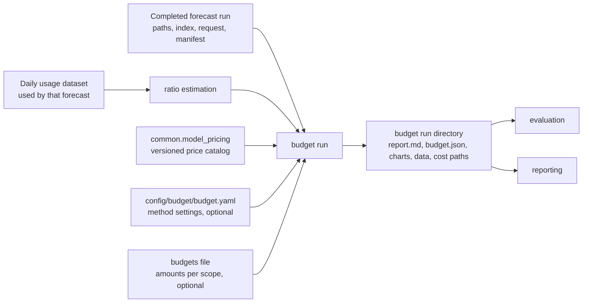

# Budget module — design

| | |
|---|---|
| **Status** | **Superseded in part, pending revision.** Pricing, ratios, scenarios, and cost outputs moved to the [cost module design](./cost-module-design.md) (2026-09-27). Budget will be revised to read cost runs only (§6–§7, budgets file, exhaustion). |
| **Scope (V1)** | Expected cost and risk per Organization / Team / Project, model, agent, and token type; budget sufficiency, required budget per confidence, and exhaustion timing. Baseline scenario only. |
| **Rule** | One design doc per module; version with `-v2` for a future rewrite, never a new name. |
| **Related** | [module architecture](../arch/module-architecture.md), [forecasting model design](./forecasting-model-design.md), [forecasting README](../../src/forecast/forecasting/README.md). [model pricing](../../../docs/modules/model-pricing.md) (`common.model_pricing`). |
| **Issues** | [#67](https://github.com/talium-ai/code-econ/issues/67) cache-write tokens in the daily contract (done, see the [cache-write contract design](./cache-write-contract-design.md)); [#68](https://github.com/talium-ai/code-econ/issues/68) dashboard/ingest pricing migration. |
| **Updated** | 2026-09-24 |

Unresolved items are marked **[open]**; deferred items are marked **[deferred]**. Everything else is agreed.

---

## 1. Purpose

Forecasting produces daily **token** paths (date × sample) per scope/model. The budget module turns
those paths into **dollars** and answers:

1. What is the expected cost of each Organization, Team, Project, model, agent, and token type?
2. What is the risk — p10 / p50 / p90 cost?
3. With a budget of, say, $40,000, what is the probability that it is enough, and what budget is
   needed for 50% / 80% / 90% confidence?
4. If the budget runs out, when?

Budget never refits or re-samples consumption. It prices the saved futures. Scenarios (a later
design pass) change the pricing inputs — model mix, shares, prices — and reuse the same kernel; V1
runs only the **baseline** scenario.

## 2. Position in the system



| Rule | Meaning |
|---|---|
| Forecast run is the source of scopes, periods, and futures | Budget takes a completed forecast run directory. Scopes, calendar periods, dates, and sample columns come from it (`forecasting.load_run`). Budget may select a subset of the run's scopes; it cannot add scopes or change the period. |
| Dataset only for ratios | Budget reads the same daily dataset the forecast used (`forecasting.dataset.load_dataset`) only to estimate agent/token-type ratios, using dates **≤ the forecast origin**. It must verify the dataset is the one the forecast used (§14). |
| Prices from `common.model_pricing` | Through a narrow lookup interface (§12). Budget has no price tables of its own. |
| Output is a saved artifact | Evaluation must be able to check predictions later ("was the 72% right?"); reporting renders from it without recomputation. |
| Dependency direction | `budget → forecasting` (reader APIs), `budget → common.model_pricing`. Nothing in forecasting imports budget. |

## 3. Entities and aggregation

| Entity | How its cost is obtained | Uncertainty |
|---|---|---|
| Organization, Team, Project (scopes) | Σ over the scope's models, **within each sample**. Each scope is priced from its **own** forecast paths. | Full sample distribution. |
| Model (within a scope) | That scope/model path × blended rate. | Full sample distribution. |
| Agent (within a scope) | Σ over models of agent share × model cost, within each sample. | Deterministic ratio × model path; the band is a **scaled model band**, not independent agent uncertainty. Flagged `derived_from_model_paths`. |
| Token type (within a scope) | Token-type share × price × path. | Reported as expected cost only. |

Rules:

- **Never add across scopes.** Org, Team, and Project are overlapping views, and sample IDs are
  seeded **per scope** (`forecasting/paths.py::joint_seed`): sample 42 of Team1 and sample 42 of the
  Organization are unrelated futures. Org cost comes from the Org's own paths, not from Σ Teams.
  Reports must not place Σ Teams beside the Org total as though they should reconcile.
- **Models add up within a scope**, because a scope's models share the same residual draws.
- **Percentiles are never added.** Every percentile — scope, model, agent — is computed from
  per-sample totals. A scope's p90 is not the sum of its models' p90s.
- **Budgets apply to scopes only** (Organization, Team, Project). Models, agents, and token types get
  expected cost and percentiles but no budget evaluation.

## 4. Cost computation

### 4.1 Blended rate

| Symbol | Meaning | Example |
|---|---|---|
| `scope` | Organization, Team, or Project — the attribution view being priced | `team1` |
| `model` | AI model | `claude-sonnet-5` |
| `agent` | Agent type that used the model | `claude`, `codex` |
| `token_type` | Billing token type — **not** an attribution category | `input`, `cache_write_5m`, `cache_write_1h`, `cache_read`, `output` |
| `date` | Forecast date | `2026-10-01` |
| `sample` | One simulated future: a column of the forecast path array (1,000 per run) | `0 … 999` |
| `tokens[scope, model, date, sample]` | Total tokens in that future on that day — the saved forecast path | 1,099,651 |
| `share[scope, model, agent, token_type]` | Fraction of the model's tokens used by that agent as that token type (§5); sums to 1 per scope/model | 0.77 |
| `price[model, token_type, date]` | Catalog $ per token | 0.000003 |

```text
rate[scope, model, date]          = Σ over agent, token_type of  share[scope, model, agent, token_type] × price[model, token_type, date]
                                    ($ per token: the model's price blended by its observed agent/token-type mix)

cost[scope, model, date, sample]  = tokens[scope, model, date, sample] × rate[scope, model, date]

cost[scope, date, sample]         = Σ over model of  cost[scope, model, date, sample]
```

Example: shares of 20% input, 77% cache read, and 3% output with prices of $3, $0.30, and $15 per
million tokens give a blended rate of $1.281 per million tokens. A future with 1,099,651 tokens on a
day therefore costs $1.41 for that day in that sample.

All prices and shares collapse to one scalar per scope/model/date, so pricing a path is one array
multiply. The date index is kept because the kernel supports a price that changes within the horizon;
the V1 catalog is one snapshot, so V1 rates are constant across the horizon
(`prices_constant_at_catalog`).

Arithmetic is float64. These are probabilistic estimates, not invoices; `Decimal` rates from the
catalog are converted once when rates are resolved.

Expected cost equals the cost of expected tokens (prices and shares are linear and fixed), but
**percentiles and budget probabilities are only valid when computed from priced samples**. The
kernel always prices samples.

## 5. Ratio estimation

Budget owns the estimate of **joint agent × token-type shares** per scope/model. This replaces
forecasting's fixed 28-day allocation for pricing purposes (§14). Shares are deterministic — no
sampling.

### 5.1 Exponentially weighted token-sum ratio

For one scope and model, over past days `day` in the window:

```text
age[day]                  = origin − day, in days
weight[day]               = 2 ^ ( −age[day] / half_life_days )        (today 1.0, 14 days ago 0.5, 28 days ago 0.25)

own_share[agent, token_type] = Σ over day of weight[day] × observed_tokens[day, agent, token_type]
                               ─────────────────────────────────────────────────────────────────
                                    Σ over day of weight[day] × observed_total_tokens[day]
```

`observed_tokens` are historical token counts from the daily dataset, not forecast paths.

- **Ratio of weighted sums, never an average of daily ratios.** A heavy day must outweigh a light day.
- **Exponential weights, not a fixed window.** Ratios move in steps (agent releases, caching changes,
  teams switching agents). A plain mean keeps an old regime at full weight for months; a fixed
  window has an edge where a heavy day dropping out moves the share with no new information.
  A 14-day half-life behaves roughly like a 20-day window, and matches the forecast's own
  exponential smoothing.
- **Window.** Days satisfy `origin − max_age_days < day ≤ origin`, within covered history.
  Declared outage days are excluded (unknown, not zero). No date after the origin is ever used.
- **Known effect: volume collapse.** When a scope's volume drops sharply, older heavy days can still
  dominate recent light ones (a 100× volume gap beats a 16× decay). Accepted: the forecast paths are
  small in that situation, so the dollar impact is small, and mid-period re-forecasting (V2) corrects
  it. `max_age_days` bounds it.

### 5.2 Parent blending

A scope with little history gives noisy shares. Team/model and Project/model shares are blended
with the Organization's shares for the same model:

```text
active_days   = number of days in the window with observed_total_tokens > 0 — counted without decay
own_weight    = active_days / (active_days + own_mix_half_weight_days)
share         = own_weight × own_share  +  (1 − own_weight) × parent_share
```

Example: Team1 has used Codex for 4 days with a 10% output share; the Organization's Codex output
share is 3%. `own_weight = 4 / (4 + 7) = 0.36`, so the output share used is
0.36 × 10% + 0.64 × 3% = 5.5%.

- `own_mix_half_weight_days` (default **7**, configurable) is the evidence, in active days, at which
  a scope's own mix counts 50%. It is a **blend, not a gate**: nothing is rejected, and day-1 data
  already carries weight (1/8 at the default).
- Evidence is measured in **days, not tokens**: tokens arrive in session-sized chunks, and a token
  threshold would not carry across organizations of different size.
- `active_days` is counted **without** the exponential decay. The decayed count levels off near 20 days at a
  14-day half-life, which would cap an established scope's weight at about 74%; raw active days over
  a 90-day window give about 93%.
- The parent is computed from the dataset at Organization level for the same model, with the same
  exponential weights and **no blending**. It does not require the Organization scope to be in the
  forecast run.
- **The Organization has no parent** and uses its own estimate. Thin Organization evidence is
  reported (`own_mix_evidence_days < own_mix_half_weight_days`), not borrowed from elsewhere.
- The blend is over the joint agent × token-type distribution. A new scope can therefore show a small
  share for an agent that only the parent has used; the ratios report lists it.

### 5.3 Inactive and failed series

- An `inactive` series has zero paths and zero cost regardless of shares; its shares are not needed
  and are not fabricated.
- A series without usable forecast paths (`insufficient_history`, `insufficient_startup`,
  `sampling_failed`) is not priced (§9).

### 5.4 Tuning **[deferred]**

Defaults (`half_life_days: 14`, `own_mix_half_weight_days: 7`) are engineering choices. The
evaluation module should select them by backtest, scoring **dollar** error, not share error: output
costs several times input and cache reads a fraction of input, so an output-share error costs far
more than the same cache-read-share error.

## 6. Budget evaluation

### 6.1 Periods

- Budgets are evaluated per **requested calendar period** of the forecast run. Internal (intermediate)
  dates in the paths are excluded, using the requested window in the forecast's `request.json`.
- **No carry-over in V1.** With several requested periods, each is evaluated separately against its
  own amount, starting from the full amount at the period start.
- V1 assumes nothing has been spent at the period start. A `spent_to_date` input is held at 0 so the
  artifact shape does not change when mid-period re-forecasting arrives **[deferred: V2]**.

### 6.2 Definitions

For one scope with budget amount `budget`, a calendar period, and each `sample` (one simulated
future, §4.1):

```text
cumulative_cost[date, sample] = Σ over period dates ≤ date of  cost[scope, date, sample]
period_total[sample]          = cumulative_cost[last period date, sample]
```

| Output | Definition |
|---|---|
| Expected cost | mean of `period_total` over all samples |
| p10 / p50 / p90 (and configured levels) | quantiles of `period_total` over samples, NumPy linear interpolation (as in forecasting) |
| `p_sufficient` | fraction of samples with `period_total ≤ budget` (a total equal to the budget is sufficient) |
| `p_overrun` | `1 − p_sufficient` |
| `required_for_confidence[q]` | quantile `q` of `period_total` — the budget that fraction `q` of futures stay within |
| Crossing date of a sample | first date with `cumulative_cost > budget`; none if `period_total ≤ budget` |
| `p_exhausted_by[date]` | fraction of **all** samples whose crossing date is ≤ `date` |
| `given_crossing` | median, p10, p90 crossing date over crossing samples only (`inverted_cdf`, so every reported date is a real sample date) and mean crossing day offset |

- The **exhaustion curve** `p_exhausted_by[date]` is the primary timing output. It answers "when" and
  "how likely" together, and does not attach a precise-looking date to an unlikely event.
- `given_crossing` is reported only with the number of crossing samples. With zero crossing samples
  it is absent; zero crossings in a finite simulation do not prove an overrun is impossible.
- Dates have daily resolution; there is no intra-day exhaustion time.
- Confidence here is the model-estimated probability of sufficiency under recorded assumptions, not
  a statistical confidence interval, and it is **uncalibrated** until evaluation measures coverage.
  Errors are drawn independently across days in forecasting, so tails are likely too narrow and
  `p_sufficient` optimistic; the report states this.

## 7. Worked example

One scope, budget $100, 3 days, 3 samples. Daily cost per sample (after pricing):

| Day | Sample 0 | Sample 1 | Sample 2 |
|---|---:|---:|---:|
| 1 | 30 | 25 | 40 |
| 2 | 35 | 30 | 65 |
| 3 | 40 | 30 | 10 |
| **Cumulative day 1 / 2 / 3** | 30 / 65 / **105** | 25 / 55 / **85** | 40 / **105** / 115 |
| Period total `T` | 105 | 85 | 115 |
| Crossing day | 3 | none | 2 |

| Output | Value |
|---|---|
| Expected cost | (105 + 85 + 115) / 3 = 101.67 |
| p50 | 105 |
| `required_for_confidence[0.8]` | sorted 85, 105, 115 → position 1.6 → 105 + 0.6 × 10 = **111** |
| `p_sufficient` / `p_overrun` | 1/3 / 2/3 |
| `p_exhausted_by` day 1 / 2 / 3 | 0 / 1/3 / 2/3 |
| `given_crossing` | 2 crossing samples; median day 2 (`inverted_cdf`), mean offset 2.5 days |

This example is a required unit test.

## 8. Inputs

### 8.1 Method config — `config/budget/budget.yaml` (optional)

Every key has a default; a run works without the file. Every run saves the resolved settings.

```yaml
schema_version: 1

ratios:
  half_life_days: 14            # exponential decay of past days in the share estimate
  own_mix_half_weight_days: 7   # active days at which a scope's own mix counts 50% vs its parent
  max_age_days: null            # history limit; null = the forecast run's history lookback

model_pricing:
  catalog_version: null         # null = latest at run time; the version used is always recorded

confidence_levels: [0.5, 0.8, 0.9]
```

### 8.2 Budgets file (optional)

Budget amounts are business inputs owned by finance or managers and change every period; they are
kept separate from method settings. Without a budgets file, a run still produces expected cost,
percentiles, and `required_for_confidence`; only `p_sufficient` and exhaustion outputs need an amount.

```yaml
schema_version: 1
budgets:
  - {scope: organization, amount_usd: 150000}
  - {scope: team, name: team1, amount_usd: 40000}
  - {scope: project, name: payment_service_improvement, amount_usd: 8000}
```

- Scopes use the same name resolution as the forecast config (`name` within `default_org_id` or an
  explicit `org_id`).
- The amount applies to **each** requested calendar period (no carry-over, §6.1). An optional
  `period_start` selects a single period when amounts differ by period.
- A budget for a scope that is not in the forecast run is an input error.
- Later, budgets become product data (a table); the file is the V1 form.

### 8.3 CLI and Python API

```bash
./econ-forecast/utils/budget.sh \
  --forecast-run econ-forecast/artifacts/september-forecast \
  --config econ-forecast/config/budget/budget.yaml \
  --budgets econ-forecast/config/budget/budgets.example.yaml \
  --output econ-forecast/artifacts/september-budget [--force] [--validate-only]
```

- `utils/budget.sh` calls `python -m forecast.budget.cli_budget`.
- `--output` behaves as in forecasting: an existing directory is refused unless `--force`, which
  deletes and recreates only that directory and never the forecast run it reads.
- Exit codes follow forecasting: 0 success / help / valid `--validate-only`; 2 completed run with any
  incomplete scope; 1 execution or storage failure. JSON summary on stdout, structured JSON logs on
  stderr.

```python
from forecast.budget import BudgetRequest, run_budget, load_budget_run

result = run_budget(forecast_run_dir, BudgetRequest(config=..., budgets=...), output_dir)
saved = load_budget_run(result.output_dir)
```

## 9. Statuses and failures

| Model (within a scope) | Meaning |
|---|---|
| `priced` | Forecast `qualified`, price resolved; cost computed. |
| `inactive` | Forecast `inactive`; zero cost, `continued_inactivity` assumption. |
| `unpriced` | Price lookup failed (`unmatched` or `ambiguous` in `common.model_pricing`, or a token type with nonzero share has no rate). Never priced at $0. |
| `unavailable` | Forecast has no usable paths (`insufficient_history`, `insufficient_startup`, `sampling_failed`). |

| Scope | Meaning |
|---|---|
| `complete` | All models `priced`. |
| `conditional` | `priced` + `inactive`; results conditioned on continued inactivity. |
| `inactive` | All models `inactive`; zero expected cost, not an empirically established 100% confidence. |
| `incomplete` | Any `unpriced` or `unavailable` model with nonzero expected consumption. Scope `cost` and `budget` are `null`; blocking models are listed; the complete models' own figures are still reported. |

Forecast assumptions carry through. A model carrying `excess_negative_correction` is priced, but its
scope's budget probabilities carry `budget_risk_unsuitable` and the report headline shows the warning
instead of the confidence figure.

## 10. Outputs

### 10.1 Run directory

```text
budget-2026-10/
├── report.md
├── budget.json              # machine-readable results (§10.2)
├── manifest.json            # versions, checksums, completion, per-scope status; written last
├── request.json             # forecast run path + manifest checksum, catalog version, budgets, scenario
├── resolved_config.yaml     # settings actually used
├── ratios.json              # shares used per scope/model (§10.3)
├── charts/                  # every chart as PNG and self-contained offline HTML
│   ├── team-team1__cumulative.png / .html
│   ├── team-team1__exhaustion.png / .html
│   ├── team-team1__distribution.png / .html
│   └── team-team1__breakdown.png / .html
├── data/                    # one CSV per chart, exactly the plotted numbers
│   ├── team-team1__cumulative.csv    # date, mean, p10, p50, p90, budget
│   ├── team-team1__exhaustion.csv    # date, p_exhausted_by
│   ├── team-team1__distribution.csv  # sample_id, period_total_usd
│   └── team-team1__breakdown.csv     # model, agent_type, token_type, expected_usd
└── paths/
    ├── index.json                    # authoritative scope identity, dates, sample order
    └── team-team1__cost__<id>.npy    # float64 [dates, samples], daily USD per scope
```

- `budget.json` stays small: summaries and budget results only. Daily and per-sample data live in
  `data/` and `paths/`.
- Each chart's PNG (matplotlib) and HTML (Plotly, plotly.js inlined, no network) render from the same
  data file, so they cannot disagree. HTML export follows the offline approach of
  `forecast/utils/plot_forecast.py::export_html`.
- Per-scope daily cost paths are saved (30 days × 1,000 samples × 8 bytes ≈ 240 KB per scope) so
  scenarios, evaluation, and reporting reuse priced futures. Per-model cost paths are not saved;
  they are recomputable from forecast paths and `ratios.json`.
- Charts and data files per multi-period run are suffixed with the period start.
- File names are display names; identity comes from `paths/index.json` and `budget.json`, never
  from parsing names (as in forecasting).

### 10.2 `budget.json`

```json
{
  "schema_version": 1,
  "scenario": {"id": "baseline"},
  "forecast_run": {"path": "...", "manifest_sha256": "..."},
  "model_pricing": {"catalog_version": "2026-09-24-ab12cd", "source": "litellm@<sha>"},
  "periods": [{"start": "2026-10-01", "end": "2026-10-31"}],
  "scopes": [{
    "org_id": "talium.ai", "scope_type": "team", "scope_id": "...", "name": "team1",
    "period_start": "2026-10-01",
    "status": "complete",
    "cost": {"expected": 37210.4, "p10": 33020.1, "p50": 36980.0, "p90": 41870.3},
    "budget": {
      "amount": 40000,
      "spent_to_date": 0,
      "p_sufficient": 0.72,
      "p_overrun": 0.28,
      "required_for_confidence": {"0.5": 36980.0, "0.8": 40610.2, "0.9": 41870.3},
      "exhaustion": {
        "crossing_samples": 280,
        "samples": 1000,
        "p_exhausted_by_period_end": 0.28,
        "given_crossing": {"median_date": "2026-10-28", "p10_date": "2026-10-24",
                           "p90_date": "2026-10-31", "mean_day_offset": 27.4}
      }
    },
    "models": [{"model": "claude-sonnet-5", "status": "priced", "match_rule": "exact",
                "expected": 29100.2, "p10": 25800.0, "p50": 28950.1, "p90": 33010.7}],
    "agents": [{"agent_type": "claude", "expected": 29100.2, "p10": 25800.0, "p50": 28950.1,
                "p90": 33010.7, "derived_from_model_paths": true}],
    "token_types": {"input": 120.0, "cache_write_5m": 180.0, "cache_write_1h": 1150.0,
                    "cache_read": 3980.4, "output": 25660.0},
    "blocking_models": [],
    "assumptions": ["uncalibrated_model_estimate", "fixed_ratio_estimate",
                    "prices_constant_at_catalog",
                    "long_context_tiers_ignored"]
  }],
  "unpriced_models": [{"model": "claude-sonnet", "status": "unmatched",
                       "scopes_affected": ["organization", "team1"]}]
}
```

- `budget` is `null` for a scope without an amount; `cost` and `budget` are `null` for an
  `incomplete` scope.
- `scenario` is reserved now and is always `{"id": "baseline"}` in V1. Scenario identification,
  overrides, and comparison are **[deferred]** to the scenario design pass.
- The authoritative schema lives with the module (`budget/schemas.py`), versioned by `schema_version`.

### 10.3 `ratios.json`

Per scope/model: final shares by agent × token type; own shares, parent shares, `own_weight`, `active_days`,
window start/end, `half_life_days`, `own_mix_half_weight_days`; parent identity; and flags for thin
evidence and agents contributed only by the parent. It is an assumption record, not a forecast.

### 10.4 Assumption labels

| Label | Meaning |
|---|---|
| `uncalibrated_model_estimate` | Carried from forecasting; probabilities not yet checked against outcomes. |
| `fixed_ratio_estimate` | Agent/token-type shares held fixed over the horizon (§5). |
| `prices_constant_at_catalog` | Prices held at the catalog snapshot for the whole horizon. |
| `long_context_tiers_ignored` | Per-request long-context price tiers cannot be applied to daily totals. |
| `continued_inactivity` | Inactive models contribute zero. |
| `budget_risk_unsuitable` | A contributing model carries `excess_negative_correction`. |

## 11. Report (`report.md`)

In reading order:

1. **Headline per budgeted scope** — e.g. "Team1: $40K budget, 72% chance it is enough; if it runs
   out, most likely around Oct 28 (280 of 1,000 futures)."
2. **Blocking problems first** — unpriced models, incomplete scopes, `budget_risk_unsuitable`.
3. **Cost table per scope** — expected, p10 / p50 / p90, required budget at each confidence level.
4. **Charts** — cumulative cost fan with the budget line; P(budget used up by date); distribution of
   period totals with the budget and confidence budgets marked; model/agent breakdown. Each links its
   PNG, HTML, and data file.
5. **Ratios** — scopes whose own-mix weight `own_weight` is below 0.9 are highlighted, with their parent.
6. **Price mapping** — model → vendor → channel → catalog key → match rule, with the catalog version.
7. **Assumptions** — each label in plain language.

Chart notes the report must carry:

- The cumulative fan's p10 / p90 lines are **per-date** quantiles. The upper edge is not one possible
  future; it traces different samples on different dates. The exhaustion curve is computed per
  sample and has no such caveat.
- Org, Team, and Project figures are separate views and do not add up.
- Agent bands are scaled model bands.

## 12. Dependency on `common.model_pricing`

`common.model_pricing` (`src/common/model_pricing/`) is a separate common module, designed in
[model-pricing.md](../../../docs/modules/model-pricing.md): LiteLLM-published prices curated into a versioned JSON catalog, deterministic automatic model
matching (exact → normalized → provider prefix → dated variant → optional alias; no fuzzy matching;
ambiguity is a failure), and a mapping report. Budget depends only on this interface:

```python
catalog = model_pricing.load_catalog(version=None)          # None = latest
catalog.version                                              # recorded in request.json / budget.json
prices = catalog.for_org(org_id)                             # org's channel per vendor (vendor API, Bedrock, Vertex, Azure)
match = prices.resolve(usage_model_id)                       # vendor, channel, key, rule, status, candidates
rate  = prices.rate(match, token_type, at=date)              # $/token or None
```

Contract items the `model_pricing` design must settle for budget:

- Token types `input`, `output`, `cache_read`, `cache_write_5m`, `cache_write_1h`.
- How a model whose vendor bills cache writes at the input rate (or has no separate cache-write
  price) is represented, so that budget does not mark it `unpriced`.
- A missing rate for a token type with nonzero share is `None`, never zero.

## 13. Source layout

```text
econ-forecast/src/forecast/budget/
├── README.md
├── __init__.py          # run_budget, load_budget_run, BudgetRequest
├── cli_budget.py        # CLI entry point
├── config.py            # method config, defaults, resolved config
├── request.py           # forecast-run selection, budgets file, validation, periods
├── ratios.py            # exponentially weighted ratios, parent blending (§5)
├── rates.py             # blended $/token per scope/model/date via common.model_pricing (§4)
├── kernel.py            # per-sample daily cost per model and scope
├── metrics.py           # quantiles, sufficiency, required budget, exhaustion (§6)
├── runner.py            # orchestration, statuses, logging
├── schemas.py           # budget.json / ratios.json / index.json schemas
├── artifacts.py         # atomic writing, manifest, load_budget_run reader
├── presentation.py      # report.md, charts (PNG + HTML), chart data files
└── errors.py            # InputError / ExecutionError, as in forecasting

econ-forecast/config/budget/
├── budget.yaml                 # commented method config template
└── budgets.example.yaml        # example amounts

econ-forecast/utils/budget.sh   # shell wrapper → python -m forecast.budget.cli_budget

econ-forecast/tests/budget/     # unit tests per file; worked example (§7); end-to-end on synthetic data
```

Scenarios will add `scenarios.py` (and `config/scenarios/`) in the scenario design pass; the kernel,
rates, and metrics are written so that a scenario is an override of their inputs.

## 14. Changes to other modules

| Module | Change | Why |
|---|---|---|
| forecasting | Record the dataset identity (dataset manifest file hashes) in the run's `manifest.json` or `request.json`. | Budget must verify it reads the same dataset the forecast used; today only `input.dataset_dir` (a path) is recorded. |
| forecasting | Deprecate `allocation` / `allocations.json` for pricing. Budget never reads `allocations.json`. Removing it (and the token-type split in `daily_expected.jsonl`) is a follow-up forecasting change **[open]** — see §16. | Ratio estimation moved to budget (§5). |
| architecture doc | Update `docs/arch/module-architecture.md` §2: budget and scenarios form one module; add `common.model_pricing`; reporting stays a separate cross-module presentation layer, with budget producing its own run report. | Agreed module boundaries. |
| common.model_pricing | New module (own design doc). | §12. |

## 15. Key decisions

| Decision | Why | Cost |
|---|---|---|
| Price every sample, then summarize | Percentiles and budget probabilities are not linear in tokens. | Array work per scope; cheap. |
| Scopes priced from their own paths; never summed | Sample IDs are per scope; views overlap. | Org ≠ Σ Teams in reports. |
| Deterministic ratios, no sampling | Mix is an observed ratio; forecasting it has no basis. | Bands understate mix-drift uncertainty; scenarios test sensitivity. |
| Exponential weighting over plain or windowed mean | Adapts to step changes without window-edge jumps. | Volume-collapse effect (§5.1). |
| Parent blending measured in active days | Stable shares for new scopes; portable across org sizes. | Parent agents can appear in a new scope's mix. |
| Budget + scenarios in one module | A scenario is an override of the same kernel inputs. | — |
| Own run report here; cross-module reporting separate | Avoids an evaluation ↔ budget import cycle; keeps numeric callers free of plotting. | Two presentation layers. |
| Saved artifact with cost paths | Evaluation needs saved predictions; reporting and scenarios reuse priced futures. | ~240 KB per scope. |
| Exhaustion curve as primary timing output | Answers when and how likely together. | Less compact than a single date. |
| No carry-over across periods | Carry-over is finance policy, not a forecast property. | Multi-period budgets are independent. |

## 16. Deferred and open

- **[deferred]** Scenarios: identification, model-mix and share overrides, comparison against the
  baseline. The `scenario` block is reserved.
- **[deferred: V2]** Mid-period re-forecast: `spent_to_date` from actuals, remaining-period forecast
  request. Requires #68 so actual and forecast costs use the same prices.
- **[deferred]** Calibration of `p_sufficient` and quantiles by the evaluation module; tuning of
  `half_life_days` and `own_mix_half_weight_days` by dollar error.
- **[deferred]** Negotiated or per-organization rates.
- **[open]** Timing of removing forecasting's `allocation` and the token-type split from
  `daily_expected.jsonl`, which the forecast report and plotting utility currently use.
