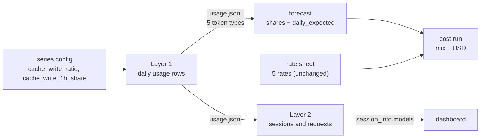

# Cache-write contract — design

| | |
|---|---|
| Status | Reviewed (fresh-reviewer findings applied 2026-10-06) |
| Scope (V1) | Carry cache-write tokens (5-minute and 1-hour) through the daily usage contract, the forecast, the cost run and the synthetic generators |
| Related | [forecasting-model-design](forecasting-model-design.md), [cost-module-design](cost-module-design.md), [synthetic-data-generation-design](synthetic-data-generation-design.md) (Layer 1), [synthetic-org-expansion-design](synthetic-org-expansion-design.md) (Layer 2), [budget-module-design](budget-module-design.md) §4.2 (removed), [scratchpad](../notes/cache-write-contract-brainstorm.md) |
| Issues | #67 (this change); #68 (price tables, separate session); #81 (dashboard prices 5m writes at 1h) |
| Updated | 2026-10-06 |

## 1. Flow



Today the daily contract has three token types and `input` includes cache writes, so cost prices writes at the plain input rate and the forecast understates dollars by 1.2–1.5× against the dashboard. After the change the contract has five token types, each priced at its own rate, and Layer 2 distributes Layer 1's write amounts instead of inventing its own.

## 2. Core logic

### 2.1 Terms

| Term | Meaning |
|---|---|
| Token type | One of `input`, `cache_write_5m`, `cache_write_1h`, `cache_read`, `output` |
| `input` | **Uncached** input only (changed meaning) |
| Cache write | Tokens stored in the vendor's prompt cache. `5m` / `1h` are the two cache lifetimes (5 minutes, 1 hour), each with its own price |
| `T` | Processed input of one row: `input + cache_write_5m + cache_write_1h + cache_read` |
| Layer 1 | Synthetic daily usage generator (`forecast/synthetic/series.py`): one row per day × user × agent × model |
| Layer 2 | Synthetic org generator (`forecast/synthetic/org/`): splits Layer 1's rows into sessions and requests (the "ledger", in memory) |
| I1 | Layer 2 invariant: sessions and requests add back up exactly to Layer 1 |
| `half_up` | `series._half_up`: round half up to an integer |
| `Pricer` | `synthetic/org/pricing.py::Pricer`, the dashboard's pricing over `config/pricing.yaml` |
| Rate sheet | The cost run's `rate_sheet.json` (from the `model_pricing` catalog) |

### 2.2 Logic of the change

```text
Layer 1, per row (processed input T):
    cached     = half_up(T × cache_hit_ratio_row)            # unchanged
    uncached   = T − cached
    writes     = half_up(uncached × cache_write_ratio)       # NEW
    write_1h   = half_up(writes × cache_write_1h_share)      # NEW
    write_5m   = writes − write_1h
    input      = uncached − writes
    output     = half_up(T × output_ratio)                   # unchanged

Forecast:    target total = sum of all five types (unchanged in value);
             allocation shares and daily_expected split over five types.
Cost:        TOKEN_TYPES = five; each priced at its rate-sheet rate.
Layer 2:     per model per day, the five totals are allocated to sessions, then to requests;
             writes are NOT derived from the cache-read curve any more.
```

Worked example (0.80 is an illustrative value, not the shipped default of 0.95). One row, `T = 1,000,000`, `cache_hit_ratio_row = 0.80`, `output_ratio = 0.03`, `cache_write_ratio = 0.997`, `cache_write_1h_share = 0.97`:

| Step | Value |
|---|---|
| `cache_read` | 800,000 |
| uncached | 200,000 |
| writes | half_up(199,400) = 199,400 |
| `cache_write_1h` | half_up(193,418.0) = 193,418 |
| `cache_write_5m` | 5,982 |
| `input` | 600 |
| `output` | 30,000 |
| Check | 600 + 5,982 + 193,418 + 800,000 = 1,000,000 |

Priced at (per token) `input` 3e-6, `cache_write_5m` 3.75e-6, `cache_write_1h` 6e-6, `cache_read` 3e-7, `output` 15e-6:

| Type | USD |
|---|---|
| `input` | 0.001800 |
| `cache_write_5m` | 0.022433 |
| `cache_write_1h` | 1.160508 |
| `cache_read` | 0.240000 |
| `output` | 0.450000 |
| **Total** | **1.874741** |
| Today (writes at input rate: 200,000 × 3e-6 + 0.24 + 0.45) | 1.290000 |
| Ratio | 1.45× |
| Dashboard residual (5m writes priced at the 1h rate: 5,982 × (6e-6 − 3.75e-6)) | 0.013460 = 0.72% of 1.874741 |

Defaults 0.997 / 0.97 are measured on 19,157 real Claude Code requests (`~/.claude/projects`, 2026-10-06): uncached input 0.35M, cache writes 108.5M (96.8% at 1h), cache reads 6,262M. Writes are 99.7% of non-cache-read input in every model (98.3–100%). One user's sample; revisit with fleet data.

## 3. Interfaces

### 3.1 Inputs

| Source | Access | Fields used (NEW marked) |
|---|---|---|
| Series config (Layer 1) | `synthetic.config.SeriesConfig` | `defaults.cache_write_ratio` NEW, `defaults.cache_write_1h_share` NEW; existing `cache_hit_ratio`, `output_ratio` |
| `usage.jsonl` | forecast: `forecasting/dataset.py` (validates `DailyUsageRecord` directly); Layer 2: `artifact_io.read_records(path, DailyUsageRecord, schema_version=2)` | `tokens.cache_write_5m` NEW, `tokens.cache_write_1h` NEW, `tokens.input` (new meaning) |
| Forecast run | cost: `cost/request.py::load_run`, mix from the dataset history (`mix.py`) | five token types arrive through `dataset.py`; manifest `schema_version` gates the run |
| Rate sheet | `common.model_pricing` catalog | already carries all five rates; no change |

### 3.2 CLI and API

No new flags. Behavioural changes:

| Interface | Change |
|---|---|
| `DailyUsageRecord.tokens` (`TokenCounts`) | Two new nullable non-negative ints; same validator as the others |
| `artifact_io.read_records` | New keyword `schema_version: int = 1`. The manifest version belongs to the dataset directory: every file read from a `series` directory (`usage.jsonl`, `coverage.jsonl`, `user_profiles.jsonl`, …) passes 2 (`org/directory.py:41`, `org/expand.py:137`, `_snapshot` in `synthetic/runner.py:94-104`, which gets the same parameter); users and teams directories keep 1 |
| `forecasting/dataset.py:442` | Requires manifest `schema_version == 2` for operation `series`/`daily` (neutral-dataset metadata at `:112` stays 1). A version-1 manifest raises `InputError("dataset uses schema 1; regenerate with this version")` |
| Forecast manifest | `forecasting/artifacts.py:200` requires `schema_version == 2`; version 1 raises `InputError("forecast run uses schema 1; rerun the forecast")` (replaces "unsupported or incomplete forecast manifest" for that case) |
| Series config | `schema_version` 3 (`SeriesConfig`, `config.py:370-384`); the `Versioned` base at `:114` (users/roster) stays 1. Unknown or missing keys keep failing (`Strict`) |
| Exit codes | Unchanged; the messages above use the existing input-error code |

## 4. Contract (`TokenCounts`)

```python
class TokenCounts(Record):
    """`input` is uncached input; cache writes are separate. All nullable measures."""
    input: StrictInt | None
    cache_write_5m: StrictInt | None
    cache_write_1h: StrictInt | None
    cache_read: StrictInt | None
    output: StrictInt | None
```

- Null stays distinct from 0 and is rejected by the forecast reader, as for the other types (`dataset.py:374-395`).
- No dual read: a version-1 `input` contains writes, so reading it as version 2 would price most of a write-heavy row at the wrong rate, silently. Real-data preparation does not exist yet, so nothing external produces version 1.

## 5. Layer 1 (`synthetic/series.py`, `config.py`, `runner.py`, `reporting.py`)

Config (`defaults` block, next to `cache_hit_ratio`):

```yaml
defaults:
  cache_hit_ratio: 0.80
  cache_hit_variation_pp: 5
  cache_write_ratio: 0.997       # share of non-cache-read input that is a cache write
  cache_write_1h_share: 0.97     # share of cache writes at the 1-hour lifetime
```

- Both are `Ratio` (0 ≤ x ≤ 1), required, no variation knob. They apply to every row.
- No new random stream: both are deterministic functions of `uncached`. The same seed yields the same `T`, `cache_read` and `output`; only the split of `uncached` changes.
- `writes ≤ uncached` and `write_1h ≤ writes` hold for ratios in [0,1], so no component is negative. `cache_write_ratio = 0` reproduces today's rows (`input` = all non-cached); `= 1` yields `input = 0`.
- Other Layer 1 code that assumes `input + cache_read` is processed input: `runner.py:257,312-313` (token `Counter`, summary fields `input_tokens`/`cache_read_tokens`) and `reporting.py:48-55` ("processed" and cache-share columns) — both change to the five types; `cli_synt_gen.py:37` help text ("input includes cache writes").

## 6. Forecast (`forecasting/`)

- `dataset.py:374-395`: the null check and the per-scope aggregation run over the five types.
- `allocation.py:14,20`, `runner.py:542,570`: shares and `daily_expected` rows (including the zero-row at `:570`) split over five types; `total_tokens` is their sum.
- The forecast target (total tokens per scope) is **unchanged** because `T` and `output` are unchanged: token paths, fits, quantiles and statuses do not move; only the split into types does.
- `schema_version` 1 → 2 for the artifacts whose content has the five types: `allocations.json` (`runner.py:710`), `daily_expected.jsonl` rows (`:546,562`) and the manifest (`:783`). `paths/index.json`, `request.json`, `diagnostics` and `period_summary.json` keep 1 (they carry no per-type values; the implementer checks `period_summary` and bumps it, with its reader, only if it holds per-type values).

Shares example (the §2.2 row; shares divide each type by the joint total 1,030,000 = `T` + `output`, as `allocation()` does today): `input` 0.000583, `cache_write_5m` 0.005808, `cache_write_1h` 0.187784, `cache_read` 0.776699, `output` 0.029126 (sum 1.000000).

## 7. Cost (`cost/`)

- `schemas.TOKEN_TYPES` becomes `("input", "cache_write_5m", "cache_write_1h", "cache_read", "output")`. This one tuple drives `mix.py`, `rates.py`, `kernel.py`, `summaries.py`, `scenario.py` (the `scenario.py:83` sum is automatic) and `presentation.py`. Hard-coded spots to edit: model fields `schemas.py:152,206`, the comment `schemas.py:17-18`, `mix.py:28` docstring, `presentation.py:54-57` text.
- Rates: the catalog derive (§6.5, `model_pricing/build.py:487-490`) fills both write rates with the input rate only when **both** are missing (label `cache_write_billed_as_input`). It gains a second rule: when `cache_write_5m` is published and `cache_write_1h` is missing, `cache_write_1h` takes the `cache_write_5m` rate (the only write price the vendor publishes), label `cache_write_1h_billed_as_5m`. The reverse case (1h only) is not derived. Reason: Layer 1 gives every model a 1h share, and two GPT models in the committed catalog have a 5m write price and no 1h price, so their series would otherwise be `unpriced`. A `null` write rate left after the derive keeps the existing rule: status `unpriced`, never 0.
- Catalog change constraints: no network fetch and no change to any published price; only the derived rate and its label are added. A new catalog version is written only if it can be produced offline from the stored data (implementer reports if not). `docs/modules/model-pricing.md` (§6.5 table) and `model_pricing/README.md` document the new rule.
- Artifact ids: `cost-mix`, `cost-daily-expected`, `cost-period-summary` go `/1.0` → `/2.0` in `SCHEMA_MAJORS` (`artifacts.py:46-54`) and the writer literals (`:235,239,242`). `cost-path`, `cost-index`, `cost-request`, `rate-sheet`, `scenario` stay `/1.0`. A forecast run at manifest version 1 is rejected by §3.2.
- Scenario changes (`model_transfer`, `agent_transfer`, `growth`) need no change beyond `TOKEN_TYPES`.

## 8. Layer 2 (`synthetic/org/`)

Layer 2 reads `usage.jsonl` (via `read_records(..., schema_version=2)`) and must carry the five types and satisfy I1 per type.

| Stage | File | Change |
|---|---|---|
| Group totals | `sessions.py:31,47,71,78,101,119,143` (`_CATEGORIES`, per-model dict keys `input_combined`, `_build_groups`) | Keys become the five types. `_processed` = `input + cache_write_5m + cache_write_1h + cache_read`. Each type is allocated to sessions with `allocate_integer` on the existing weights, so per-type sums are preserved |
| Expected rollup | `models.py:163` (`ExpectedRollupRecord`), `expand.py:93` | `input_combined` → five fields (§9) |
| Requests | `requests.py:226-243` | The write totals per model are given (`cache_write_5m`, `cache_write_1h`), not derived by `min(input − R_m, round(cr_total × cw_shape / cr_shape))`. `cw_shape` still decides **which request** gets how much (weights for `allocate_integer`); 5m and 1h are allocated over requests separately with `cw_weights`. `input` is allocated with equal weights |
| `Request` | `requests.py:50` | `cache_write` → `cache_write_5m`, `cache_write_1h`, plus a read-only property `cache_write = 5m + 1h`, so the many readers (`content.py:107,125,237-270,331,420,497`) keep working |
| Cache lifetime | `config.py:278` | `ttl_s: 300` → `3600`. It drives the idle gap after which a cache goes cold (`requests.py:281-308`, emitted as `ttl_s` in `info.resume_cost`); the write lifetime split comes from Layer 1, not from `ttl_s` |
| Session info | `content.py:107,331` | `session_info.models` keeps `{input, output, cache_read, cache_write}` with `cache_write = 5m + 1h` |
| Event pricing | `content.py:237-283`, `synthetic/org/pricing.py` | Mirrors real `graph_fold`: busts, resumes and `projected` reloads keep pricing the combined `cache_write` at the 1h rate (parity with `graph_fold.py:770,855,873`, `test_parity_graph_fold.py`). Only `_interrupted` prices from the request's split, as real payloads do via `cache_write_detail`: `Pricer` gains `request_micros(model, tokens, at, cache_write_detail)` over `price_tokens`, with `cache_write_detail = [{ttl_s: 300, tokens: n5m}, {ttl_s: 3600, tokens: n1h}]` (zero entries omitted); the event's `tokens` keeps the combined `cache_write` |

Rules:

- **No minimum input per request.** Today writes are capped at `input_combined − R_m`, reserving 1 uncached input token per request. `input` is now given by Layer 1 (0.3% of non-read input); a session can have fewer input tokens than requests and some requests then have `input = 0`. Real data averages 18 input tokens per request, so zeros are plausible.
- **Request count and context-window loop.** The number of requests `R` is derived from the context-bearing tokens: `R = max(2, min(1500, round((cache_read_total + cache_write_5m_total + cache_write_1h_total) / mean_context)))` over the session's models, still raised to the number of models with tokens. A request's context is its cache reads plus its new writes, and writes are no longer bounded by the cache-read curve; counting reads alone would give a session with no reads but large writes `R = 2` and push its peak past the window. The existing `peak <= context_window_tokens` compaction loop (`requests.py`) stays. The implementer reports the number of sessions that hit `_MAX_CONTEXT_ITERATIONS`; a failure still raises `InputDataError`.
- **`session_info.models` keeps one `cache_write`.** Real sessions have only that, and the dashboard prices a bare `cache_write` at the 1h rate (`common/pricing.py::split_cache_write`, case 3). Adding 5m/1h keys beside it would be ignored by the dashboard and double-counted by `price_tokens`; removing it would zero cache writes in every dashboard view. The split lives per request in the ledger only.
- **Resumes (risk, measured not tuned).** Resume gap = `ttl_s + 60 + U(0,120)` (`requests.py:297`), at least 3,660 s; resumes are dropped while their total exceeds 0.8 × planned session duration (`:313-319`). With `ttl_s` 3600 only sessions planned at about 77 minutes or more keep a resume; the default mean session is about 48 minutes (`sessions.py:30`, 25,000 tokens/min). Resume requests, the `resume_cost` events and the resume bucket therefore become rare. The implementer reports resume counts before and after; the decision on the gap (scale with `ttl_s`, or a separate knob) is the owner's, not made here.

## 9. Invariants and loader

I1 per type (replaces the combined comparison):

| Check | Where | Compares |
|---|---|---|
| In-process I1 | `expand.py::_assert_rollup` | Sum over requests of each of the five types, grouped by (date, user, repo→project, agent, model), against Layer 1's row. `content.py::build_all` must return the ledgers (or per-session per-model five-type totals) because `SessionRecord.models` has only the combined `cache_write`; `_assert_rollup`'s signature changes accordingly |
| Loader post-load check | `src/server/storage/synthetic_load.py` (Counter tuples, rollup block) and `config/queries/synthetic.yaml::daily_rollup` | `input`, `cache_write` (= `5m + 1h`), `cache_read`, `output` per key, from `session_info.models` |

- `expected_rollup.jsonl` rows carry `input`, `cache_write_5m`, `cache_write_1h`, `cache_read`, `output` (replacing `input_combined`). The in-process check uses all five; the loader sums the two writes because the database has one `cache_write`. The SQL selects `input` and `cache_write` as separate columns, and the tuple built from it changes with it.
- Layer 2 dataset manifest `schema_version` 1 → 2 (`expand.py:200`). `synthetic_load.py::_verify_manifest` (`:113-136`) does not read the version today: add the check, with the message "dataset uses schema 1; regenerate with this version", so an old `expected_rollup.jsonl` never reaches a `KeyError`.

## 10. Acceptance

| # | Check | Method |
|---|---|---|
| A1 | Cache-write effect is 1.00 per model | On a regenerated synthetic org, for the 28 days before the forecast origin, per model: USD of the same five-type tokens priced at request level with the Pricer table and the request's split, divided by USD of the cost run (its `rate_sheet.json`). Equals 1.00 for models whose two price tables agree; Sonnet shows #68's table effect (about 1.50) until #68 lands |
| A2 | Dashboard residual reported | Price `session_info.models` as the dashboard does (combined `cache_write` at 1h) against the same tokens priced by split; expected about 0.3% overall at the shipped 0.95 hit ratio (0.7% at the illustrative 0.80 of §2.2) |
| A3 | I1 holds per type; loader check passes | Run the Layer 2 CLI and the loader on the regenerated org |
| A4 | Tests | `pytest econ-forecast/tests` and `pytest tests` green; `econ-forecast/utils/test_forecast.sh` report regenerated |
| A5 | Worked examples | §2.2 and §6 numbers are unit tests (Layer 1 split, shares, USD ratio 1.45, residual 0.72%) |
| A6 | Resume and context-window report | Resume request count and compaction-loop failures before vs after (§8); reported, not gated |

A1 and A2 run from an in-process harness over the ledgers (re-running `simulate`), because per-request splits are not persisted.

## 11. Versioning, migration and change list

| Artifact | Before | After |
|---|---|---|
| `series` dataset manifest (`synthetic/runner.py:184`, `2 if operation == "series" else 1`) | `schema_version` 1 | 2 for the whole series directory; users/teams directories stay 1 |
| Series config | 2 | 3 |
| Forecast `allocations.json`, `daily_expected.jsonl` rows, manifest | 1 | 2 |
| `cost-mix`, `cost-daily-expected`, `cost-period-summary` | `/1.0` | `/2.0` |
| Layer 2 dataset manifest | 1 | 2 |

Files (beyond those named in §4–§9):

| Path | Change |
|---|---|
| `src/forecast/contracts.py`, `artifact_io.py` | §4, §3.2 |
| Series configs: `econ-forecast/config/synthetic/series.yaml`, `config/synthetic/org/series.yaml`, `examples/synthetic/{baseline,curve-guided,curve-spiked,weekend-drop}.yaml`, inline configs in `tests/synthetic/**/conftest.py` | Add the two keys, `schema_version: 3` |
| Committed runs: `examples/curve-guided/`, `examples/curve/artifacts`, `econ-forecast/artifacts/org-demo` | Regenerate |
| Tests with hand-built three-key `tokens` rows: `tests/acceptance/conftest.py:61,156`, `test_scope_contract.py`, `test_known_events_overlay.py`, `tests/cost/{test_schemas,test_summaries,test_mix,test_rates,test_kernel}.py`, `tests/forecasting/*` | Five keys; new tests per §10 |
| Docs: `forecasting/README.md`, `synthetic/README.md`, `synthetic/org/README.md`, `cost/README.md`, `docs/operations/README-forecast.md`, designs `cost-module`, `forecasting-model`, `synthetic-data-generation`, `synthetic-org-expansion`; `budget-module-design.md` §4.2 and its labels removed; plans mentioning `input_combined` | Updated to the five-type contract |

No data migration tool; a version-1 dataset or forecast run fails with a message naming the regeneration step.

## 12. Assumption labels

| Label | Change |
|---|---|
| `configured_cache_write_ratio` (budget design §4.2) | Removed with the section; it never existed in code |
| `cache_write_billed_as_input` (rate sheet, derived) | Unchanged |
| `cache_write_1h_billed_as_5m` (rate sheet, derived) | NEW: 1h write rate taken from the 5m write rate (§7) |

## 13. Key decisions

| Decision | Pros | Cons |
|---|---|---|
| `input` becomes uncached only; version bump, no dual read | One meaning per field; no silent misread | Existing datasets and examples must be regenerated |
| Layer 1 sets the write amounts (config ratios) | Single source of truth; Layer 2 and forecast cannot disagree | Two new config fields |
| `session_info.models` keeps one `cache_write`; split lives in the ledger | Real sessions look the same; no change to dashboard code in `src/` | 0.7% residual until #81 |
| Event pricing mirrors `graph_fold` (only `_interrupted` uses the split) | Keeps parity tests; minimal change | Busts/resumes priced at 1h like the real dashboard |
| `Request.cache_write` stays as a property | Few call-site edits | Two ways to read writes |
| `ttl_s` 300 → 3600 | Cache behaviour consistent with 1h writes | Resumes become rare (§8); needs owner decision |
| No minimum input per request | Matches real data | Requests with `input = 0` |

## 14. Deferred

- Dashboard fix for 5m writes priced at 1h (#81).
- Synthetic `cache_hit_ratio` default is now 0.95 (real Claude Code data is about 0.98): writes are about 5% of synthetic processed tokens against about 1.7% in real data. Left as is.
- Resume-gap policy under `ttl_s` 3600 (§8).
- Real-data preparation module (does not exist yet); it will be written against this contract.
- Per-user or per-model write ratios in Layer 1.
