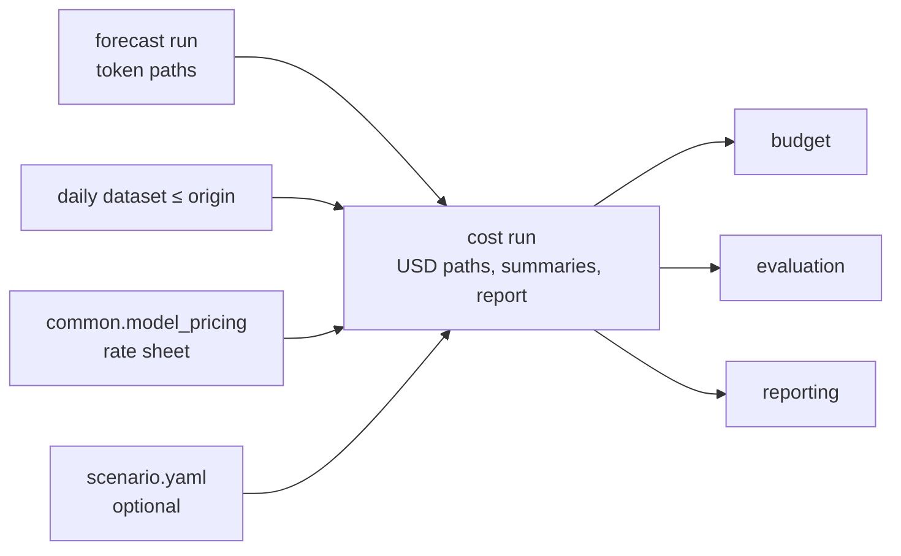
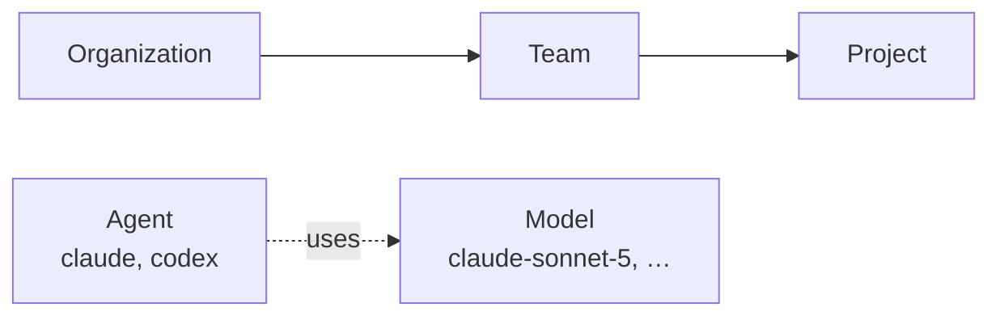

# Cost module — design

| | |
|---|---|
| **Status** | Agreed design, **not implemented**. Module `forecast.cost` (cost + scenarios). |
| **Scope (V1)** | Price a forecast run into USD paths per series; expected daily cost, p10/p50/p90, report (charts via the plot utility). Named scenarios (model transfer, agent transfer, growth). One org per run. Per-token (API) billing only; seat / Team plans are a separate design. |
| **Related** | [forecasting design](./forecasting-model-design.md), [model pricing](../../../docs/modules/model-pricing.md), [budget design](./budget-module-design.md) (consumer), [brainstorm notes](../notes/cost-budget-brainstorm.md), [plan](../plan/cost-module-plan.md). |
| **Issues** | [#74](https://github.com/talium-ai/code-econ/issues/74) cost module; [#68](https://github.com/talium-ai/code-econ/issues/68) dashboard pricing migration. |
| **Updated** | 2026-09-27 (charts moved to plot utility) |

## 1. Flow



A cost run mirrors the forecast run in USD: same series, dates, and samples. A scenario creates new token
series from the forecast series, then is priced the same way; each scenario is its own cost run.

## 2. Core logic

### 2.1 Terms



| Term | Meaning |
|---|---|
| Scope | An attribution view: Organization ⊇ Team ⊇ Project (one team per project). Views overlap; they never add up. |
| Agent | Coding agent (`claude`, `codex`). Cuts across scopes; not a scope. |
| Series | One (scope, model) forecast: tokens `[dates, samples]`. |
| Sample | One simulated future (a column of the path array). |
| Token type | `input` (uncached input only), `cache_write_5m`, `cache_write_1h`, `cache_read`, `output` (includes reasoning). Each has its own price. |
| Mix | A series' split of its tokens by agent × token type (§5). |
| Attribution share | A child scope's fraction of a parent scope's tokens for one model, e.g. team1 = 40% of org Opus (§5). |

### 2.2 Logic

```text
# Baseline — every series priced independently
for scope in forecast.scopes:
    scope_cost = zeros[dates, samples]
    for series in scope.series:
        tokens = forecast.paths(series)                                          # [dates, samples]
        rate   = Σ_token_type mix[series, token_type] × price[model, token_type, date]   # [dates], USD/token
        cost   = tokens × rate                                                   # [dates, samples], USD
        write cost path; daily expected = mean over samples
        period expected, p10/p50/p90 = over samples of Σ_period cost
        scope_cost += cost                                                       # models add within a scope
    scope daily expected, period expected, p10/p50/p90 from scope_cost
    charts (plot_cost.sh, not the cost run): per scope/model daily cost fan; per scope — model breakdown

# Scenario — new token series, then the baseline logic unchanged
tokens' = forecast paths
for change in scenario.changes:                         # each acts on the previous result
    apply change to the declared scope, its sub-scopes, and its parent scopes (§6.3)
price tokens' with the baseline logic
```

- Example: mix 0.06% input, 0.58% 5-minute writes, 18.78% 1-hour writes, 77.67% cache read, 2.91%
  output at $3 / $3.75 / $6 / $0.30 / $15 per million → $1.8202 per million; 1,030,000 tokens on a
  day → $1.87 in that sample (the same tokens priced with writes folded into `input` gave $1.29).
- `mix[series, token_type]` is summed over agents: agent does not change price; it is used only for the
  agent breakdown.
- Percentiles come from per-sample totals, never by adding percentiles.
- Memory: one scope at a time; each series memory-mapped.
- Budget adds only what needs an amount (sufficiency, required budget, exhaustion).

## 3. Interfaces

### 3.1 Inputs

| Source | Access | Used |
|---|---|---|
| Forecast run | `forecasting.load_run(dir) → SavedRun` | `org_id`, dates, samples, scopes and series (identity, status, assumptions, reasons, `risk_ready`), token paths. **New on `SavedRun`:** `origin`, `periods` (requested + calendar), `dataset` (path, manifest sha256), `history_lookback_days`. |
| Dataset | `forecasting.dataset.load_dataset(path) → PreparedDataset` | `usage` per scope / model / agent / date by token type; covered days as forecasting §4. Verified against the forecast's recorded sha256. |
| Prices | `model_pricing.rate_sheet(org_id, model_ids, start, end) → RateSheet` | §4. `start`, `end` = first and last forecast date. |
| Scenario | `config/scenarios/<name>.yaml` | §6. Absent = baseline. |

### 3.2 CLI and Python API

```bash
./econ-forecast/utils/cost.sh --forecast-run artifacts/sep-forecast \
  [--scenario config/scenarios/team1-opus-to-sonnet.yaml] \
  --output artifacts/sep-forecast-cost-baseline [--force] [--validate-only]
# -> python -m forecast.cost.cli_cost
```

| | |
|---|---|
| `--output` | Required. Existing directory refused unless `--force` (recreates only that directory). |
| `--validate-only` | Reads inputs, builds the rate sheet, lists unpriced models; writes nothing. |
| stdout / stderr | JSON summary (scenario, per-scope status, expected USD per period) / structlog JSON logs. |
| Exit | `0` success; `2` any scope `incomplete` (also `--validate-only` with unpriced models); `1` input or execution failure. |

```python
from forecast.cost import CostRequest, run_cost, load_cost_run

result = run_cost(forecast_run_dir, CostRequest(scenario=Path(...) | None, catalog=None), output_dir)
# catalog: optional pinned common.model_pricing Catalog (tests, reproducible reruns); None = latest
run = load_cost_run(dir)        # → CostRun
run.request, run.index, run.rate_sheet, run.mix, run.daily_expected, run.period_summary
run.paths(series)               # [dates, samples] USD, memory-mapped
run.scope_paths(scope)          # Σ of the scope's series paths; None for an incomplete scope
```

Consumers read only through `load_cost_run`. Method constants (no config file in V1): `half_life_days: 14`,
`own_mix_half_weight_days: 7`, `max_age_days` = forecast history lookback. Recorded in `request.json`.

## 4. Prices — rate sheet (`rate-sheet/1.0`, owned by `model_pricing`)

`model_pricing` owns matching, channel, date rules (future dates → latest known price), retirement, and
derived rates. Cost never loads or names a catalog.

```json
{
  "org_id": "talium.ai",
  "start": "2026-10-01",
  "end": "2026-10-31",
  "price_version": "2026-09-25-a950f989",
  "models": [
    {
      "usage_model_id": "claude-sonnet-5",
      "status": "matched",
      "model_id": "claude-sonnet-5",
      "vendor": "anthropic",
      "channel": "anthropic",
      "match_step": "normalized",
      "segments": [
        {
          "from": "2026-10-01",
          "to": "2026-10-31",
          "rates": {
            "input": "0.000003",
            "output": "0.000015",
            "cache_read": "0.0000003",
            "cache_write_5m": "0.00000375",
            "cache_write_1h": "0.000006"
          }
        }
      ]
    },
    {
      "usage_model_id": "claude-sonnet",
      "status": "ambiguous",
      "reason": "normalizes to 2 registry models",
      "candidates": [
        "claude-sonnet-4-5",
        "claude-sonnet-5"
      ]
    }
  ]
}
```

| Field | Rule / consumer |
|---|---|
| `status` | `matched` \| `unmatched` \| `ambiguous`; non-matched → `reason`, `candidates`, no segments. |
| `match_step` | `alias` \| `normalized` \| `canonical` (as `MatchResult.step`). Report price mapping. |
| `segments` | Cover `start…end`, inclusive, no gaps. A price change = two segments; retired = all rates `null`. |
| `rates` | USD per token, exact decimal strings; `null` = no price, never 0. Cost uses all five types. A `null` rate for a type with nonzero tokens makes the series `unpriced`. When a vendor publishes only a 5-minute write price, the catalog bills the 1-hour write at it (`cache_write_1h_billed_as_5m`). |
| `price_version`, `vendor`, `channel`, `model_id` | Report price mapping; provenance. |

## 5. Mix and attribution

Deterministic, from the dataset: days $d \le$ origin, covered days only, within `max_age_days`.

| Symbol | Meaning |
|---|---|
| $x_{d}$ | Tokens of the series (scope, model) on day $d$ |
| $x_{d,a,t}$ | Same, for agent $a$ and token type $t$ |
| $h$ | `half_life_days` (14) |
| $m$ | `own_mix_half_weight_days` (7) |
| $n$ | Active days: days with $x_d > 0$ (not decayed) — `active_days` in `mix.json` |
| $\lambda$ | Weight of the scope's own mix — `own_weight` in `mix.json` |

**Day weight** — recent days count more:

$$w_d = 2^{-(\text{origin} - d)/h}$$

**Own mix** — ratio of weighted sums, never an average of daily ratios:

$$\text{own}_{a,t} = \frac{\sum_d w_d \, x_{d,a,t}}{\sum_d w_d \, x_d}$$

**Mix** — Team and Project blend toward the Organization's mix for the same model; the Organization uses its own:

$$\lambda = \frac{n}{n + m} \qquad \text{mix}_{a,t} = \lambda \, \text{own}_{a,t} + (1 - \lambda) \, \text{org}_{a,t}$$

Example: 4 active days, own output share 10%, org 3% → $\lambda = 4/11$ → 5.5%.

**Attribution share** of child scope $c$ in parent scope $A$, for one model (0 if the denominator is 0):

$$s_{c,A} = \frac{\sum_d w_d \, x^{c}_{d}}{\sum_d w_d \, x^{A}_{d}}$$

Example: team1's weighted Opus tokens / org's weighted Opus tokens = 0.4.

`inactive` series need no mix; series without paths are not priced.

## 6. Scenarios

### 6.1 Config — `scenario/1.0`

```yaml
schema: scenario/1.0
name: team1-opus-to-sonnet          # = file name; "baseline" is reserved
scope:                              # declared scope; default: organization
  type: team
  name: team1
changes:                            # applied in order, each on the previous result
  - model_transfer:
      from: claude-opus-5
      to: claude-sonnet-5
      fraction: 0.3
      token_factor: 1.0
      effective_from: 2026-10-15
  - agent_transfer:
      from: codex
      to: claude
      fraction: 0.5
      token_factor: 1.0
  - growth:
      factor: 1.2
      effective_from: 2026-10-15
```

`effective_from` is optional (default: first forecast date). `token_factor` = tokens used at the destination
per token moved; 1.0 = consumption unchanged.

### 6.2 Changes

Applied to each affected scope with weight `k` (§6.3), on dates ≥ `effective_from`, in every sample.

| Change | Rule |
|---|---|
| `model_transfer` | `moved = k·f·tokens'[from]`; `tokens'[from] −= moved`; `tokens'[to] += token_factor·moved`. |
| `agent_transfer` | For each series `m` in the scope: `moved_m = k·f·a_from[m]·tokens'[m]`, `a_from[m]` = `from` agent's share of `m` (§5). `M = Σ moved_m`; `tokens'[m] −= moved_m`; for each model `j` of the `to` agent: `tokens'[j] += token_factor·M·split_to[j]`, `split_to` = `to` agent's model split (§5 weights, org level). |
| `growth` | `tokens'[every series] ×= 1 + (factor − 1)·k`. |

- Moved tokens are priced at the destination series' rate (§5 mix of that scope and model). A destination
  not used in the scope falls back to the org mix (`own_weight = 0`); not used anywhere → source mix,
  `scenario_mix_borrowed`.
- A destination series missing in a scope is created (`qualified`, `scenario_added_series`).
- Only `qualified` series give or receive tokens; others are unchanged. A scope without the `from` model
  or agent is skipped.
- Agent transfer is exact when each model serves one agent; otherwise remaining tokens keep the series mix.

### 6.3 Applying a change at every scope level

A change is declared on one scope but affects its sub-scopes and parent scopes too.

Example — team1 moves 30% of its Opus to Sonnet; team1 is 40% of the org's Opus:

| Scope | Effect | `k` |
|---|---|---|
| team1 (declared) | moves 30% of its Opus | 1 |
| team1's projects (sub-scopes) | each moves 30% of its own Opus | 1 |
| Organization (parent) | moves 0.4 × 30% = 12% of its Opus | attribution share `s` = 0.4 |
| team2, team3 and their projects | unchanged | — |

- A project declared → its team and the org are parents, each with its own `s` (§5).
- `s` is per model: the `from` model for `model_transfer`; each series' model for `agent_transfer` and `growth`.
- Parent scopes are exact in expectation, approximate per sample (their samples are independent draws);
  assumption `scenario_propagated_by_share`.
- Scenario and baseline runs have the same scope set.

### 6.4 Validation (input error before pricing)

| Item | Rule |
|---|---|
| `name` | Matches file name; not `baseline`. |
| `scope` | Exists in the forecast run. |
| `model_transfer` | `from` is a series in the declared scope; `to` is `matched` in the rate sheet; `0 < fraction ≤ 1`. |
| `agent_transfer` | `from` has usage in the declared scope; `to` has usage in the org; `0 < fraction ≤ 1`. |
| `growth` | `factor ≥ 0`. |
| All | `token_factor > 0`; `effective_from` within forecast dates. |

## 7. Statuses

| Forecast series status | Pricing | Cost series status |
|---|---|---|
| `qualified` | matched, and every token type with nonzero mix has a non-null rate on every date | `qualified` |
| `qualified` | otherwise | `unpriced` |
| `inactive` | — | `inactive` (zero path) |
| `insufficient_history` / `insufficient_startup` / `sampling_failed` | — | unchanged, no path |

Scope status uses forecasting's rules on cost series statuses, after the scenario: `complete` (all
`qualified`), `conditional` (`qualified` + `inactive`), `inactive`, `incomplete` (any series without a path,
including `unpriced`, with nonzero expected tokens — no scope total). `risk_ready` is carried unchanged.

## 8. Artifacts

### 8.1 Layout

```text
sep-forecast-cost-baseline/
├── manifest.json          # written last; per file: schema, bytes, sha256
├── request.json           # inputs by name, periods, constants
├── scenario.yaml          # copy; scenario runs only
├── rate_sheet.json        # §4, unchanged
├── mix.json               # shares and attribution used
├── daily_expected.jsonl   # expected USD + tokens per date / series / agent
├── period_summary.json    # expected, p10/p50/p90 USD per series and scope, per period
├── report.md              # not in the manifest; re-rendered by plot_cost
├── charts/                # optional; written by plot_cost (plot design §7), not in the manifest
└── paths/
    ├── index.json         # authoritative identity, dates, statuses
    └── <scope>__<model>.npy   # float64 [dates, samples], USD per day; zeros for inactive
```

| Forecast run | Cost run |
|---|---|
| `paths/*`, `daily_expected.jsonl`, `period_summary.json`, `manifest.json`, `request.json`, `report.md`, `charts/` | same, in USD |
| `allocations.json` | `mix.json` |
| `resolved_config.yaml`, `diagnostics.json` | — |
| — | `rate_sheet.json`, `scenario.yaml` |

- Names: `<scope_type>-<scope_name>` and model, lowercased, non-alphanumerics → `-`; `-2` on collision.
  Identity comes from `index.json` only.
- `report.md` and `charts/*` are presentation, not listed in the manifest and not read by the reader.
  Charts come from `plot_cost.sh` + `plot.yaml` ([plot design §14](./plot-forecast-enhancements-design.md)).
- `request.json` `forecast_run.path` is relative to the cost run; the dataset is reached through the
  forecast run, not recorded again ([plot design §14.3](./plot-forecast-enhancements-design.md)).
- Schema ids `<name>/<major>.<minor>`, recorded once per file in the manifest. Minor = additive; readers
  accept the same major and ignore unknown fields. Hashes are integrity checks, never identity.
- Every field has a consumer; forecast fields without one are not copied (`sample_ids` → `samples`,
  `shape`, `dtype`, `total_*`, per-row `schema_version`, hash suffixes in names).

### 8.2 Schemas

`manifest.json` — `cost-manifest/1.0`

```json
{
  "status": "complete",
  "created_at": "2026-10-01T09:00:00Z",
  "code_version": "7cf5f13",
  "files": {
    "paths/index.json": {
      "schema": "cost-index/1.0",
      "bytes": 18211,
      "sha256": "…"
    }
  }
}
```

`request.json` — `cost-request/1.0`

```json
{
  "org_id": "talium.ai",
  "forecast_run": {
    "name": "sep-forecast",
    "path": "../sep-forecast",
    "manifest_sha256": "…"
  },
  "scenario": "baseline",
  "periods": [
    {
      "type": "requested",
      "start": "2026-10-01",
      "end": "2026-10-31"
    },
    {
      "type": "calendar",
      "start": "2026-10-01",
      "end": "2026-10-31"
    }
  ],
  "settings": {
    "half_life_days": 14,
    "own_mix_half_weight_days": 7,
    "max_age_days": 90
  }
}
```

`paths/index.json` — `cost-index/1.0`

```json
{
  "org_id": "talium.ai",
  "dates": [
    "2026-10-01",
    "…"
  ],
  "samples": 1000,
  "scopes": [
    {
      "scope_type": "team",
      "scope_name": "team1",
      "status": "complete",
      "risk_ready": true,
      "assumptions": [
        "uncalibrated_model_estimate"
      ],
      "reasons": []
    }
  ],
  "series": [
    {
      "scope_type": "team",
      "scope_name": "team1",
      "model": "claude-sonnet-5",
      "status": "qualified",
      "path": "paths/team-team1__claude-sonnet-5.npy",
      "assumptions": [
        "fixed_mix_estimate"
      ],
      "reasons": []
    }
  ]
}
```

`daily_expected.jsonl` — `cost-daily-expected/2.0`; one row per line in the file, shown expanded;
`qualified` and `inactive` series.

```json
{
  "date": "2026-10-01",
  "scope_type": "team",
  "scope_name": "team1",
  "model": "claude-sonnet-5",
  "agent_type": "claude",
  "usd": {
    "input": 0.001,
    "cache_write_5m": 0.022,
    "cache_write_1h": 1.161,
    "cache_read": 0.24,
    "output": 0.45
  },
  "tokens": {
    "input": 600.0,
    "cache_write_5m": 5982.0,
    "cache_write_1h": 193418.0,
    "cache_read": 800000.0,
    "output": 30000.0
  }
}
```

`period_summary.json` — `cost-period-summary/2.0`; `model: null` = scope total.

```json
{
  "entries": [
    {
      "scope_type": "team",
      "scope_name": "team1",
      "model": null,
      "period_type": "requested",
      "start": "2026-10-01",
      "end": "2026-10-31",
      "status": "complete",
      "expected": 37210.4,
      "p10": 33020.1,
      "p50": 36980.0,
      "p90": 41870.3,
      "assumptions": []
    }
  ]
}
```

`mix.json` — `cost-mix/2.0`

```json
{
  "entries": [
    {
      "scope_type": "project",
      "scope_name": "payment_service_improvement",
      "model": "claude-sonnet-5",
      "window": {
        "start": "2026-07-04",
        "end": "2026-09-30"
      },
      "active_days": 41,
      "own_weight": 0.85,
      "shares": [
        {
          "agent_type": "claude",
          "input": 0.001,
          "cache_write_5m": 0.006,
          "cache_write_1h": 0.193,
          "cache_read": 0.77,
          "output": 0.03
        }
      ],
      "attribution": {
        "team": 0.62,
        "organization": 0.18
      }
    }
  ]
}
```

| File | Field | Rule / consumer |
|---|---|---|
| manifest | `status` | `complete` \| `incomplete` (any incomplete scope). The manifest's existence marks a finished write. |
| manifest | `code_version` | Git HEAD short sha; `unknown` outside a repo. |
| request | `forecast_run.name` | Budget compares only runs of the same forecast. |
| request | `periods` | Forecast's periods: `requested` (whole horizon) + `calendar` (each week / month). Budget evaluates per period. |
| request | `scenario` | Scenario name or `baseline`. |
| index | `samples` | Sample ids `0..samples−1`, the forecast's own. |
| index | `path` | `null` unless `qualified` or `inactive`. |
| index | `assumptions` | Series: forecast's (without `fixed_allocation_shares`) + cost's (§9). Scope: union of its series. |
| daily_expected | `usd`, `tokens` | Mean over samples × mix, per agent and token type. Baseline token totals equal the forecast's; the split follows `mix.json`. |
| period_summary | entries | Per series and scope × period type; scope total only for `complete`, `conditional`, `inactive`. Quantiles: NumPy linear. |
| mix | `own_weight`, `active_days`, `window` | Report (thin evidence when `own_weight` < 0.9). |
| mix | `attribution` | Parent-scope weights (§6.3); absent for the Organization. |

### 8.3 Report and charts

`report.md`: blocking problems (unpriced models, incomplete scopes) → cost table per scope and period
(expected, p10 / p50 / p90) → charts → scenario changes and token shifts → thin-evidence mix → price
mapping (`price_version`) → assumptions.

Charts are not written by the cost run: `plot_cost.sh` draws them from `plot.yaml` into `charts/` and
re-renders `report.md`, whose chart section lists `charts/index.json` and is omitted without it
([plot design §14](./plot-forecast-enhancements-design.md)). Chart kinds: per scope total fan and per model fan (mean, configurable band); per scope model
breakdown of expected cost. Notes: fan edges are per-date quantiles,
not one future; scopes do not add up; prices are the latest known; long-context tiers are ignored.

## 9. Assumption labels

| Label | Attached to |
|---|---|
| `uncalibrated_model_estimate`, `excess_negative_correction`, … | Carried from the forecast series. |
| `fixed_mix_estimate` | Every priced series; replaces forecast's `fixed_allocation_shares`. |
| `continued_inactivity` | `inactive` series. |
| `scenario_constant_tokens` / `scenario_token_factor_manual` | Series changed by a transfer with `token_factor` = 1.0 / ≠ 1.0. |
| `scenario_mix_borrowed`, `scenario_added_series` | Destination series (§6.2). |
| `scenario_propagated_by_share` | Parent-scope series changed with `k = s`. |

## 10. Source layout

```text
econ-forecast/
├── src/forecast/cost/
│   ├── README.md
│   ├── __init__.py       # run_cost, load_cost_run, CostRequest, CostRun
│   ├── cli_cost.py
│   ├── request.py        # forecast run, dataset check, scenario load + validation (§3, §6.4)
│   ├── mix.py            # §5
│   ├── scenario.py       # §6.2–6.3 changes, scope levels
│   ├── rates.py          # rate sheet → rate[series, date] (§4)
│   ├── kernel.py         # §2 baseline loop
│   ├── summaries.py      # daily_expected, period_summary
│   ├── schemas.py        # §8.2
│   ├── artifacts.py      # atomic write, manifest last, load_cost_run
│   ├── presentation.py   # §8.3
│   └── errors.py         # InputError / ExecutionError
├── config/scenarios/     # examples
├── utils/cost.sh
└── tests/cost/
```

## 11. Dependencies and changes to other modules

| Module | Change |
|---|---|
| `forecast.forecasting` | `SavedRun` exposes `origin`, `periods`, `dataset` (path resolved against the run + manifest sha256), `history_lookback_days`; run records the dataset manifest sha256; reader ignores unknown fields. |
| `forecast.forecasting.allocation` | Unchanged. **Known error:** its split (28-day plain sum) differs from cost's mix (§5); tracked in [#76](https://github.com/talium-ai/code-econ/issues/76); fix = forecasting adopts §5. The cost report notes it. |
| `common.model_pricing` | New `rate_sheet` (§4). |
| `common.pricing` (legacy, retired by #68) | Not used. |
| `forecast.budget`, evaluation, reporting | Read via `load_cost_run`. |
| Architecture doc | `cost` replaces pricing in `budget` and the `scenarios` module; add `common.model_pricing`, `curve`. |
| Libraries | numpy, pydantic, PyYAML, structlog, matplotlib, plotly — already present. |
| `forecast.utils` (plot) | Draws cost charts (`plot_cost.sh`); reuses `presentation.py` chart builders. [plot design §14](./plot-forecast-enhancements-design.md) |

## 12. Key decisions

| Decision | Pros | Cons |
|---|---|---|
| Cost + scenarios in one module | One kernel, one artifact type. | `scenario.py` carries the complexity. |
| Rate sheet, not per-record pricing | One call per run; pricing stays in `model_pricing`. | New `model_pricing` API. |
| Percentiles in cost; charts via the plot utility | Cost is readable alone, like the forecast; scenarios compare without budgets. | Budget re-reads paths for amount questions. |
| Parent scopes changed by attribution share | Every level reflects a change. | Parent tails approximate. |
| Growth as a scenario | Every evaluated dollar exists in a saved cost run. | — |
| No config file in V1 | Nothing configurable without a tuning basis. | Constant change = code change. |

## 13. Deferred

- Estimating `token_factor` from data (same-user comparisons around switches); per-token-type factor.
- Channel override as a scenario lever; seat / Team plans.
- Pricing observed history (1 sample) for evaluation and #68.
- Tuning mix constants by backtest on dollar error; calibration.
