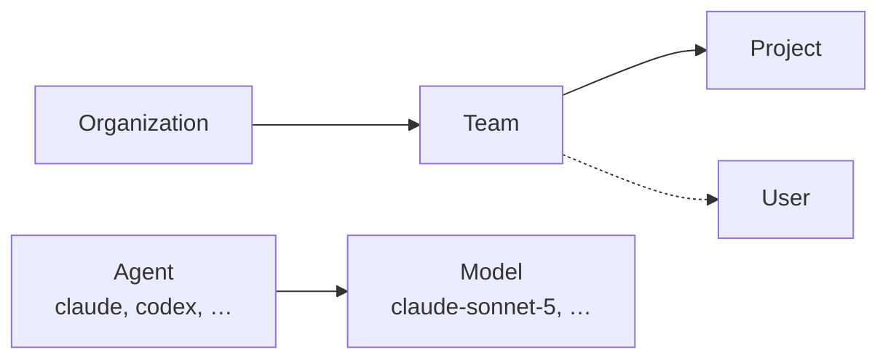
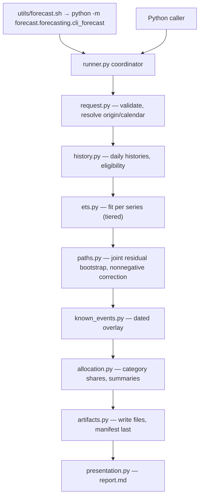
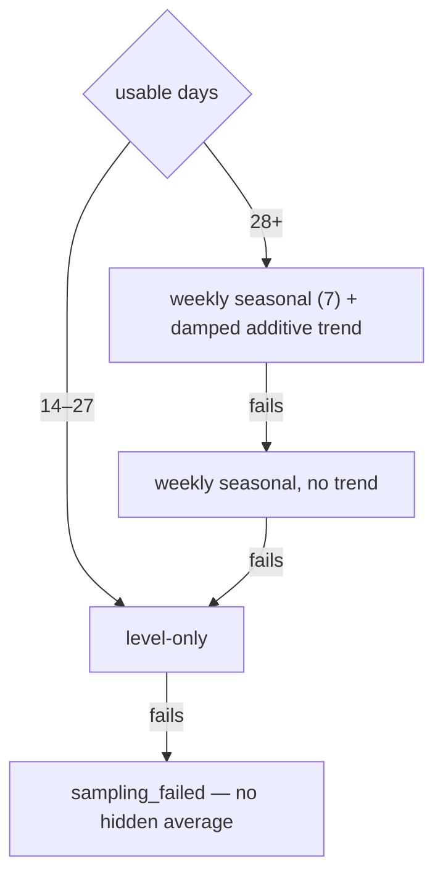
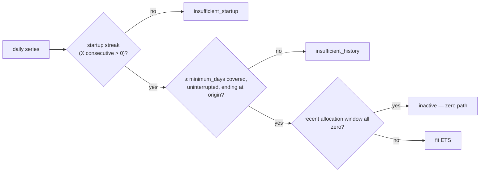
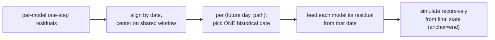
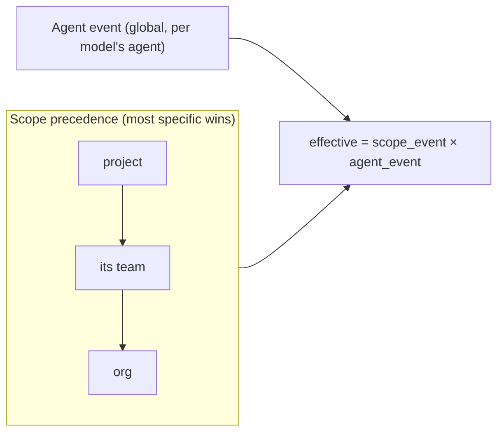

# Forecasting model — design

| | |
|---|---|
| **Status** | Authoritative, **implemented** (branch `forecast`). Single design doc for the `forecasting` module. |
| **Model** | Data-driven **ETS** (statsmodels) + **dated known-event overlay**. |
| **Replaces** | `forecasting.md`, `forecasting-design.md`, `forecasting-release-contract.md`, `forecasting-weekday-bootstrap.md`, `forecasting-ets-and-known-events-design.md`. The interim `weekday_bootstrap` model is **retired**. |
| **Rule** | One design doc per module; version with `-v2` for a future rewrite, never a new name. |
| **Evidence (not design)** | [numerical preflight](../notes/forecast-numerical-preflight.md), [acceptance matrix](../notes/forecasting-acceptance-matrix.md), [decision log](../notes/forecasting-design-decisions.md) — historical snapshots. |
| **Related** | [module architecture](../arch/module-architecture.md), [synthetic generation](./synthetic-data-generation-design.md), [plotting utility](./plot-forecast-enhancements-design.md), operator guide [README-forecast](../operations/README-forecast.md). |
| **Updated** | 2026-09-24 |

Unresolved items are marked **[open]**; everything else is agreed and implemented.

---

## 1. Structural model (authoritative)

Stated once here; other docs and configs conform.



```text
Usage row: (org_id, team_id, project_id, user_id, agent_type, model, date, tokens{input, cache_write_5m, cache_write_1h, cache_read, output})
Series:    (org_id, scope_type, scope_id, model)
```

| Rule | Meaning |
|---|---|
| Scope tree | Org → Team → Project; **one team per project**. Org/Team/Project are *views* of the same tokens — never add Team and Project totals. |
| Agent ⟂ scope | Agent cuts across the tree. Models **partition** an agent → agent total = Σ its model forecasts (exact, forecast-driven). |
| Fitted unit | One series per `(scope, model)`. Agent is not fitted. Scope total = Σ its model series. |
| Token total | `total = input + cache_write_5m + cache_write_1h + cache_read + output`. Stored `input` is uncached input only; cache writes are their own types (daily-usage schema 2, [cache-write contract](./cache-write-contract-design.md)). The total, and so every fit and path, is the same value as when writes were folded into `input`. |
| Coverage | Absent usage inside declared coverage = **zero**; declared outage = **unknown**; malformed tokens = validation error. |
| Unattributed | A null user ID stream is one aggregate contributor. |

Per-category split (`input`/`cache_write_5m`/`cache_write_1h`/`cache_read`/`output`) comes from historical shares in allocation (§6), not from the model.

Synthetic data follows the tree **by convention** (one team per project in all maintained configs/examples);
the generator can still emit multi-team projects if configured — see the
[synthetic design](./synthetic-data-generation-design.md#1-invariants).

## 2. Batch architecture



```text
src/forecast/forecasting/
├── cli_forecast.py   # CLI entry (--config, --origin, --unit/--offset/--periods, --output, --force, --validate-only)
├── config.py         # strict YAML schema (§9)
├── dataset.py        # daily usage/coverage loader
├── request.py        # origin + calendar resolution
├── history.py        # startup gate, covered history, inactivity (§4)
├── ets.py            # tiered ETS fit (§3)
├── paths.py          # joint uncertainty paths + nonnegative correction (§5, §6)
├── known_events.py   # dated overlay (§7)
├── allocation.py     # (agent, category) shares (§6)
├── artifacts.py      # writer + reader contract (§10)
├── presentation.py   # report.md
└── runner.py         # coordinator
```

Fitting ≠ uncertainty: a mean pattern is not the path distribution. This module computes no dollars; budget/scenarios reuse saved paths.

## 3. Consumption model: data-driven ETS

Seasonality and trend are **estimated** here; they are **controlled** only in the synthetic generator.

```yaml
model:
  method: ets        # statsmodels ETSModel, additive error
  seasonal: auto     # auto = learn from data | none = force off
  trend: auto        # auto = learn from data | none = force off
```

Tiered fit (`auto`) — failure fallback, not a model search; first numerically accepted fit wins:



| Mode | Effect |
|---|---|
| `seasonal: none` | Drops seasonal tiers. **Collapses to level-only even with `trend: auto`** — there is no trend-only tier (known limitation). |
| `trend: none` | Drops the trend tier: 28+ → seasonal-only → level-only. |
| weekend knob | **None.** The old `weekend:` block / `WeekendOverride` is removed; a weekly pattern is learned by the seasonal tier if present in data. |

Numerical controls (details in the [preflight note](../notes/forecast-numerical-preflight.md)):

- Affine-normalize non-constant series (`location=mean`, `scale=max(std, spacing)`); `maxiter=1000`, `disp=False`.
- Require convergence and finite params/residuals/forecasts; reject convergence warnings.
- Exactly-constant series → analytic level branch (zero residuals, no optimizer). Low variation is normal; never inject noise.
- Simulation uses `anchor="end"` (the statsmodels default anchors at sample start).

## 4. History and activity eligibility

```yaml
history:
  lookback_days: 90          # max window ending at --origin (inclusive)
  minimum_days: 14           # consecutive covered days ending at origin (floor 14)
  minimum_active_days: 4     # startup gate: X consecutive days with total > 0
```



- Start = **first** day of the first qualifying streak; earlier zeros/isolated positives are excluded. Later zeros never re-trigger the gate.
- X=7 needs weekend usage — a weekday-only team cannot qualify at X=7.
- A declared outage truncates history; an outage at origin fails. Never bridge gaps or move origin; no post-origin data enters a path.
- All-zero covered history → `inactive` (continued-inactivity assumption, not measured zero risk). Low-but-positive usage is fitted normally.

## 5. Joint uncertainty paths

```yaml
uncertainty:
  paths: 1000      # equally weighted daily futures
  seed: 42
```

Per scope, errors are bootstrapped **jointly** across its active models so same-day relationships survive:



- Each model is fit on its full usable history; residuals are sampled only from **overlapping** dates.
- Require **≥ 14 shared error dates**, else the scope is unsuitable for joint risk (no invented or silently independent errors).
- Inactive models contribute zero without shortening the window.
- Limitations: independent across days (multi-day bursts underrepresented); fixed params/shares; calibration not yet established on real data.

## 6. Nonnegative paths and token allocation

```yaml
uncertainty:
  max_negative_correction_ratio: 0.05   # share of requested-horizon tokens removed by max(0, ·)
allocation:
  lookback_days: 28                     # intersected with usable history
```

| Step | Rule |
|---|---|
| Nonnegative correction | `max(0, ·)` on daily outputs, **not** fed back into state. Nonfinite → `sampling_failed`. Means/quantiles use corrected paths. |
| Correction exceeds ratio | Series stays **`qualified`** (keeps paths) but is flagged **`excess_negative_correction`** → unsuitable for budget risk. |
| Allocation | Sum tokens per `(agent, category)` over the window; shares = ratios of **summed** tokens (never averages of daily %). Fixed across the horizon; applied to expectations and every path; reconciles to each path/day total. |
| Zero window | Entirely zero recent window → `inactive`; never fall back to older shares. |

## 7. Known events (dated spikes)

A **planned** future event is a **post-simulation, model-agnostic overlay** on the `(days × paths)` array —
never part of the fit. A one-off *historical* spike is not forecastable (it washes out); a **declared** event is.

```yaml
known_events:              # optional; every key optional; ≤ 1 event per org/team/project/agent
  org:      { start_date: 2026-09-14, end_date: 2026-09-18, multiplier: 1.4, spread: 0.15 }
  teams:    { team1: { start_date: …, end_date: …, multiplier: 1.6, spread: 0.2 } }
  projects: { payment_service_improvement: { start_date: …, end_date: …, multiplier: 2.0, spread: 0.0 } }
  agents:   { claude: { start_date: …, end_date: …, multiplier: 2.0, spread: 0.3 } }
```

| Field | Meaning |
|---|---|
| `multiplier` | Expected size (≥ 0). |
| `spread` | Absolute half-width, `0 ≤ spread ≤ multiplier`. Per-path factor `~ Uniform(multiplier ± spread)`, drawn **once per path**. `0` → band shifts; `> 0` → band fans out. |
| Window | `end_date ≥ start_date`, inside the horizon. |

**Anti-washout:** one factor per path for the whole window → the event shows in the mean **and** the band (independent per-day draws would average away).

**Targeting — two orthogonal axes, multiplicative:**



| Forecast series | Scope event used (first match) |
|---|---|
| Organization | org |
| Team `T` | team[`T`] → org |
| Project `P` | project[`P`] → team[`P`'s team] → org |

- Inactive axis → 1.0; draws independent per axis per path. Zero (inactive) paths stay zero.
- Example: org ×1.4 × claude ×2.0, mix 60/40 → claude models ×2.8, codex ×1.4, org total ×2.24.
- **No model-level events.** Scope events move only their own series — **no parent roll-up** yet (§13, Phase 3).
- Declared events are part of the **base forecast**; what-ifs belong to `scenarios`.
- Provenance per applied event (level, name, dates, multiplier, spread, factor stats) → `diagnostics.json`.

## 8. Statuses

| Series status | Path? | Meaning |
|---|---|---|
| `qualified` | yes | Fitted and simulated (may carry `excess_negative_correction`). |
| `inactive` | zero path | Valid all-zero history / recent window. |
| `insufficient_history` | no | Covered-history floor not met. |
| `insufficient_startup` | no | No qualifying startup streak. |
| `sampling_failed` | no | Fit/simulation/joint sampling failed; nonempty reasons. |

| Scope status | Rule |
|---|---|
| `complete` | All models `qualified`. |
| `conditional` | `qualified` + `inactive`. |
| `inactive` | All `inactive`. |
| `incomplete` | Any nonzero component without a usable path → partial run, **CLI exit 2**. |

No `fit_failed` / `correction_failed` — the artifact reader rejects them. Qualified results are saved even if a sibling fails; independent scopes complete regardless of each other.

## 9. Forecast config

Strict YAML: unknown fields, unsupported methods, nonfinite numbers, and booleans in numeric fields are
rejected. Paths resolve relative to the config file. Maintained template: `config/forecasting/forecast.yaml`.

```yaml
schema_version: 1
input:        { dataset_dir: ../../artifacts/series-60d }
default_org_id: talium.ai          # null only if every scope sets org_id
scopes:
  - { type: organization }
  - { type: team, name: team1 }
  - { type: project, name: payment_service_improvement }
history:      { lookback_days: 90, minimum_days: 14, minimum_active_days: 4 }
model:        { method: ets, seasonal: auto, trend: auto }
allocation:   { lookback_days: 28 }
uncertainty:  { paths: 1000, seed: 42, max_negative_correction_ratio: 0.05 }
known_events: { … }                # optional (§7)
runtime:      { workers: 1 }       # 1..4, ≤ CPU count
```

CLI:

```bash
utils/forecast.sh --config config/forecasting/forecast.yaml \
  --unit month --offset 1 --periods 1 \
  --output artifacts/forecast-sep [--origin 2026-09-30] [--force] [--validate-only]
```

| Flag | Meaning |
|---|---|
| `--origin` | Defaults to the dataset's declared end. |
| `--unit week\|month`, `--offset`, `--periods` | Requested calendar horizon. |
| `--force` | Recreate an existing/non-empty `--output`; deletion confined to the resolved target. |

## 10. Artifact layout

One directory per run; `manifest.json` is written last (publication marker).

```text
artifacts/<run>/
├── manifest.json          # versions, checksums, series + scope statuses
├── resolved_config.yaml   # settings used, incl. input.dataset_dir (relative to the run), model, known_events
├── request.json           # origin, scopes, requested/internal dates
├── daily_expected.jsonl   # date/scope/model/agent/category expected tokens (five categories; schema_version 2)
├── period_summary.json    # period means + p10/p50/p90 (sum per sample, then quantile)
├── allocations.json       # (agent, category) shares + source window/totals (schema_version 2; the forecast manifest is 2 too)
├── diagnostics.json       # history, fit tier, sampling, corrections, applied events, runtime
├── report.md
├── charts/                  # optional; written by plot_forecast.sh, not in the manifest
└── paths/
    ├── index.json               # AUTHORITATIVE series identity, dates, sample order
    └── <scope>__<model>.npy     # float64 [dates, samples]; qualified/inactive only
```

Reader contract (checksums, traversal/symlink/pickle rejection, mmap, dtype/shape/finiteness, status
vocabulary) is enforced by `artifacts.py::load_run`. Never parse identity from filenames.

`request.json` additionally carries, additively, the facts the cost module needs (cost design §3.1):
`dataset` (`{path, manifest_sha256}`, `path` relative to the run, the dataset's own `manifest.json` hash, independent of
`input_sources`), `history_lookback_days` (= `history.lookback_days`), and `period_ranges` (requested +
calendar periods, one typed list; distinct from the existing `periods` key, which is the request's period
*count*). `load_run` exposes these as `SavedRun.dataset`, `SavedRun.history_lookback_days`,
`SavedRun.periods`, and `SavedRun.origin`; all four are `None` on a run saved before this field existed --
`load_run` itself never requires them, so old runs keep loading. A consumer that needs a fact raises its
own error when it is absent (the cost module raises there, with a message to re-run the forecast).

## 11. Reporting and plotting boundary

Forecast owns the saved consumption contract; budget owns pricing/risk; reporting/plotting only present saved
results (no refit). Plotting: [plot-forecast-enhancements-design](./plot-forecast-enhancements-design.md).

## 12. Key decisions

| Decision | Pros | Cons |
|---|---|---|
| ETS replaces `weekday_bootstrap` | Learns level/trend/weekly season from data; no config-imposed weekend. | Needs ≥ 28 days for season/trend; numerical care (preflight). |
| Events as post-simulation overlay | Model-agnostic; visible in mean and band; explicit operator input. | Relies on operator judgment; no parent roll-up yet. |
| `multiplier` + `spread` (uniform) | One "expected" number + honest uncertainty; `spread: 0` is deterministic. | Asymmetric risk not expressible (would need min/max or triangular). |
| Joint residual bootstrap per scope | Preserves same-day cross-model relationships. | Independent across days; needs ≥ 14 shared dates. |

Spikes belong in the *shape* (synthetic curve) or as a *declared* forecast event — not independent per-day random draws.

## 13. Rollout

| Phase | Scope | State |
|---|---|---|
| 1 | Known-event overlay (scope precedence × agent, per-series) | **Done** |
| 2 | ETS revival, weekend knob removed, `--force` on all CLIs, examples rebuilt | **Done** |
| 3 | Parent attribution: roll sub-scope events up the tree (project → team → org) via share propagation or bottom-up coherent forecasting (also fixes org ≠ Σteams). `known_events` surface unchanged. | **Deferred** |

## 14. Validation evidence (2026-09-23)

| Experiment | Result |
|---|---|
| Flat curve + one 3× anchor bump, synth noise off | Aggregate peak/median = 3.0 on the anchor day. |
| Clean 3× *historical* spike → forecast | Flat forecast — one-off events wash out. |
| Overlay `Uniform(1.25, 1.55)` once per path | Window mean ×1.40, band fans out — no washout. |

## 15. Open questions

- **[open]** Phase 3 approach: share-based propagation vs. bottom-up coherent forecasting.
- **[open]** Trend-only tier when `seasonal: none, trend: auto` (currently collapses to level-only).
- **[open]** Asymmetric event sizing (`min`/`max` or triangular) if operators need it; current choice is `multiplier`+`spread`, uniform.
