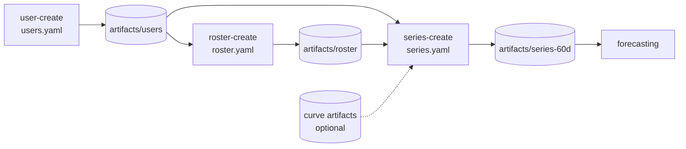
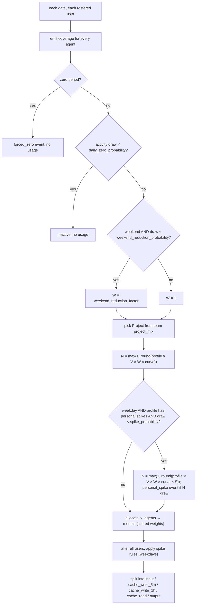

# Synthetic data generation — design

| | |
|---|---|
| **Status** | Implemented (branch `forecast`). Review: [implementation review](../notes/synthetic-implementation-review.md). |
| **Spec** | [functional specification](synthetic-data-generation.md), [module architecture](../arch/module-architecture.md). |
| **Related** | [curve-guided series](./series-curve-binding-design.md), [curve creation](./curve-creation-design.md), [forecasting model](./forecasting-model-design.md). |
| **Operator guide** | [module README](../../src/forecast/synthetic/README.md), [README-forecast](../operations/README-forecast.md). |
| **Updated** | 2026-09-24 — weekend reduction default-off; one-team-per-project convention; `--force`; restyle. |

Three independent, deterministic operations produce fake usage in the same daily contract the forecaster reads:



Out of scope: forecasting, DB extraction, pricing, UI, subscription billing, sessions, multiple Projects per user-day.

## 1. Invariants

| Invariant | Rule |
|---|---|
| Reuse | Users and rosters are generated once and reused; series never regenerates them. |
| Team membership | A user is in ≤ 1 Team; unassigned users don't participate. |
| Profile | Each user gets one light/mid/heavy profile per series, fixed for the whole series. |
| Project per day | One Project per active user-day (all agent/model rows share it); may change between days. |
| One team per project | Forecasting requires Org → Team → Project as a tree ([forecasting §1](./forecasting-model-design.md#1-structural-model-authoritative)). **Convention:** every maintained config/example lists each Project in exactly one Team's `project_mix`. The generator does **not** enforce it (multi-team Projects remain a capability, e.g. for testing). |
| Allocation | Daily processed input is drawn **once per user**, then split across agents → models (adding a model never multiplies the baseline). |
| Tokens | `input` (uncached input only), `cache_write_5m`, `cache_write_1h`, `cache_read`, `output`. Processed input = `input + cache_write_5m + cache_write_1h + cache_read`. See the [cache-write contract design](./cache-write-contract-design.md). |
| Coverage | Complete for every rostered user × configured agent × date, including inactive days; inactivity emits no usage row. |
| Billing | `api` only; `TODO(subscription)` at the `billing_mode` validation boundary. |
| Spikes | Dated rules, additive, weekday-only, never turn zero positive. Optional per-profile personal spikes ([§3.4.1](#341-personal-spikes-per-profile)). |
| Weekends | **No weekend drop by default** (`weekend_reduction_probability: 0`). Opt-in capability. |

## 2. Layout

```text
econ-forecast/
├── config/synthetic/{users,roster,series}.yaml     # maintained configs (one team/project, no weekend drop)
├── examples/synthetic/                             # baseline, weekend-drop, curve-guided, curve-spiked
├── src/forecast/
│   ├── contracts.py          # shared DailyUsageRecord / CoverageRecord (reused by real data)
│   ├── artifact_io.py        # JSONL + manifest persistence; no synthetic imports
│   └── synthetic/
│       ├── cli_synt_gen.py   # --op user-create|roster-create|series-create
│       ├── config.py         # strict YAML models
│       ├── models.py         # synthetic records
│       ├── randomness.py     # derive_seed / rng_for
│       ├── allocation.py     # allocate_integer / vary_weights
│       ├── users.py  roster.py  profiles.py  events.py  series.py
│       ├── runner.py         # run_users / run_roster / run_series (+ force)
│       └── reporting.py      # report.md
├── utils/synt_gen.sh         # → python -m forecast.synthetic.cli_synt_gen
└── tests/synthetic/
```

Tech: Python 3.11+, `Faker==40.38.0` (pinned: seeded output is version-dependent), Pydantic 2, PyYAML
(SafeLoader, duplicate keys rejected), stdlib `random`/`hashlib`/`fractions`/`zoneinfo`, `structlog` via
`common.msging.log`, argparse. No network, NumPy, or pandas in generation.

## 3. Configuration

Strict: unknown fields rejected, finite numbers only, no booleans for numbers, shares must sum to 1
(tolerance `1e-9`), zero weights preserved. Relative paths resolve against the YAML file; `--output` against the shell cwd.

### 3.1 Users and roster (`schema_version: 1`)

```yaml
# users.yaml
schema_version: 1
users: { count: 100, org_domain: talium.ai, locale: en_US, seed: 42 }   # org_id = normalized domain
```

```yaml
# roster.yaml
schema_version: 1
roster:
  users_file: ../../artifacts/users/users.jsonl
  seed: 43
  teams:                              # names trimmed, unique case-insensitively; IDs generated
    - { team_name: team1, count: 10 }
    - { team_name: team2, count: 15 }
    - { team_name: team3, count: 25 } # total ≤ pool; remainder unassigned
```

### 3.2 Series (`schema_version: 3`) — maintained config

```yaml
schema_version: 3
series:
  users_file: ../../artifacts/users/users.jsonl
  roster_file: ../../artifacts/roster/teams.jsonl
  start_date: "2026-07-01"
  days: 60
  timezone: Asia/Kolkata
  profile_seed: 100          # profile assignment only
  usage_seed: 123            # activity, project, volume, spikes, mix, cache

defaults:
  daily_variation_pct: 30        # volume ~ Uniform(0.70, 1.30) × baseline; [0,100)
  output_ratio: 0.03             # output = 3% of processed input; [0,1)
  cache_hit_ratio: 0.95          # [0,1]; shipped default 0.95 (real Claude Code data is about 0.98)
  cache_hit_variation_pp: 5      # ±5 percentage points; [0,100]
  cache_write_ratio: 0.997       # share of non-cache-read input that is a cache write; [0,1]
  cache_write_1h_share: 0.97     # share of cache writes at the 1-hour lifetime; [0,1]
  mix_variation_pct: 10          # relative jitter on agent/model weights; [0,100)
  daily_zero_probability: 0.10   # ordinary inactivity, every day
  # weekend_reduction_probability: 0.0   # optional; default 0 = no weekend drop
  # weekend_reduction_factor: 0.25       # optional; (0,1]; used only when probability > 0

profiles:                        # processed input per ACTIVE user-day
  light_profile: { daily_input_tokens: 250000 }
  mid_profile:   { daily_input_tokens: 1000000 }
  heavy_profile: { daily_input_tokens: 5000000 }

team_profiles:                   # one team per project
  team1:
    profile_mix: { light_profile: 0.8, heavy_profile: 0.2 }
    project_mix: { payment_service_improvement: 0.7, auth_service_rewrite: 0.3 }
  team2:
    profile_mix: { light_profile: 0.4, mid_profile: 0.4, heavy_profile: 0.2 }
    project_mix: { data_pipeline_upgrade: 0.6, search_service_improvement: 0.4 }
  team3:
    profile_mix: { light_profile: 0.2, mid_profile: 0.4, heavy_profile: 0.4 }
    project_mix: { developer_tooling: 1.0 }

projects:
  - { name: payment_service_improvement }
  - { name: auth_service_rewrite }
  - { name: data_pipeline_upgrade }
  - { name: search_service_improvement }
  - { name: developer_tooling }

agents:
  claude: { billing_mode: api, usage_share: 0.6, models: { claude-sonnet-5: 0.75, claude-opus-5: 0.25 } }
  codex:  { billing_mode: api, usage_share: 0.4, models: { gpt-5.6-terra: 0.75, gpt-5.6-sol: 0.25 } }

events:
  spike_rules:
    - { id: default-spike, probability: 0.02, multiplier_min: 3.0, multiplier_max: 5.0,
        targets: { teams: [], agents: [], models: [] } }
  zero_periods: []

# curve: { … }                   # optional — see series-curve-binding-design
```

### 3.3 Team activity override

```yaml
team_profiles:
  team2:
    activity:                              # REPLACES defaults' activity values for this Team
      daily_zero_probability: 0.10         # required
      weekend_reduction_probability: 0.8   # optional (default 0) — opt-in for this Team
      weekend_reduction_factor: 0.25       # optional (default 0.25)
```

No field-level inheritance: an `activity` block that omits the weekend fields has **no** weekend drop, even if `defaults` enables one.

### 3.4 Events

```yaml
events:
  spike_rules:
    - id: payment-release                 # unique across spike rules + zero periods
      probability: 1.0                    # one draw per eligible weekday per rule
      multiplier_min: 4.0                 # 1 ≤ min ≤ max
      multiplier_max: 4.0
      date_range: { start_date: "2026-07-20", end_date: "2026-07-22" }   # optional; inclusive
      targets:
        teams: [team1]                    # [] = all Teams
        agents: []                        # all models of these agents
        models: []                        # exact {agent, model}; unioned with agents
  zero_periods:
    - { id: organization_break, target_type: org, target: talium.ai,     # user | team | org
        start_date: "2026-07-27", end_date: "2026-07-28" }
```

| Rule | Behavior |
|---|---|
| Targeting | Team ∩ (agents ∪ models). All empty → org-wide. Unknown/duplicate/redundant targets rejected. |
| Increment | `B` = matched positive baseline; `E = round_half_up(B × M) − B`; split in baseline proportion. |
| Overlap | Rules add independent increments from the same baseline; never compound. |
| Exclusions | Weekends never spike; zero rows stay zero; `M = 1` emits no event. |
| Zero periods | Suppress baseline rows; coverage stays complete (consumption event, not an outage). |

#### 3.4.1 Personal spikes (per profile)

`spike_rules` hit every targeted user on a date, so they cannot say "this user spikes often". A profile may therefore opt in to **personal spikes**:

```yaml
profiles:
  power_profile:
    daily_input_tokens: 45000000
    spike_probability: 0.15        # 0..1; chance a given active weekday of a user on this profile spikes
    spike_multiplier_min: 1.5      # finite, >= 1
    spike_multiplier_max: 2.5      # finite, >= spike_multiplier_min
```

| Rule | Behavior |
|---|---|
| Validation | All three fields or none (one or two is an error). `spike_probability` is a `Ratio`; `1 ≤ min ≤ max`, all finite numbers (no booleans or strings). `spike_probability: 0` is allowed and a no-op, but the multipliers are still required and validated. An explicit `null` equals omitting the field. Unknown profile fields are still rejected. |
| Draw | Only on an **active weekday**: not a weekend day, not a forced-zero or daily-zero day, at the point where the user's day total is computed. One independent draw per user-day: `rng("profile_spike").random() < spike_probability`; when it fires, `rng("profile_spike_multiplier").uniform(min, max)`. The domains are new (not `spike_selection`/`spike_multiplier`), keyed by `(usage_seed, domain, user, date)`. |
| Effect | The multiplier scales the user's day total (`daily_input_tokens × volume × weekend factor × curve level`) **before** the agent/model split, so all of the user's rows scale together. Rounding is the usual half-up on the exact product; an event is recorded only when the rounded count actually grows. |
| Composition | Multiplicative with volume jitter, weekend reduction (weekends never spike, so the two never combine), and curves. `spike_rules` then act on the already-scaled baseline, so a rule and a personal spike on the same day compound (personal 2× then a 2× org rule is 4×); personal spikes do not themselves compound with each other (one draw per user-day). |
| Events | One `personal_spike` record per spiked user-day in `generation_events.jsonl`: `date`, `user_id`, `team_id`, `profile`, `multiplier`, `baseline_processed_input` (the user's day without the spike), `incremental_processed_input`. Sorted after `forced_zero` and before `spike` records. `spike_events`/`spike_days` still count rule spikes only. |
| Report | When any profile sets `spike_probability` (including 0), the manifest summary gains `personal_spike_events` and `personal_spike_incremental_processed_input`, and the series report gains a "Personal spikes by profile" table (one row per opted-in profile). Otherwise neither changes. |
| Absent = identical | A config with none of the three fields produces byte-identical `usage.jsonl`, `coverage.jsonl`, `user_profiles.jsonl`, `generation_events.jsonl`, `config.yaml` (and so the manifest `config_sha256`), report and manifest summary: the fields are omitted from the saved `config.yaml` when unset, as `github_login` is for users. With the feature configured but `spike_probability: 0` the data artifacts are still identical; only `config.yaml`, the report and the summary gain the feature. Pinned by golden hashes in `tests/synthetic/test_personal_spikes.py`. |
| Knob independence | A user's draws depend only on `(usage_seed, domain, user, date)`, so changing other profiles, other teams' `profile_mix`, or other config does not move them. Raising `spike_probability` only adds spike days; changing the multiplier bounds only changes the values. Because the date is part of the key, retiming a series (a different start or `--end-date`) changes which calendar dates spike, exactly as for every other random draw; extending a series with the same start keeps its earlier days byte for byte. |

## 4. Daily generation



- `V ~ Uniform(1 − d/100, 1 + d/100)`; `curve` = bound curve level for the day (1.0 if none); `S ~ Uniform(spike_multiplier_min, spike_multiplier_max)` for a profile with [personal spikes](#341-personal-spikes-per-profile) (the step applies only on weekdays, so `W` and `S` never combine).
- Weekend reduction never forces zero (factor > 0). With the default probability 0, weekends are ordinary days.
- Counts above signed 64-bit range are errors, never wrapped.

### 4.1 Mix and tokens

```text
Mix:     w' = w × (1 + Uniform(−j/100, +j/100)) for w > 0; zeros stay 0; normalize
         agents first (agent_mix stream), then models within agent (model_mix stream)
Tokens:  h          ~ Uniform(max(0, c − pp/100), min(1, c + pp/100))    # truncated, not clipped
         cache_read = round(T × h)
         uncached   = T − cache_read
         writes     = half_up(uncached × cache_write_ratio)
         write_1h   = half_up(writes × cache_write_1h_share)
         write_5m   = writes − write_1h
         input      = uncached − writes                                   # input + both writes + cache_read = T exactly
         output     = round(T × output_ratio)                             # per model record
```

`allocate_integer(total, weights)`: exact `Fraction` quotas, floor, largest remainder, ties by lexical key; sums exactly to `total`. Used for profile counts and token splits.

### 4.2 Numerical oracle

One active user, weekday, baseline 1,000,000, all variation off, 80% cache (an illustrative value, not the shipped default), 3% output, write ratio 0.997, 1h share 0.97, example shares:

| Agent / model | Processed | `input` | `cache_write_5m` | `cache_write_1h` | `cache_read` | `output` |
|---|---:|---:|---:|---:|---:|---:|
| claude / claude-sonnet-5 | 450,000 | 270 | 2,692 | 87,038 | 360,000 | 13,500 |
| claude / claude-opus-5 | 150,000 | 90 | 897 | 29,013 | 120,000 | 4,500 |
| codex / gpt-5.6-terra | 300,000 | 180 | 1,795 | 58,025 | 240,000 | 9,000 |
| codex / gpt-5.6-sol | 100,000 | 60 | 598 | 19,342 | 80,000 | 3,000 |
| **Total** | **1,000,000** | **600** | **5,982** | **193,418** | **800,000** | **30,000** |

An org-wide 4× rule multiplies every count by 4. A forced-zero day emits zero usage and two coverage rows.

### 4.3 Determinism

`rng_for(seed, domain, *keys)` = `random.Random(int.from_bytes(sha256(json([seed, domain, *keys]))[:16]))`. No global RNG, no `hash()`.

| Domain | Seed | Keys |
|---|---|---|
| `identity` | users.seed | org, index |
| `roster` | roster.seed | org |
| `profile` | profile_seed | team |
| `activity`, `weekend_reduction`, `project`, `volume` | usage_seed | user, date |
| `spike_selection`, `spike_multiplier` | usage_seed | rule, date |
| `profile_spike`, `profile_spike_multiplier` | usage_seed | user, date |
| `agent_mix` / `model_mix` / `cache` | usage_seed | user, date, agent[, model] |

- Mapping order in YAML never changes output (lexical processing).
- Extending 30 → 60 days with the same start preserves the first 30 days byte-for-byte.
- Changing one control (e.g. cache variation) does not perturb unrelated streams.

## 5. Records and artifacts

| Record (`contracts.py`) | Fields |
|---|---|
| `DailyUsageRecord` | `date`, `org_id`, `team_id`, `user_id`, `project_id` (nullable), `agent_type`, `model`, `billing_mode` (`api`\|`subscription`\|`unknown`), `tokens{input, cache_write_5m, cache_write_1h, cache_read, output}` (nonneg int or null; null ≠ 0; `input` is uncached; series manifest `schema_version` 2) |
| `CoverageRecord` | `date`, `org_id`, `user_id`, `agent_type`, `status` (`complete`\|`partial`\|`missing`\|`unknown`; synthetic writes `complete`) |

| Record (`synthetic/models.py`) | Fields |
|---|---|
| `UserRecord` | `user_id` (uuid5), `org_id`, `name`, `email` |
| `TeamRecord` | `team_id` (uuid5 of name), `org_id`, `team_name`, `user_ids` |
| `UserProfileRecord` | `user_id`, `team_id`, `profile` |
| `ForcedZeroEvent` / `PersonalSpikeEvent` / `SpikeEvent` | per user-day / per spiked user-day (with profile, multiplier, baseline + increment) / per selected rule-date (with baseline + increment) |

```text
artifacts/
├── users/        users.jsonl  config.yaml  report.md  manifest.json
├── roster/       teams.jsonl  inputs/users/{users.jsonl,manifest.json}  config.yaml  report.md  manifest.json
└── series-60d/   usage.jsonl  coverage.jsonl  user_profiles.jsonl  generation_events.jsonl
                  inputs/{users,roster}/…  config.yaml  report.md  manifest.json
```

- `config.yaml` = resolved config with input paths rewritten to local snapshots → replayable after moving the directory.
- `manifest.json` (written last, atomically): versions, config SHA-256, per-file SHA-256 + row counts, report hash, input provenance, summary counts. Readers reject a directory without a complete manifest.
- Canonical JSONL (sorted keys, compact, UTF-8, trailing newline); sorted rows; empty `usage.jsonl` is valid.

## 6. CLI

```bash
utils/synt_gen.sh --op user-create   --config config/synthetic/users.yaml  --output artifacts/users
utils/synt_gen.sh --op roster-create --config config/synthetic/roster.yaml --output artifacts/roster
utils/synt_gen.sh --op series-create --config config/synthetic/series.yaml --output artifacts/series-60d [--force]
utils/synt_gen.sh --op series-create --config config/synthetic/series.yaml --validate-only
```

| Flag | Behavior |
|---|---|
| `--op` | `user-create` \| `roster-create` \| `series-create` (unknown → exit 2). |
| `--config` | Required YAML. |
| `--output` | Required unless `--validate-only`. Existing path refused unless `--force`. |
| `--force` | Delete and recreate the resolved `--output` only. Refuses symlinks, non-directories, protected system paths, and any path that is or contains a required input. |
| `--validate-only` | Validate config + inputs; write nothing. |

| Exit | Meaning |
|---|---|
| 0 | Success / valid / help |
| 2 | Argument, config, unsupported mode, or input-data error |
| 1 | Artifact I/O or unexpected failure |

stdout: exactly one JSON summary (`status`, `operation`, `run_id`, `output_dir`, `files`, `report_path`, `counts`). stderr: structured JSON logs.
On a handled failure only the directory this invocation created is removed.

## 7. Logging

JSON via `common.msging.log.configure_logging` at CLI start only; bound `module`, `operation`, `run_id`. No names/emails or raw records in logs.

| Event | Fields |
|---|---|
| `synthetic.config_validated` | operation, schema version, path |
| `synthetic.users_created` / `roster_created` / `profiles_assigned` | counts, seeds |
| `synthetic.day_generated` | date, active/inactive/zero users, row counts (one per date) |
| `synthetic.artifact_written` | path, rows, SHA-256 |
| `synthetic.force_recreate` | output dir |
| `synthetic.run_completed` / `run_failed` | counts + duration / error category, stage, cleanup outcome |

## 8. Reports

Each stage writes `report.md` before the manifest, from the same counters as the manifest summary.
Series reports: date range, profile counts per Team, active/inactive/zero user-days, coverage check,
forced-zero and spike counts, token breakdowns by Team, Project, agent/model (shares `N/A` on zero totals).
Team and Project views overlap — never add them.

## 9. Tests

`venv/bin/python -m pytest econ-forecast/tests/synthetic -q` (also run by `utils/test_forecast.sh`). No DB, network, or credentials.

| Area | Key assertions |
|---|---|
| Config | Every shipped YAML parses; strictness (unknown/duplicate keys, bad types, NaN, ranges, shares, targets); weekend fields optional, default 0. |
| Determinism | Stream separation, mapping-order independence, 30-day prefix of a 60-day run matches. |
| Allocation / tokens | Exact conservation; §4.2 oracle; cache extremes; zero weights stay zero. |
| Activity / calendar | Probabilities 0/1; weekend reduction off by default and on when opted in; leap day/month boundaries. |
| Events | Targeting, additive overlap, weekday-only, zero stays zero. |
| Artifacts / CLI | Manifests, snapshots, replay after move, refusal without `--force`, `--force` safety guards, exit codes, stdout/stderr separation. |

## 10. Design choices

| Choice | Pros | Cons |
|---|---|---|
| Weekend reduction default **off** | Forecaster must *learn* weekly season from data; default data has no imposed pattern. | Weekly-pattern demos require explicit opt-in (`examples/synthetic/weekend-drop.yaml`). |
| One-team-per-project by convention, not enforced | Matches forecasting tree; keeps multi-team capability for tests. | A misconfigured config silently yields multi-team Projects. |
| Draw user total once, then split | Adding models never inflates volume; exact conservation. | Per-model volatility is only via mix jitter. |
