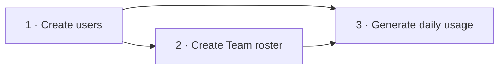
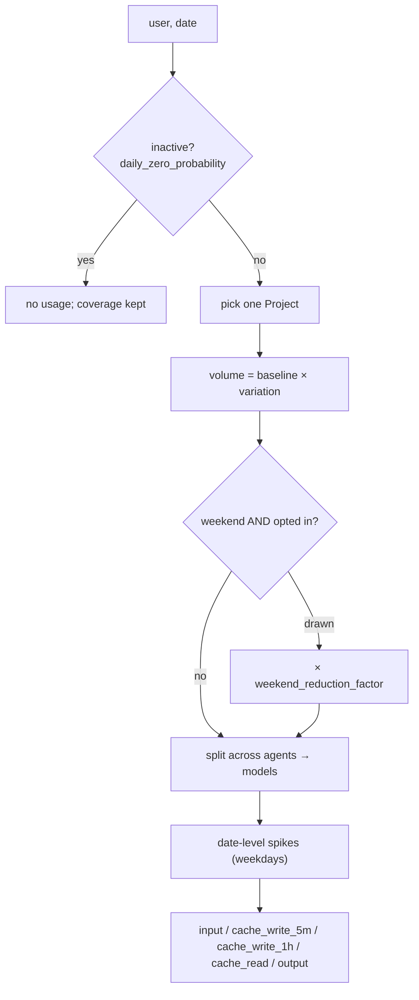

# Synthetic data generation — functional specification

| | |
|---|---|
| **Status** | Approved; implemented. |
| **Design** | [detailed design](synthetic-data-generation-design.md) — config schema, algorithms, artifacts, CLI, tests. |
| **Related** | [forecasting model](forecasting-model-design.md), [module architecture](../arch/module-architecture.md), [curve-guided series](series-curve-binding-design.md). |
| **Updated** | 2026-09-24 — weekend drop off by default; one team per project; name-based operator config; restyle. |

## 1. Purpose

Generate reproducible **daily** AI token consumption to build and test forecasting before (and alongside) real data.

- Daily records directly — no fabricated sessions.
- Same daily usage contract as data prepared from real PostgreSQL usage.
- Kept after real data arrives, for controlled tests.

## 2. Operations



| Operation | Inputs | Output |
|---|---|---|
| Create users | count, org domain, locale, seed | Users with stable IDs, names, unique emails |
| Create Team roster | saved users, Team names + sizes, seed | Teams with fixed memberships |
| Generate daily usage | saved users + roster, dates, profiles, Team mixes, Projects, agents/models, events, seeds | Usage with Project attribution, complete coverage, profile assignments, metadata |

- Each operation runs separately; later ones **read saved outputs**, never rerun earlier ones.
- A new series never regenerates identities or memberships. A new roster is a separate, explicit operation.

## 3. Users

```yaml
users: { count: 100, org_domain: talium.ai, locale: en_US, seed: 42 }
```

| Field | Meaning |
|---|---|
| `user_id` | Stable synthetic ID used by rosters and usage. |
| `name` | Faker display name (need not be unique). |
| `email` | Unique, under `org_domain`; collisions resolved. |

- Exactly `count` users. No Team or profile assigned here.
- Faker version is recorded — seeded output is version-dependent.
- Local identities only; no accounts or messages.

## 4. Team roster

```yaml
roster:
  users_file: users.jsonl
  seed: 43
  teams:
    - { team_name: team1, count: 10 }
    - { team_name: team2, count: 15 }
    - { team_name: team3, count: 25 }
```

- Users selected **without replacement**; a user is in ≤ 1 Team.
- Operators name Teams (`team_name`); a stable `team_id` is generated internally.
- 100 users, 50 rostered → 50 unassigned (not silently added). Usage covers rostered users only.
- Reject: membership > pool, duplicate membership, unknown users, duplicate names, nonpositive sizes.
- Membership is fixed for the series and every series reusing the roster.

## 5. Usage profiles

```yaml
profiles:                                  # per ACTIVE user-day, processed input incl. cache reads
  light_profile: { daily_input_tokens: 250000 }
  mid_profile:   { daily_input_tokens: 1000000 }
  heavy_profile: { daily_input_tokens: 5000000 }

team_profiles:                             # part of the SERIES config, not the roster
  team1: { profile_mix: { light_profile: 0.8, heavy_profile: 0.2 } }
  team2: { profile_mix: { light_profile: 0.4, mid_profile: 0.4, heavy_profile: 0.2 } }
  team3: { profile_mix: { light_profile: 0.2, mid_profile: 0.4, heavy_profile: 0.4 } }
```

- Baselines are synthetic assumptions, not measured averages.
- `daily_input_tokens` is the user's total across all agents/models; output is extra.
- Profiles are assigned **once per series** with exact counts (largest remainder, ties by name): 15 users at 80/20 → 12 light, 3 heavy.
- Assignments survive duration and `usage_seed` changes. Inactive days don't change a user's profile.
- Every participating Team needs a mix; referenced profiles exist; shares ≥ 0, sum to 1; zero share → no users.

## 6. Projects

```yaml
projects:
  - name: payment_service_improvement
  - name: auth_service_rewrite
  - name: data_pipeline_upgrade

team_profiles:
  team1: { project_mix: { payment_service_improvement: 0.7, auth_service_rewrite: 0.3 } }
  team2: { project_mix: { data_pipeline_upgrade: 1.0 } }
```

| Rule | Meaning |
|---|---|
| Catalog | Fixed, unique names; stable `project_id` generated internally. |
| One team per project | Forecasting treats Org → Team → Project as a tree ([forecasting §1](forecasting-model-design.md#1-structural-model-authoritative)), so maintained configs list each Project under **one** Team. The generator still allows sharing (not enforced). |
| Daily choice | Each active user-day picks **one** Project from its Team's mix; applies to all that day's records. May change next day. |
| Share semantics | 30% = 30% chance per active user-day — not a quota and not a token share. |
| Validation | Names exist; shares ≥ 0, sum to 1; zero share never picked. |

| Date | User | Project | Agent | Model |
|---|---|---|---|---|
| 2026-07-01 | john | payment_service_improvement | claude | claude-sonnet-5 |
| 2026-07-01 | john | payment_service_improvement | codex | gpt-5.6-terra |
| 2026-07-02 | john | auth_service_rewrite | claude | claude-sonnet-5 |

Multiple Projects per user-day is out of scope for the generator; the shared record shape must not prevent it.

## 7. Series period and daily behavior

```yaml
series:
  users_file: users.jsonl
  roster_file: teams.jsonl
  start_date: "2026-07-01"
  days: 60                        # inclusive → ends 2026-08-29
  timezone: Asia/Kolkata          # calendar + weekend (Sat/Sun) classification
  profile_seed: 100
  usage_seed: 123

defaults:
  daily_variation_pct: 30         # 70–130% of baseline
  output_ratio: 0.03
  cache_hit_ratio: 0.95
  cache_hit_variation_pp: 5
  mix_variation_pct: 10
  daily_zero_probability: 0.10    # ordinary inactivity, every day
  # weekend_reduction_probability: 0.0   # default 0 → NO weekend drop
  # weekend_reduction_factor: 0.25       # used only when opted in
```



- Inactivity is drawn per user per day — no exact daily fraction.
- **Weekends are ordinary days by default.** Opting in (`weekend_reduction_probability > 0`) reduces volume for drawn active users; it never forces zero. A Team `activity` block can override these values.
- Inactive users emit no usage. Counts are nonnegative integers.

### Spikes

```yaml
events:
  spike_rules:
    - id: release
      probability: 1.0
      multiplier_min: 3.0
      multiplier_max: 5.0
      date_range: { start_date: "2026-07-20", end_date: "2026-07-22" }   # omit = whole series
      targets: { teams: [team1], agents: [], models: [] }               # all empty = org-wide
  zero_periods: []
```

- One draw per rule per eligible **weekday**; weekends never spike.
- Targets: Teams ∩ (agents ∪ exact models).
- Increment is allocated in proportion to the targeted positive baseline; overlapping rules **add** from the same baseline (no compounding).
- Zero rows stay zero. Cache/output ratios are unchanged.

### Coverage

Always complete for every rostered user × date × configured agent, including inactive days. Complete coverage + no usage = **zero**; missing coverage ≠ zero. Collection outages are not simulated.

## 8. Agents, models, tokens

```yaml
agents:
  claude: { billing_mode: api, usage_share: 0.6, models: { claude-sonnet-5: 0.75, claude-opus-5: 0.25 } }
  codex:  { billing_mode: api, usage_share: 0.4, models: { gpt-5.6-terra: 0.75, gpt-5.6-sol: 0.25 } }
```

| Rule | Meaning |
|---|---|
| Shares | Agents sum to 1; models sum to 1 within an agent. Models are record values, not columns. |
| Conservation | The user's daily total is split, never multiplied, by adding agents/models. |
| Mix variation | Relative jitter on positive weights, then renormalized; zeros stay zero. |
| Billing | `api` only (default). Anything else is rejected, never relabelled. **TODO(subscription):** subscription generation + equivalent-cost interpretation, per-agent boundary. |

```text
processed input = input + cache_write_5m + cache_write_1h + cache_read   # input = uncached input only
cache_read      = processed × cache-hit ratio (± variation pp)
output          = processed × output_ratio    # additional
```

- No separate cache-write field or ratio; the combined `input` loses the cache-write billing split — expense conversion must state its assumption.
- Context-window limits are not daily limits.
- Tokens only; pricing belongs to the budget module.

1,000,000 processed input, 80% cache hits (illustrative; the shipped default is 95%), variation off:

| Agent | Model | Processed | `input` | `cache_read` | `output` |
|---|---|---:|---:|---:|---:|
| claude | claude-sonnet-5 | 450,000 | 90,000 | 360,000 | 13,500 |
| claude | claude-opus-5 | 150,000 | 30,000 | 120,000 | 4,500 |
| codex | gpt-5.6-terra | 300,000 | 60,000 | 240,000 | 9,000 |
| codex | gpt-5.6-sol | 100,000 | 20,000 | 80,000 | 3,000 |
| **Total** | | **1,000,000** | **200,000** | **800,000** | **30,000** |

## 9. Outputs and reproducibility

```text
<series-dir>/
├── usage.jsonl             # one record per date/user/team/project/agent/model/billing
├── coverage.jsonl          # one record per date/user/agent
├── user_profiles.jsonl     # resolved profile per user
├── generation_events.jsonl # forced-zero + spike annotations
├── inputs/                 # users + roster snapshots
├── config.yaml             # resolved, replayable
├── report.md               # human summary per stage
└── manifest.json           # versions, seeds, hashes, counts
```

- JSON Lines + JSON; no database. Each stage writes its own `report.md`.
- One series per directory, with snapshots → reproducible without mutable inputs.
- Same inputs + config + seeds + versions → same logical records. Users, roster, profiles, and daily usage use independent randomness.
- Generator-only details (profiles, event annotations) stay in supporting files, not the forecasting contract.
- CLI: `synt_gen.sh --op user-create|roster-create|series-create`; existing output refused unless `--force`.

Usage record (one line on disk; IDs shortened):

```json
{"date": "2026-07-01", "org_id": "talium.ai", "team_id": "team-001", "user_id": "user-001",
 "project_id": "proj-001", "agent_type": "claude", "model": "claude-sonnet-5", "billing_mode": "api",
 "tokens": {"input": 90000, "cache_read": 360000, "output": 13500}}
```

Coverage record — user inactive on July 2, both agents still covered:

```json
{"date": "2026-07-02", "org_id": "talium.ai", "user_id": "user-001", "agent_type": "claude", "status": "complete"}
```

Names/emails join via `users.jsonl`; membership via the roster; profiles via `user_profiles.jsonl`.

## 10. Acceptance scenarios

| Scenario | Required result |
|---|---|
| 100 users under `talium.ai` | Exactly 100 stable IDs, unique emails in that domain. |
| Teams of 10/15/25 from 100 users | 50 distinct assigned, none in two Teams, 50 unassigned. |
| Membership > pool | Validation error. |
| Reuse a roster | Identities and memberships unchanged. |
| 15-user Team at 80/20 | 12 light + 3 heavy, fixed for all dates. |
| Fractional profile counts | Deterministic; Team size preserved. |
| Change duration or `usage_seed` only | Profile assignments unchanged. |
| Team with one Project at share 1 | Every active member-day uses it. |
| Team with several Projects | One Project per active user-day; may change between days. |
| Several agents/models on a day | All records share the Project. |
| Maintained configs | Each Project appears under exactly one Team. |
| Unknown Project or bad shares | Validation error. |
| 30 or 60 days | Exact calendar range, even with no-usage days. |
| Inactivity probability 1 | No usage; coverage complete. |
| Weekend fields omitted | No weekend drop (weekends like weekdays). |
| Weekend reduction opted in | Drawn active weekend users reduced by the factor; inactivity handled separately. |
| 1,000,000 input at 80% cache | `input` 200,000, `cache_read` 800,000; output extra. |
| Spike rule without range | Eligible all series, weekdays only. |
| Targeted / overlapping spikes | Proportional to targeted baseline; overlaps add, no compounding. |
| Spike on inactive/zero row | Stays zero; coverage complete. |
| `billing_mode` omitted or `api` | All records `api`. |
| Subscription requested | Unsupported-mode error. |
| Mix variation off / on | Configured shares (± rounding) / valid shares; total conserved either way. |
| Identical rerun | Identical profiles, Project picks, usage records. |

## 11. References

- [Consumption and Budget Forecasting](../../../../../Docs/ProductSpec/Forecasting.md).
- [Faker](https://faker.readthedocs.io/en/master/) — seeded identities.
- [Claude models](https://platform.claude.com/docs/en/models/overview), [OpenAI models](https://developers.openai.com/api/docs/models/all) — example model IDs (checked 2026-09-12).
- [Claude prompt caching](https://platform.claude.com/docs/en/build-with-claude/prompt-caching) — input, cache read, cache creation are distinct.
