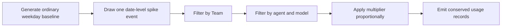

# Synthetic Date-Level Spike Plan (V1)

**Status:** Agreed behavior; implementation not started
**Updated:** 2026-09-19

## 1. Goal

Replace independently sampled per-user random spikes with shared weekday spike events that remain visible after Organization, Team, agent, and model aggregation.

The ordinary synthetic baseline remains responsible for user activity, profile volume, Team membership, agent/model allocation, and token-category allocation. The spike changes only the selected portion of that completed baseline.

## 2. Agreed behavior

- Select a random spike once per eligible calendar date. Saturday and Sunday are never eligible.
- Allow a spike to target one or more Teams. With no Team target, it applies across the Organization.
- Do not support Project targeting.
- Allow a spike to target an entire coding agent or specific models. Identify a model by its `(agent, model)` pair.
- When Team and agent/model targets are both present, affect only their intersection.
- Apply the spike multiplier to the selected baseline slice. It does not describe a multiplier for the whole Organization unless the spike has no narrower target.
- Allocate the spike proportionally to the selected slice's existing baseline usage. This preserves its realized user, agent, and model proportions.
- Do not add a separate spike distribution or spike-specific mix-variation control.
- Do not activate inactive users or models with zero baseline usage on the selected date.

For a selected slice with baseline processed input `B` and multiplier `M`, the final selected load is `B × M`, subject to the generator's integer-allocation rules. Usage outside the selected slice is unchanged.

## 3. Implementation plan

1. Extend strict synthetic configuration so the random-spike definition can express Team, agent, and `(agent, model)` targets. Validate every target against the loaded roster and configured agent/model catalog.
2. Move the random-spike probability and multiplier draws out of the per-user loop. Derive them from the usage seed and date so the same date has one deterministic event and extending a series preserves its existing prefix.
3. Generate the ordinary day's usage allocation first, select the targeted baseline rows, and allocate the incremental processed input proportionally with exact integer conservation.
4. Preserve the normal cache/input and output accounting when producing the final records. Leave non-targeted rows byte-for-byte equivalent to a run without that spike event.
5. Record and report random spikes as date-level events, including the realized date, multiplier, target, selected baseline, and incremental load. Do not describe affected-user rows as separate random spike events.
6. Update the synthetic design, configuration example, module guide, and operator-facing report descriptions to use the new date-level semantics.

## 4. Verification

- Probability `0` produces no random spike dates; probability `1` selects every eligible weekday and no weekend.
- A fixed seed reproduces the same spike dates, multipliers, and output records. Extending the duration preserves the original prefix.
- Organization, Team-only, agent-only, model-only, and Team-plus-agent/model targets affect exactly the intended rows.
- A model name under the wrong agent and every unknown Team, agent, or model target is rejected.
- Project assignment does not participate in spike targeting.
- Targeted final load equals the configured multiple of targeted baseline load within documented integer rounding; non-targeted usage is unchanged.
- Inactive users and zero-baseline agent/models remain zero.
- Adding the spike conserves token accounting and does not introduce duplicate usage keys.
- Saved configuration replay produces byte-identical usage, coverage, profile, and event artifacts.
- Focused synthetic tests and the documented synthetic CLI workflow pass. A full suite and independent review require user approval under the current handoff constraints.

## 5. Decisions still required before implementation

These details were not decided in the discussion and must not be inferred during coding:

- Exact YAML field names and representation.
- Whether V1 supports one random-spike rule or multiple independently sampled rules.
- Precedence when a random spike and an explicit dated spike overlap.
- Exact backward-compatibility and schema-version treatment for saved configurations and event artifacts.

## 6. Deferred V2 boundary

An authoritative Organization usage curve followed by hierarchical allocation is separate V2 generator work. V1 retains the existing bottom-up baseline generator and changes only random-spike correlation and targeting.
