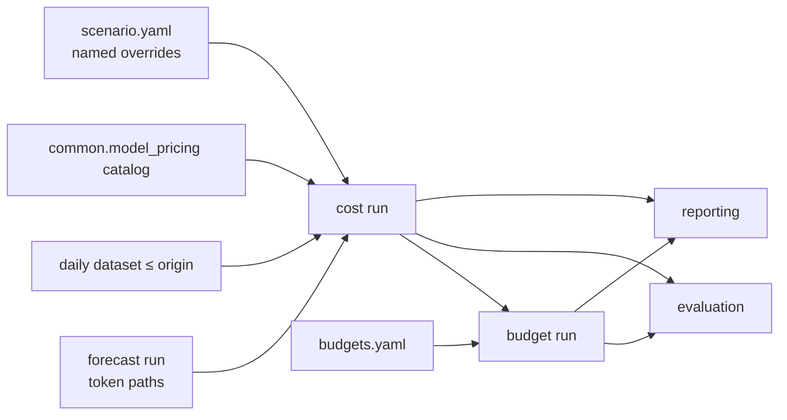

# Cost / scenario / budget — brainstorm scratchpad

Working notes for the cost + budget design pass. Feeds `docs/design/cost-module-design.md` (new),
`docs/design/budget-module-design.md` (reduced to budget only), and `docs/arch/module-architecture.md`.

**Outcome (2026-09-27):** cost + scenario design written to `docs/design/cost-module-design.md`.
Proposed items Q1, Q5, Q6, Q8, Q12, Q19, Q22–Q25 were adopted there. Q2, Q14 are open; Q7, Q11, Q20 deferred;
Q4 belongs to the budget pass. Budget design is a separate, later pass.

Started 2026-09-27. Design criteria: simple · versioned interface + versioned output · external-module
choices itemized and decided together.

## Decisions

| # | Decision | Notes |
|---|---|---|
| D1 | Two modules: `cost` (includes scenarios) and `budget`. No separate `scenarios` module. | A forecast run and a scenario follow the same cost path and produce identical output. |
| D2 | A scenario is a named set of overrides to cost inputs. `baseline` = no overrides. | Levers today: model mix, agent mix. Later: pricing (e.g. Team vs API). |
| D3 | Identity is by readable name, never by hash. | Scenario name, forecast-run name. |
| D4 | All reads go through module reader APIs (`load_cost_run`, …). Nobody opens artifact files directly. | File layout can change behind the reader. |
| D5 | Cost converts every forecast sample to dollars in the same entity shape as the token paths: `(scope, model) × date × sample`. Budget consumes cost samples only. | Budget never reads the forecast run, dataset, or catalog. |
| D6 | Module flow agreed as drawn below. | |
| D7 | `model_pricing` owns price selection by usage date (channel, model match, forward/backward/retired rules, cache-write derivation). The cost module never loads, selects, or names a catalog. | User, 2026-09-27. Catalog version appears only as provenance returned by the pricing API. |
| D8 | Future dates use the latest known price (forward rule). The decision is made inside `model_pricing`, not in cost. | Cost records the version it was given and does not reason about it. |
| D9 | Cost module contract: usage input → cost → output files. | |
| D10 | The design declares a schema for every output file (and for the rate sheet). | Start: rate sheet (Q12). |
| D12 | Cost run mirrors the forecast run file for file (tokens → USD). Cost reads the forecast only through `forecasting.load_run`. | Symmetry is a deliberate output choice, not a dependency on forecast files. |
| D13 | Identity by name: `(org_id, scope_type, scope_name, model)`. Cost outputs drop the forecast's `scope_id` UUID and `series_id` sha256. | Accepted 2026-09-27 (was Q15). Needs names unique per org + scope type. |
| D14 | Cost status = forecast status + `unpriced`; scope status uses forecast's rules with `unpriced` counted as no usable path. | Accepted (was Q16). |
| D15 | Each scenario produces its own cost run for a given forecast run; baseline is one of them. Same layout for all. | User, 2026-09-27. |
| D16 | Scenario cost runs save USD only; the adjusted expected tokens appear in `daily_expected.jsonl`. | User, 2026-09-27 (was Q18). |
| D17 | Usage growth is a scenario change in cost: `growth: {factor, effective_from}` over all series in the scenario scope. Budget never changes cost. | User, 2026-09-27 (was Q21). Known events = forecast's belief; growth = planner what-if. |
| D18 | Scenario changes percolate through Org → Team → Project: down by applying the same change, up by attribution share. Scenario and baseline cost runs have the same scope set. | User, 2026-09-27. Same problem as forecasting §13 Phase 3 (parent roll-up); share propagation chosen here — keep consistent. |
| D19 | No `--config` in V1. Pricing settings belong to `model_pricing`; mix and interim cache-write settings are module constants recorded in the run. A config file returns (minor version) when evaluation tunes them. | User, 2026-09-27. |
| D20 | Module `forecast.cost`, housed in `econ-forecast/src/forecast/cost/`. | User, 2026-09-27 (was Q9). |
| D11 | Every schema field needs a named consumer that acts on it or shows it. No informational extras, no fields reserved for future needs. | User, 2026-09-27. |



## Open questions

| # | Question | Status |
|---|---|---|
| Q1 | Hashes as integrity checks (not identity): keep them hidden in manifests to detect a forecast run that changed under the same name? | Proposed: yes, check only, never shown as an ID. To confirm. |
| Q2 | Team/seat plans vs API pricing: seat plans are billed per seat, not per token. Does this still fit "same cost path", or is it a different cost model? | Flagged. Fact: the daily contract has `billing_mode: api/subscription/unknown`, and forecasting rejects non-`api` rows today, so subscription usage never reaches cost. |
| Q3 | Model-mix override schema: token transfer between models per scope (fraction of path), plus agent-mix share overrides. | Proposed; to confirm. |
| Q4 | Budget amounts: stopgap `budgets.yaml` or long-lived file input? Sets how much of the budget input to version now. | Open. |
| Q5 | Versioning rule: `schema: <artifact>/<major>.<minor>`; readers accept the same major and ignore unknown fields. Applies to forecasting's readers too (today they reject anything but `1`). | Proposed; to confirm. |
| Q6 | Save cost paths per `(scope, model)`; the reader sums them to scope totals. | Proposed; to confirm. |
| Q8 | Pricing API granularity: a **rate sheet** per `(org, model_id, date range)` → `{date: {token_type: $/token or None}}` + match + provenance, not per-record `calculate_cost`. Cost does `tokens × rate` as an array multiply. | Proposed; see reasoning in chat. To confirm. |
| Q9 | Module name: `usage_cost` (user's term) → `forecast.usage_cost`? | To confirm. |
| Q11 | Scenario pricing lever = channel override per vendor (e.g. Anthropic API → Bedrock), passed into the pricing API. Seat plans stay under Q2. | Proposed. |
| Q12 | Rate-sheet schema (draft below). | Proposed; under discussion. |
| Q13 | ~~Usage set~~ | Withdrawn: forced intermediate. Replaced by D12. |
| Q14 | Does a forecast run ever span more than one org? Decides whether `org_id` is per usage set or per series (and one rate sheet vs several). | Fact needed from user. |
| Q17 | ~~1B usage rows~~ | Resolved: a scale probe. Per-series incremental processing (rev 3) answers it. |
| Q19 | Scenario config (draft below). | Proposed; under discussion. |
| Q22 | CLI (draft below). | Proposed; under discussion. |
| Q23 | Output file schemas (draft below). | Proposed; under discussion. |
| Q24 | Schema id lives in `manifest.json` per file (not per JSONL row, not repeated in every file). | Proposed. Depends on Q5. |
| Q25 | Deliberate departures from forecast symmetry under D11: no `sample_ids` list, `shape`, `dtype`, `total_*`, per-row `schema_version`, `period_type`, hash suffix in file names. | Proposed. |
| Q20 | Research: estimate `token_factor` (how a model/agent changes token consumption for the same work) from observed data — paired same-user comparisons around switches, per session where available. | Proposed research item. |
| Q7 | Cost also prices observed history (exact, 1 sample) for evaluation. V1 = forecast input only; shape reserved. | Proposed; to confirm. |

## External-module items (to decide together)

1. `forecasting` run reader: version-tolerant reader (Q5).
2. `forecasting` manifest: record dataset identity.
3. `forecasting.allocation`: remove once cost owns ratios.
4. `forecasting.dataset`: used by cost for ratio estimation (dates ≤ origin).
5. `common.model_pricing`: new rate-sheet API (Q8), channel override input (Q11), versioned return type. Already settled by model_pricing: 5 token types, cache-write billed as input is derived + flagged, `None` never 0, date-based selection.
6. `common.pricing` (legacy, server): not used by cost; server migrates under #68.
7. `budget`, `evaluation`, `reporting`: read through reader APIs only (D4).
8. Libraries: NumPy, pydantic, matplotlib, Plotly; no new dependencies.
9. Architecture doc refresh (stale: `common.pricing`, `scenarios` module, `curve` missing).

## Draft — rate sheet (`rate-sheet/1.0`, owned by `model_pricing`) — rev 2

One sheet per org per date range, covering every usage model id the caller asks for. One call per run.
Saved in the cost run as the record of the prices used. Unit is fixed by the schema: USD per token.

```json
{
  "schema": "rate-sheet/1.0",
  "org_id": "talium.ai",
  "start": "2026-10-01",
  "end": "2026-10-31",
  "price_version": "2026-09-25-a950f989",
  "models": [
    {
      "usage_model_id": "claude-sonnet-5",
      "status": "matched",
      "model_id": "claude-sonnet-5",
      "vendor": "anthropic",
      "channel": "anthropic",
      "match_step": "exact",
      "segments": [
        {"from": "2026-10-01", "to": "2026-10-31",
         "rates": {"input": "0.000003", "output": "0.000015", "cache_read": "0.0000003",
                   "cache_write_5m": "0.00000375", "cache_write_1h": "0.000006"}}
      ]
    },
    {
      "usage_model_id": "claude-sonnet",
      "status": "ambiguous",
      "reason": "normalizes to 2 registry models",
      "candidates": ["claude-sonnet-4-5", "claude-sonnet-5"]
    }
  ]
}
```

| Field | Consumer |
|---|---|
| `schema` | Reader version check. |
| `org_id`, `start`, `end` | Cost checks the sheet covers the run. |
| `price_version` | Cost run provenance; report. |
| `status`, `reason`, `candidates` | Cost model status (`unpriced`); report's blocking-problems section. |
| `model_id`, `vendor`, `channel`, `match_step` | Report's price-mapping table. |
| `segments[].from/to/rates` | Cost kernel. A retired model is a segment with all rates `null`. |

Removed in rev 2: `rule`, `price_start` (cost never branches on them), `flags` (derived cache-write
rates are already filled in), `unit` (fixed by schema), `channel_overrides` (recorded by the scenario).

## Draft — cost run mirrors forecast run (rev 3, replaces the usage-set draft)

Withdrawn: the usage set (a forced intermediate; exploded per agent × token type, not incremental).

| Forecast run (tokens) | Cost run (USD) | Notes |
|---|---|---|
| `paths/index.json` | `paths/index.json` | Same dates, sample ids, scopes, series; cost status per series/scope. |
| `paths/<scope>__<model>.npy` float64 [dates, samples] | same name, USD | `cost = tokens × rate[date]`, rate = Σ share × price. |
| `daily_expected.jsonl` (date/scope/model/agent, tokens by category) | same rows, USD by token type | Deterministic split of the expected value. |
| `period_summary.json` (series + scope aggregate, expected/p10/p50/p90) | same, USD | Sum per sample, then quantile. |
| `allocations.json` (agent × category shares) | `mix.json` | Shares cost used (own estimate, parent blend, scenario override). |
| — | `rate_sheet.json` | From `model_pricing`, unchanged. |
| `manifest.json`, `request.json`, `report.md`, `charts/` | same | `resolved_config.yaml` dropped (D19); settings recorded in `request.json`. |

Processing unit = one series (one `.npy`, memory-mapped). Series are processed scope by scope; the
scope total accumulates in one array per scope. Memory is bounded by one scope, not the run.

Cost status = forecast status, plus one value:

| Forecast series status | Pricing | Cost series status |
|---|---|---|
| `qualified` | model matched and every token type with nonzero share has a rate | `qualified` |
| `qualified` | not matched, ambiguous, or a needed rate is `null` | `unpriced` |
| `inactive` | not needed | `inactive` |
| `insufficient_history` / `insufficient_startup` / `sampling_failed` | not attempted | unchanged |

Scope status: forecast's rules (`complete` / `conditional` / `inactive` / `incomplete`), with `unpriced` counted as "no usable path".

## Draft — scenario config (`scenario/1.0`, owned by cost)

One file per scenario, `config/scenarios/<name>.yaml`; `name` must match the file name.
Reusable across forecast runs (the forecast run is chosen on the command line).

```yaml
schema: scenario/1.0
name: team1-opus-to-sonnet
scope: {type: team, name: team1}        # default {type: organization}
changes:                                # applied in order
  - model_transfer:
      from: claude-opus-5
      to: claude-sonnet-5
      fraction: 0.3                     # of `from` tokens, per day and sample
      token_factor: 1.0                 # tokens used by `to` per token of `from`; 1.0 = consumption unchanged
      effective_from: 2026-10-15        # optional; default = start of horizon
  - agent_transfer:
      from: codex
      to: claude
      fraction: 0.5
      token_factor: 1.0
  - growth:
      factor: 1.2                       # all series in the scope, per day and sample
      effective_from: 2026-10-15        # optional
```

Rules:

| Rule | Meaning |
|---|---|
| Coverage | A change at any level affects all three levels (D18). A scenario cost run covers every scope of the forecast run — the same scope set as baseline. |
| Down (team → its projects) | Same change, same fraction/factor, applied to each descendant's series. |
| Up (project → team → org) | Change scaled by the child's attribution share `s` of the ancestor, per model: `from' = (1 − f·s) × from`; `to' = to + f·s·token_factor × from`; growth `1 + (g − 1)·s`. |
| Attribution share `s` | Exponentially weighted token ratio child/ancestor per model, dates ≤ origin (same estimator as the mix). Recorded in `mix.json`. |
| Siblings | Unchanged. |
| Transfer | Per day and sample: `from' = (1 − f) × from`; `to' = to + f × token_factor × from`. Sample identity preserved. |
| Mix of moved tokens | Take the destination's observed agent × token-type mix (Organization level, same estimator as §5). Destination with no history anywhere → source mix, assumption `scenario_mix_borrowed`. |
| Agent transfer | Moved tokens are spread over the destination agent's models by its observed model split, then priced as a model transfer. |
| Validation | Σ fractions leaving one source within the scope ≤ 1; `to` must resolve in the rate sheet; `from` must exist in the scope. |
| Assumptions | `scenario_constant_tokens` when `token_factor = 1.0`; `scenario_token_factor_manual` otherwise; `scenario_propagated_by_share` on ancestors. |
| Limitation | Upward propagation is exact in expectation, approximate per sample: child and ancestor paths are independent draws (sample ids are seeded per scope). Ancestor tails are approximate. |

## Draft — CLI

```bash
./econ-forecast/utils/cost.sh \
  --forecast-run artifacts/sep-forecast \          # required: the forecast artifact
  [--scenario config/scenarios/team1-opus-to-sonnet.yaml] \   # absent = baseline
  --output artifacts/sep-forecast-cost-baseline \
  [--force] [--validate-only]
# -> python -m forecast.cost.cli_cost
```

| Behaviour | Rule |
|---|---|
| Dataset for the mix | Taken from the forecast run's recorded dataset and verified; no flag. |
| Prices | `model_pricing` for the forecast run's org(s); channel config is `model_pricing`'s own. No flag. |
| `--output` | Required, explicit (as forecasting). Existing directory refused unless `--force`, which recreates only that directory. |
| `--validate-only` | Reads forecast run and scenario; builds the rate sheet; reports unpriced models. Writes nothing. |
| stdout | JSON summary: run name, scenario, per-scope status and expected USD for the period. |
| stderr | Structured JSON logs. |
| Exit codes | `0` success / valid; `2` completed with any `incomplete` scope; `1` input or execution failure. |

Python API: `run_cost(forecast_run_dir, CostRequest(scenario=...), output_dir)`, `load_cost_run(dir)`.

No `--config` (D19). Method settings are module constants, recorded in the run's `request.json`:
`mix.half_life_days: 14`, `mix.own_mix_half_weight_days: 7`, `mix.max_age_days: forecast history lookback`,
`cache_write.fraction_of_input: 0.0`, `cache_write.share_5m: 1.0` (the last two carry `TODO(#67)`).

## Draft — source layout

```text
econ-forecast/
├── src/forecast/cost/
│   ├── README.md
│   ├── __init__.py        # run_cost, load_cost_run, CostRequest
│   ├── cli_cost.py        # CLI entry point
│   ├── request.py         # forecast run via load_run, scenario load + validation, method constants
│   ├── mix.py             # agent × token-type mix, parent blend, attribution shares
│   ├── scenario.py        # scenario schema; transfer, agent transfer, growth; percolation
│   ├── rates.py           # rate sheet via model_pricing; usage → price token types (TODO(#67)); blended rate
│   ├── kernel.py          # per-series cost path; per-scope accumulation
│   ├── summaries.py       # daily_expected, period_summary
│   ├── schemas.py         # every output file schema
│   ├── artifacts.py       # atomic write, manifest last, load_cost_run
│   ├── presentation.py    # report.md, charts (PNG + HTML)
│   └── errors.py          # InputError / ExecutionError
├── config/scenarios/      # example scenarios
├── utils/cost.sh          # -> python -m forecast.cost.cli_cost
└── tests/cost/
```

## Draft — external dependencies

| Dependency | Used for | Interface | Change needed |
|---|---|---|---|
| `forecast.forecasting.artifacts` | Token paths, index, statuses, periods | `load_run`, `SavedRun.load_paths` | Version-tolerant reader (Q5); record dataset identity in the run. |
| `forecast.forecasting.dataset` | History for mix and attribution shares | `load_dataset` | None. |
| `forecast.contracts` | Usage token types | `DailyUsageRecord`, `TokenCounts` | None (until #67). |
| `forecast.artifact_io` | Hashing, record writing | `sha256`, `DatasetWriter` | None. |
| `common.model_pricing` | Prices | new `rate_sheet(org_id, model_ids, start, end)` → `rate-sheet/1.0` | **New API.** |
| Libraries | arrays, schemas, YAML, logs, charts | numpy, pydantic, PyYAML, structlog, matplotlib, plotly | None; all in `requirements.txt`. |

Consumers: `forecast.budget`, evaluation, reporting — through `load_cost_run` only.

## Draft — cost run output files

```text
sep-forecast-cost-baseline/
├── manifest.json          # written last; file list + schema ids + integrity hashes
├── request.json           # inputs by name, periods, method constants
├── scenario.yaml          # copy of the scenario file; absent for baseline
├── rate_sheet.json        # rate-sheet/1.0 from model_pricing, unchanged
├── mix.json               # shares and attribution shares used
├── daily_expected.jsonl   # expected USD + tokens per date/scope/model/agent
├── period_summary.json    # expected, p10/p50/p90 USD per series and per scope
├── report.md
├── charts/
└── paths/
    ├── index.json                         # authoritative identity, dates, statuses
    └── team-team1__claude-sonnet-5.npy    # float64 [dates, samples], USD per day
```

### `manifest.json` — `cost-manifest/1.0`

```json
{
  "status": "complete",
  "created_at": "2026-10-01T09:00:00Z",
  "code_version": "forecast.cost@7cf5f13",
  "files": {
    "paths/index.json": {"schema": "cost-index/1.0", "bytes": 18211, "sha256": "…"},
    "daily_expected.jsonl": {"schema": "cost-daily-expected/1.0", "bytes": 912004, "sha256": "…"}
  }
}
```

| Field | Consumer |
|---|---|
| `status` | `complete` / `incomplete` (any scope incomplete). Readers, budget, CLI exit code. |
| `created_at`, `code_version` | Report; reproducibility. |
| `files[].schema` | Reader version check (Q5). |
| `files[].bytes/sha256` | Reader integrity check (Q1); never shown as identity. |

### `request.json` — `cost-request/1.0`

```json
{
  "forecast_run": {"name": "sep-forecast", "path": "artifacts/sep-forecast", "manifest_sha256": "…"},
  "dataset": {"path": "artifacts/series-60d", "manifest_sha256": "…"},
  "scenario": "baseline",
  "periods": [{"start": "2026-10-01", "end": "2026-10-31"}],
  "settings": {
    "mix": {"half_life_days": 14, "own_mix_half_weight_days": 7, "max_age_days": 90},
    "cache_write": {"fraction_of_input": 0.0, "share_5m": 1.0}
  }
}
```

| Field | Consumer |
|---|---|
| `forecast_run.name` | Budget: compare only cost runs from the same forecast. |
| `forecast_run.path/manifest_sha256`, `dataset` | Verification (Q1). |
| `scenario` | Budget comparison labels; report. |
| `periods` | Budget evaluates per period without reading the forecast (D5). |
| `settings` | Reproducibility (D19). |

### `paths/index.json` — `cost-index/1.0`

```json
{
  "dates": ["2026-10-01", "…", "2026-10-31"],
  "samples": 1000,
  "scopes": [
    {"org_id": "talium.ai", "scope_type": "team", "scope_name": "team1",
     "status": "complete", "risk_ready": true, "assumptions": ["…"], "reasons": []}
  ],
  "series": [
    {"org_id": "talium.ai", "scope_type": "team", "scope_name": "team1", "model": "claude-sonnet-5",
     "status": "qualified", "path": "paths/team-team1__claude-sonnet-5.npy",
     "assumptions": ["uncalibrated_model_estimate"], "reasons": []}
  ]
}
```

| Field | Consumer |
|---|---|
| `dates`, `samples` | Array shape check; sample ids are `0..samples-1`. |
| identity (`org_id`, `scope_type`, `scope_name`, `model`) | Everyone (D13). |
| `status` | D14. `path` is `null` unless `qualified` or `inactive`. |
| `risk_ready` | Carried from forecast; budget refuses risk figures when false. |
| `assumptions`, `reasons` | Budget (`excess_negative_correction`), report. |

File names are display names (slug of scope and model); a slug collision gets `-2`. Identity comes from the index only.

### `daily_expected.jsonl` — `cost-daily-expected/1.0`

One row per date / scope / model / agent, for `qualified` and `inactive` series.

```json
{"date": "2026-10-01", "org_id": "talium.ai", "scope_type": "team", "scope_name": "team1",
 "model": "claude-sonnet-5", "agent_type": "claude",
 "usd": {"input": 0.61, "cache_read": 0.23, "output": 0.45},
 "tokens": {"input": 215855.6, "cache_read": 851766.7, "output": 32028.8}}
```

| Field | Consumer |
|---|---|
| `usd` | Daily cost charts, breakdowns. `input` includes cache-write cost (#67). |
| `tokens` | Scenario token shifts in the report (D16). Equal to forecast for baseline. |

### `period_summary.json` — `cost-period-summary/1.0`

```json
{"entries": [
  {"org_id": "talium.ai", "scope_type": "team", "scope_name": "team1", "model": null,
   "start": "2026-10-01", "end": "2026-10-31", "status": "complete",
   "expected": 37210.4, "p10": 33020.1, "p50": 36980.0, "p90": 41870.3,
   "assumptions": ["…"]}
]}
```

`model: null` = scope total; emitted only for `complete`, `conditional`, or `inactive` scopes. Sum per sample, then quantile (NumPy linear).

### `mix.json` — `cost-mix/1.0`

```json
{"entries": [
  {"org_id": "talium.ai", "scope_type": "project", "scope_name": "payment_service_improvement",
   "model": "claude-sonnet-5",
   "window": {"start": "2026-07-04", "end": "2026-09-30"},
   "active_days": 41, "own_weight": 0.85,
   "shares": [{"agent_type": "claude", "input": 0.20, "cache_read": 0.77, "output": 0.03}],
   "attribution": {"team": 0.62, "organization": 0.18}}
]}
```

| Field | Consumer |
|---|---|
| `shares` | Kernel; report. |
| `window`, `active_days`, `own_weight` | Report ratios section (thin evidence when `own_weight` < 0.9). |
| `attribution` | Scenario percolation (D18); report. Absent for the Organization. |
