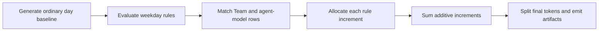

# Synthetic Date-Level Spikes — Detailed Design

**Date:** 2026-09-19
**Status:** Implemented and verified
**Source:** `econ-forecast/docs/design/synthetic-date-level-spike-plan.md`

## 1. Nutshell

- Replace per-user random spikes and separate dated spikes with one list of named spike rules.
- Evaluate each rule once per weekday. Omitted date range means the full series; a configured range limits eligibility.
- Target optional Teams plus agents and `(agent, model)` pairs. No Team target means Organization-wide. No agent/model target means all configured agents and models.
- Apply each rule's incremental processed input proportionally to its positive targeted baseline.
- Multiple rules are additive and calculate from the same immutable baseline.
- Preserve inactivity, zero periods, Projects, weekend reduction, normal mix variation, cache allocation, output ratio, and coverage behavior.
- No backward compatibility. V2 curve-driven generation is excluded.



Reference workload: 50 users × 60 days × 4 agent/model combinations produces at most 12,000 baseline rows. Ten rules require at most about 86,000 weekday row-rule matches. No network or paid service is added.

## 2. Terms

| Term | Definition |
|---|---|
| Baseline | Ordinary generated processed input before spikes: `input + cache_read`. |
| Eligible date | Weekday inside the rule's resolved range. Weekends are never eligible. |
| Target slice | Positive baseline rows matching the rule's Team and technology targets. |
| Technology target | An entire agent or an exact `(agent, model)` pair. |
| Applied event | A selected rule/date with positive baseline and positive incremental load. |
| Increment | Additional processed input created by one rule from the immutable baseline. |

## 3. Configuration contract

Series configuration advances to schema version `2`; user and roster configurations remain version `1`. Old series spike fields are rejected.

```yaml
schema_version: 2
events:
  spike_rules:
    - id: release-surge                 # required; nonempty; unique
      probability: 0.20                # required; finite 0..1; one draw per eligible weekday
      multiplier_min: 3.0              # required; finite >=1
      multiplier_max: 3.0              # required; finite >= multiplier_min
      date_range:                       # optional as a whole; omission means full series
        start_date: '2026-07-13'        # required within date_range; inclusive; inside series
        end_date: '2026-07-17'          # required within date_range; inclusive; >= start_date
      targets:                          # required
        teams: [team1]                  # required list; empty means every Team
        agents: [codex]                 # required list; union with models
        models:                         # required list of exact pairs
          - {agent: claude, model: claude-opus-5}
  zero_periods: []                      # unchanged
```

Validation:

- Reject duplicate rule IDs, duplicate targets, unknown Teams, agents, or agent/model pairs.
- Reject a model target already covered by a whole-agent target in the same rule.
- Require both range boundaries through the `date_range` object; reject ranges outside the series.
- Empty `spike_rules` disables spikes. Probability `0` disables one rule.
- Equal multiplier bounds create a fixed multiplier. Probability `1` is reserved for an intentional sustained uplift on every eligible weekday; it is not the normal probabilistic-spike example.
- Rule and YAML order do not affect output.

Target logic:

| Teams | Agents/models | Result |
|---|---|---|
| Empty | Empty | All positive Organization rows. |
| Set | Empty | All positive rows belonging to those Teams. |
| Empty | Set | Matching technology rows across the Organization. |
| Set | Set | Intersection of selected Teams and technology targets. |

Within the technology dimension, whole-agent and exact-model targets form a union. Projects never filter spikes.

## 4. Generation algorithm

For each date:

1. Generate the ordinary baseline using existing zero-period, inactivity, profile, volume, Project, weekend-reduction, agent/model-mix, and cache-ratio streams.
2. Retain one internal row per final user/Team/Project/agent/model identity with its integer baseline processed input and sampled cache ratio.
3. On weekdays, evaluate rules in normalized ID order:
   - Resolve the rule range to its configured range or the complete series.
   - Draw selection from a stream keyed by `usage_seed`, `spike_selection`, rule ID, and ISO date.
   - If selected, draw one multiplier from a separate `spike_multiplier` stream with the same rule/date identity.
   - Match positive baseline rows. Zero and inactive rows remain absent.
   - Let `B` be their summed baseline and `M` the drawn multiplier.
   - Compute `F = round_half_up(B × M)` and `E = F - B`.
   - Allocate `E` across matching rows using original row counts as weights and the existing exact largest-remainder allocator.
4. Every rule uses the same immutable baseline. Sum allocated increments per row; never feed one rule's result into another rule.
5. Split each final processed-input count into `input` and `cache_read` using that row's normal cache ratio; derive `output` using the existing output ratio.
6. Enforce signed 64-bit bounds after all increments. Emit no fabricated or clipped value.

Example overlap for one row with baseline `100`:

- Rule A multiplier `2`: increment `100`.
- Rule B multiplier `3`: increment `200`.
- Final: `100 + 100 + 200 = 400` (`4×`, not `6×`).

Determinism invariants:

- Extending a series with the same start date preserves the existing prefix.
- Adding, removing, or reordering another rule does not alter a rule's dates or multipliers.
- Non-target rows retain their ordinary baseline counts and random-stream outcomes.

## 5. Event and report contracts

`generation_events.jsonl` becomes a discriminated union. No compatibility reader is required.

Applied spike event:

```json
{
  "date": "2026-07-14",
  "kind": "spike",
  "rule_id": "release-surge",
  "multiplier": 3.0,
  "targets": {
    "teams": ["team1"],
    "agents": ["codex"],
    "models": [{"agent": "claude", "model": "claude-opus-5"}]
  },
  "baseline_processed_input": 12000000,
  "incremental_processed_input": 24000000
}
```

Forced-zero events retain their current fields and `kind: forced_zero`. A selected rule with no positive target baseline or zero increment emits no spike event.

Series summary/report replaces random-versus-dated counters with:

- `spike_events`: applied rule/date rows.
- `spike_days`: distinct dates containing applied spikes.
- `spike_incremental_processed_input`: sum of event increments.
- Per-rule applied days, baseline processed input, and incremental processed input.

The completion manifest remains schema version `1`: its envelope is unchanged. Saved resolved series configuration is version `2`.

## 6. Module and documentation changes

| Area | Required change |
|---|---|
| Configuration | `src/forecast/synthetic/config.py` — strict rule/range/target models, series schema `2`, roster/catalog validation. |
| Generation | `src/forecast/synthetic/series.py` — baseline rows, rule/date draws, proportional immutable-baseline allocation. |
| Events | `src/forecast/synthetic/events.py`, `src/forecast/synthetic/models.py` — forced-zero resolution and discriminated date-level events. |
| Reporting | `src/forecast/synthetic/runner.py`, `src/forecast/synthetic/reporting.py` — date/per-rule summaries. |
| CLI | `src/forecast/synthetic/cli_synt_gen.py` — report the loaded schema version. |
| Maintained config | `config/synthetic/series.yaml` — schema `2` and `spike_rules`. |
| Tests | `tests/synthetic/test_behavior.py`, `test_regressions.py`, `test_interfaces.py`. |
| Functional/design docs | `docs/design/synthetic-data-generation.md`, `docs/design/synthetic-data-generation-design.md`. |
| Guides | `src/forecast/synthetic/README.md`, `docs/operations/README-forecast.md`. |

Do not update historical handoff notes. `forecasting-weekday-bootstrap.md` needs no semantic change: its shared-date resampling already preserves correlated historical spike dates.

## 7. Acceptance tests

| ID | Scenario | Required result |
|---|---|---|
| CFG-01 | Old fields, schema v1 series, missing/extra/invalid rule fields | Rejected with field locations. |
| CFG-02 | Unknown/duplicate/redundant Team, agent, or model targets | Rejected before output creation. |
| DATE-01 | Probability 0 and 1; omitted and explicit ranges | Exact eligible-date behavior; never weekends. |
| DATE-02 | Same seed, reordered rules, extended duration | Stable rule streams and byte-identical prefix. |
| TGT-01 | Organization, Team, agent, model, and combined targets | Only matching positive baseline rows change. |
| ALG-01 | Hand oracle with uneven row weights and integer residue | Exact proportional allocation and conservation. |
| ALG-02 | Two overlapping rules | Additive result from original baseline; order independent. |
| ZERO-01 | Inactive user, forced zero, zero-share model, empty target slice | No fabricated usage and no applied spike event. |
| TOK-01 | Cache ratios 0/1, output ratio, tiny counts, overflow | Existing category invariants; overflow rejected. |
| EVT-01 | Multiple rules on one date | One event per applied rule; correct distinct-day and per-rule report totals. |
| IO-01 | CLI generation and saved-config replay | Byte-identical record artifacts and valid manifest/report. |

Run focused synthetic tests and the documented synthetic CLI workflow. Ask before a full repository suite. Independent review occurs only when explicitly requested.

## 8. Decisions and alternatives

| Decision | Chosen | Rejected | Reason / switch condition |
|---|---|---|---|
| Rule model | One named schema with optional range | Separate automatic/dated schemas | Same behavior; range is only an eligibility bound. Switch only for genuinely different semantics. |
| Event correlation | One draw per rule/date | Per-user draws | Per-user events disappear under aggregation. |
| Overlap | Add increments from immutable baseline | Compounding | Order independent and bounded. |
| Allocation | Existing baseline proportions | Separate spike mix | Preserves actual Team/agent/model distribution without another control. |
| Project target | Unsupported | Project filter | Explicitly excluded from V1. |
| Compatibility | Replace old series schema | Dual parser/migration | Development phase; no compatibility requirement. |
| Aggregate curve | Defer to V2 | Include in V1 | Reverses the generator's bottom-up ownership model. |

## 9. Resource model

| Assumption | Value |
|---|---:|
| Users | 50 |
| Calendar days / weekdays | 60 / about 43 |
| Agent/model rows per active user | 4 |
| Spike rules | 10 |

- Baseline rows: `50 × 60 × 4 = 12,000` maximum before inactivity.
- Rule matching: `50 × 4 × 43 × 10 = 86,000` row-rule checks.
- Working memory: one day, at most `50 × 4 = 200` internal rows plus rule allocations.
- Maximum applied event rows: `43 × 10 = 430` when every rule has probability `1`.
- External latency/cost: none; offline local generation only. Measure the focused workflow after implementation and report any regression.

## 10. Clarifications and phasing

| Question | Settled behavior |
|---|---|
| Default range | Omitted range means complete series. |
| Dated versus automatic | No separate type; probability and optional range express both. |
| Weekend spikes | Never. |
| Zero baseline | Remains zero; no event emitted. |
| Backward compatibility | Not required until explicitly reinstated. |
| Review | Optional; only when explicitly requested. |

Phases:

1. **V0:** current per-user random spikes plus separate dated spikes.
2. **V1:** implement this unified date-level rule design, focused tests, artifacts, and documentation.
3. **V2:** separately design authoritative Organization curves and hierarchical allocation.

## 11. Verification

- `PYTHONPATH=econ-forecast/src:src venv/bin/python -m pytest -q econ-forecast/tests/synthetic` — 115 passed.
- Maintained series configuration validation and generation — passed; one weekday spike event, and event totals matched the report and manifest.
- Repeated maintained-config generation produced byte-identical usage, coverage, and event records.
- Python compilation and `git diff --check` for the changed synthetic scope — passed.
- Independent review was not run; it was explicitly excluded from this implementation request.
